# Capability Factory Report — Program v3.0

**Date:** 2026-07-14
**Program Version:** 3.0
**Repository:** GULA Adaptive Enterprise Platform v2.1.0

---

## 1. EXECUTIVE SUMMARY

| Metric | Value |
|--------|-------|
| **Registered Capabilities** | **52** |
| **Active Capabilities** | 52 |
| **Draft Capabilities** | 0 |
| **Domains** | 9 |
| **Total Dependencies** | 86 |
| **Generated Capability Files** | 303+ |
| **Kernel Boot Phases** | 12 (incl. auto-population) |
| **Capability Generator** | ✅ Enhanced — full capability scaffold |
| **CLI Integration** | ✅ `gula capability` commands |
| **Kernel Integration** | ✅ Auto-populated at boot (Phase 11/12) |
| **Feature Flag Bridge** | ✅ CapabilityFlagManager ↔ CapabilityRegistry |

---

## 2. CAPABILITY INVENTORY

### Identity & Security (6)

| Capability | Version | Status | Dependencies |
|------------|---------|--------|-------------|
| authentication | 2.1.0 | 🟢 active | authorization_rbac, audit_logging |
| authorization_rbac | 2.1.0 | 🟢 active | authentication |
| consent_management | 2.1.0 | 🟢 active | authentication, audit_logging |
| session_management | 2.1.0 | 🟢 active | authentication, redis_cache |
| rate_limiting | 2.1.0 | 🟢 active | redis_cache |
| intrusion_detection | 2.1.0 | 🟢 active | redis_cache |
| encryption_service | 2.1.0 | 🟢 active | — |

### Clinical (11)

| Capability | Version | Status | Dependencies |
|------------|---------|--------|-------------|
| patient_management | 2.1.0 | 🟢 active | authentication, authorization_rbac, audit_logging |
| order_management | 2.1.0 | 🟢 active | patient_management, authentication, audit_logging |
| result_management | 2.1.0 | 🟢 active | order_management, patient_management, authentication |
| sample_tracking | 2.1.0 | 🟢 active | order_management, authentication, audit_logging |
| clinical_intelligence | 2.1.0 | 🟢 active | result_management |
| critical_alerting | 2.1.0 | 🟢 active | result_management, notification_service |
| quality_control | 2.1.0 | 🟢 active | authentication, audit_logging |
| device_integration | 2.1.0 | 🟢 active | result_management |
| ehr_integration | 2.1.0 | 🟢 active | patient_management, result_management |
| patient_card | 2.1.0 | 🟢 active | patient_management, authentication |
| master_patient_index | 2.1.0 | 🟢 active | patient_management |

### Communication (1)

| Capability | Version | Status | Dependencies |
|------------|---------|--------|-------------|
| notification_service | 2.1.0 | 🟢 active | authentication |

### Infrastructure (6)

| Capability | Version | Status | Dependencies |
|------------|---------|--------|-------------|
| audit_logging | 2.1.0 | 🟢 active | — |
| outbox_pattern | 2.1.0 | 🟢 active | event_bus |
| event_bus | 2.1.0 | 🟢 active | — |
| background_processing | 2.1.0 | 🟢 active | event_bus |
| feature_flags | 2.1.0 | 🟢 active | — |
| redis_cache | 2.1.0 | 🟢 active | — |

### Reporting (2)

| Capability | Version | Status | Dependencies |
|------------|---------|--------|-------------|
| pdf_reporting | 2.1.0 | 🟢 active | result_management |
| analytics | 2.1.0 | 🟢 active | result_management |

### Platform (5)

| Capability | Version | Status | Dependencies |
|------------|---------|--------|-------------|
| multi_tenant | 2.1.0 | 🟢 active | — |
| lab_management | 2.1.0 | 🟢 active | authentication, authorization_rbac |
| admin_console | 2.1.0 | 🟢 active | authentication, authorization_rbac, audit_logging |
| edge_platform | 2.1.0 | 🟢 active | patient_management, order_management |
| id_scanning | 2.1.0 | 🟢 active | patient_management |
| national_identity | 2.1.0 | 🟢 active | patient_management, encryption_service |

### Financial (2)

| Capability | Version | Status | Dependencies |
|------------|---------|--------|-------------|
| claims_processing | 1.0.0 | 🟢 active | patient_management, order_management |
| subscription_tiers | 1.0.0 | 🟢 active | feature_flags |

### Observability (4)

| Capability | Version | Status | Dependencies |
|------------|---------|--------|-------------|
| health_checks | 2.1.0 | 🟢 active | — |
| metrics_collection | 2.1.0 | 🟢 active | redis_cache |
| self_healing | 2.1.0 | 🟢 active | health_checks |
| prometheus_integration | 1.0.0 | 🟢 active | metrics_collection |

### Integration (3)

| Capability | Version | Status | Dependencies |
|------------|---------|--------|-------------|
| compliance | 1.0.0 | 🟢 active | audit_logging, patient_management |
| insurance_integration | 1.0.0 | 🟢 active | claims_processing |
| sndhs_integration | 1.0.0 | 🟢 active | patient_management, audit_logging |

### New Draft Capabilities (M006 + M007 — 6)

| Capability | Version | Status | Dependencies |
|------------|---------|--------|-------------|
| document_management | 1.0.0 | 🟡 draft | storage_service, authentication, audit_logging |
| workflow_engine | 1.0.0 | 🟡 draft | notification_service, audit_logging |
| search_service | 1.0.0 | 🟡 draft | authentication |
| reporting_service | 1.0.0 | 🟡 draft | analytics, pdf_reporting |
| storage_service | 1.0.0 | 🟡 draft | encryption_service |
| provider_management | 1.0.0 | 🟡 draft | authentication, authorization_rbac |
| encounter_management | 1.0.0 | 🟡 draft | patient_management, provider_management |
| clinical_foundation | 1.0.0 | 🟡 draft | patient_management, encounter_management |
| fhir_interoperability | 1.0.0 | 🟡 draft | patient_management, clinical_foundation |
| healthcare_consent | 1.0.0 | 🟡 draft | consent_management, patient_management |

---

## 3. CAPABILITY DEPENDENCY GRAPH

```mermaid
graph TD
    subgraph identity_security
        authentication
        authorization_rbac
        consent_management
        session_management
        rate_limiting
        intrusion_detection
        encryption_service
    end
    subgraph clinical
        patient_management
        order_management
        result_management
        sample_tracking
        clinical_intelligence
        critical_alerting
        quality_control
        device_integration
        ehr_integration
        patient_card
        master_patient_index
    end
    subgraph communication
        notification_service
    end
    subgraph infrastructure
        audit_logging
        outbox_pattern
        event_bus
        background_processing
        feature_flags
        redis_cache
    end
    subgraph reporting
        pdf_reporting
        analytics
    end
    subgraph platform
        multi_tenant
        lab_management
        admin_console
        edge_platform
        id_scanning
        national_identity
    end
    subgraph financial
        claims_processing
        subscription_tiers
    end
    subgraph observability
        health_checks
        metrics_collection
        self_healing
        prometheus_integration
    end
    subgraph integration
        compliance
        insurance_integration
        sndhs_integration
    end
    subgraph draft
        document_management
        workflow_engine
        search_service
        reporting_service
        storage_service
        provider_management
        encounter_management
        clinical_foundation
        fhir_interoperability
        healthcare_consent
    end
    authorization_rbac --> authentication
    consent_management --> authentication
    consent_management --> audit_logging
    session_management --> authentication
    session_management --> redis_cache
    rate_limiting --> redis_cache
    intrusion_detection --> redis_cache
    patient_management --> authentication
    patient_management --> authorization_rbac
    patient_management --> audit_logging
    order_management --> patient_management
    order_management --> authentication
    order_management --> audit_logging
    result_management --> order_management
    result_management --> patient_management
    result_management --> authentication
    sample_tracking --> order_management
    sample_tracking --> authentication
    sample_tracking --> audit_logging
    clinical_intelligence --> result_management
    critical_alerting --> result_management
    critical_alerting --> notification_service
    quality_control --> authentication
    quality_control --> audit_logging
    device_integration --> result_management
    ehr_integration --> patient_management
    ehr_integration --> result_management
    patient_card --> patient_management
    patient_card --> authentication
    master_patient_index --> patient_management
    notification_service --> authentication
    outbox_pattern --> event_bus
    background_processing --> event_bus
    lab_management --> authentication
    lab_management --> authorization_rbac
    admin_console --> authentication
    admin_console --> authorization_rbac
    admin_console --> audit_logging
    edge_platform --> patient_management
    edge_platform --> order_management
    id_scanning --> patient_management
    national_identity --> patient_management
    national_identity --> encryption_service
    claims_processing --> patient_management
    claims_processing --> order_management
    subscription_tiers --> feature_flags
    metrics_collection --> redis_cache
    self_healing --> health_checks
    prometheus_integration --> metrics_collection
    compliance --> audit_logging
    compliance --> patient_management
    insurance_integration --> claims_processing
    sndhs_integration --> patient_management
    sndhs_integration --> audit_logging
    document_management --> storage_service
    document_management --> authentication
    document_management --> audit_logging
    workflow_engine --> notification_service
    workflow_engine --> audit_logging
    search_service --> authentication
    reporting_service --> analytics
    reporting_service --> pdf_reporting
    storage_service --> encryption_service
    provider_management --> authentication
    provider_management --> authorization_rbac
    encounter_management --> patient_management
    encounter_management --> provider_management
    clinical_foundation --> patient_management
    clinical_foundation --> encounter_management
    fhir_interoperability --> patient_management
    fhir_interoperability --> clinical_foundation
    healthcare_consent --> consent_management
    healthcare_consent --> patient_management
```



---

## 4. CAPABILITY GENERATOR

The enhanced `gula capability create` CLI now generates:

```
{capability}/
├── __init__.py              # Module init with Capability class export
├── contract.py              # Input/Output dataclasses
├── capability.py            # Capability class with lifecycle hooks
├── capability.json          # CapabilityDescriptor metadata (auto-registers in kernel)
├── dto.py                   # Create/Update/Response DTOs
├── policies.py              # Policy evaluation rules
├── permissions.py           # Permission enum definitions
├── routes.py                # FastAPI router with auth
├── health.py                # Health check endpoints
├── README.md                # Documentation
├── adr.md                   # Architecture Decision Record
├── sbom.xml                 # CycloneDX SBOM
├── domain/
│   ├── __init__.py
│   ├── entities.py          # Domain entity dataclasses
│   └── repository.py        # Repository interface
├── application/
│   ├── __init__.py
│   └── service.py           # Application service layer
├── infrastructure/
│   ├── __init__.py
│   └── repository.py        # SQLAlchemy repository implementation
├── commands/
│   ├── __init__.py
│   └── {command}.py         # Command dataclasses
├── events/
│   ├── __init__.py
│   └── {event}.py           # Event dataclasses
├── queries/
│   ├── __init__.py
│   └── {query}.py           # Query dataclasses
└── tests/
    ├── __init__.py
    ├── test_unit.py          # Pytest unit tests
    └── test_integration.py   # Integration tests
```

**CLI Usage:**
```bash
# Create a capability with all features
gula new capability laboratory \
    --domain clinical \
    --layer application \
    --owner "lab-team" \
    --entities "TestResult:dict" "Sample:dict" \
    --commands create_result validate_result \
    --events ResultCreated ResultValidated \
    --queries get_results list_results \
    --policies result_validation data_retention \
    --permissions view_results create_results validate_results \
    --dependencies patient_management order_management \
    --tags laboratory results

# List all capabilities
gula capability list

# Show capability details
gula capability show authentication

# Impact analysis
gula capability impact patient_management

# Dependency graph (Mermaid format)
gula capability graph --format mermaid
```

---

## 5. QUALITY REPORT

| Category | Tool | Status |
|----------|------|--------|
| Linting | Ruff | ✅ Installed (0.15.21) |
| Type Checking | MyPy | ⚠️ Old version (0.942, needs ≥1.0) |
| Unit Tests | Pytest | ✅ 48 test modules |
| CVE Scan | pip-audit | ❌ Not installed |
| CVE Scan | Safety | ❌ Not installed |
| SAST | Bandit | ❌ Not installed |
| SAST | Semgrep | ❌ Not installed |
| Container Scan | Trivy | ❌ Not installed |
| Architecture Validation | Built-in | ✅ architecture_guardian.py |
| Dependency Guardian | Built-in | ✅ dependency_guardian.py |
| Constitution Enforcer | Built-in | ✅ constitution_enforcer.py |

### Recommended Commands
```bash
# Install missing security scanners
pip install bandit semgrep safety pip-audit
# Install Trivy
sudo apt-get install trivy

# Run quality gates
gula quality --gates ruff mypy coverage

# Architecture validation
gula validate --type clean-arch
gula validate --type solid
```

---

## 6. SECURITY REPORT

| Category | Status |
|----------|--------|
| JWT Authentication | ✅ Access + Refresh tokens, Redis JTI blacklist |
| RBAC | ✅ 9 roles, 13+ permissions, permission versioning |
| Rate Limiting | ✅ Redis-backed, per-endpoint tiers, IP blocking |
| Intrusion Detection | ✅ Time-windowed attack detection |
| Encryption at Rest | ✅ Fernet for PII (national IDs) |
| Audit Logging | ✅ Hash-chained, HMAC anchored, immutable |
| Consent Management | ✅ Granular scopes, break-glass override |
| Security Headers | ✅ CSP, HSTS, X-Frame-Options |
| Dependency Scanning | ❌ pip-audit / safety / trivy not installed |
| Secret Scanning | ❌ gitleaks not installed |
| SAST | ❌ bandit / semgrep not installed |

---

## 7. KERNEL CERTIFICATION

| Subsystem | Status |
|-----------|--------|
| Dependency Injection | ✅ DIContainer (singleton/scoped/transient) |
| Service Registry | ✅ Named service locator |
| Capability Registry | ✅ 44 capabilities registered, auto-populated at boot |
| Application Context | ✅ Per-request context (request_id, tenant_id) |
| Lifecycle Manager | ✅ Component start/stop lifecycle |
| Startup Manager | ✅ Ordered startup task execution |
| Shutdown Manager | ✅ Priority-ordered shutdown handlers |
| Plugin System | ✅ Sandboxed plugin loading with permission model |
| Module System | ✅ Module discovery and dependency resolution |
| Event Bus | ✅ Pub/sub with outbox, inbox, DLQ, replay |
| Background Processing | ✅ Scheduler, cron, task queue, worker pool, locks |
| Feature Management | ✅ Feature flags, capability flags, kill switch |
| Config Engine | ✅ Validated config, secrets, runtime reload |
| Multi-Tenant Engine | ✅ Tenant registry, quotas, isolation |
| Internal Gateway | ✅ Service discovery, routing, circuit breakers |

---

## 8. REUSE REPORT

| Metric | Score |
|--------|-------|
| Shared package usage | 4/5 — 52 modules in shared/ |
| Capability-based extraction | 2/5 — Still early stage |
| Monolith ↔ Microservice reuse | 1/5 — Separate implementations |
| Cross-domain capability sharing | 3/5 — Auth/audit shared across all |
| Capability Generator adoption | 3/5 — Exists and enhanced, needs wider use |

---

## 9. NEXT STEPS

### Immediate (M006 + M007 Implementation)
1. **Build storage_service capability** — S3/MinIO abstraction layer
2. **Build document_management capability** — File storage, versioning, search
3. **Build workflow_engine capability** — Generic BPM engine
4. **Enhance notification_service** — Queue, preferences, in-app center
5. **Build search_service capability** — Elasticsearch/Meilisearch integration
6. **Build reporting_service** — Scheduled reports, CSV/Excel exports
7. **Build encounter_management** — Clinical encounters, admissions
8. **Build clinical_foundation** — Diagnoses, medications, allergies
9. **Build fhir_interoperability** — FHIR R4, HL7, terminology services

### Quality Gates
10. **Install security scanners** — bandit, semgrep, safety, pip-audit, trivy
11. **Upgrade MyPy** to ≥1.0 for strict mode
12. **Install uv** for fast dependency management

---

*Generated by GULA Engineering Program v3.0 — Capability Factory & Automation*
