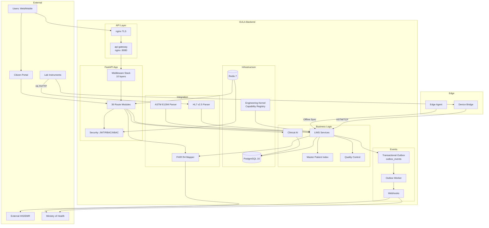
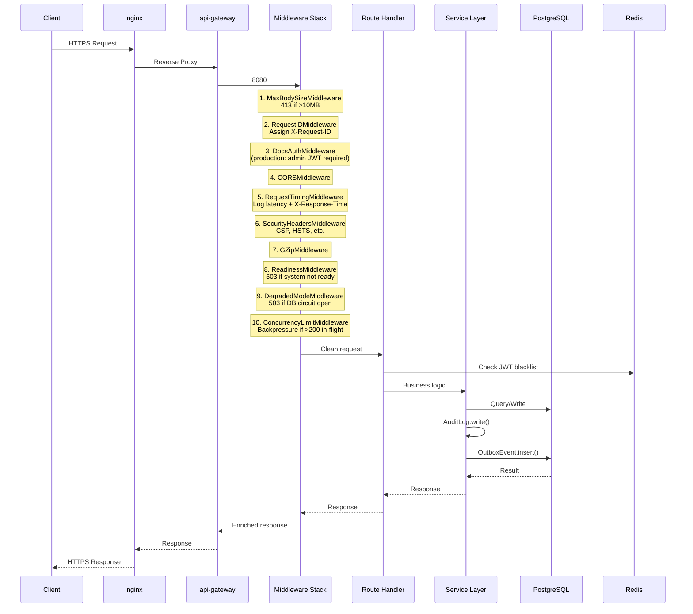
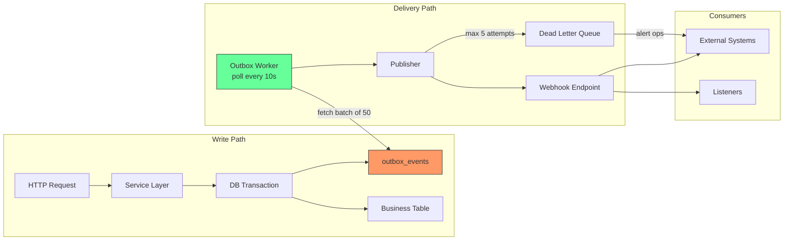
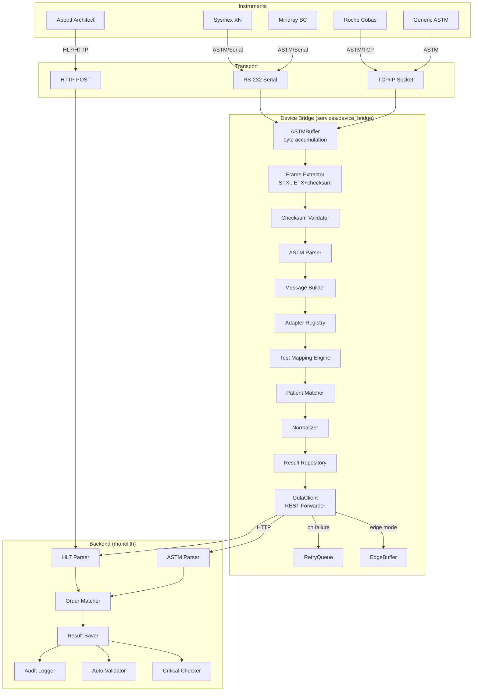
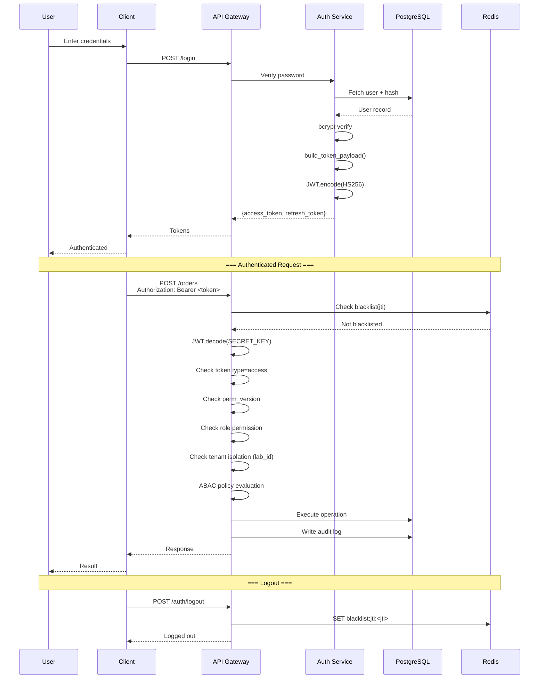
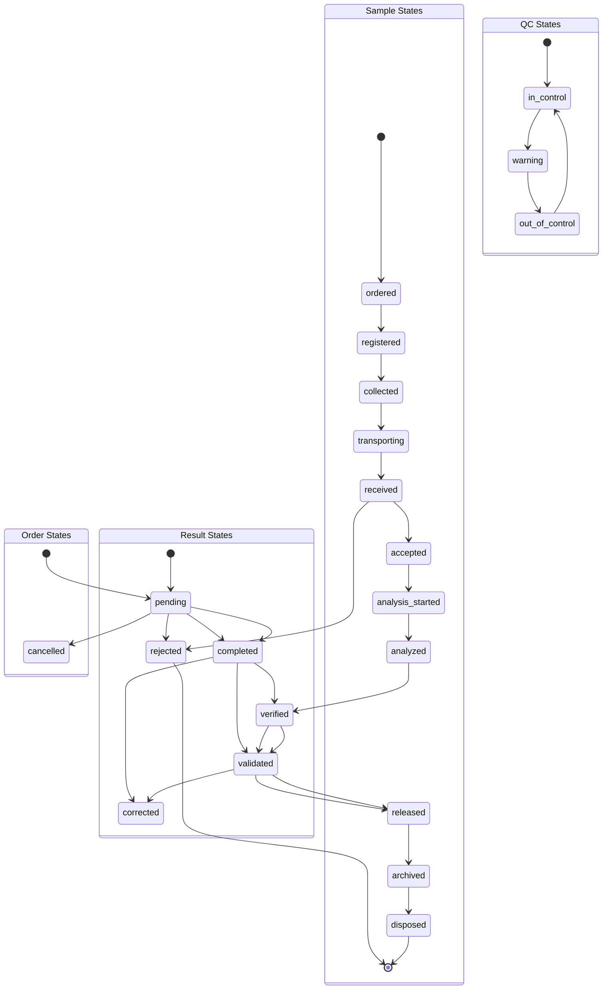
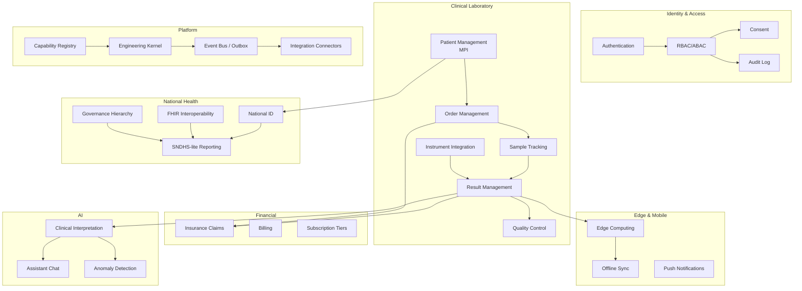
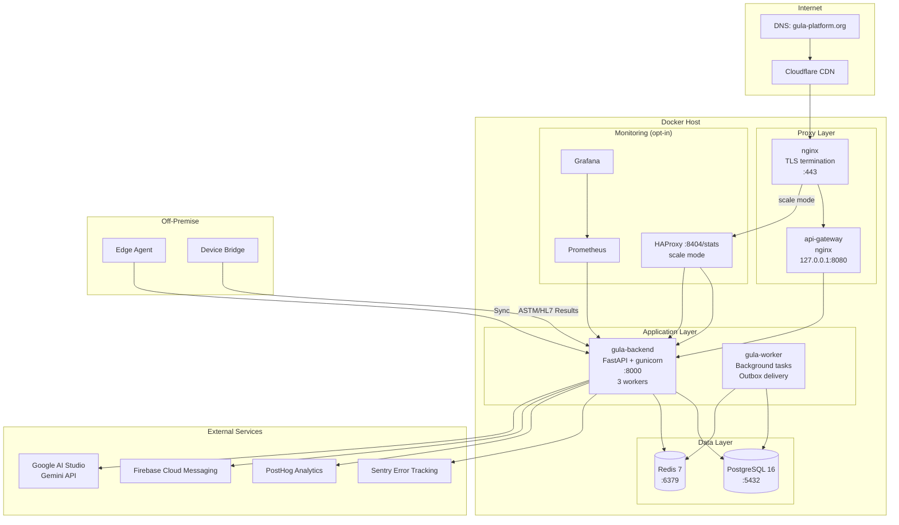

# GULA Platform — Architecture Diagrams

**Contract Tag:** `integration-contracts-v1.0` | **Date:** 2026-07-14

---

## 1. System Architecture (All Components)



## 2. Request Lifecycle



## 3. Event Flow (Outbox Pattern)



## 4. FHIR Mapping Flow

```mermaid
graph LR
    subgraph "Source Models"
        CIT[Citizen]
        PAT[Patient]
        ORG[Organization]
        PRAC[Practitioner]
        LAB[LabResult]
        ORD[LabOrder]
        SPEC[Specimen]
    end

    subgraph "FHIR Mappers"
        PM[PatientMapper]
        ORGM[OrganizationMapper]
        PRM[PractitionerMapper]
        OM[ObservationMapper]
        DRM[DiagnosticReportMapper]
        SM[SpecimenMapper]
        SRM[ServiceRequestMapper]
    end

    subgraph "FHIR Resources"
        FP[Patient]
        FO[Organization]
        FPR[Practitioner]
        FOB[Observation]
        FDR[DiagnosticReport]
        FS[Specimen]
        FSR[ServiceRequest]
    end

    subgraph "Endpoint Families"
        CMP[Compliance<br/>/compliance/fhir]
        LIMSFHIR[LIMS<br/>/lims/{res}s/{id}/fhir]
        NAT[National<br/>/national/fhir]
    end

    CIT --> PM
    PAT --> PM
    ORG --> ORGM
    PRAC --> PRM
    LAB --> OM
    LAB --> DRM
    ORD --> SRM
    SPEC --> SM

    PM --> FP
    ORGM --> FO
    PRM --> FPR
    OM --> FOB
    DRM --> FDR
    SM --> FS
    SRM --> FSR

    FP --> CMP
    FOB --> CMP
    FDR --> CMP
    FSR --> CMP

    FS --> LIMSFHIR
    FSR --> LIMSFHIR
    FOB --> LIMSFHIR
    FDR --> LIMSFHIR

    FP --> NAT
    FO --> NAT
    FPR --> NAT
    FOB --> NAT
```

## 5. HL7/ASTM Ingestion Pipeline



## 6. Auth/Security Flow



## 7. LIMS State Machine



## 8. Sub-domain Boundaries (DDD)



## 9. Deployment Architecture


