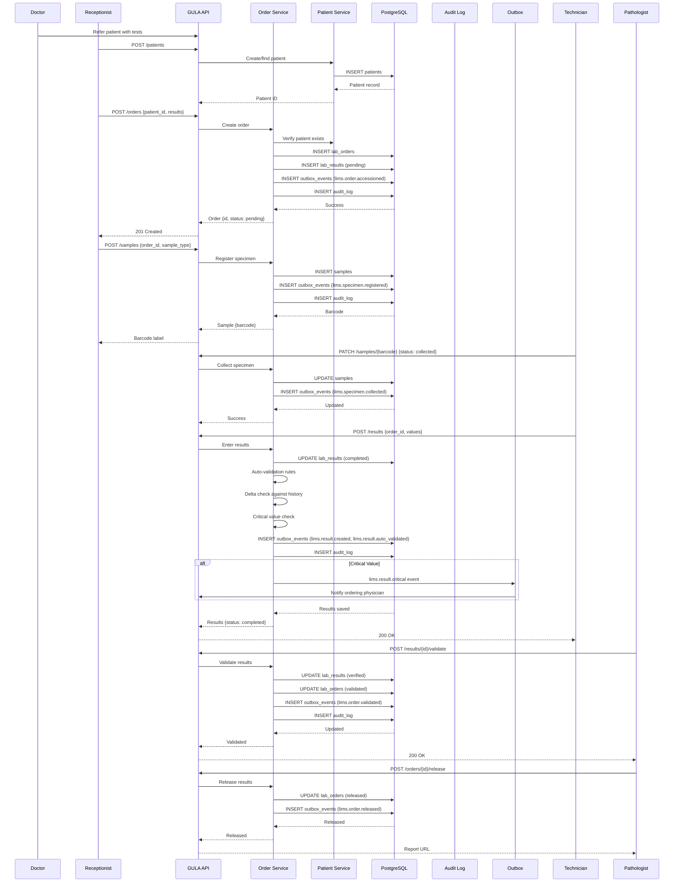
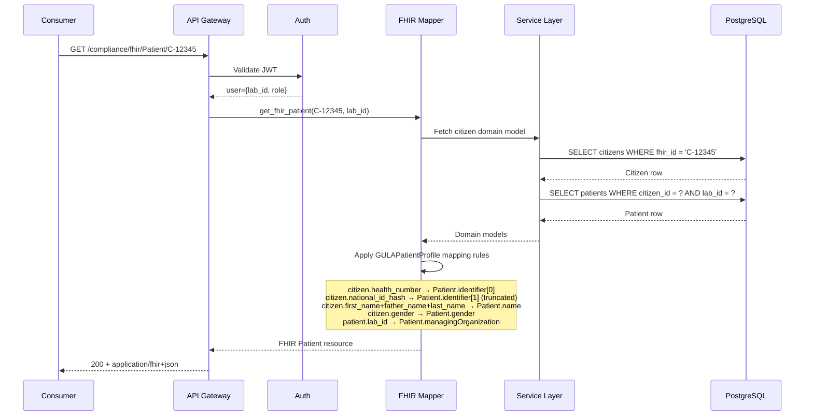
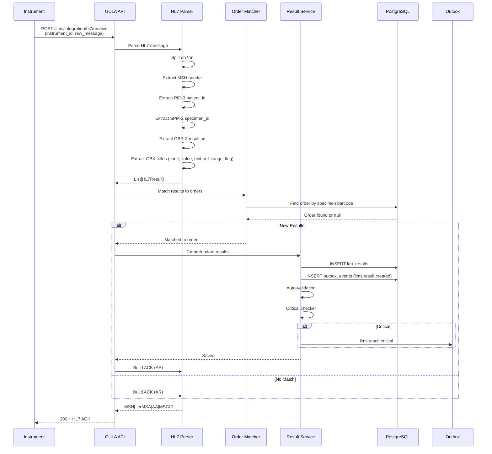
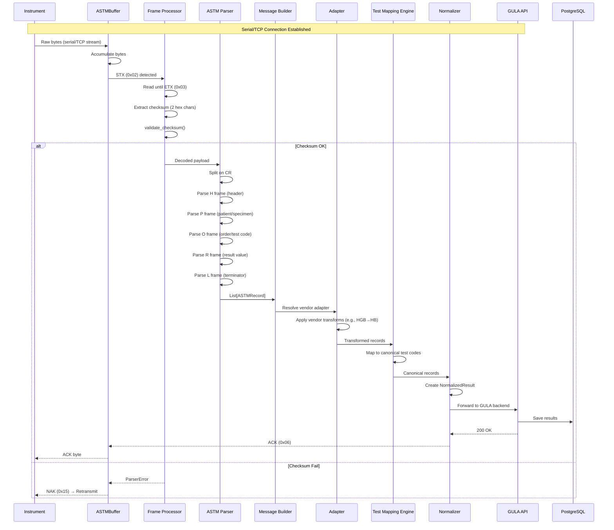
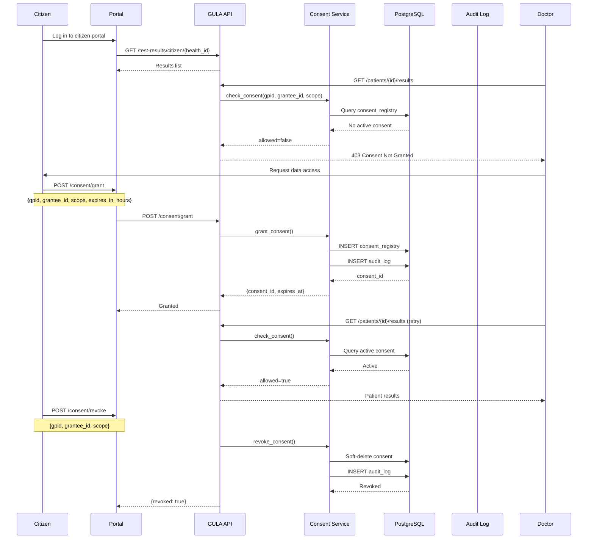
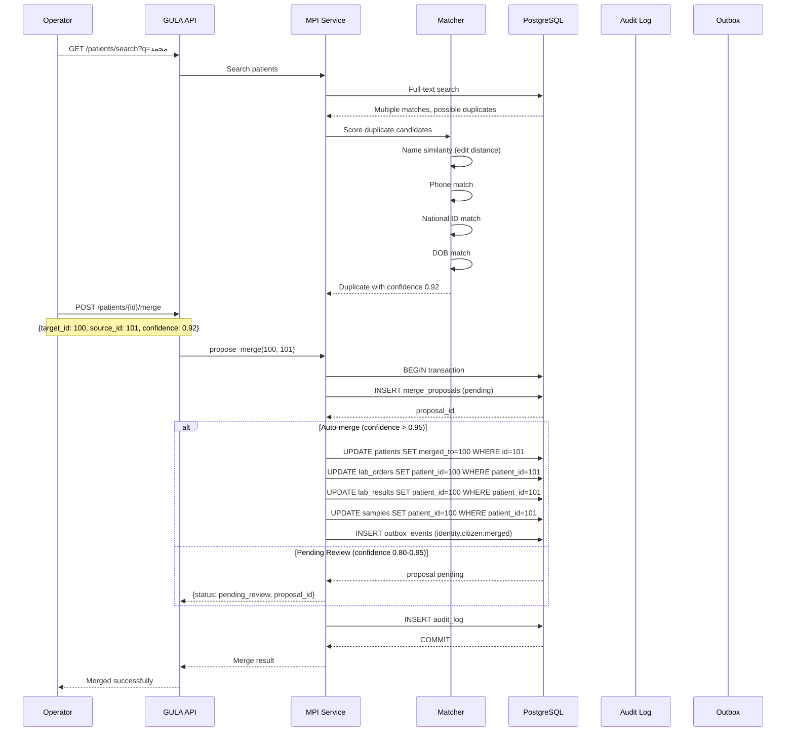
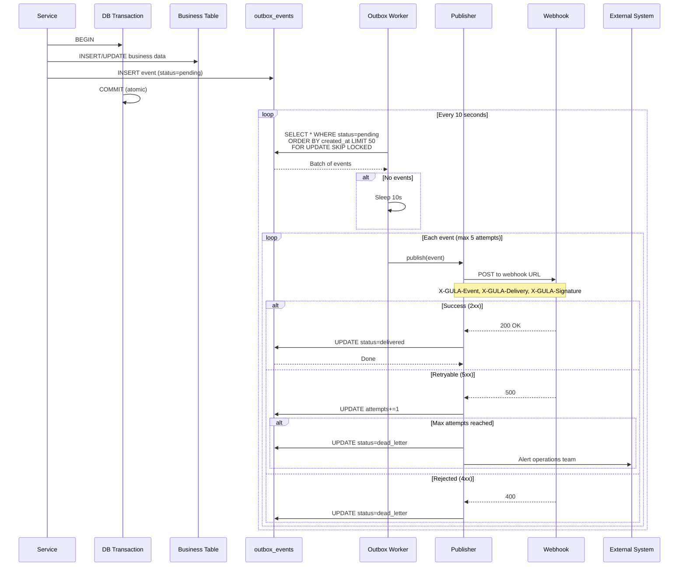
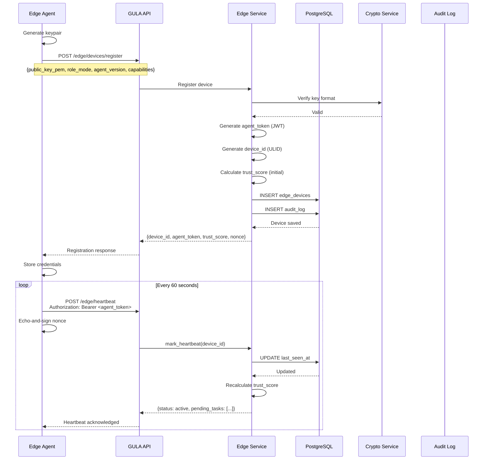
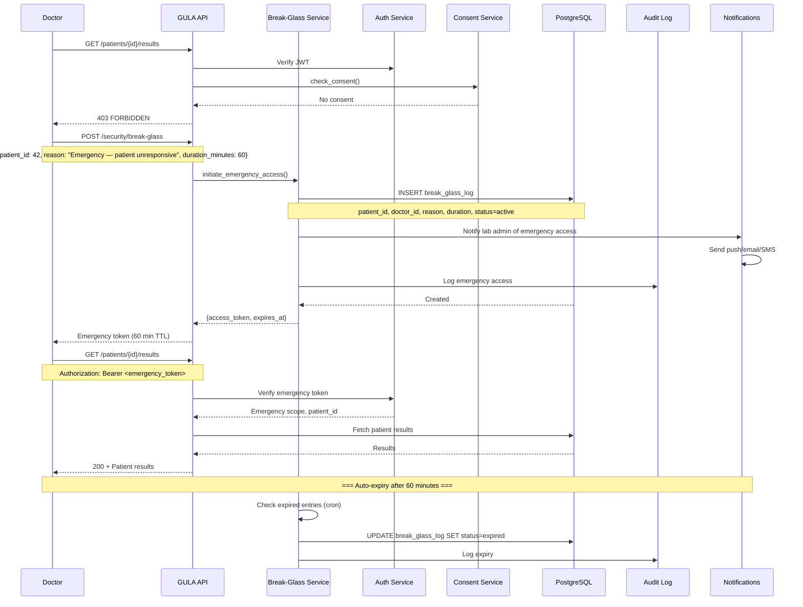

# GULA Platform — Sequence Diagrams

**Contract Tag:** `integration-contracts-v1.0` | **Date:** 2026-07-14

---

## 1. Order Creation → Validation → Results Flow

## 2. FHIR Resource Retrieval

## 3. HL7 Message Ingestion

## 4. ASTM Instrument Communication

## 5. Citizen Consent Flow

## 6. Patient Merge Flow

## 7. Outbox Event Delivery

## 8. Edge Device Registration

## 9. Break-Glass Emergency Access

