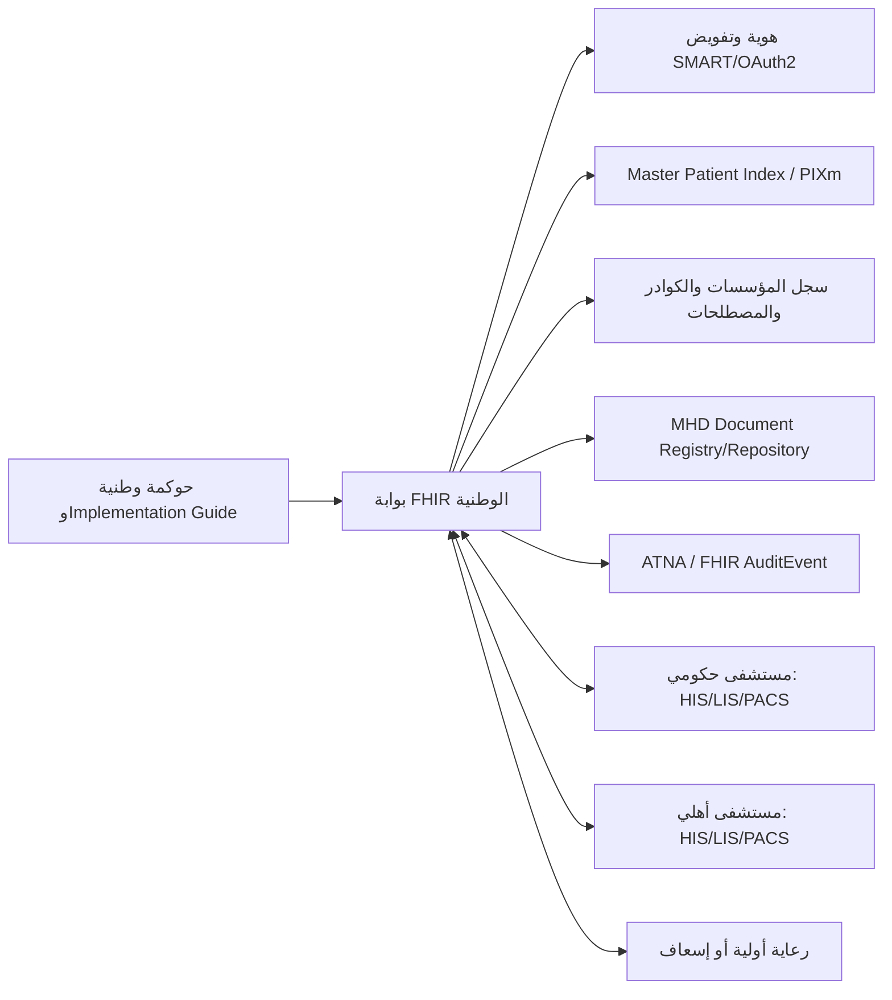

# توسيع استراتيجية FHIR R4 لربط المستشفيات الحكومية والأهلية في العراق

**الحالة:** توصية معمارية قابلة للتحويل إلى برنامج وطني تجريبي

## الخلاصة التنفيذية

ينبغي ألا تُبنى المنظومة المركزية على نقل جميع السجلات السريرية إلى قاعدة بيانات واحدة منذ اليوم الأول. النموذج الأكثر أماناً وقابلية للتوسع هو **نموذج تبادل وطني هجين**: تحتفظ كل مؤسسة صحية بسجلها التشغيلي المحلي، بينما توفر المنظومة المركزية خدمات مشتركة للهوية والفهرسة والتفويض والتدقيق والتبادل المنظم. هذا النموذج يجمع بين استقلال المستشفى وبين قدرة الطبيب أو الجهة المخولة على الوصول إلى معلومات موثوقة عند الحاجة.

تُستخدم **FHIR R4** كواجهة ومعيار بيانات، وليس كبديل إلزامي وفوري لكل نظام HIS أو LIS أو PACS قائم. يبدأ الربط بمشاركة الوثائق والتقارير الموقعة، ثم ينتقل إلى موارد سريرية منظمة واستعلامات محددة، وبعد نضج الحوكمة والهوية يُفتح تبادل أوسع للملخص السريري والإحالات والوصفات والمطالبات.

> المبدأ الحاكم: **المركز ينسّق ويثبت الثقة، والمؤسسة تظل مالكة لسجلها التشغيلي ومسؤولة عن جودة بياناتها.**

## 1. النموذج المقترح

يقترح التصميم أربع طبقات مترابطة. الطبقة الأولى هي **بوابة التكامل الوطنية** التي تنفذ سياسات الوصول، وتتحقق من CapabilityStatement، وتطبق تحديد المعدل، وتوجه الطلبات إلى المستودع المناسب. الطبقة الثانية هي **الخدمات الوطنية المشتركة** وتشمل Master Patient Index، سجل المؤسسات والكوادر، دليل المصطلحات، خادم التفويض، وسجل التدقيق. الطبقة الثالثة هي **مستودعات التبادل** التي تحتفظ بنسخ أو مؤشرات الوثائق والموارد المسموح بتبادلها. أما الطبقة الرابعة فهي أنظمة المستشفيات والمختبرات والصيدليات، وتبقى فيها البيانات التشغيلية الأصلية.

لا تعني البوابة المركزية أن كل طلب يجب أن يمر عبرها بشكل متزامن. في المحافظات أو المؤسسات ذات الاتصال غير المستقر، يُستخدم **Integration Gateway محلي** يقوم بالتخزين المؤقت، وإعادة الإرسال، وتوقيع الرسائل، ومزامنة الأحداث عند عودة الاتصال. لا ينبغي تخزين بيانات سريرية حساسة في طوابير غير مشفرة أو على أجهزة غير مُدارة.

## 2. نطاق الإصدار الوطني الأول

يجب إصدار **Implementation Guide عراقي** يحدد الملفات التعريفية والامتدادات والقيم المسموح بها وقواعد البحث والأخطاء والأمن. ويجب نشره مع CapabilityStatement قابلة للاختبار، ونسخة دلالية واضحة، وحزمة اختبار للمؤسسات قبل منحها اعتماد الإنتاج.

| المجال | موارد FHIR R4 الأولية | الغرض |
|---|---|---|
| هوية المريض | Patient، RelatedPerson | تعريف المريض وربط الهوية المحلية والوطنية |
| الجهات | Organization، Location، Practitioner، PractitionerRole | تعريف المستشفى والقسم والطبيب والدور |
| الإحالة | ServiceRequest، Task، Encounter | إحالة المريض وتتبع حالتها |
| المختبر | ServiceRequest، Specimen، Observation، DiagnosticReport | طلب الفحص والعينة والنتيجة والتقرير |
| الوثائق | DocumentReference، Binary، Composition | تبادل التقارير والملخصات الموقعة |
| الأدوية | Medication، MedicationRequest، MedicationDispense | الوصفة والصرف، بعد جاهزية الحوكمة الدوائية |
| التغطية | Coverage، Claim، ClaimResponse | ربط الضمان والشراء، في مرحلة لاحقة |
| الثقة | Consent، Provenance، AuditEvent | الموافقة ومصدر البيانات وسجل الاستخدام |

يُفضّل أن يبدأ الإصدار الأول بحالات استخدام قليلة: **ملخص الخروج، تقرير المختبر، الإحالة، والتحقق من هوية المريض**. توسيع الموارد قبل تثبيت الهوية والمصطلحات والموافقة سيخلق تبادلاً سريعاً لكنه غير موثوق.

## 3. الهوية وسجل المريض الوطني

لا يجوز استخدام رقم ملف المستشفى باعتباره معرفاً وطنياً. يحتفظ كل مستشفى بمعرفه المحلي، ويُربط بمعرف وطني أو اتحادي عبر **Master Patient Index**. ويُستحسن استخدام IHE PIXm للبحث في المعرفات المتقاطعة، مع تدفق آمن لتغذية أحداث الإنشاء والتحديث والدمج.

تحتاج المطابقة إلى مستويين. المستوى الآلي يعالج المطابقات عالية الثقة اعتماداً على حقول موثقة مثل الاسم، تاريخ الميلاد، الجنس، رقم الهوية المسموح قانونياً، ورقم الهاتف عند توفره. أما الحالات المتقاربة أو المتعارضة فتذهب إلى **مراجعة بشرية** ولا تُدمج تلقائياً. يجب أن تكون عملية الدمج قابلة للعكس ومصحوبة بسجل Provenance، لأن دمج هويتين خطأً أخطر من وجود سجلين مؤقتين.

| القرار | التوصية |
|---|---|
| معرف المؤسسة | يبقى محلياً ولا يُلغى |
| المعرف الوطني | يصدر من جهة موثوقة، ولا يُكشف في كل سياق استخدام |
| المطابقة | احتمالية مع عتبات ومراجعة بشرية |
| الدمج | عملية قابلة للتتبع والرجوع |
| البحث | لا يسمح بالبحث المفتوح؛ يجب تحديد الغرض والجهة والمريض |

## 4. الثقة والتفويض بين الحكومة والقطاع الأهلي

تحتاج الشبكة إلى **نموذج ثقة مؤسسي** يميز بين هوية المؤسسة وهوية المستخدم. يُسجل كل مستشفى كمؤسسة معتمدة، ويُسجل كل نظام تكامل كعميل Backend Service له شهادة أو مفتاح غير متماثل. تستخدم الخدمات الآلية SMART Backend Services، بينما تستخدم تطبيقات الأطباء SMART App Launch عند وجود مستخدم وسياق سريري.

ينبغي أن تكون الصلاحيات قصيرة العمر ومحددة بنوع المورد والعملية والغرض. فمثلاً لا يحتاج نظام مختبر إلى صلاحية قراءة كل الموارد السريرية، ولا يحتاج موظف استقبال إلى قراءة النتائج الطبية التفصيلية. تُصمم scopes بحسب الدور والمؤسسة وحالة المريض، وتُراجع دورياً وتُلغى فور فقدان الاعتماد أو انتهاء العقد.

يُستخدم Consent لتسجيل أساس الوصول عندما يتطلب القانون أو السياسة ذلك، لكن لا ينبغي أن يكون بديلاً عن التحكم بالوصول. فالموافقة لا تمنح تطبيقاً غير موثوق صلاحية تجاوز عزل المؤسسة أو قراءة موارد خارج الغرض المعلن.

## 5. مشاركة الوثائق قبل الاستعلام السريري الواسع

توصى المرحلة الأولى باستخدام **IHE MHD** لتبادل الوثائق والتقارير. يرسل المستشفى DocumentReference مع بياناته الوصفية، وتُحفظ الوثيقة الموقعة في مستودع مناسب أو لدى المؤسسة وفق سياسة الاستضافة. ثم يمكن للطرف المخول العثور على الوثيقة واسترجاعها مع تسجيل العملية.

بعد نجاح مشاركة الوثائق، تُفتح موارد منظمة محددة مثل Observation وDiagnosticReport وServiceRequest. يسمح ذلك بتحليلات أفضل وتقليل إعادة الإدخال، مع تجنب الوعد المبكر بأن كل نظام قديم قادر على تحويل جميع بياناته إلى FHIR بشكل صحيح.

## 6. الأمن والتدقيق

يجب اعتماد مبادئ IHE ATNA كحد أدنى: مصادقة العقد، تشفير الاتصالات، مصادقة المستخدم، وتسجيل الأحداث. يجب أن يسجل النظام هوية الجهة والمستخدم والتطبيق، والمريض أو المورد المتأثر، والغرض، والنتيجة، والوقت، ومصدر الطلب. لا ينبغي أن يحتوي سجل التدقيق على قيم النتائج الطبية نفسها ما لم تكن هناك ضرورة مبررة.

تُنقل سجلات التدقيق إلى مستودع منفصل مقاوم للعبث، مع صلاحيات قراءة محدودة، ومراقبة لمحاولات الوصول غير المعتادة. تُدار المفاتيح خارج قاعدة البيانات التطبيقية، وتُطبق تدويرات ومراجعات وإلغاء فوري للشهادات. كما يجب اختبار انقطاع الشبكة، وإعادة الإرسال، وتضارب النسخ، وفشل الشهادة، وطلبات البحث الواسعة.

## 7. خطة التنفيذ المرحلية

| المرحلة | النطاق | بوابة الانتقال |
|---|---|---|
| 0. التأسيس، 8–12 أسبوعاً | جهة حوكمة، سجل مؤسسات، Implementation Guide أولي، بيئة اختبار، بيانات اصطناعية | اجتياز اختبارات المطابقة وموافقة الخصوصية |
| 1. تجربة محدودة، 3–6 أشهر | مستشفى حكومي، مستشفى أهلي، مختبر مرجعي، مركز رعاية أولية؛ MHD وPIXm وAuditEvent | دقة هوية عالية، عدم وجود تسرب، زمن استجابة مقبول |
| 2. توسيع محافظاتي، 6–12 شهراً | الإحالات، تقارير المختبر، ملخص الخروج، بوابات اتصال غير مستقر | تشغيل بيني موثق ومراجعة حوادث ناجحة |
| 3. شبكة وطنية تدريجية | مستشفيات إضافية، الضمان، الصيدليات، التصوير، مؤشرات الصحة العامة | اعتماد مؤسسي، تمويل تشغيلي، قدرة دعم ومراقبة |

يجب ألا يُربط القطاع الأهلي بمنطق مختلف عن الحكومي في معيار البيانات. الاختلاف يكون في **اعتماد المؤسسة، التعاقد، نطاق البيانات، وآلية الدفع**، وليس في السماح بمعايير أضعف أو صلاحيات أوسع. ويمكن تقديم Gateway مُدار منخفض التكلفة للمؤسسات الصغيرة بدلاً من إلزامها بإعادة بناء نظامها بالكامل.

## 8. اختبارات الاعتماد قبل الإنتاج

لا تحصل المؤسسة على اعتماد الإنتاج بمجرد نجاح الاتصال. يجب أن تجتاز اختبار هوية المريض، وتبادل وثيقة، وتبادل نتيجة مختبر، وإبطال رمز وصول، والتعامل مع عدم وجود موافقة، وتسجيل AuditEvent، وفشل الشبكة، وطلب خارج النطاق. ويجب اختبار عدم تسرب بيانات مؤسسة إلى أخرى باستخدام حالات متعددة المستأجرين.

| المؤشر | هدف تجريبي مبدئي |
|---|---:|
| نجاح مطابقة هوية الحالات عالية الثقة | ≥ 99% مع مراجعة الحالات الملتبسة |
| رسائل FHIR المطابقة للعقد | ≥ 98% في الاختبارات المعتمدة |
| عمليات قراءة قابلة للتدقيق | 100% |
| محاولات وصول خارج النطاق المرفوضة | 100% |
| توفر بوابة التكامل | ≥ 99.5% في التجربة، مع قياس الانقطاع منفصلاً |
| زمن وصول تقرير مختبر بعد نشره | يحدد بخط أساس واقعي لكل محافظة |
| زمن اكتشاف حادثة أمنية | أقل من 24 ساعة في البداية ثم أقل تدريجياً |

هذه الأهداف ليست بديلاً عن خط أساس ميداني. يجب قياس الوضع الحالي في المؤسسات التجريبية أولاً، ثم اعتماد أهداف نهائية مرتبطة بحجم الاستخدام والاتصال والكوادر.

## 9. التمويل والتشغيل

ينبغي تمويل المنظومة كخدمة عامة مشتركة، مع ميزانية منفصلة للهوية، والتكامل، والدعم، والأمن، والتدريب. لا ينبغي ربط نجاح الشبكة بشراء منتج مغلق من مورد واحد. يجب أن تتضمن عقود القطاع الأهلي متطلبات FHIR وCapabilityStatement وحماية البيانات والإبلاغ عن الحوادث وإتاحة بيانات المؤسسة عند إنهاء العقد.

يحتاج كل مستشفى إلى مسؤول تكامل وخصوصية، ومركز دعم مركزي، وسجل للمشكلات والإصدارات. كما يجب نشر بيئة Sandbox وبيانات اصطناعية وحزمة اختبار حتى يتمكن الموردون المحليون من التطوير دون الوصول إلى بيانات حقيقية.

## 10. القرار المقترح لـGULA Platform

يمكن لـGULA أن يبدأ كمكوّن LIS مرجعي متوافق مع Implementation Guide العراقي المقترح، لا كبديل فوري لنظام المستشفى. الأولوية العملية هي إضافة CapabilityStatement وMHD/PIXm/ATNA إلى جانب Bundle المختبر الحالي، ثم بناء Gateway يُخفي اختلافات الأنظمة القديمة ويطبق عزل المختبر والتفويض والتدقيق.

الخطوة التالية الآمنة هي تنفيذ تجربة Staging ببيانات اصطناعية بين ثلاثة أطراف: مختبر GULA، مستشفى حكومي تجريبي، ومستشفى أهلي تجريبي. لا تُستخدم بيانات مرضى حقيقية قبل اعتماد سياسة البيانات، واختبار الهوية، وتوقيع اتفاقيات المسؤولية والوصول.

## المراجع

[1]: https://profiles.ihe.net/ITI/HIE-Whitepaper/index.html "IHE Health Information Exchange White Paper"

[2]: https://www.hl7.org/fhir/R4/ "HL7 FHIR R4 Specification"

[3]: https://www.who.int/health-topics/digital-health "WHO Digital Health"

[4]: https://hl7.org/fhir/smart-app-launch/ "HL7 SMART App Launch v2.2.0"

[5]: https://profiles.ihe.net/ITI/MHD/index.html "IHE Mobile access to Health Documents (MHD)"

[6]: https://profiles.ihe.net/ITI/PIXm/index.html "IHE Patient Identifier Cross-reference for Mobile (PIXm)"

[7]: https://profiles.ihe.net/ITI/TF/Volume1/ch-9.html "IHE Audit Trail and Node Authentication (ATNA)"

[8]: https://www.hl7.org/fhir/consent.html "FHIR R4 Consent Resource"

[9]: https://www.hl7.org/fhir/provenance.html "FHIR R4 Provenance Resource"

[10]: https://www.hl7.org/fhir/auditevent.html "FHIR R4 AuditEvent Resource"

*ملاحظة: يجب مراجعة المتطلبات القانونية العراقية الخاصة بالهوية الوطنية، الخصوصية، مشاركة البيانات، والضمان الصحي مع الجهات المختصة قبل تحويل هذه التوصية إلى سياسة ملزمة أو عقد تشغيل.*
