# GULA Platform — Enterprise Knowledge Graph

> **Version:** 2.1.0 | **Last Updated:** 2026-07-18 | **Classification:** CONFIDENTIAL
> **Purpose:** Map relationships between ALL enterprise components — 6 graphs covering entities, dependencies, impact, ownership, risk, and healthcare-specific relationships.

---

## Table of Contents

1. [Knowledge Graph — Entity Relationship Map](#1-knowledge-graph--entity-relationship-map)
2. [Dependency Graph](#2-dependency-graph)
3. [Impact Graph](#3-impact-graph)
4. [Ownership Graph](#4-ownership-graph)
5. [Risk Graph](#5-risk-graph)
6. [Healthcare-Specific Graph](#6-healthcare-specific-graph)
7. [Cross-Graph Analysis](#7-cross-graph-analysis)

---

## 1. Knowledge Graph — Entity Relationship Map

```mermaid
graph TD
    subgraph "Repositories"
        REPO[gula-platform Monorepo]
    end

    subgraph "Applications"
        APP_BE[Backend API - FastAPI]
        APP_CIT[Citizen Portal - React 19]
        APP_DOC[Doctor Workspace - React 19]
        APP_LAB[Lab Dashboard - React 19]
        APP_MIN[Ministry Command Centre - React 19]
        APP_ADM[Admin Panel - React 19]
        APP_PWA[Offline PWA - Static HTML]
        APP_CLI[tRPC SPA - React 18]
        APP_NHOP[NHOP Platform - FastAPI]
        APP_DVB[Device Bridge - Python]
        APP_EA[Edge Agent - Python CLI]
        APP_AI[AI Microservice - FastAPI]
    end

    subgraph "Platform Apps"
        PLT_CIT[Citizen PWA]
        PLT_DOC[Doctor PWA]
        PLT_LAB[Laboratory PWA]
        PLT_MIN[Ministry PWA]
        PLT_NUR[Nurse PWA]
        PLT_PHARM[Pharmacy PWA]
        PLT_RAD[Radiology PWA]
        PLT_HOSP[Hospital PWA]
    end

    subgraph "Backend Modules"
        MOD_ROUTES["Routes (52 files)"]
        MOD_MODELS["Models (25+ ORM)"]
        MOD_SERVICES["Services (15+ files)"]
        MOD_CORE["Core Infrastructure (15)"]
        MOD_SEC["Security (15 files)"]
        MOD_KERNEL["Kernel (10 subpackages, 100 files)"]
        MOD_CAP["Capabilities (10 bounded contexts)"]
        MOD_INTEG["Integration (10 subpackages)"]
        MOD_NAT["National Layer (150+ files)"]
        MOD_AI_FAB["AI Fabric (25 files)"]
        MOD_AUDIT["Audit System"]
        MOD_TASKS["Background Tasks"]
        MOD_FIN["Financial Engine - Phase A"]
    end

    subgraph "Services Layer"
        SVC_LAB[Lab Service]
        SVC_ORDER[Order Service]
        SVC_PATIENT[Patient Service]
        SVC_RESULT[Result Service]
        SVC_SAMPLE[Sample Service]
        SVC_NOTIFY[Notification Service]
        SVC_AUTO[Autonomous Manager]
    end

    subgraph "API Groups"
        API_AUTH[/api/v1/auth/*]
        API_PATIENTS[/api/v1/patients/*]
        API_ORDERS[/api/v1/orders/*]
        API_RESULTS[/api/v1/results/*]
        API_SAMPLES[/api/v1/samples/*]
        API_LABS[/api/v1/labs/*]
        API_CLINICAL[/api/v1/clinical/*]
        API_AI[/api/v1/ai/*]
        API_FHIR[/ehr/fhir]
        API_HEALTH[/health*]
        API_COMPLIANCE[/api/v1/compliance/*]
        API_CITIZEN[/api/v1/citizen/*]
        API_NATIONAL[/api/v1/national/*]
    end

    subgraph "Events"
        EVT_OUTBOX[Outbox Events]
        EVT_AUDIT[Audit Events]
        EVT_AI[AI Interactions]
        EVT_KERNEL[Kernel Events]
        EVT_INTEG[Integration Events]
    end

    subgraph "Workflows"
        WF_ORDER[Order Processing]
        WF_RESULT[Result Validation]
        WF_SAMPLE[Sample Tracking]
        WF_CRITICAL[Critical Alerting]
        WF_COMPLIANCE[Compliance Reporting]
        WF_SYNC[Edge Sync]
    end

    subgraph "Databases"
        DB_POSTGRES[PostgreSQL 16]
        DB_REDIS[Redis 7]
        DB_FIREBASE[Firebase Firestore]
    end

    subgraph "Database Entities"
        ENT_PATIENT[patients]
        ENT_LAB_ORDER[lab_orders]
        ENT_LAB_RESULT[lab_results]
        ENT_SAMPLE[samples]
        ENT_LAB[labs]
        ENT_USER[lab_users]
        ENT_AUDIT[audit_logs]
        ENT_OUTBOX[outbox_events]
        ENT_QC[quality_controls]
        ENT_SUB[subscriptions]
        ENT_CONSENT[consents]
        ENT_AI[ai_interactions]
        ENT_VISIT[visits - SNDHS]
        ENT_CLAIM[claims]
    end

    subgraph "Aggregates"
        AGG_PATIENT[Patient Aggregate - MPI]
        AGG_ORDER[Lab Order Aggregate]
        AGG_RESULT[Lab Result Aggregate]
        AGG_SAMPLE[Sample Aggregate]
        AGG_LAB[Lab Tenant Aggregate]
        AGG_CITIZEN[Citizen Aggregate]
    end

    REPO -->|contains| APP_BE
    REPO -->|contains| APP_CIT
    REPO -->|contains| APP_DOC
    REPO -->|contains| APP_LAB
    REPO -->|contains| APP_MIN
    REPO -->|contains| APP_ADM
    REPO -->|contains| APP_PWA
    REPO -->|contains| APP_CLI
    REPO -->|contains| APP_NHOP
    REPO -->|contains| APP_DVB
    REPO -->|contains| APP_EA
    REPO -->|contains| APP_AI

    APP_BE -->|contains| MOD_ROUTES
    APP_BE -->|contains| MOD_MODELS
    APP_BE -->|contains| MOD_SERVICES
    APP_BE -->|contains| MOD_CORE
    APP_BE -->|contains| MOD_SEC
    APP_BE -->|contains| MOD_KERNEL
    APP_BE -->|contains| MOD_CAP
    APP_BE -->|contains| MOD_INTEG
    APP_BE -->|contains| MOD_NAT
    APP_BE -->|contains| MOD_AI_FAB
    APP_BE -->|contains| MOD_AUDIT
    APP_BE -->|contains| MOD_TASKS
    APP_BE -->|contains| MOD_FIN

    MOD_SERVICES -->|implements| SVC_LAB
    MOD_SERVICES -->|implements| SVC_ORDER
    MOD_SERVICES -->|implements| SVC_PATIENT
    MOD_SERVICES -->|implements| SVC_RESULT
    MOD_SERVICES -->|implements| SVC_SAMPLE
    MOD_SERVICES -->|implements| SVC_NOTIFY
    MOD_CORE -->|implements| SVC_AUTO

    MOD_ROUTES -->|exposes| API_AUTH
    MOD_ROUTES -->|exposes| API_PATIENTS
    MOD_ROUTES -->|exposes| API_ORDERS
    MOD_ROUTES -->|exposes| API_RESULTS
    MOD_ROUTES -->|exposes| API_SAMPLES
    MOD_ROUTES -->|exposes| API_LABS
    MOD_ROUTES -->|exposes| API_CLINICAL
    MOD_ROUTES -->|exposes| API_AI
    MOD_ROUTES -->|exposes| API_FHIR
    MOD_ROUTES -->|exposes| API_HEALTH
    MOD_ROUTES -->|exposes| API_COMPLIANCE
    MOD_ROUTES -->|exposes| API_CITIZEN
    MOD_ROUTES -->|exposes| API_NATIONAL

    API_ORDERS -->|triggers| EVT_OUTBOX
    API_RESULTS -->|triggers| EVT_OUTBOX
    API_AUTH -->|triggers| EVT_AUDIT
    API_AI -->|triggers| EVT_AI
    MOD_KERNEL -->|triggers| EVT_KERNEL
    MOD_INTEG -->|triggers| EVT_INTEG
    MOD_AUDIT -->|triggers| EVT_AUDIT

    EVT_OUTBOX -->|orchestrates| WF_ORDER
    EVT_OUTBOX -->|orchestrates| WF_RESULT
    EVT_OUTBOX -->|orchestrates| WF_SAMPLE
    EVT_KERNEL -->|orchestrates| WF_CRITICAL
    EVT_INTEG -->|orchestrates| WF_SYNC
    EVT_AUDIT -->|orchestrates| WF_COMPLIANCE

    WF_ORDER -->|persists| DB_POSTGRES
    WF_RESULT -->|persists| DB_POSTGRES
    WF_SAMPLE -->|persists| DB_POSTGRES
    WF_CRITICAL -->|persists| DB_POSTGRES
    WF_SYNC -->|persists| DB_POSTGRES
    WF_COMPLIANCE -->|persists| DB_POSTGRES
    APP_CIT -->|persists| DB_FIREBASE
    MOD_CORE -->|caches in| DB_REDIS
    MOD_SEC -->|caches in| DB_REDIS

    DB_POSTGRES -->|stores| ENT_PATIENT
    DB_POSTGRES -->|stores| ENT_LAB_ORDER
    DB_POSTGRES -->|stores| ENT_LAB_RESULT
    DB_POSTGRES -->|stores| ENT_SAMPLE
    DB_POSTGRES -->|stores| ENT_LAB
    DB_POSTGRES -->|stores| ENT_USER
    DB_POSTGRES -->|stores| ENT_AUDIT
    DB_POSTGRES -->|stores| ENT_OUTBOX
    DB_POSTGRES -->|stores| ENT_QC
    DB_POSTGRES -->|stores| ENT_SUB
    DB_POSTGRES -->|stores| ENT_CONSENT
    DB_POSTGRES -->|stores| ENT_AI
    DB_POSTGRES -->|stores| ENT_VISIT
    DB_POSTGRES -->|stores| ENT_CLAIM

    ENT_PATIENT -->|composes| AGG_PATIENT
    ENT_LAB_ORDER -->|composes| AGG_ORDER
    ENT_LAB_RESULT -->|composes| AGG_RESULT
    ENT_SAMPLE -->|composes| AGG_SAMPLE
    ENT_LAB -->|composes| AGG_LAB
    ENT_USER -->|composes| AGG_LAB
    ENT_SUB -->|composes| AGG_LAB
    ENT_CONSENT -->|composes| AGG_CITIZEN
    ENT_VISIT -->|composes| AGG_PATIENT

    APP_NHOP -->|shares| DB_POSTGRES
    APP_DVB -->|writes via| API_RESULTS
    APP_EA -->|syncs via| API_NATIONAL
```

### Entity Relationship Map — Key Takeaways

This knowledge graph captures the complete entity relationship topology of the GULA Platform. The monorepo (`gula-platform`) contains 12+ applications, including the production FastAPI backend monolith, 4 production-grade React 19 frontends (Citizen Portal, Doctor Workspace, Lab Dashboard, Ministry Command Centre), and 8 platform PWA apps in development. The backend monolith is the central system of record — it owns 66+ subdirectories across 1,561 Python files.

The backend exposes 52 route modules mapped to 79 API endpoint groups (`app.include_router()` calls). These APIs trigger events through the outbox pattern and kernel event bus, which in turn orchestrate workflows (order processing, result validation, critical alerting, edge sync). All workflows persist to PostgreSQL 16, which stores 30+ named entity types across 46 migration files.

The database entities compose into 6 key aggregates: the Patient Aggregate (backed by the Master Patient Index), the Lab Order Aggregate, the Lab Result Aggregate (with optimistic locking via a `version` column), the Sample Aggregate, the Lab Tenant Aggregate (the isolation boundary), and the Citizen Aggregate. The device bridge and edge agent are satellite systems that communicate back to the monolith via HTTP APIs — they never write directly to the database.

---

## 2. Dependency Graph

```mermaid
graph TD
    subgraph "External Dependencies"
        PG[PostgreSQL 16]
        RD[Redis 7]
        FB[Firebase Auth + Firestore]
        OLL[Ollama - Local AI]
        SENTRY[Sentry - Error Tracking]
        GH[GitHub Actions - CI/CD]
        DK[Docker - Container Runtime]
    end

    subgraph "Infrastructure Layer"
        NGX[nginx - TLS Termination]
        GW[api-gateway - Docker nginx]
        PROM[Prometheus]
        GRAF[Grafana]
        LOKI[Loki]
        ALERT[Alertmanager]
        HAP[HAProxy - Load Balancer]
    end

    subgraph "Core Platform Layer"
        MAIN[main.py - App Entrypoint]
        CONFIG[config.py - Env Config]
        DB_MOD["database.py - SQLAlchemy Pool"]
        STARTUP["startup_guard.py - Readiness"]
        SH["self_healing.py - Circuit Breaker"]
        AR["auto_repair.py - Repair Engine"]
        KERNEL[Kernel Engine]
    end

    subgraph "Security Layer"
        JWT[JWT Auth - HS256]
        RBAC[RBAC - 9 Roles]
        ENC[Fernet Encryption]
        MFA[MFA Service]
        OAUTH[OAuth2 Provider]
        SAML[SAML SSO]
        RATE[Rate Limiting]
        ABAC[ABAC - Attribute Based]
    end

    subgraph "Application Layer"
        ROUTES[52 Route Modules]
        SERVICES[15+ Service Modules]
        MODELS[25+ ORM Models]
        TASKS[Background Tasks]
        WORKER[Worker Processes]
    end

    subgraph "Shared Library Layer"
        SH_AUTH["shared/auth/"]
        SH_RBAC["shared/rbac/"]
        SH_SEC["shared/security/"]
        SH_AUDIT["shared/audit/"]
        SH_CB["shared/circuit_breaker/"]
        SH_EVENTS["shared/events/"]
        SH_QR["shared/qr/"]
        SH_PDF["shared/pdf/"]
        SH_NOTIFY["shared/notifications/"]
    end

    subgraph "Circular Dependencies (7 Cycles)"
        CYC1["models → database.py"]
        CYC2["startup_guard → database.py"]
        CYC3["shared/* imports backend/app/*"]
        CYC4["config.py → shared.config"]
        CYC5["services → shared → config"]
        CYC6["routes → services → core → config"]
        CYC7["worker → self_healing → database"]
    end

    subgraph "Layer Flow"
        L1["Layer 1: Routes (API)"]
        L2["Layer 2: Services (Business Logic)"]
        L3["Layer 3: Domain (Entities + Rules)"]
        L4["Layer 4: Infrastructure (DB, Cache, Events)"]
    end

    PG -->|Primary DB| MAIN
    PG -->|Outbox| WORKER
    RD -->|Cache + Rate Limit| MAIN
    RD -->|Session| WORKER
    FB -->|Frontend Auth| APP_CIT
    OLL -->|Optional AI| MOD_AI_FAB
    SENTRY -->|Error Tracking| MAIN
    GH -->|CI Pipeline| DK

    NGX -->|Terminates TLS| GW
    GW -->|Routes :8080| MAIN
    PROM -->|Scrapes| MAIN
    GRAF -->|Visualizes| PROM
    LOKI -->|Logs| MAIN
    ALERT -->|Alerts| PROM
    HAP -->|Scales| MAIN

    CONFIG -->|Loaded by| MAIN
    DB_MOD -->|Used by| MAIN
    STARTUP -->|Blocks until ready| MAIN
    SH -->|Circuit breaker on| DB_MOD
    AR -->|Recycles| DB_MOD
    KERNEL -->|Manages| TASKS

    MAIN -->|Uses| ROUTES
    MAIN -->|Uses| SERVICES
    MAIN -->|Uses| MODELS
    MAIN -->|Uses| TASKS
    MAIN -->|Starts| WORKER

    SH_AUTH -->|Imported by| JWT
    SH_RBAC -->|Imported by| RBAC
    SH_SEC -->|Imported by| ENC
    SH_AUDIT -->|Imported by| ROUTES
    SH_CB -->|Imported by| SH
    SH_EVENTS -->|Imported by| KERNEL
    SH_QR -->|Imported by| ROUTES
    SH_PDF -->|Imported by| SH_QR
    SH_NOTIFY -->|Imported by| SERVICES

    JWT -->|Protects| ROUTES
    RBAC -->|Authorizes| ROUTES
    ENC -->|Encrypts| MODELS
    MFA -->|Secures| JWT
    OAUTH -->|Provides| ROUTES
    SAML -->|Provides| ROUTES
    RATE -->|Limits| ROUTES
    ABAC -->|Planned for| ROUTES

    ROUTES --> L1
    L1 -->|calls| L2
    L2 -->|uses| L3
    L3 -->|persists via| L4
    L4 --> PG
    L4 --> RD

    CYC1 -.->|LOW RISK| CYC2
    CYC3 -.->|MEDIUM RISK - MUST FIX| CYC3
    CYC4 -.->|LOW RISK| CYC4
    CYC5 -.->|LOW RISK| CYC6
    CYC7 -.->|LOW RISK| CYC7
```



### Dependency Graph — Key Takeaways

The platform has a clear layered architecture (Routes → Services → Domain → Infrastructure) with well-defined external dependencies. PostgreSQL 16 and Redis 7 are the only mandatory runtime dependencies; all others (Ollama, Sentry, Prometheus, Grafana) are optional and the platform degrades gracefully. The CI pipeline (GitHub Actions with 6 workflows) validates every push through syntax gate, migration check, smoke test, backend test, security scan, and container build.

A compliance engine analysis identified **7 circular dependency cycles**, most of which are low-risk expected patterns (models importing database.py for the Base, startup_guard importing database for connectivity checks). However, cycle C3 is a **medium-risk finding**: `shared/` — which is supposed to be the canonical dependency-free library — imports several `backend/app/` modules. This violates the design intent that `shared/` be the foundational layer with zero internal dependencies. This should be resolved through dependency inversion.

The four-layer architecture flow is clean: Routes call Services, Services use Domain entities and rules, and Domain persists through Infrastructure adapters (SQLAlchemy, Redis, event bus). This layered approach enables testability — each layer can be mocked independently. The shared library provides 20+ utility modules (auth, RBAC, encryption, audit, QR, PDF, notifications) consumed across all layers.

---

## 3. Impact Graph

```mermaid
graph TD
    subgraph "Tier 1 - Critical Path (Single Points of Failure)"
        SPOF_PG[PostgreSQL 16]
        SPOF_REDIS[Redis 7]
        SPOF_AUTH[JWT Auth Service]
        SPOF_API[Core API Gateway]
        SPOF_CONFIG[Config Loading]
        SPOF_SEC[Encryption Keys]
    end

    subgraph "Tier 2 - Dependent Services"
        DEP_ORDER[Order Service]
        DEP_RESULT[Result Service]
        DEP_PATIENT[Patient Service]
        DEP_SAMPLE[Sample Service]
        DEP_LAB[Lab Service]
        DEP_INTEGR[Integration Layer]
        DEP_WORKER[Background Worker]
        DEP_EDGE[Edge Sync]
    end

    subgraph "Tier 3 - Leaf Nodes"
        LEAF_CIT[Citizen Portal]
        LEAF_DOC[Doctor Workspace]
        LEAF_LAB[Lab Dashboard]
        LEAF_MIN[Ministry Command Centre]
        LEAF_PWA[Offline PWA]
        LEAF_REPORT[Reporting & Analytics]
        LEAF_AI[AI Features]
        LEAF_NOTIFY[Notifications]
    end

    subgraph "Failure Propagation Paths"
        FP1["DB Down → Everything Down"]
        FP2["Auth Down → No Access"]
        FP3["Redis Down → Rate Limiting + Cache Lost"]
        FP4["Worker Down → Outbox Unprocessed"]
        FP5["Device Bridge Down → Lab Results Delayed"]
        FP6["Encryption Key Lost → Patient Data Unreadable"]
    end

    subgraph "Self-Healing Mitigations"
        SH_CB[Circuit Breaker - Isolates DB Failures]
        SH_DM[Degraded Mode - Blocks Writes]
        SH_AC[Adaptive Concurrency - Slow DB Protection]
        SH_REP[Auto-Repair - GC + Pool Recycle]
        SH_REC[RecoveryWorker - Background Recovery]
        SH_CACHE[Redis Cache - Reduces DB Load]
    end

    SPOF_PG -.->|CASCADES TO| SPOF_API
    SPOF_PG -.->|CASCADES TO| DEP_ORDER
    SPOF_PG -.->|CASCADES TO| DEP_RESULT
    SPOF_PG -.->|CASCADES TO| DEP_PATIENT
    SPOF_PG -.->|CASCADES TO| DEP_SAMPLE
    SPOF_PG -.->|CASCADES TO| DEP_LAB
    SPOF_PG -.->|CASCADES TO| DEP_WORKER
    SPOF_PG -.->|CASCADES TO| DEP_EDGE

    SPOF_REDIS -.->|AFFECTS| SPOF_AUTH
    SPOF_REDIS -.->|AFFECTS| LEAF_REPORT
    SPOF_REDIS -.->|AFFECTS| LEAF_NOTIFY

    SPOF_AUTH -.->|BLOCKS| LEAF_CIT
    SPOF_AUTH -.->|BLOCKS| LEAF_DOC
    SPOF_AUTH -.->|BLOCKS| LEAF_LAB
    SPOF_AUTH -.->|BLOCKS| LEAF_MIN
    SPOF_AUTH -.->|BLOCKS| DEP_ORDER
    SPOF_AUTH -.->|BLOCKS| DEP_RESULT

    SPOF_API -.->|BLOCKS ALL| LEAF_CIT
    SPOF_API -.->|BLOCKS ALL| LEAF_DOC
    SPOF_API -.->|BLOCKS ALL| LEAF_LAB
    SPOF_API -.->|BLOCKS ALL| LEAF_MIN
    SPOF_API -.->|BLOCKS ALL| DEP_ORDER
    SPOF_API -.->|BLOCKS ALL| LEAF_AI
    SPOF_API -.->|BLOCKS ALL| LEAF_NOTIFY

    SPOF_CONFIG -.->|FAILS STARTUP| SPOF_API
    SPOF_SEC -.->|DATA LOSS| DEP_PATIENT

    DEP_WORKER -.->|DELAYS| LEAF_NOTIFY
    DEP_WORKER -.->|DELAYS| DEP_EDGE

    DEP_INTEGR -.->|DELAYS| LEAF_REPORT
    DEP_INTEGR -.->|DELAYS| LEAF_AI

    DEP_ORDER -.->|BLOCKS| LEAF_LAB
    DEP_RESULT -.->|BLOCKS| LEAF_DOC
    DEP_RESULT -.->|BLOCKS| LEAF_CIT

    SPOF_PG -->|Mitigated by| SH_CB
    SPOF_PG -->|Mitigated by| SH_DM
    SPOF_PG -->|Mitigated by| SH_AC
    SPOF_PG -->|Mitigated by| SH_REP
    SPOF_PG -->|Mitigated by| SH_CACHE
    SPOF_PG -->|Mitigated by| SH_REC

    SPOF_REDIS -->|Mitigated by| SH_CACHE
    SPOF_REDIS -->|Mitigated by| SH_DM
```



### Impact Graph — Key Takeaways

The platform has a well-architected resilience model. The **critical path (Tier 1)** consists of 6 single points of failure: PostgreSQL 16, Redis 7, JWT Auth, the Core API Gateway, the config loading sequence, and the encryption keys. If any of these fail, cascading effects propagate through the entire system. PostgreSQL failure is the most severe — it takes down all dependent services (orders, results, patients, samples, worker, edge sync) and all frontends.

The self-healing infrastructure provides five layers of mitigation. The **Circuit Breaker** (`self_healing.py`) isolates database failures by tracking consecutive errors against configurable thresholds: Level 1 (5 timeouts per 5 minutes → prefer cache), Level 2 (20 refusals → open breaker, block writes), Level 3 (50 refusals → critical-only mode). The **Auto-Repair Engine** (`auto_repair.py`) runs garbage collection, pool recycling, and reconnection logic. **Adaptive Concurrency** dynamically halves the in-flight request limit when the DB exceeds 300ms response times, and restores it after 3 consecutive fast reads under 150ms.

**Critical observation:** The encryption keys (`SECRET_KEY`, `ENCRYPTION_KEY`, `NID_HMAC_KEY`) are a non-recoverable single point of failure. If lost, all encrypted patient national IDs become permanently unreadable. The platform has no key escrow or key rotation mechanism — this is a documented security gap that should be prioritized. The device bridge failure does not cascade to other services (results are queued and synced later), making lab instrument integration a containment-safe edge case.

---

## 4. Ownership Graph

```mermaid
graph TD
    subgraph "Repository Ownership"
        OWNER[samertts (Samer Al-Bujasim)]
        ORG[GitHub Organization]
    end

    subgraph "Core Platform - Owned by samertts"
        OP_BACKEND[Backend Monolith - 1,561 Python files]
        OP_DB[Database Schema - 46 Migrations]
        OP_CONFIG[Infrastructure Config]
        OP_DEPLOY[Deployment Pipeline]
        OP_SHARED[Shared Library - 100+ files]
        OP_DEV_BRIDGE[Device Bridge - LabLink-Core]
        OP_NHOP[NHOP Platform - 36 files]
    end

    subgraph "Frontend Team Responsibility"
        FE_CITIZEN[Citizen Portal - React 19]
        FE_DOCTOR[Doctor Workspace - React 19]
        FE_LAB[Lab Dashboard - React 19]
        FE_MINISTRY[Ministry Command Centre - React 19]
        FE_ADMIN[Admin Panel - React 19]
        FE_PLATFORM[8 Platform Apps - PWAs]
        FE_CLIENT[tRPC Client]
        FE_PWA[Static PWA]
    end

    subgraph "Security Ownership"
        SEC_AUTH[JWT Auth - security/auth.py]
        SEC_RBAC[RBAC - security/rbac.py]
        SEC_ENC[Encryption - shared/security/]
        SEC_MFA[MFA - security/mfa_service.py]
        SEC_RATE[Rate Limiting - security/rate_limit.py]
        SEC_AUDIT[Audit System - audit/]
    end

    subgraph "Database Ownership"
        DB_PAT[Patient Models]
        DB_ORDER[Order Models]
        DB_RESULT[Result Models]
        DB_SAMPLE[Sample Models]
        DB_AUDIT[Audit Log Models]
        DB_OUTBOX[Outbox Models]
        DB_SNDHS[SNDHS Extension Models]
        DB_FINANCIAL[Financial Engine Models]
    end

    subgraph "Routes Responsibility"
        R_AUTH["routes/login.py - Auth"]
        R_PAT["routes/patients.py - Patients"]
        R_RES["routes/results.py - Results"]
        R_SAM["routes/samples.py - Samples"]
        R_LAB["routes/labs.py - Labs"]
        R_CLIN["routes/clinical*.py - Clinical"]
        R_AI["routes/ai*.py - AI"]
        R_EHR["routes/ehr*.py - EHR/FHIR"]
        R_COMP["routes/compliance.py - Compliance"]
        R_EDGE["routes/edge.py - Edge Platform"]
        R_NAT["routes/national*.py - National"]
    end

    subgraph "Git Blame - High Activity Areas"
        GIT_MAIN["main.py - High Churn"]
        GIT_CONFIG["config.py - Core Config"]
        GIT_DB["database.py - Connection Logic"]
        GIT_SELF["self_healing.py - Circuit Breaker"]
        GIT_AI["routes/ai.py - AI Integration"]
        GIT_SNDHS["SNDHS Migrations - Phase 1"]
    end

    ORG -->|Owner| OWNER
    ORG -->|Repository| OP_BACKEND

    OWNER -->|Primary Author| OP_BACKEND
    OWNER -->|Primary Author| OP_DB
    OWNER -->|Primary Author| OP_CONFIG
    OWNER -->|Primary Author| OP_DEPLOY
    OWNER -->|Primary Author| OP_SHARED
    OWNER -->|Primary Author| OP_DEV_BRIDGE
    OWNER -->|Primary Author| OP_NHOP

    OWNER -->|Git Blame Pattern| GIT_MAIN
    OWNER -->|Git Blame Pattern| GIT_CONFIG
    OWNER -->|Git Blame Pattern| GIT_DB
    OWNER -->|Git Blame Pattern| GIT_SELF
    OWNER -->|Git Blame Pattern| GIT_AI
    OWNER -->|Git Blame Pattern| GIT_SNDHS

    OP_BACKEND -->|Contains| SEC_AUTH
    OP_BACKEND -->|Contains| SEC_RBAC
    OP_BACKEND -->|Contains| SEC_ENC
    OP_BACKEND -->|Contains| SEC_MFA
    OP_BACKEND -->|Contains| SEC_RATE
    OP_BACKEND -->|Contains| SEC_AUDIT
    OP_BACKEND -->|Contains| R_AUTH
    OP_BACKEND -->|Contains| R_PAT
    OP_BACKEND -->|Contains| R_RES
    OP_BACKEND -->|Contains| R_SAM
    OP_BACKEND -->|Contains| R_LAB
    OP_BACKEND -->|Contains| R_CLIN
    OP_BACKEND -->|Contains| R_AI
    OP_BACKEND -->|Contains| R_EHR
    OP_BACKEND -->|Contains| R_COMP
    OP_BACKEND -->|Contains| R_EDGE
    OP_BACKEND -->|Contains| R_NAT

    OP_DB -->|Contains| DB_PAT
    OP_DB -->|Contains| DB_ORDER
    OP_DB -->|Contains| DB_RESULT
    OP_DB -->|Contains| DB_SAMPLE
    OP_DB -->|Contains| DB_AUDIT
    OP_DB -->|Contains| DB_OUTBOX
    OP_DB -->|Contains| DB_SNDHS
    OP_DB -->|Contains| DB_FINANCIAL

    OP_BACKEND -->|Team Area| FE_CITIZEN
    OP_BACKEND -->|Team Area| FE_DOCTOR
    OP_BACKEND -->|Team Area| FE_LAB
    OP_BACKEND -->|Team Area| FE_MINISTRY
    OP_BACKEND -->|Team Area| FE_ADMIN
    OP_BACKEND -->|Team Area| FE_PLATFORM
    OP_BACKEND -->|Team Area| FE_CLIENT
    OP_BACKEND -->|Team Area| FE_PWA

    SEC_AUTH -->|High Churn - Auth| GIT_MAIN
    DB_SNDHS -->|Migration Focus| GIT_SNDHS
```

### Ownership Graph — Key Takeaways

The repository is solely owned by `samertts` (Samer Al-Bujasim), who is the primary author of all core platform components. Git blame patterns identify high-churn files concentrated in `main.py` (app entrypoint, middleware stack, background loops), `config.py` (environment configuration with 30+ variables), `database.py` (connection pooling and circuit escalation), and `self_healing.py` (the three-layer resilience system). The SNDHS migrations (Phase 1, 6 files) and AI route files show the most recent activity.

The security subsystem spans 15 files across `backend/app/security/` and `shared/`, covering JWT authentication, RBAC (9 roles × 13 permissions), encryption (Fernet at rest, bcrypt for passwords, HMAC for device comms), MFA (TOTP + WebAuthn in development), rate limiting (Redis-backed token bucket), and the immutable audit hash chain. All security code is authored by the same owner, creating a bus-factor risk of 1 for the entire security posture.

The frontend portfolio — comprising 4 production React 19 apps (Citizen Portal, Doctor Workspace, Lab Dashboard, Ministry Command Centre), 8 platform PWA apps, a tRPC client, and a static offline PWA — represents a distinct ownership area. These are less actively maintained than the backend, with several apps in development status and no dedicated frontend team. The 3-frontend architecture (frontend-v2, client, frontend) with 8 additional platform apps creates significant duplication (noted as a P3 recommendation to consolidate).

---

## 5. Risk Graph

```mermaid
graph TD
    subgraph "HIGH-RISK Components"
        RISK_AUTH[JWT Auth - HS256]
        RISK_ENC[Encryption - Patient Data]
        RISK_PAT[Patient Data Storage]
        RISK_DB[PostgreSQL Primary DB]
        RISK_AUDIT[Audit Hash Chain Integrity]
        RISK_SEC_KEYS[Secret Key Management]
        RISK_TENANT[Tenant Isolation]
    end

    subgraph "MEDIUM-RISK Components"
        RISK_INTEG[Integration Layer]
        RISK_AI[Clinical AI Features]
        RISK_FIN[Financial Engine - Phase A]
        RISK_SAML[SAML/OAuth2 SSO]
        RISK_EDGE[Edge Agent Sync]
        RISK_DEVICE[Device Bridge]
        RISK_FHIR[FHIR Interoperability]
        RISK_WORKER[Background Worker]
    end

    subgraph "LOW-RISK Components"
        RISK_UI[Frontend UIs]
        RISK_DOC[Documentation]
        RISK_ANALYTICS[Reporting & Analytics]
        RISK_QR[QR Code System]
        RISK_PDF[PDF Generation]
        RISK_STATS[Statistics System]
    end

    subgraph "Risk Clusters by Domain"
        CLUSTER_SEC["Security Cluster - HIGH"]
        CLUSTER_CLIN["Clinical Cluster - HIGH"]
        CLUSTER_INTEG["Integration Cluster - MEDIUM"]
        CLUSTER_AI["AI Cluster - MEDIUM"]
        CLUSTER_LEGAL["Regulatory Cluster - HIGH"]
        CLUSTER_INFRA["Infrastructure Cluster - MEDIUM"]
    end

    subgraph "Risk Propagation Paths"
        RP_JWT[JWT Weakness → Auth Bypass]
        RP_ENC[Encryption Break → Patient Data Exposure]
        RP_TENANT[Isolation Failure → Cross-Tenant Data Leak]
        RP_DB_FAIL[DB Failure → System Unavailable]
        RP_KEY_LOSS[Key Loss → Data Unrecoverable]
        RP_AUDIT_FAIL[Audit Break → Compliance Failure]
    end

    subgraph "Critical Findings (Master Atlas)"
        CRIT_NO_LOINC["No LOINC/SNOMED/ICD-10 - Cannot code lab results"]
        CRIT_NO_AI_VALID["No Clinical AI Validation - Unsafe recommendations"]
        CRIT_NO_PRIVACY["No Privacy Framework - GDPR/HIPAA gap"]
        CRIT_NO_DR_TEST["No DR Testing - Failover untested"]
        CRIT_NO_E2E["No E2E Tests - Cannot verify system integrity"]
    end

    RISK_AUTH -->|Compromise leads to| RP_JWT
    RISK_ENC -->|Break leads to| RP_ENC
    RISK_TENANT -->|Failure leads to| RP_TENANT
    RISK_DB -->|Failure leads to| RP_DB_FAIL
    RISK_SEC_KEYS -->|Loss leads to| RP_KEY_LOSS
    RISK_AUDIT -->|Break leads to| RP_AUDIT_FAIL

    RP_JWT -->|High Impact| CLUSTER_SEC
    RP_ENC -->|High Impact| CLUSTER_SEC
    RP_TENANT -->|High Impact| CLUSTER_SEC
    RP_AUDIT_FAIL -->|High Impact| CLUSTER_LEGAL

    RISK_AI -->|Medium Impact| CLUSTER_AI
    RISK_FHIR -->|Medium Impact| CLUSTER_INTEG
    RISK_INTEG -->|Medium Impact| CLUSTER_INTEG
    RISK_DEVICE -->|Medium Impact| CLUSTER_INTEG
    RISK_EDGE -->|Medium Impact| CLUSTER_INTEG

    RISK_FIN -->|Low-Medium| CLUSTER_LEGAL

    RISK_UI -->|Low Impact| CLUSTER_INTEG
    RISK_DOC -->|Low Impact| CLUSTER_LEGAL
    RISK_ANALYTICS -->|Low Impact| CLUSTER_INTEG

    CLUSTER_SEC -->|Contains| RISK_AUTH
    CLUSTER_SEC -->|Contains| RISK_ENC
    CLUSTER_SEC -->|Contains| RISK_TENANT
    CLUSTER_SEC -->|Contains| RISK_SEC_KEYS
    CLUSTER_SEC -->|Contains| RISK_AUDIT

    CLUSTER_CLIN -->|Contains| RISK_PAT
    CLUSTER_CLIN -->|Contains| RISK_AI
    CLUSTER_CLIN -->|Contains| RISK_FHIR
    CLUSTER_CLIN -->|Contains| CRIT_NO_LOINC
    CLUSTER_CLIN -->|Contains| CRIT_NO_AI_VALID

    CLUSTER_LEGAL -->|Contains| CRIT_NO_PRIVACY
    CLUSTER_LEGAL -->|Contains| RISK_AUDIT

    CLUSTER_INFRA -->|Contains| RISK_DB
    CLUSTER_INFRA -->|Contains| RISK_WORKER
    CLUSTER_INFRA -->|Contains| CRIT_NO_DR_TEST
    CLUSTER_INFRA -->|Contains| CRIT_NO_E2E
```



### Risk Graph — Key Takeaways

Risk is clustered into 5 domains. The **Security Cluster** is the highest priority: JWT auth uses HS256 (symmetric, weaker than RS256), encryption at rest relies on Fernet (AES-128-CBC), and tenant isolation is enforced at the application layer through `lab_id` filtering. A failure in any of these could result in patient data exposure. The platform has no PKI infrastructure, no automated key rotation, and the bus-factor risk is 1 for all security code (sole author).

The **Clinical Cluster** carries the most critical findings from the Master System Atlas. The absence of LOINC, SNOMED CT, and ICD-10 coding means lab results cannot be semantically coded — a critical interoperability gap for any healthcare system. Clinical AI features have no validation framework, meaning AI outputs could contain unsafe recommendations. There is no clinical safety case, no privacy impact assessment, and no compliance certification (HIPAA, ISO 15189, ISO 27001).

The **Infrastructure Cluster** has high likelihood risks: disaster recovery has never been tested, the monitoring stack (Prometheus/Grafana/Loki/Tempo) is configured but not live by default, and automated backups are not implemented (only manual `make backup`). The lack of E2E tests means system integrity after changes cannot be verified. These are all P1-priority recommendations from the Master Atlas.

The risk propagation paths show that a single security key left exposed or a single tenant isolation bypass would cascade across all patients, labs, and results in the system. The platform's layered security (TLS → JWT → RBAC → Encryption → Audit) provides defense-in-depth, but each layer depends on the security of the one above it, and the foundational keys have no escrow.

---

## 6. Healthcare-Specific Graph

```mermaid
graph TD
    subgraph "Core Lab Workflow"
        PATIENT[Patient]
        ORDER[Lab Order]
        SAMPLE[Physical Sample]
        RESULT[Lab Result]
        CRITICAL[Critical Alert]
        REPORT[Patient Report]
    end

    subgraph "Device Integration Pipeline"
        DVB_ASTM[Sysmex Analyzer - ASTM]
        DVB_HL7[Roche Analyzer - HL7]
        DVB_MIND[Generic Device - ASTM/HL7]
        DVB_CONT["Device Bridge (LabLink-Core)"]
        DVB_NORM["Result Normalization Engine"]
        DVB_VALID["Clinical Validation Rules"]
        DVB_TRANS["Result Transformation"]
    end

    subgraph "Government Integration - SNDHS"
        SNDHS_GW[SNDHS Gateway Service]
        SNDHS_NAT[National Identity - Iraqi MoH]
        SNDHS_VISIT[Visit Tracking]
        SNDHS_HEALTH[Health ID Assignment]
        SNDHS_NATIONAL_ID[Encrypted National ID]
        SNDHS_AUDIT[SNDHS Audit v2]
        SNDHS_HIE[National HIE - FHIR Gateway]
    end

    subgraph "FHIR Data Flow"
        FHIR_GW[FHIR Gateway]
        FHIR_PAT[Patient FHIR Resource]
        FHIR_OBS[Observation FHIR Resource]
        FHIR_SVC[ServiceRequest FHIR Resource]
        FHIR_DIAG[DiagnosticReport FHIR Resource]
        FHIR_CAP[Capability Statement]
    end

    subgraph "Clinical Decision Support"
        CDS_RULES[Clinical Rules Engine]
        CDS_AI[Clinical AI Agent]
        CDS_QC[Quality Control Monitoring]
        CDS_REF[Reference Range Checking]
        CDS_INTERP[Result Interpretation AI]
    end

    subgraph "National Health Oversight"
        NHOP_PORTAL[NHOP Platform - Port 8100]
        NHOP_OUTBREAK[Outbreak Detection]
        NHOP_CITIZEN[Citizen Registry]
        NHOP_EPIDEM[Epidemiological Surveillance]
        NHOP_REPORT[National Health Reporting]
    end

    subgraph "Patient-Facing"
        CITIZEN_PORTAL[Citizen Portal]
        PATIENT_CARD[QR Patient Card]
        PATIENT_CONSENT[Consent Management]
        PATIENT_PHR[Personal Health Record]
        PATIENT_TELE[Telemedicine]
    end

    subgraph "Healthcare Standards"
        STD_ASTM[ASTM E1381]
        STD_HL7[HL7 v2.5.1]
        STD_FHIR[HL7 FHIR R4]
    end

    PATIENT -->|requests| ORDER
    ORDER -->|collects| SAMPLE
    SAMPLE -->|analyzed by| RESULT
    RESULT -->|may trigger| CRITICAL
    CRITICAL -->|notifies clinician| PATIENT
    RESULT -->|generates| REPORT
    REPORT -->|delivered to| PATIENT

    DVB_ASTM -->|sends ASTM| DVB_CONT
    DVB_HL7 -->|sends HL7| DVB_CONT
    DVB_MIND -->|sends ASTM/HL7| DVB_CONT
    DVB_CONT -->|normalizes| DVB_NORM
    DVB_NORM -->|validates| DVB_VALID
    DVB_VALID -->|transforms| DVB_TRANS
    DVB_TRANS -->|creates| RESULT
    DVB_TRANS -->|creates| ORDER

    STD_ASTM -->|implemented by| DVB_ASTM
    STD_ASTM -->|implemented by| DVB_MIND
    STD_HL7 -->|implemented by| DVB_HL7
    STD_FHIR -->|implemented by| FHIR_GW

    SNDHS_GW -->|integrates with| SNDHS_NAT
    SNDHS_GW -->|links to| SNDHS_HEALTH
    SNDHS_GW -->|tracks| SNDHS_VISIT
    SNDHS_HEALTH -->|requires| SNDHS_NATIONAL_ID
    SNDHS_VISIT -->|audited by| SNDHS_AUDIT
    SNDHS_HIE -->|connects to| SNDHS_GW
    SNDHS_NAT -->|provides IDs for| PATIENT

    PATIENT -->|has| SNDHS_NATIONAL_ID
    PATIENT -->|optionally has| SNDHS_HEALTH
    ORDER -->|optionally linked to| SNDHS_VISIT

    FHIR_GW -->|maps Patient| FHIR_PAT
    FHIR_GW -->|maps Result| FHIR_OBS
    FHIR_GW -->|maps Order| FHIR_SVC
    FHIR_GW -->|maps Report| FHIR_DIAG
    FHIR_GW -->|exposes| FHIR_CAP

    CDS_RULES -->|evaluates| RESULT
    CDS_AI -->|analyzes| RESULT
    CDS_QC -->|monitors| RESULT
    CDS_REF -->|checks ranges| RESULT
    CDS_INTERP -->|interprets| RESULT
    CDS_RULES -->|triggers| CRITICAL

    NHOP_PORTAL -->|receives| NHOP_OUTBREAK
    NHOP_PORTAL -->|manages| NHOP_CITIZEN
    NHOP_PORTAL -->|analyzes| NHOP_EPIDEM
    NHOP_PORTAL -->|publishes| NHOP_REPORT
    NHOP_CITIZEN -->|links to| PATIENT
    NHOP_EPIDEM -->|uses| RESULT

    CITIZEN_PORTAL -->|views| PATIENT_PHR
    CITIZEN_PORTAL -->|manages| PATIENT_CONSENT
    CITIZEN_PORTAL -->|uses| PATIENT_TELE
    CITIZEN_PORTAL -->|scans| PATIENT_CARD
    PATIENT_CARD -->|contains HMAC-signed| PATIENT
    PATIENT_CARD -->|displays| REPORT
    PATIENT_CONSENT -->|controls| FHIR_GW
    PATIENT_CONSENT -->|controls| CITIZEN_PORTAL
```



### Healthcare-Specific Graph — Key Takeaways

The **core lab workflow** (Patient → Lab Order → Physical Sample → Lab Result → Critical Alert → Patient Report) represents the primary clinical value stream. This flow is triggered from three sources: manual lab orders (via the Lab Dashboard frontend), device bridge ingestion (from physical analyzers via ASTM/HL7), and citizen self-service (via the Citizen Portal). Each result undergoes quality control monitoring, reference range checking, clinical validation rules, and optional AI interpretation before being finalized and reported.

The **device integration pipeline** is production-grade. The Device Bridge (LabLink-Core at `services/device_bridge/`) supports Sysmex analyzers over ASTM E1381, Roche analyzers over HL7 v2.5.1, and generic devices. Results flow through: raw parser → normalization engine → clinical validation → transformation → API submission via `gula_client.py`. This pipeline is the only laboratory-to-digital path and represents a single integration point — if the device bridge is down, lab results must be entered manually.

The **SNDHS Government Integration** adds Iraqi MoH compliance via encrypted national IDs (`patients.national_id` encrypted with `NID_HMAC_KEY`), health IDs (`sndhs_health_id`), and visit tracking (`visits` table + `lab_orders.visit_id`). This integration is gated by two feature flags (`SNDHS_ENABLE_VISITS`, `SNDHS_ENABLE_NATIONAL_ID`) that default to `false` and require data backfill before enabling. The FHIR Gateway provides HL7 FHIR R4 interoperability for future national HIE connectivity — `Patient`, `Observation`, `ServiceRequest`, and `DiagnosticReport` resources are all mapped.

**Critical healthcare gaps** identified: no LOINC coding for lab tests (results cannot be semantically categorized), no SNOMED CT for clinical findings, no ICD-10 for diagnoses. The NHOP Platform (port 8100) serves as the national citizen registry and outbreak detection system but operates as a separate FastAPI app sharing the same PostgreSQL database — this tight coupling means NHOP cannot scale independently of the main platform.

---

## 7. Cross-Graph Analysis

### 7.1 Graph Intersections

| Entity | K-Graph Node | Dependencies | Impact Tier | Owner | Risk Level | Healthcare Role |
|--------|-------------|--------------|-------------|-------|------------|-----------------|
| PostgreSQL 16 | Database Root | 0 (external) | T1-Critical | samertts | HIGH | All patient data |
| JWT Auth | MOD_SEC | Redis, shared/auth | T1-Critical | samertts | HIGH | Access control |
| Lab Result Model | ENT_LAB_RESULT | DB_POSTGRES | T2-Dependent | samertts | HIGH | Clinical core |
| Device Bridge | APP_DVB | Lab analyzers | T2-Dependent | samertts | MEDIUM | Results pipeline |
| Clinical AI | MOD_AI_FAB | Ollama, Gemini | T3-Leaf | samertts | MEDIUM | Decision support |
| Citizen Portal | APP_CIT | Firebase, API | T3-Leaf | Frontend | LOW | Patient access |
| Financial Engine | MOD_FIN | DB_POSTGRES | T2-Dependent | samertts | MEDIUM | Billing (future) |
| Audit Log | ENT_AUDIT | DB_POSTGRES | T1-Critical | samertts | HIGH | Compliance |

### 7.2 Architecture Scoring (from Master Atlas)

| Dimension | Score | Key Driver |
|-----------|-------|------------|
| Security | 7.0/10 | Strong auth/encryption, no PKI/key rotation |
| Infrastructure | 6.8/10 | Full IaC, monitoring not live, DR not tested |
| Clinical | 3.7/10 | 17 domains covered, no LOINC/SNOMED/ICD-10 |
| AI | 3.4/10 | Well-designed fabric, no production integration |
| Documentation | 5.0/10 | 26 ADRs, no user manuals |
| Production Readiness | 7.0/10 | Core LIMS is production-ready |

### 7.3 Key Systemic Risks

1. **Bus-factor = 1**: All security, database, and core infrastructure code authored by a single person — any disruption to the sole owner blocks all security-sensitive changes.

2. **No standardized terminology**: The LOINC/SNOMED/ICD-10 gap affects every node in the healthcare graph — results, orders, diagnoses, clinical AI, FHIR interoperability, and national reporting.

3. **86 configured but not active**: Configurations for Prometheus, Grafana, Loki, Tempo, Jaeger, SIEM, IDS, Vault, Zero Trust, and K8s exist but are not deployed. This creates a gap between documented architecture and operational reality.

4. **3 frontend codebases**: The frontend portfolio is fragmented across `frontend-v2/` (production React 19), `client/` (development tRPC), and `frontend/` (static PWA) plus 8 platform app PWAs. This creates duplication in auth handling (Firebase vs. JWT), API client logic, and component implementations.

5. **Alembic migration risk**: With 46 migration files and the rule that migrations are immutable once merged, any schema recovery scenario requires replaying the full migration chain against a clean database. The CI migration-gate tests this, but it has never been validated for disaster recovery.

### 7.4 Recommended Actions (by Priority)

| Priority | Action | Graph Reference |
|----------|--------|----------------|
| P0 | Implement LOINC/SNOMED/ICD-10 coding | Healthcare Graph §6, Risk Graph §5 |
| P0 | Create clinical safety case | Healthcare Graph §6, Risk Graph §5 |
| P0 | Conduct privacy impact assessment | Risk Graph §5 |
| P1 | Resolve shared/ circular dependency | Dependency Graph §2 (cycle C3) |
| P1 | Implement automated key rotation | Impact Graph §3, Risk Graph §5 |
| P1 | Test disaster recovery plan | Impact Graph §3, Risk Graph §5 |
| P1 | Activate monitoring stack | Dependency Graph §2 |
| P2 | Consolidate frontend codebases | Ownership Graph §4 |
| P2 | Add ABAC enforcement | Risk Graph §5, Security Graph |
| P2 | Implement E2E testing | Risk Graph §5 |

---

*This Enterprise Knowledge Graph was generated from the following sources: `docs/architecture/KNOWLEDGE_GRAPH.md`, `docs/reference/KNOWLEDGE_GRAPH.md`, `reports/discovery/16_DEPENDENCY_GRAPH.md`, `assessment/brain/knowledge_graph.json`, `assessment/brain/cross_reference.json`, `MASTER_SYSTEM_ATLAS.md`, and `docs/genome/PLATFORM_GENOME.md`. All 6 graphs are maintained as Mermaid diagrams for version-control-friendly rendering.*
