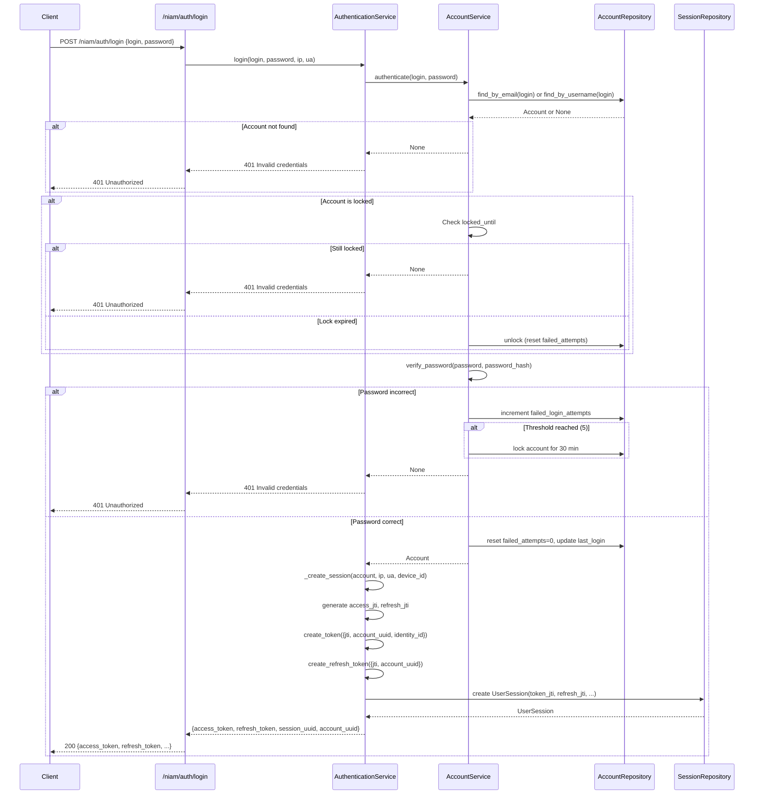
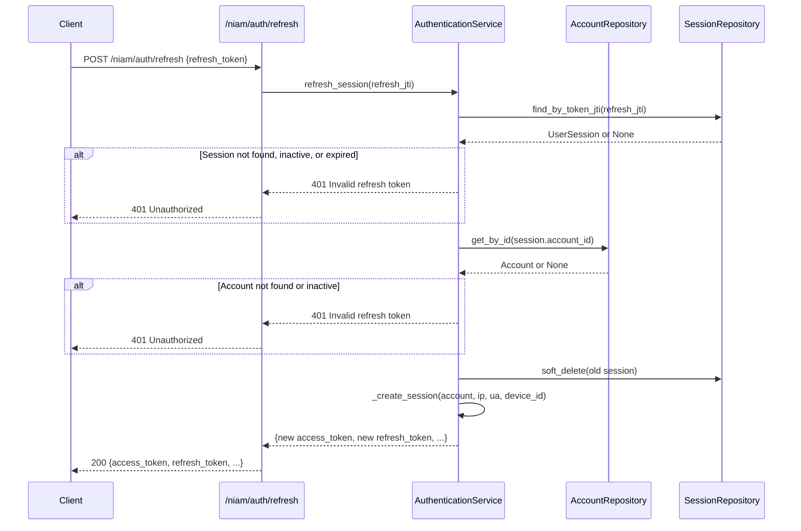

# NIAM — Authentication Flow

## Login Flow



### Request

```http
POST /niam/auth/login
Content-Type: application/json

{
  "login": "user@example.com",
  "password": "securePassword123!"
}
```

### Success Response

```json
{
  "access_token": "eyJhbGciOiJIUzI1NiIs...",
  "refresh_token": "eyJhbGciOiJIUzI1NiIs...",
  "token_type": "bearer",
  "expires_in": 900,
  "session_uuid": "a1b2c3d4-...",
  "account_uuid": "e5f6g7h8-..."
}
```

### Error Response

```json
{
  "detail": "Invalid credentials"
}
```

---

## Token Structure

### Access Token (15-minute expiry)

```json
{
  "jti": "uuid-v4",
  "account_uuid": "uuid-v4",
  "identity_id": "26-char-ulid",
  "type": "access",
  "exp": 1700000000,
  "iat": 1699999100
}
```

### Refresh Token (7-day expiry)

```json
{
  "jti": "uuid-v4",
  "account_uuid": "uuid-v4",
  "type": "refresh",
  "exp": 1700600000,
  "iat": 1699999100
}
```

---

## Token Refresh Flow



### Request

```http
POST /niam/auth/refresh
Content-Type: application/json

{
  "refresh_token": "eyJhbGciOiJIUzI1NiIs..."
}
```

### Response

Same format as login response (new tokens, new session).

---

## Logout Flow

### Single Session Logout

```http
POST /niam/auth/logout
Content-Type: application/json

{
  "session_uuid": "a1b2c3d4-..."
}
```

Process:
1. Find session by UUID
2. Set `is_active=False`
3. Set `terminated_at`, `termination_reason="user_logout"`, `terminated_by="user"`
4. Audit: `session_terminated`

### All Sessions Logout

```http
POST /niam/sessions/account/{account_uuid}/terminate-all
Content-Type: application/json

{
  "reason": "user_logout_all"
}
```

Process:
1. Find all active sessions for account
2. Terminate all (update query on `niam_sessions`)
3. Each session marked inactive with termination reason

---

## MFA Flow

NIAM supports MFA through the `Account` model (`mfa_enabled`, `mfa_methods`, `mfa_secret`) and integrates with the existing `app.security` MFA infrastructure.

### MFA Enrollment

1. User requests MFA setup
2. Generate TOTP secret
3. Display QR code for authenticator app
4. User scans and provides verification code
5. Verify code matches TOTP secret
6. Store `mfa_secret` (encrypted)
7. Set `mfa_methods = "totp"`
8. Set `mfa_enabled = True`
9. Audit: `account_mfa_enabled`

### MFA Authentication

1. User provides password → primary auth success
2. Server generates MFA challenge
3. User provides TOTP code from authenticator
4. Server verifies code against stored `mfa_secret`
5. If valid: create session with `mfa_used=True`
6. If invalid: reject with 401

### MFA Disable

1. User provides current password
2. Provide current TOTP code (verify identity)
3. Clear `mfa_secret`
4. Set `mfa_enabled = False`
5. Audit: `account_mfa_disabled`

---

## FIDO2/Passkey Flow (Reference)

The `Credential` model supports `passkey` and `fido2` credential types with `public_key` storage on `Device`. The flow follows the WebAuthn standard:

1. **Registration**: Generate credential creation options → User agent creates key pair → Store public key in `Device.public_key` or `Credential.credential_value`
2. **Authentication**: Generate assertion options → User agent signs challenge → Verify signature against stored public key
3. **Credential storage**: `Credential` with `credential_type="passkey"` or `credential_type="fido2"`, linked to `Account`

---

## Account Lockout Flow

```
Failed login attempt
  → Increment failed_login_attempts
  → if failed_login_attempts >= 5 (ACCOUNT_LOCKOUT_THRESHOLD):
      → Set is_locked = True
      → Set locked_until = now + 30 min (ACCOUNT_LOCKOUT_DURATION_MINUTES)
      → Set lock_reason = "Account locked after 5 failed attempts"
      → Audit: account_locked

On next login attempt while locked:
  → Check locked_until
  → if locked_until > now: reject (still locked)
  → if locked_until <= now: auto-unlock, reset failed_attempts

Manual unlock by admin:
  → POST /niam/accounts/{uuid}/unlock
  → Reset is_locked, locked_until, lock_reason, failed_login_attempts
  → Audit: account_unlocked
```

---

## Security Constants

| Constant | Value | Location |
|---|---|---|
| `PASSWORD_MIN_LENGTH` | 12 | `account_service.py` |
| `ACCOUNT_LOCKOUT_THRESHOLD` | 5 | `account_service.py` |
| `ACCOUNT_LOCKOUT_DURATION_MINUTES` | 30 | `account_service.py` |
| `PASSWORD_EXPIRY_DAYS` | 90 | `account_service.py` |
| `ACCESS_TOKEN_EXPIRE_MINUTES` | 15 | `authentication_service.py` |
| `REFRESH_TOKEN_EXPIRE_DAYS` | 7 | `authentication_service.py` |

## Session Termination Reasons

| Reason | Trigger |
|---|---|
| `user_logout` | User initiated logout |
| `user_logout_all` | User terminated all sessions |
| `session_expired` | Token/session TTL reached |
| `password_changed` | Password change invalidated sessions |
| `account_locked` | Account was locked |
| `account_deactivated` | Account was deactivated |
| `admin_terminated` | Admin terminated session |
| `security_breach` | Security incident response |
| `impossible_travel` | Geographic anomaly detected |
