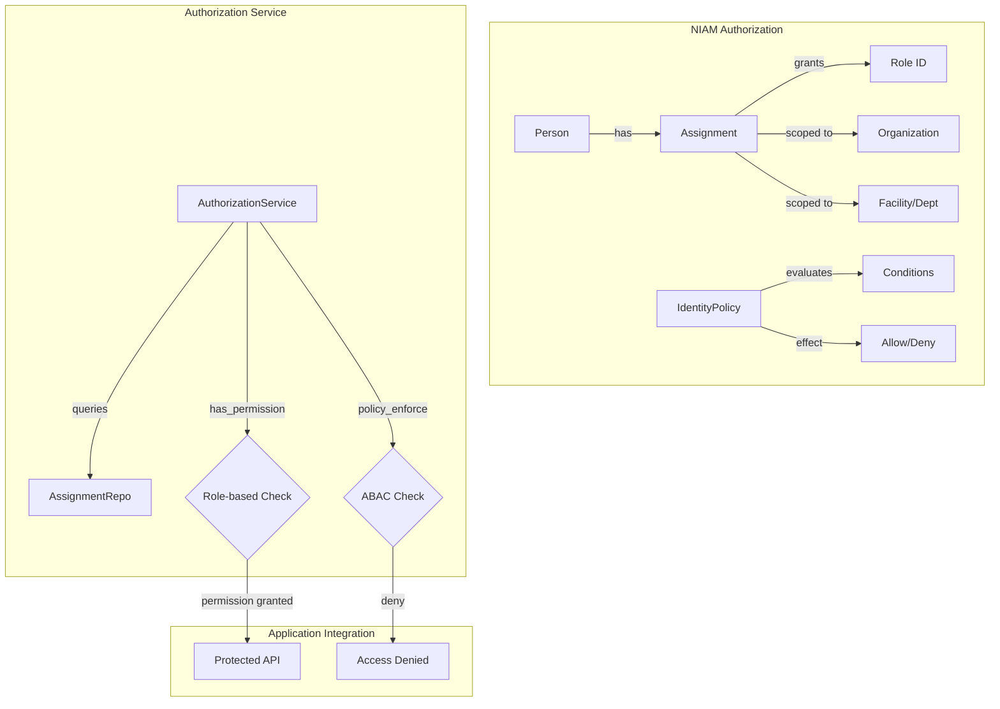
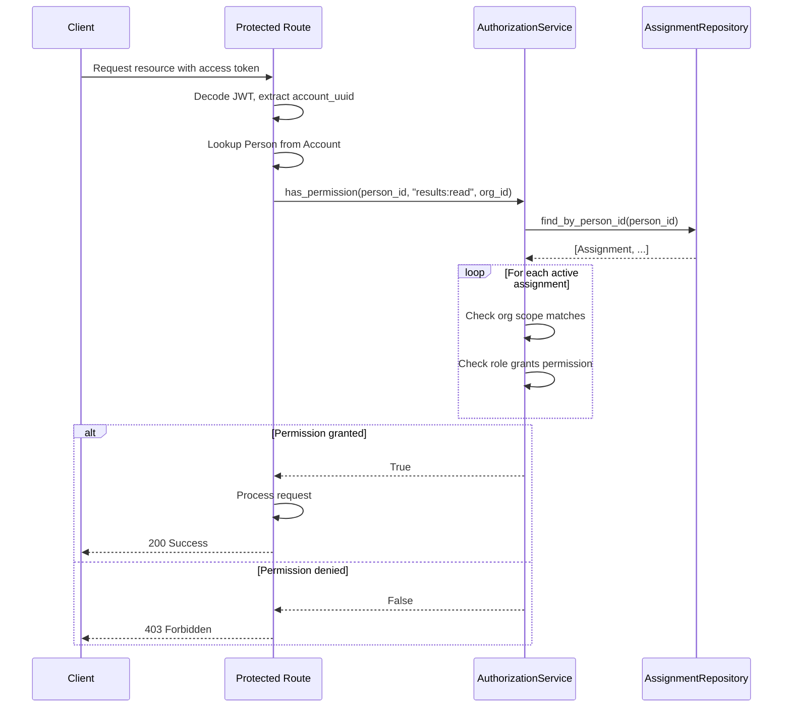

# NIAM — Authorization Model

## Overview

NIAM provides a two-layer authorization model:

1. **RBAC (Role-Based Access Control)** — through the Assignment engine, where each assignment links a person to a role at a specific organizational scope.
2. **ABAC (Attribute-Based Access Control)** — through the Policy Engine (`IdentityPolicy` model), where policies with JSON conditions enable fine-grained, context-aware access decisions.

Both layers integrate with the existing `app.security.rbac` and `app.models.authorization` systems.

---

## Authorization Architecture



## RBAC Through Assignments

### How It Works

Every active `Assignment` grants a specific `role_id` to a `person_id` within an organizational scope. The `AuthorizationService.has_permission()` method checks if a person has any active assignment that grants the required permission.

```python
# Service layer check
authorization_service = AuthorizationService(db)
can_view = await authorization_service.has_permission(
    person_id=person.id,
    permission="results:read",
    organization_id=org.id,
)
```

### Assignment-to-Permission Mapping

The `role_id` in an Assignment maps to the existing RBAC permission model defined in `app.security.rbac` and `app.models.authorization`. Each role (e.g., `lab_director`, `lab_technician`, `pharmacist`) maps to a set of permissions.

Currently, `AuthorizationService._check_assignment_permission()` returns `True` for all active assignments (permission check logic is delegated to the calling layer). The service provides the assignment context, and the application layer evaluates the role/permission mapping.

### Organization-Scoped Authorization

Assignments are scoped to specific organizations, facilities, departments, units, committees, or task forces:

```
Org-wide:    organization_id=MoH, facility_id=None, department_id=None
Facility:    organization_id=MoH, facility_id=Baghdad_Hospital, department_id=None
Department:  organization_id=MoH, facility_id=Baghdad_Hospital, department_id=Hematology
Committee:   committee="Infection Control Committee"
Task Force:  task_force="COVID-19 Response"
```

This enables fine-grained authorization like:
- "Dr. Ali can view lab results only at Baghdad Hospital's Hematology Department"
- "Dr. Sarah can manage all facilities in the Baghdad Directorate"

---

## ABAC Through Policy Engine

### IdentityPolicy Model

Policies are stored in `niam_policies` and use JSON-based conditions for attribute-based evaluation.

```json
{
  "policy_id": "pol-lab-results-night-shift",
  "name": "Lab Results - Night Shift Restriction",
  "effect": "deny",
  "actions": ["results:approve", "results:modify"],
  "resources": ["lab:results:*"],
  "subjects": ["role:lab_technician"],
  "conditions": {
    "time": {
      "after": "22:00",
      "before": "06:00"
    },
    "require_mfa": true
  }
}
```

### Evaluation Logic

```
For each access request:
  1. Collect subject attributes (person, roles, org)
  2. Collect resource attributes (resource type, org, sensitivity)
  3. Collect action attributes (action name, context)
  4. Collect environment attributes (time, location, device trust)
  5. Find all applicable policies (matching subject/resource/action)
  6. Sort by priority
  7. For each policy:
     a. Evaluate conditions
     b. If conditions match → apply effect (allow/deny)
  8. Default: deny
```

### Policy Condition Examples

| Condition Type | Example |
|---|---|
| Time-based | `{"time": {"after": "08:00", "before": "17:00"}}` |
| Location-based | `{"location": {"governorate": "Baghdad"}}` |
| Device trust | `{"device": {"trusted": true}}` |
| MFA requirement | `{"require_mfa": true}` |
| Org type | `{"org_type": ["government_hospital", "government_laboratory"]}` |
| Risk score | `{"risk_score": {"max": 50}}` |

---

## Integration with Existing RBAC

The existing authorization system in `app.security.rbac` and `app.models.authorization` defines:

- **10 roles** (MASTER_ADMIN, ADMIN, PROVINCE_ADMIN, LAB_OWNER, LAB_MANAGER, TECHNICIAN, DOCTOR, ACCOUNTANT, RECEPTIONIST, GUARD)
- **16 extended permissions** (lab.*, patient.*, result.*, order.*, etc.)
- **3 permission tiers** (read, write, admin)

NIAM's `Assignment` model replaces the `role` column on `LabUser` by providing:
- A global role system (not per-lab)
- Organization scoping (not flat lab_id)
- Temporal assignments (start/end dates)
- Special assignment types (temporary, emergency, delegated)
- MFA requirement per assignment

### Migration Path

Existing permission checks like:

```python
# Old: LabUser.role == "admin" && LabUser.lab_id == request.lab_id
if current_user.role != "admin":
    raise Forbidden()

# New: AuthorizationService.has_permission()
if not await authz.has_permission(person_id, "lab:admin", org_id=request.org_id):
    raise Forbidden()
```

---

## Permission Check Flow



---

## Delegation Support

NIAM supports delegated assignments where a person exercises authority on behalf of another:

```python
assignment = Assignment(
    person_id=deputy.id,
    role_id="lab_director",
    is_delegated=True,
    delegated_from=original_assignment.id,
    delegated_by=director.id,
    max_duration_hours=72,
    start_date=date.today(),
    expected_end_date=date.today() + timedelta(days=3),
)
```

Key features:
- Delegated assignments have a `max_duration_hours` limit
- Delegation must be explicitly created by the delegator
- Delegated assignments can be revoked early

---

## Emergency Access

Emergency assignments bypass normal authorization:

```python
assignment = Assignment(
    person_id=doctor.id,
    role_id="emergency_access",
    is_emergency=True,
    max_duration_hours=4,
    requires_mfa=False,  # Bypass MFA in emergency
    notes="Emergency override during system outage",
)
```

---

## Break-Glass Access

For critical situations where normal access controls would prevent patient safety:

1. User triggers break-glass at the application layer
2. Temporary emergency assignment created
3. All actions during break-glass are audited with priority
4. Notifications sent to security team
5. Session has elevated risk score
6. Break-glass must be justified with a reason

---

## Permission Categories

| Category | Actions | Description |
|---|---|---|
| `person:*` | `read`, `create`, `update`, `deactivate` | Person registry management |
| `identity:*` | `read`, `create`, `verify`, `revoke` | Identity management |
| `account:*` | `read`, `create`, `lock`, `unlock`, `reset_password` | Account management |
| `organization:*` | `read`, `create`, `update`, `manage` | Organization management |
| `employment:*` | `read`, `create`, `terminate`, `transfer` | Employment management |
| `assignment:*` | `read`, `create`, `revoke`, `delegate` | Assignment management |
| `session:*` | `read`, `terminate`, `terminate_all` | Session management |
| `device:*` | `read`, `register`, `trust`, `revoke` | Device management |
| `audit:*` | `read`, `export` | Audit log access |
| `policy:*` | `read`, `create`, `update`, `delete` | Policy management |
