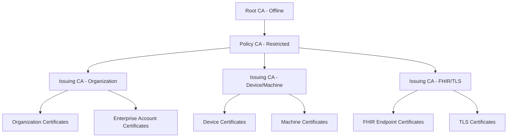
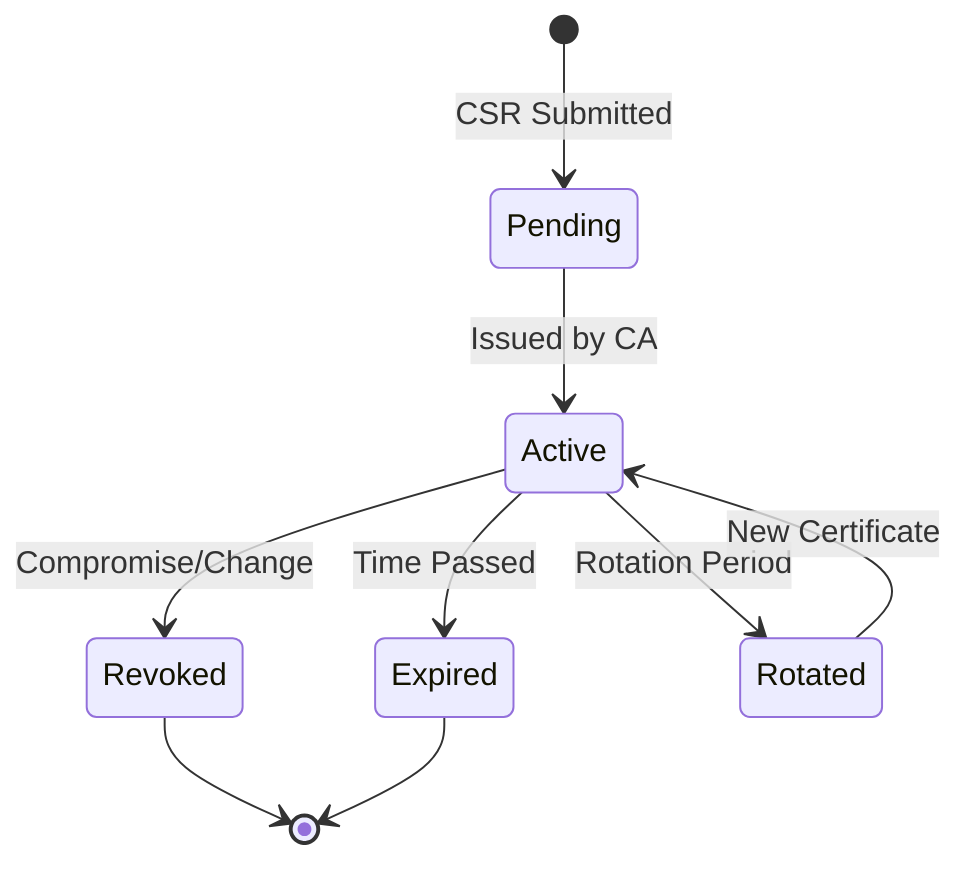
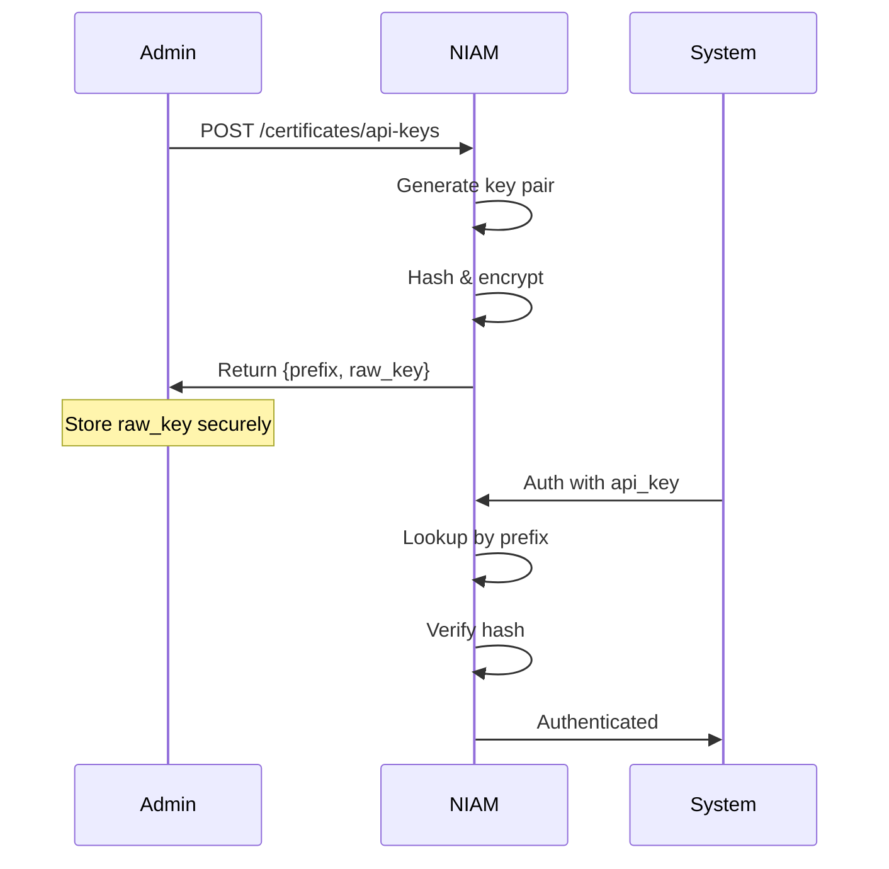

# NIAM — Certificate Management

## Overview

NIAM provides a complete Public Key Infrastructure (PKI) for the GULA ecosystem. It manages Certificate Authorities (CAs) in a three-tier hierarchy, issues digital certificates for organizations, devices, machines, FHIR endpoints, and APIs, and manages Certificate Revocation Lists (CRLs) and API keys.

---

## Certificate Authority Hierarchy

### CA Types (`CertificateAuthority`)

| CA Type | Key Size | Validity | Usage |
|---------|----------|----------|-------|
| `root` | 4096-bit RSA | 10 years | Offline root of trust |
| `intermediate` | 3072-bit RSA | 5 years | Policy enforcement CA |
| `issuing` | 2048-bit RSA | 2-3 years | End-entity issuance |

Each CA tracks: `ca_id`, `ca_type`, `certificate` (PEM), `private_key_encrypted`, `public_key`, `serial_number`, `thumbprint`, `valid_from`, `valid_to`, `signing_algorithm`, `key_size`, `path_length_constraint`, `parent_ca_id`, `issued_certificate_count`, `revoked_certificate_count`.

---

## Certificate Types (`DigitalCertificate`)

| Certificate Type | Subject | Validity | Purpose |
|-----------------|---------|----------|---------|
| `organization` | Organization | 1-2 years | Organization identity |
| `device` | Device | 1 year | Device authentication |
| `machine` | Machine/Server | 1 year | Machine-to-machine auth |
| `fhir` | FHIR Endpoint | 1 year | FHIR API TLS/mTLS |
| `api` | API Gateway | 1 year | API authentication |
| `tls` | Domain/Hostname | 1 year | TLS termination |
| `person` | Person | 1 year | Person identity certificate |
| `ca` | CA Name | 2-10 years | CA certificate |

Fields: `certificate_id`, `serial_number`, `subject`, `issuer`, `certificate_type`, `public_key`, `private_key_encrypted`, `certificate_pem`, `certificate_chain`, `thumbprint`, `signature_algorithm`, `key_size`, `issued_at`, `expires_at`, `revoked_at`, `revocation_reason`.

---

## Certificate Lifecycle

### Certificate Rotation

- Configurable `rotation_period_days`
- Automated rotation via `rotate_certificate()` service
- Chain update on rotation
- Grace period for old certificate

### Certificate Revocation

- `revoke_certificate()` with reason: `key_compromise`, `ca_compromise`, `affiliation_changed`, `superseded`, `cessation_of_operation`, `certificate_hold`
- Added to Certificate Revocation List (CRL)
- Timestamp and signature for non-repudiation

---

## Certificate Revocation List (CRL)

Each CA maintains a CRL:

| Field | Description |
|-------|-------------|
| `crl_id` | Unique CRL identifier |
| `ca_id` | Issuing CA |
| `crl_number` | Monotonically increasing |
| `this_update` | CRL issue timestamp |
| `next_update` | Next CRL publication (usually T+24h) |
| `revoked_certificates` | JSON array of revoked cert data |
| `crl_pem` | Signed CRL in PEM format |
| `signature` | CRL signature |

---

## Mutual TLS (mTLS)

NIAM supports mTLS for:
- FHIR endpoint connections
- Inter-service communication
- Enterprise account API access

Certificates issued with `certificate_type = "fhir"` or `"tls"` include client authentication extended key usage.

---

## API Key Management (`APIKey`)

### API Key Attributes
- `key_prefix` (first 10 chars for lookup)
- `key_hash` (SHA-256 of full key)
- `scopes` (JSON array, e.g., `["fhir:read", "fhir:write"]`)
- `permissions` (JSON array, fine-grained)
- `allowed_ips`, `allowed_referrers`
- `rate_limit` (requests per minute)
- `expires_at`, `last_used_at`, `rotated_at`

### API Key Operations
- **Generation**: Returns `raw_key` once (must be stored securely)
- **Validation**: Prefix lookup → hash comparison → scope check
- **Rotation**: New key generated, old key deprecated
- **Revocation**: Immediate invalidation of `key_hash`
- **Scoping**: Fine-grained API access control via `scopes` and `permissions`

---

## Database Tables

| Table | Purpose |
|-------|---------|
| `niam_cert_certificates` | Digital certificates |
| `niam_cert_authorities` | Certificate Authorities |
| `niam_cert_crls` | Certificate Revocation Lists |
| `niam_cert_api_keys` | API keys |
