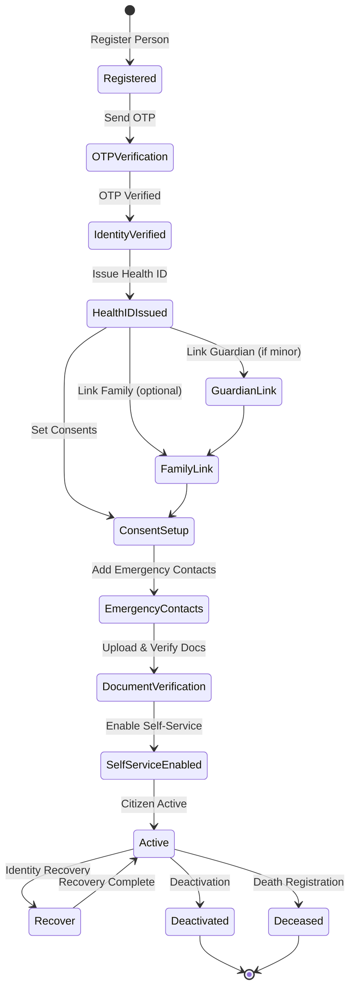

# NIAM — Citizen Lifecycle

## Overview

The Citizen Lifecycle covers the complete identity journey for citizens from registration through deactivation or death registration. It includes guardian accounts, family links, consent management, emergency contacts, document verification, and self-service capabilities.

---

## Citizen Lifecycle State Machine

---

## Registration Flow

### 1. Registration
- Person record created with biographical data
- National ID hashed (HMAC-SHA256, never stored in plaintext)
- Citizen identity record created
- Status: `registered`

### 2. OTP Verification
- One-time password sent to registered phone
- Verifies phone ownership
- OTP sent at / verified at tracked
- Status: `otp_verified`

### 3. Identity Verification
- National ID validation against civil registry
- Identity proofing at appropriate IAL level
- Status: `identity_verified`

### 4. Health ID Issuance
- Unique SNDHS health identifier issued
- Links citizen to national health system
- Status: `health_id_issued`

---

## Guardian & Family Accounts

### Guardian Types

| Relationship | Guardian Type | Description |
|-------------|---------------|-------------|
| Parent | `legal_guardian` | Biological or legal parent |
| Legal Guardian | `court_appointed` | Court-appointed legal guardian |
| Caregiver | `caregiver` | Authorized care provider |
| Dependent | `dependent` | Person under guardianship |
| Child | `child` | Minor child of citizen |

### Guardian Account Model (`GuardianAccount`)

Fields: `guardian_id`, `guardian_person_id`, `dependent_person_id`, `relationship`, `guardian_type`, `start_date`, `end_date`, `delegated_access` (JSON), `consent_inheritance` (boolean), `verified_by`, `verified_at`, `documents`.

Supports:
- Multiple guardians per dependent
- Time-bound guardianship
- Delegated access scopes
- Consent inheritance chain
- Document verification

### Family Links (`FamilyLink`)

Fields: `person_id`, `relative_person_id`, `relationship`, `emergency_contact` (boolean), `consent_sharing` (boolean).

Supports linking: parents, children, siblings, spouses, emergency contacts.

---

## Consent Management (`ConsentRecord`)

| Field | Description |
|-------|-------------|
| `consent_id` | Unique identifier |
| `person_id` | Consenting person |
| `consent_type` | Type (healthcare/data_sharing/research) |
| `granted_to` | Organization or person |
| `scope` | JSON consent scope definition |
| `terms` | Consent terms text |
| `expires_at` | Consent expiry |

Supports full lifecycle: grant → revoke → expire.

---

## Additional Features

### Emergency Contacts
Stored as JSON array per citizen lifecycle record: name, phone, relationship, priority.

### Address History
JSON array of address records with timestamps: `{address, governorate, district, from_date, to_date, type}`.

### Document Verification
JSON tracking of uploaded identity documents: `{doc_type, doc_id, verified_at, verified_by, status}`.

### Self-Service
`self_service_enabled` flag controls portal access for profile management, document uploads, and consent management.

### Identity Recovery
Tracked via `last_recovery_at`. Supports account recovery workflows with re-verification.

### Deactivation
`deactivated_at` and `deactivation_reason` for opt-out or administrative removal.

### Death Registration
`deceased_at`, `death_certificate_id` for end-of-life identity closure. Triggers automated notifications and account suspension.

---

## Database Tables

| Table | Purpose |
|-------|---------|
| `niam_lifecycle_citizen` | Main citizen lifecycle track |
| `niam_lifecycle_guardians` | Guardian/dependent relationships |
| `niam_lifecycle_family_links` | Family relationship links |
| `niam_lifecycle_consents` | Consent records |
