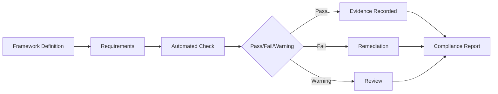

# NIAM — Compliance Model

## Overview

The Compliance Model provides automated compliance framework management, mapping NIAM capabilities against industry standards and regulatory requirements. It supports NIST 800-63, OAuth2/OIDC/SAML compliance, FHIR Security, OWASP ASVS, ISO 27001, ISO 27799, and Zero Trust architecture principles.

---

## Supported Frameworks

| Framework | Type | Scope |
|-----------|------|-------|
| NIST SP 800-63-3 | Identity | Digital identity guidelines |
| OAuth 2.0 (RFC 6749) | Federation | Authorization framework |
| OpenID Connect (OIDC) | Federation | Authentication layer |
| SAML 2.0 | Federation | Enterprise SSO |
| FHIR Security (HL7) | Healthcare | Healthcare data security |
| OWASP ASVS | Application | Application security verification |
| ISO 27001 | Information Security | ISMS requirements |
| ISO 27799 | Healthcare | Health information security |
| Zero Trust Architecture | Architecture | NIST SP 800-207 |

---

## NIST 800-63 Compliance Mapping

### IAL Mapping

| IAL Level | NIAM Implementation |
|-----------|-------------------|
| IAL1 | Self-registered citizen accounts, self-attested identity |
| IAL2 | Remote identity proofing with biometric liveness check |
| IAL3 | In-person identity verification with trained operator |
| IAL4 | Enhanced vetting for national security roles |

### AAL Mapping

| AAL Level | NIAM Implementation |
|-----------|-------------------|
| AAL1 | Password-only authentication (bcrypt) |
| AAL2 | Password + OTP (TOTP) or FIDO2 |
| AAL3 | FIDO2 security keys + smart card support |

### FAL Mapping

| FAL Level | NIAM Implementation |
|-----------|-------------------|
| FAL1 | Signed JWT ID token |
| FAL2 | Signed + pairwise pseudonymous identifiers |
| FAL3 | Holder-of-key proof of possession |

---

## FHIR Security Compliance

NIAM supports FHIR security requirements:
- SMART on FHIR authorization
- OAuth2 scopes for FHIR resources
- Patient privacy consent enforcement
- Audit logging per FHIR interaction
- mTLS for FHIR endpoint connections

---

## Automated Compliance Checks

The `ComplianceCheck` model enables automated compliance verification:

### Check Lifecycle
- `framework_id` links to `ComplianceFramework`
- `requirement_id` identifies the specific requirement
- `target_type` / `target_id` scopes the check
- `check_type`: `automated` or `manual`
- `status`: `not_checked` → `passed` / `failed` / `warning` / `not_applicable`
- `evidence`: JSON evidence of check results
- `finding`: Text finding description
- `recommendation`: Remediation recommendation

---

## Compliance Report

Generated reports include:

| Field | Description |
|-------|-------------|
| `report_id` | Unique report identifier |
| `organization_id` | Scoped to organization (optional) |
| `framework_id` | Which framework assessed |
| `report_type` | self_assessment / audit / certification |
| `overall_score` | 0-100 compliance score |
| `passed_count`, `failed_count` | Pass/fail counts |
| `warning_count`, `not_applicable_count` | Additional counts |
| `findings` | JSON array of findings |
| `recommendations` | JSON array of remediations |
| `generated_by`, `generated_at` | Report metadata |
| `valid_until` | Report validity period |

---

## Compliance Framework Model (`ComplianceFramework`)

| Field | Description |
|-------|-------------|
| `framework_id` | Unique ID |
| `name` | Framework name (e.g., "NIST 800-63") |
| `framework_type` | identity/federation/security/healthcare |
| `version` | Version string |
| `requirements` | JSON array of requirement definitions |
| `status` | draft/active/archived |

---

## Zero Trust Architecture

NIAM implements Zero Trust principles (NIST SP 800-207):

| Principle | NIAM Implementation |
|-----------|-------------------|
| Verify explicitly | Multi-factor auth, risk scoring, device trust |
| Least privilege | RBAC + ABAC policies, scoped API keys |
| Assume breach | Session termination, device revocation, audit trail |
| Continuous validation | Risk evaluation, impossible travel detection |
| Micro-segmentation | Organization-scoped permissions, FHIR scoping |

---

## Compliance APIs

| Endpoint | Description |
|----------|-------------|
| `POST /compliance/frameworks` | Register a compliance framework |
| `GET /compliance/frameworks` | List registered frameworks |
| `GET /compliance/frameworks/{id}` | Get framework details |
| `POST /compliance/checks` | Run an automated compliance check |
| `GET /compliance/checks/{target}` | List checks for a target |
| `POST /compliance/reports` | Generate compliance report |
| `GET /compliance/reports/{id}` | Get report details |
| `GET /compliance/status/{org_id}` | Get org compliance status |

---

## Database Tables

| Table | Purpose |
|-------|---------|
| `niam_comp_frameworks` | Compliance framework definitions |
| `niam_comp_checks` | Automated compliance check results |
| `niam_comp_reports` | Compliance assessment reports |
