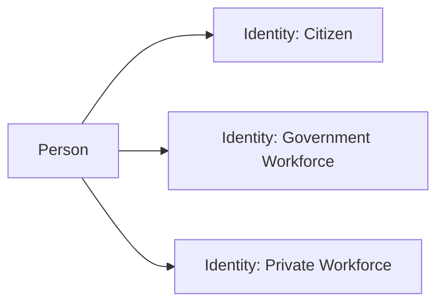
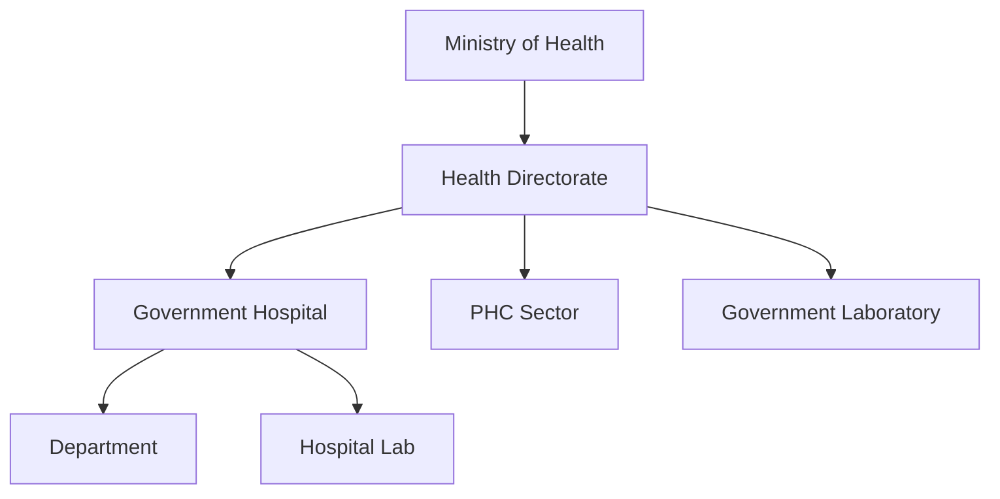

# NIAM — Core Concepts

## Person (الشخص)

The **Person** is the fundamental entity — the representation of a natural human being. A person exists once in the system and carries their biographical data.

```
Person
├── uuid (globally unique, stable identifier)
├── national_id_hash (HMAC-SHA256 of Iraqi National ID)
├── health_id (SNDHS health identifier)
├── passport_number
├── given_name / middle_name / family_name
├── full_name_ar (Arabic full name)
├── gender / birth_date / nationality (default: IRQ)
├── email / phone / address
├── emergency_contact (name, phone, relation)
├── is_deceased / deceased_at
├── tags / extra_metadata (JSON)
└── is_active (soft delete flag)
```

Key rules:
- A Person is **immutable in identity** — biographical data can be updated but the `uuid` is permanent.
- National ID is stored as an **HMAC-SHA256 hash** only — never in plaintext.
- A Person can be linked to multiple Identities, Employments, Accounts, and Devices.

---

## Identity (الهوية)

An **Identity** is a set of verifiable claims about a person in a specific context. One person can have multiple identities (e.g., citizen + government employee + private sector consultant).



### Identity Types

| Type | Value | Description |
|---|---|---|
| Citizen | `citizen` | General population identity |
| Government Workforce | `government_workforce` | MoH/government employee |
| Private Workforce | `private_workforce` | Private sector healthcare worker |
| Enterprise | `enterprise` | Organization-level identity |
| Machine | `machine` | Non-human system identity |
| Temporary | `temporary` | Short-term/visitor identity |
| Guest | `guest` | External guest/auditor |
| External Federation | `external_federation` | Federated identity from another system |

Each Identity tracks:
- `issued_at`, `expires_at`, `verified_at`
- `verification_method` (e.g., "in_person", "nid_check", "federation")
- `issued_by_organization` (which org verified this identity)
- `status` (active, suspended, revoked)

---

## Account (الحساب)

An **Account** is the authentication principal — what a person uses to log in. Every account is linked to exactly one Identity (and transitively to one Person).

```
Account
├── account_type: human | machine | service | system
├── status: active | locked | suspended | deactivated | pending_verification
├── email (unique login identifier)
├── phone (unique login identifier)
├── username (unique login identifier)
├── password_hash (bcrypt)
├── password_changed_at / password_expires_at (90-day expiry)
├── mfa_enabled / mfa_methods / mfa_secret
├── is_locked / locked_until / lock_reason
├── failed_login_attempts / last_failed_login
├── last_login / last_login_ip
├── email_verified / phone_verified / identity_verified
└── activated_at / deactivated_at / deactivation_reason
```

Key rules:
- One Identity can have **exactly one Account** (1:1 relationship).
- Account lockout occurs after **5 failed attempts** for **30 minutes**.
- Passwords expire after **90 days**.
- Account statuses: `pending_verification` → `active` → `locked`/`suspended`/`deactivated`.

---

## Organization (المنظمة)

An **Organization** represents any entity in the national healthcare hierarchy. Organizations form a tree via `parent_org_id`.



### Organization Types (19 defined)

`ministry`, `directorate`, `government_hospital`, `private_hospital`, `primary_healthcare_sector`, `health_center`, `government_laboratory`, `private_laboratory`, `blood_bank`, `forensic_medicine`, `university`, `research_center`, `insurance_company`, `ngo`, `supplier`, `vendor`, `medical_company`, `pharmacy`, `external_authority`

Each organization has:
- `name_en` / `name_ar` (bilingual naming)
- `license_number`, `accreditation`
- `governorate`, `district` (geographic scoping)
- `fhir_endpoint`, `digital_certificate` (integration)
- `subscriptions`, `settings`, `tags` (JSON)

---

## Employment (التوظيف)

**Employment** represents a work relationship between a Person and an Organization. One person can have multiple concurrent employments (e.g., works at a hospital and teaches at a university).

```
Employment
├── person_id → Person
├── organization_id → NIAMOrganization
├── employee_id (HR system ID)
├── employment_type (full_time, part_time, contractor, etc.)
├── position / department / title
├── start_date / end_date
├── contract_type / contract_end_date
├── supervisor_person_id → Person
├── is_primary_employment (one primary)
├── status: active | on_leave | suspended | terminated | retired | transferred
├── termination_reason / termination_date
├── transfer_from_employment / transfer_to_organization / transfer_date
└── notes
```

---

## Assignment (التعيين)

An **Assignment** is a person assigned to a specific role or position at an organization, facility, department, unit, committee, or task force. Assignments are the mechanism for **RBAC** — every role a person holds is an Assignment.

```
Assignment
├── employment_id → Employment (optional linkage)
├── person_id → Person
├── organization_id → NIAMOrganization
├── facility_id / department_id / unit / committee / task_force
├── role_id (the RBAC role, e.g., "lab_director", "pharmacist")
├── assignment_type
├── is_primary (one primary assignment)
├── start_date / end_date / expected_end_date
├── is_temporary / is_emergency / is_delegated
├── delegated_from / delegated_by
├── max_duration_hours (for temporary/emergency)
├── requires_mfa (sensitive roles)
└── assigned_by / notes
```

### Assignment vs Employment

| Aspect | Employment | Assignment |
|---|---|---|
| What it represents | "Works at" | "Holds role" |
| Cardinality | N per person | N per person |
| Time-bound | Yes (start/end date) | Yes (with expected end) |
| Role-specific | No | Yes (role_id) |
| Emergency/temp | No | Yes |
| Delegation | No | Yes |
| MFA requirement | No | Yes |

---

## Session (الجلسة)

A **UserSession** represents an authenticated login session. Created on login, terminated on logout or expiry.

Key attributes:
- `token_jti` / `refresh_token_jti` (JWT ID for token tracking)
- `session_type` (web, mobile, api)
- `ip_address`, `user_agent`, `device_id`
- `location_city`, `location_country`, `location_lat`, `location_lng`
- `started_at`, `last_activity_at`, `expires_at` (7-day TTL)
- `terminated_at`, `termination_reason`, `terminated_by`
- `auth_method`, `mfa_used`, `risk_score`

---

## Device (الجهاز)

A **Device** represents a known device (browser, mobile, workstation) associated with a person.

Key attributes:
- `device_fingerprint` (unique, from browser/device characteristics)
- `device_type`, `manufacturer`, `model`
- `os`, `os_version`, `browser`, `browser_version`
- `public_key` (for FIDO2/WebAuthn)
- `trusted` / `trusted_at` (trust lifecycle)
- `first_seen_at` / `last_seen_at`
- `is_locked` (remote device lock)

---

## Credential (المعتمد)

A **Credential** is an authentication factor stored for an account. Multiple credentials can exist per account.

| Credential Type | Value |
|---|---|
| Password | `password` |
| Passkey | `passkey` |
| FIDO2 | `fido2` |
| OTP Secret | `otp_secret` |
| Authenticator App | `authenticator_app` |
| API Key | `api_key` |
| Certificate | `certificate` |
| Smart Card | `smart_card` |
| Biometric | `biometric` |
| OAuth2 Token | `oauth2_token` |
| SAML Assertion | `saml_assertion` |

---

## License (الترخيص)

A **ProfessionalLicense** represents a professional certification or license (medical, lab, pharmacy, etc.).

Tracks: `license_type`, `license_number`, `issuing_authority`, `issue_date`, `expiry_date`, `board_certification`, `degree_type`/`degree_name`/`degree_institution`, `continuing_education_hours`.

---

## Machine Identity (هوية الآلة)

A **MachineIdentity** represents a non-human entity (server, lab instrument, IoT device) that needs to authenticate to the platform.

Tracks: `machine_type`, `serial_number`, `ip_address`, `mac_address`, `hostname`, `public_key`, `certificate_sn`, `certificate`, `last_heartbeat`, `is_compromised`.

---

## Policy (السياسة)

An **IdentityPolicy** is an ABAC (Attribute-Based Access Control) policy definition. Policies use JSON conditions for fine-grained access control.

Key fields:
- `policy_id` (unique policy identifier)
- `effect` (allow/deny)
- `actions` (JSON array of action patterns)
- `resources` (JSON array of resource patterns)
- `subjects` (JSON array of subject patterns)
- `conditions` (JSON conditions for context-aware evaluation)
- `priority` (resolution order)
- `applies_to_org_types` (org type scoping)

---

## Audit Event (حدث التدقيق)

An **IdentityAuditEntry** records every identity-related event with context for non-repudiation.

Each entry captures: `action`, `actor_id`, `actor_type`, `target_type`, `target_id`, `changes` (JSON diff), `metadata`, `context`, `ip_address`, `user_agent`, `session_id`, `organization_id`, `outcome`, `error_message`.

See [AUDIT_MODEL.md](./AUDIT_MODEL.md) for the full audit action catalog.

---

## Enterprise Account (حساب المؤسسة)

An **EnterpriseAccount** is an organization-level credential for system-to-system integration. Organizations can have API keys, OAuth2 client credentials, and digital certificates for automated access.

Tracks: `api_key_prefix`/`api_key_hash`, `oauth2_client_id`/`oauth2_client_secret_hash`, `certificate`/`certificate_thumbprint`, `scopes`, `fhir_endpoint`.

---

## Arabic Terms (المصطلحات العربية)

| English | العربية |
|---|---|
| Person | شخص |
| Identity | هوية |
| Account | حساب |
| Organization | منظمة |
| Employment | توظيف |
| Assignment | تعيين |
| Session | جلسة |
| Device | جهاز |
| Credential | معتمد |
| License | ترخيص |
| Machine Identity | هوية الآلة |
| Policy | سياسة |
| Audit Event | حدث التدقيق |
| Enterprise Account | حساب المؤسسة |
