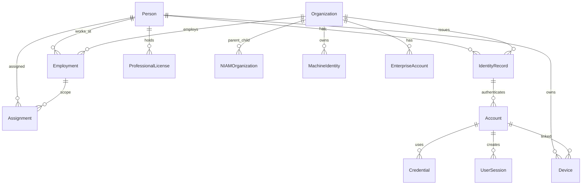

# NIAM — Data Model

## Table Overview

| # | Table Name | Model Class | Schema |
|---|---|---|---|
| 1 | `niam_persons` | `Person` | Core person registry |
| 2 | `niam_identities` | `IdentityRecord` | Identity claims per person |
| 3 | `niam_accounts` | `Account` | Login accounts tied to identities |
| 4 | `niam_organizations` | `NIAMOrganization` | Healthcare org hierarchy |
| 5 | `niam_enterprise_accounts` | `EnterpriseAccount` | Org-level API/OAuth2 credentials |
| 6 | `niam_employments` | `Employment` | Person-org work relationships |
| 7 | `niam_assignments` | `Assignment` | Person-role-position assignments |
| 8 | `niam_licenses` | `ProfessionalLicense` | Professional certifications |
| 9 | `niam_credentials` | `Credential` | Authentication factors |
| 10 | `niam_sessions` | `UserSession` | Auth sessions |
| 11 | `niam_devices` | `Device` | Known devices |
| 12 | `niam_machine_identities` | `MachineIdentity` | Non-human identities |
| 13 | `niam_policies` | `IdentityPolicy` | ABAC policy definitions |
| 14 | `niam_audit_entries` | `IdentityAuditEntry` | Immutable audit log |

All tables use the `IdentityBase` declarative base (separate from main app's `Base`).

---

## Common Columns

Every table inherits from `IdentityBaseEntity`:

| Column | Type | Constraints | Description |
|---|---|---|---|
| `id` | `VARCHAR(26)` | PK, default=_ulid() | ULID primary key |
| `created_at` | `TIMESTAMP WITH TIME ZONE` | NOT NULL | Row creation time |
| `updated_at` | `TIMESTAMP WITH TIME ZONE` | NOT NULL, onupdate | Row last update time |

Models using `IdentitySoftDeleteEntity` also have:

| Column | Type | Constraints | Description |
|---|---|---|---|
| `is_deleted` | `BOOLEAN` | DEFAULT FALSE | Soft delete flag |
| `deleted_at` | `TIMESTAMP WITH TIME ZONE` | NULLABLE | When soft-deleted |

Every model also has an `is_active` column (`BOOLEAN`, DEFAULT TRUE, NOT NULL) for active/inactive status.

---

## 1. niam_persons

| Column | Type | Constraints | Description |
|---|---|---|---|
| `uuid` | `VARCHAR(36)` | UNIQUE, NOT NULL, INDEX | Stable global identifier |
| `national_id_hash` | `VARCHAR(255)` | UNIQUE, NULLABLE, INDEX | HMAC-SHA256 of Iraqi National ID |
| `health_id` | `VARCHAR(100)` | UNIQUE, NULLABLE, INDEX | SNDHS health identifier |
| `passport_number` | `VARCHAR(50)` | UNIQUE, NULLABLE, INDEX | Passport number |
| `given_name` | `VARCHAR(100)` | NOT NULL | First name |
| `middle_name` | `VARCHAR(100)` | NULLABLE | Middle/father name |
| `family_name` | `VARCHAR(100)` | NOT NULL | Last name/family name |
| `full_name_ar` | `VARCHAR(300)` | NULLABLE | Full name in Arabic |
| `gender` | `VARCHAR(20)` | NULLABLE | Gender |
| `birth_date` | `DATE` | NULLABLE | Date of birth |
| `nationality` | `VARCHAR(3)` | DEFAULT 'IRQ' | ISO country code |
| `email` | `VARCHAR(200)` | NULLABLE, INDEX | Email address |
| `phone` | `VARCHAR(30)` | NULLABLE, INDEX | Phone number |
| `address` | `TEXT` | NULLABLE | Physical address |
| `emergency_contact_name` | `VARCHAR(200)` | NULLABLE | Emergency contact |
| `emergency_contact_phone` | `VARCHAR(30)` | NULLABLE | Emergency phone |
| `emergency_contact_relation` | `VARCHAR(50)` | NULLABLE | Relation to person |
| `is_deceased` | `BOOLEAN` | DEFAULT FALSE | Death status |
| `deceased_at` | `TIMESTAMP WITH TIME ZONE` | NULLABLE | Time of death recorded |
| `tags` | `JSON` | NULLABLE | Arbitrary tags |
| `extra_metadata` | `JSON` | NULLABLE | Additional metadata |
| `is_active` | `BOOLEAN` | DEFAULT FALSE, NOT NULL | Active status |

---

## 2. niam_identities

| Column | Type | Constraints | Description |
|---|---|---|---|
| `uuid` | `VARCHAR(36)` | UNIQUE, NOT NULL, INDEX | Stable identifier |
| `person_id` | `VARCHAR(26)` | FK → niam_persons.id, CASCADE, NOT NULL, INDEX | Owning person |
| `identity_type` | `VARCHAR(30)` | NOT NULL, INDEX | Enum: citizen, government_workforce, etc. |
| `status` | `VARCHAR(20)` | DEFAULT 'active', NOT NULL, INDEX | active, suspended, revoked |
| `verified_at` | `TIMESTAMP WITH TIME ZONE` | NULLABLE | When identity was verified |
| `verified_by` | `VARCHAR(100)` | NULLABLE | Who verified |
| `verification_method` | `VARCHAR(50)` | NULLABLE | How verified |
| `issued_at` | `TIMESTAMP WITH TIME ZONE` | NOT NULL | When issued |
| `expires_at` | `TIMESTAMP WITH TIME ZONE` | NULLABLE | When expires |
| `issued_by_organization` | `VARCHAR(26)` | FK → niam_organizations.id, SET NULL, NULLABLE | Issuing org |
| `notes` | `TEXT` | NULLABLE | Notes |
| `is_active` | `BOOLEAN` | DEFAULT TRUE, NOT NULL | Active status |

---

## 3. niam_accounts

| Column | Type | Constraints | Description |
|---|---|---|---|
| `uuid` | `VARCHAR(36)` | UNIQUE, NOT NULL, INDEX | Stable identifier |
| `identity_id` | `VARCHAR(26)` | FK → niam_identities.id, CASCADE, NOT NULL, INDEX | Linked identity |
| `account_type` | `VARCHAR(20)` | DEFAULT 'human', NOT NULL | human, machine, service, system |
| `status` | `VARCHAR(30)` | DEFAULT 'pending_verification', NOT NULL, INDEX | active, locked, suspended, etc. |
| `email` | `VARCHAR(200)` | UNIQUE, NULLABLE, INDEX | Email login |
| `phone` | `VARCHAR(30)` | UNIQUE, NULLABLE, INDEX | Phone login |
| `username` | `VARCHAR(100)` | UNIQUE, NULLABLE, INDEX | Username login |
| `password_hash` | `VARCHAR(255)` | NULLABLE | bcrypt hash |
| `password_changed_at` | `TIMESTAMP WITH TIME ZONE` | NULLABLE | Last password change |
| `password_expires_at` | `TIMESTAMP WITH TIME ZONE` | NULLABLE | Password expiry (90 days) |
| `mfa_enabled` | `BOOLEAN` | DEFAULT FALSE, NOT NULL | MFA active |
| `mfa_methods` | `VARCHAR(200)` | NULLABLE | Comma-separated methods |
| `mfa_secret` | `VARCHAR(255)` | NULLABLE | TOTP secret |
| `is_locked` | `BOOLEAN` | DEFAULT FALSE, NOT NULL | Locked status |
| `locked_until` | `TIMESTAMP WITH TIME ZONE` | NULLABLE | Auto-unlock time |
| `lock_reason` | `VARCHAR(200)` | NULLABLE | Why locked |
| `failed_login_attempts` | `INTEGER` | DEFAULT 0, NOT NULL | Consecutive failures |
| `last_failed_login` | `TIMESTAMP WITH TIME ZONE` | NULLABLE | Last failed attempt |
| `last_login` | `TIMESTAMP WITH TIME ZONE` | NULLABLE | Last successful login |
| `last_login_ip` | `VARCHAR(45)` | NULLABLE | Last login IP |
| `email_verified` | `BOOLEAN` | DEFAULT FALSE, NOT NULL | Email confirmed |
| `phone_verified` | `BOOLEAN` | DEFAULT FALSE, NOT NULL | Phone confirmed |
| `identity_verified` | `BOOLEAN` | DEFAULT FALSE, NOT NULL | Identity verified |
| `activated_at` | `TIMESTAMP WITH TIME ZONE` | NULLABLE | When activated |
| `deactivated_at` | `TIMESTAMP WITH TIME ZONE` | NULLABLE | When deactivated |
| `deactivation_reason` | `VARCHAR(200)` | NULLABLE | Why deactivated |
| `is_active` | `BOOLEAN` | DEFAULT TRUE, NOT NULL | Active status |

---

## 4. niam_organizations

| Column | Type | Constraints | Description |
|---|---|---|---|
| `uuid` | `VARCHAR(36)` | UNIQUE, NOT NULL, INDEX | Stable identifier |
| `org_id` | `VARCHAR(100)` | UNIQUE, NOT NULL, INDEX | Business identifier |
| `name_en` | `VARCHAR(300)` | NOT NULL | English name |
| `name_ar` | `VARCHAR(300)` | NOT NULL | Arabic name |
| `org_type` | `VARCHAR(50)` | NOT NULL, INDEX | From ORG_TYPES (19 values) |
| `parent_org_id` | `VARCHAR(26)` | FK → niam_organizations.id, SET NULL, NULLABLE, INDEX | Parent in hierarchy |
| `license_number` | `VARCHAR(100)` | UNIQUE, NULLABLE | Org license |
| `accreditation` | `VARCHAR(200)` | NULLABLE | Accreditation body |
| `accreditation_expires` | `TIMESTAMP WITH TIME ZONE` | NULLABLE | Accreditation expiry |
| `status` | `VARCHAR(20)` | DEFAULT 'active', NOT NULL, INDEX | active, inactive, suspended |
| `fhir_endpoint` | `VARCHAR(500)` | NULLABLE | FHIR API endpoint |
| `digital_certificate` | `TEXT` | NULLABLE | TLS/client certificate |
| `certificate_expires` | `TIMESTAMP WITH TIME ZONE` | NULLABLE | Certificate expiry |
| `contact_email` | `VARCHAR(200)` | NULLABLE | Org contact |
| `contact_phone` | `VARCHAR(30)` | NULLABLE | Org phone |
| `address` | `TEXT` | NULLABLE | Physical address |
| `website` | `VARCHAR(300)` | NULLABLE | Website |
| `governorate` | `VARCHAR(50)` | NULLABLE | Governorate |
| `district` | `VARCHAR(50)` | NULLABLE | District |
| `subscriptions` | `JSON` | NULLABLE | Feature subscriptions |
| `settings` | `JSON` | NULLABLE | Org settings |
| `tags` | `JSON` | NULLABLE | Tags |
| `is_active` | `BOOLEAN` | DEFAULT TRUE, NOT NULL | Active status |

---

## 5. niam_enterprise_accounts

| Column | Type | Constraints | Description |
|---|---|---|---|
| `uuid` | `VARCHAR(36)` | UNIQUE, NOT NULL, INDEX | Stable identifier |
| `organization_id` | `VARCHAR(26)` | FK → niam_organizations.id, CASCADE, NOT NULL, INDEX | Owning org |
| `display_name` | `VARCHAR(200)` | NOT NULL | Human-readable name |
| `api_key_prefix` | `VARCHAR(10)` | NULLABLE, INDEX | API key prefix for identification |
| `api_key_hash` | `VARCHAR(255)` | NULLABLE | Hashed API key |
| `api_key_rotated_at` | `TIMESTAMP WITH TIME ZONE` | NULLABLE | Last rotation |
| `oauth2_client_id` | `VARCHAR(100)` | UNIQUE, NULLABLE, INDEX | OAuth2 client ID |
| `oauth2_client_secret_hash` | `VARCHAR(255)` | NULLABLE | Hashed client secret |
| `certificate` | `TEXT` | NULLABLE | Client certificate |
| `certificate_thumbprint` | `VARCHAR(100)` | NULLABLE | Certificate SHA-256 thumbprint |
| `certificate_expires` | `TIMESTAMP WITH TIME ZONE` | NULLABLE | Cert expiry |
| `digital_signature_key` | `TEXT` | NULLABLE | For document signing |
| `fhir_endpoint` | `VARCHAR(500)` | NULLABLE | Org FHIR endpoint |
| `scopes` | `TEXT` | NULLABLE | Permission scopes |
| `is_active` | `BOOLEAN` | DEFAULT TRUE, NOT NULL | Active status |
| `last_used_at` | `TIMESTAMP WITH TIME ZONE` | NULLABLE | Last API call |
| `notes` | `TEXT` | NULLABLE | Notes |

---

## 6. niam_employments

| Column | Type | Constraints | Description |
|---|---|---|---|
| `uuid` | `VARCHAR(36)` | UNIQUE, NOT NULL, INDEX | Stable identifier |
| `person_id` | `VARCHAR(26)` | FK → niam_persons.id, CASCADE, NOT NULL, INDEX | Employee |
| `organization_id` | `VARCHAR(26)` | FK → niam_organizations.id, CASCADE, NOT NULL, INDEX | Employer |
| `employee_id` | `VARCHAR(50)` | NULLABLE, INDEX | HR system ID |
| `employment_type` | `VARCHAR(50)` | NOT NULL | full_time, part_time, contractor, etc. |
| `status` | `VARCHAR(20)` | DEFAULT 'active', NOT NULL, INDEX | active, on_leave, terminated, etc. |
| `position` | `VARCHAR(200)` | NOT NULL | Job title |
| `department` | `VARCHAR(200)` | NULLABLE | Department |
| `title` | `VARCHAR(200)` | NULLABLE | Honorific title |
| `start_date` | `DATE` | NOT NULL | Employment start |
| `end_date` | `DATE` | NULLABLE | Employment end |
| `contract_type` | `VARCHAR(50)` | NULLABLE | permanent, fixed_term, etc. |
| `contract_end_date` | `DATE` | NULLABLE | Contract end |
| `supervisor_person_id` | `VARCHAR(26)` | FK → niam_persons.id, SET NULL, NULLABLE | Supervisor |
| `is_primary_employment` | `BOOLEAN` | DEFAULT FALSE, NOT NULL | Primary job |
| `termination_reason` | `TEXT` | NULLABLE | Why terminated |
| `termination_date` | `DATE` | NULLABLE | When terminated |
| `transfer_from_employment` | `VARCHAR(26)` | FK → niam_employments.id, SET NULL, NULLABLE | Previous employment |
| `transfer_to_organization` | `VARCHAR(26)` | FK → niam_organizations.id, SET NULL, NULLABLE | Transferred to |
| `transfer_date` | `DATE` | NULLABLE | Transfer date |
| `notes` | `TEXT` | NULLABLE | Notes |
| `is_active` | `BOOLEAN` | DEFAULT TRUE, NOT NULL | Active status |

---

## 7. niam_assignments

| Column | Type | Constraints | Description |
|---|---|---|---|
| `uuid` | `VARCHAR(36)` | UNIQUE, NOT NULL, INDEX | Stable identifier |
| `employment_id` | `VARCHAR(26)` | FK → niam_employments.id, CASCADE, NOT NULL, INDEX | Linked employment |
| `person_id` | `VARCHAR(26)` | FK → niam_persons.id, CASCADE, NOT NULL, INDEX | Assigned person |
| `organization_id` | `VARCHAR(26)` | FK → niam_organizations.id, SET NULL, NULLABLE, INDEX | Org scope |
| `facility_id` | `VARCHAR(26)` | NULLABLE, INDEX | Facility scope |
| `department_id` | `VARCHAR(26)` | NULLABLE, INDEX | Department scope |
| `unit` | `VARCHAR(200)` | NULLABLE | Unit name |
| `committee` | `VARCHAR(200)` | NULLABLE | Committee name |
| `task_force` | `VARCHAR(200)` | NULLABLE | Task force name |
| `role_id` | `VARCHAR(100)` | NOT NULL, INDEX | RBAC role identifier |
| `assignment_type` | `VARCHAR(50)` | NOT NULL | primary, secondary, temporary, etc. |
| `is_primary` | `BOOLEAN` | DEFAULT FALSE, NOT NULL | Primary assignment |
| `status` | `VARCHAR(20)` | DEFAULT 'active', NOT NULL, INDEX | active, completed, cancelled, expired |
| `start_date` | `DATE` | NOT NULL | When assignment starts |
| `end_date` | `DATE` | NULLABLE | When assignment ends |
| `expected_end_date` | `DATE` | NULLABLE | Expected end date |
| `is_temporary` | `BOOLEAN` | DEFAULT FALSE, NOT NULL | Temporary assignment |
| `is_emergency` | `BOOLEAN` | DEFAULT FALSE, NOT NULL | Emergency assignment |
| `is_delegated` | `BOOLEAN` | DEFAULT FALSE, NOT NULL | Delegated authority |
| `delegated_from` | `VARCHAR(26)` | FK → niam_assignments.id, SET NULL, NULLABLE | Source assignment |
| `delegated_by` | `VARCHAR(26)` | FK → niam_persons.id, SET NULL, NULLABLE | Who delegated |
| `max_duration_hours` | `INTEGER` | NULLABLE | Max hours (temp assignments) |
| `requires_mfa` | `BOOLEAN` | DEFAULT FALSE, NOT NULL | MFA required for this role |
| `assigned_by` | `VARCHAR(26)` | FK → niam_persons.id, SET NULL, NULLABLE | Who assigned |
| `assigned_at` | `TIMESTAMP WITH TIME ZONE` | NOT NULL | When assigned |
| `notes` | `TEXT` | NULLABLE | Notes |
| `is_active` | `BOOLEAN` | DEFAULT TRUE, NOT NULL | Active status |

---

## 8. niam_licenses

| Column | Type | Constraints | Description |
|---|---|---|---|
| `uuid` | `VARCHAR(36)` | UNIQUE, NOT NULL, INDEX | Stable identifier |
| `person_id` | `VARCHAR(26)` | FK → niam_persons.id, CASCADE, NOT NULL, INDEX | License holder |
| `license_type` | `VARCHAR(50)` | NOT NULL, INDEX | medical, lab, pharmacy, nursing, etc. |
| `license_number` | `VARCHAR(100)` | NOT NULL, INDEX | License ID |
| `license_name` | `VARCHAR(200)` | NOT NULL | License display name |
| `issuing_authority` | `VARCHAR(200)` | NOT NULL | Who issued |
| `issuing_country` | `VARCHAR(3)` | DEFAULT 'IRQ' | ISO country code |
| `issue_date` | `DATE` | NOT NULL | When issued |
| `expiry_date` | `DATE` | NULLABLE | When expires |
| `verification_date` | `DATE` | NULLABLE | Last verified |
| `status` | `VARCHAR(20)` | DEFAULT 'active', NOT NULL, INDEX | active, expired, suspended, revoked, pending |
| `status_reason` | `TEXT` | NULLABLE | Why status changed |
| `board_certification` | `BOOLEAN` | DEFAULT FALSE, NOT NULL | Board certified |
| `board_name` | `VARCHAR(200)` | NULLABLE | Board name |
| `board_certified_at` | `DATE` | NULLABLE | Board certification date |
| `degree_type` | `VARCHAR(50)` | NULLABLE | bachelor, master, PhD, etc. |
| `degree_name` | `VARCHAR(200)` | NULLABLE | Degree name |
| `degree_institution` | `VARCHAR(200)` | NULLABLE | Institution |
| `degree_year` | `INTEGER` | NULLABLE | Graduation year |
| `degree_country` | `VARCHAR(3)` | NULLABLE | ISO country code |
| `continuing_education_hours` | `INTEGER` | NULLABLE | CME hours |
| `continuing_education_expires` | `DATE` | NULLABLE | CME expiry |
| `verified` | `BOOLEAN` | DEFAULT FALSE, NOT NULL | License verified |
| `verified_by` | `VARCHAR(100)` | NULLABLE | Who verified |
| `attachments` | `TEXT` | NULLABLE | Document references |
| `notes` | `TEXT` | NULLABLE | Notes |
| `is_active` | `BOOLEAN` | DEFAULT TRUE, NOT NULL | Active status |

---

## 9. niam_credentials

| Column | Type | Constraints | Description |
|---|---|---|---|
| `uuid` | `VARCHAR(36)` | UNIQUE, NOT NULL, INDEX | Stable identifier |
| `account_id` | `VARCHAR(26)` | FK → niam_accounts.id, CASCADE, NOT NULL, INDEX | Owning account |
| `credential_type` | `VARCHAR(30)` | NOT NULL, INDEX | password, passkey, fido2, etc. |
| `credential_value` | `TEXT` | NOT NULL | The credential data (encrypted) |
| `credential_identifier` | `VARCHAR(255)` | NULLABLE, INDEX | User-visible identifier |
| `is_primary` | `BOOLEAN` | DEFAULT FALSE, NOT NULL | Primary credential |
| `is_revoked` | `BOOLEAN` | DEFAULT FALSE, NOT NULL | Revoked |
| `revoked_at` | `TIMESTAMP WITH TIME ZONE` | NULLABLE | Revocation time |
| `revocation_reason` | `VARCHAR(200)` | NULLABLE | Why revoked |
| `expires_at` | `TIMESTAMP WITH TIME ZONE` | NULLABLE | Credential expiry |
| `last_used_at` | `TIMESTAMP WITH TIME ZONE` | NULLABLE | Last use |
| `device_info` | `VARCHAR(500)` | NULLABLE | Device info for this credential |
| `ip_address` | `VARCHAR(45)` | NULLABLE | IP when created |
| `user_agent` | `TEXT` | NULLABLE | UA when created |
| `is_active` | `BOOLEAN` | DEFAULT TRUE, NOT NULL | Active status |

---

## 10. niam_sessions

| Column | Type | Constraints | Description |
|---|---|---|---|
| `uuid` | `VARCHAR(36)` | UNIQUE, NOT NULL, INDEX | Stable identifier |
| `account_id` | `VARCHAR(26)` | FK → niam_accounts.id, CASCADE, NOT NULL, INDEX | Owning account |
| `token_jti` | `VARCHAR(128)` | UNIQUE, NOT NULL, INDEX | Access token JWT ID |
| `refresh_token_jti` | `VARCHAR(128)` | UNIQUE, NULLABLE, INDEX | Refresh token JWT ID |
| `session_type` | `VARCHAR(20)` | DEFAULT 'web', NOT NULL | web, mobile, api, device |
| `is_active` | `BOOLEAN` | DEFAULT TRUE, NOT NULL | Session active |
| `ip_address` | `VARCHAR(45)` | NULLABLE | Client IP |
| `user_agent` | `TEXT` | NULLABLE | User agent string |
| `device_id` | `VARCHAR(26)` | FK → niam_devices.id, SET NULL, NULLABLE | Linked device |
| `location_city` | `VARCHAR(100)` | NULLABLE | City |
| `location_country` | `VARCHAR(3)` | NULLABLE | ISO country code |
| `location_lat` | `VARCHAR(20)` | NULLABLE | Latitude |
| `location_lng` | `VARCHAR(20)` | NULLABLE | Longitude |
| `started_at` | `TIMESTAMP WITH TIME ZONE` | NOT NULL | Session start |
| `last_activity_at` | `TIMESTAMP WITH TIME ZONE` | NOT NULL | Last activity |
| `expires_at` | `TIMESTAMP WITH TIME ZONE` | NOT NULL | Session expiry (7 days) |
| `terminated_at` | `TIMESTAMP WITH TIME ZONE` | NULLABLE | When terminated |
| `termination_reason` | `VARCHAR(100)` | NULLABLE | Why terminated |
| `terminated_by` | `VARCHAR(100)` | NULLABLE | Who terminated |
| `auth_method` | `VARCHAR(50)` | NULLABLE | How authenticated |
| `mfa_used` | `BOOLEAN` | DEFAULT FALSE, NOT NULL | MFA was used |
| `risk_score` | `INTEGER` | NULLABLE | Session risk score |

---

## 11. niam_devices

| Column | Type | Constraints | Description |
|---|---|---|---|
| `uuid` | `VARCHAR(36)` | UNIQUE, NOT NULL, INDEX | Stable identifier |
| `person_id` | `VARCHAR(26)` | FK → niam_persons.id, CASCADE, NOT NULL, INDEX | Device owner |
| `account_id` | `VARCHAR(26)` | FK → niam_accounts.id, SET NULL, NULLABLE, INDEX | Linked account |
| `device_name` | `VARCHAR(200)` | NULLABLE | Human-readable name |
| `device_type` | `VARCHAR(50)` | NULLABLE | desktop, mobile, tablet, server |
| `manufacturer` | `VARCHAR(100)` | NULLABLE | Device manufacturer |
| `model` | `VARCHAR(100)` | NULLABLE | Device model |
| `os` | `VARCHAR(100)` | NULLABLE | Operating system |
| `os_version` | `VARCHAR(50)` | NULLABLE | OS version |
| `browser` | `VARCHAR(100)` | NULLABLE | Browser name |
| `browser_version` | `VARCHAR(50)` | NULLABLE | Browser version |
| `device_fingerprint` | `VARCHAR(255)` | UNIQUE, NOT NULL, INDEX | Browser/device fingerprint |
| `device_id` | `VARCHAR(255)` | UNIQUE, NULLABLE | Platform device ID |
| `public_key` | `TEXT` | NULLABLE | Public key (FIDO2/WebAuthn) |
| `trusted` | `BOOLEAN` | DEFAULT FALSE, NOT NULL | Trusted device |
| `trusted_at` | `TIMESTAMP WITH TIME ZONE` | NULLABLE | When trusted |
| `last_ip` | `VARCHAR(45)` | NULLABLE | Last known IP |
| `first_seen_at` | `TIMESTAMP WITH TIME ZONE` | NOT NULL | First appearance |
| `last_seen_at` | `TIMESTAMP WITH TIME ZONE` | NOT NULL | Last appearance |
| `is_locked` | `BOOLEAN` | DEFAULT FALSE, NOT NULL | Remotely locked |
| `is_active` | `BOOLEAN` | DEFAULT TRUE, NOT NULL | Active status |

---

## 12. niam_machine_identities

| Column | Type | Constraints | Description |
|---|---|---|---|
| `uuid` | `VARCHAR(36)` | UNIQUE, NOT NULL, INDEX | Stable identifier |
| `organization_id` | `VARCHAR(26)` | FK → niam_organizations.id, CASCADE, NOT NULL, INDEX | Owning org |
| `machine_name` | `VARCHAR(200)` | NOT NULL | Hostname/display name |
| `machine_type` | `VARCHAR(50)` | NOT NULL | server, instrument, workstation, iot |
| `serial_number` | `VARCHAR(100)` | UNIQUE, NULLABLE | Hardware serial |
| `ip_address` | `VARCHAR(45)` | NULLABLE | IP address |
| `mac_address` | `VARCHAR(17)` | UNIQUE, NULLABLE | MAC address |
| `hostname` | `VARCHAR(255)` | NULLABLE | DNS hostname |
| `os` | `VARCHAR(100)` | NULLABLE | Operating system |
| `os_version` | `VARCHAR(50)` | NULLABLE | OS version |
| `agent_version` | `VARCHAR(30)` | NULLABLE | Monitoring agent version |
| `public_key` | `TEXT` | NULLABLE | SSH/TLS public key |
| `certificate_sn` | `VARCHAR(100)` | UNIQUE, NULLABLE | Certificate serial number |
| `certificate` | `TEXT` | NULLABLE | Full certificate |
| `certificate_expires` | `TIMESTAMP WITH TIME ZONE` | NULLABLE | Certificate expiry |
| `assigned_to_person` | `VARCHAR(26)` | FK → niam_persons.id, SET NULL, NULLABLE | Assigned user |
| `assigned_at` | `TIMESTAMP WITH TIME ZONE` | NULLABLE | Assignment date |
| `location` | `VARCHAR(200)` | NULLABLE | Physical location |
| `last_heartbeat` | `TIMESTAMP WITH TIME ZONE` | NULLABLE | Last check-in |
| `is_compromised` | `BOOLEAN` | DEFAULT FALSE, NOT NULL | Security compromise flag |
| `compromised_at` | `TIMESTAMP WITH TIME ZONE` | NULLABLE | When compromised |
| `notes` | `TEXT` | NULLABLE | Notes |
| `is_active` | `BOOLEAN` | DEFAULT TRUE, NOT NULL | Active status |

---

## 13. niam_policies

| Column | Type | Constraints | Description |
|---|---|---|---|
| `uuid` | `VARCHAR(36)` | UNIQUE, NOT NULL, INDEX | Stable identifier |
| `policy_id` | `VARCHAR(100)` | UNIQUE, NOT NULL, INDEX | Business policy ID |
| `name` | `VARCHAR(200)` | NOT NULL | Policy name |
| `description` | `TEXT` | NULLABLE | Description |
| `policy_type` | `VARCHAR(50)` | NOT NULL, INDEX | access_control, consent, audit, etc. |
| `category` | `VARCHAR(50)` | NULLABLE, INDEX | security, clinical, operational, etc. |
| `effect` | `VARCHAR(10)` | NOT NULL | allow or deny |
| `actions` | `JSON` | NOT NULL | Allowed/denied actions (array) |
| `resources` | `JSON` | NOT NULL | Target resources (array) |
| `subjects` | `JSON` | NULLABLE | Subject patterns |
| `conditions` | `JSON` | NULLABLE | ABAC conditions |
| `priority` | `INTEGER` | DEFAULT 0, NOT NULL | Evaluation priority |
| `version` | `VARCHAR(20)` | DEFAULT '1.0', NOT NULL | Policy version |
| `applies_to_org_types` | `JSON` | NULLABLE | Org type restrictions |
| `start_at` | `TIMESTAMP WITH TIME ZONE` | NULLABLE | Effective start |
| `end_at` | `TIMESTAMP WITH TIME ZONE` | NULLABLE | Effective end |
| `created_by` | `VARCHAR(100)` | NOT NULL | Policy author |
| `approved_by` | `VARCHAR(100)` | NULLABLE | Approver |
| `approved_at` | `TIMESTAMP WITH TIME ZONE` | NULLABLE | Approval date |
| `is_enabled` | `BOOLEAN` | DEFAULT TRUE, NOT NULL | Enabled/disabled |
| `is_active` | `BOOLEAN` | DEFAULT TRUE, NOT NULL | Active status |
| `tags` | `JSON` | NULLABLE | Tags |

---

## 14. niam_audit_entries

| Column | Type | Constraints | Description |
|---|---|---|---|
| `uuid` | `VARCHAR(36)` | UNIQUE, NOT NULL, INDEX | Stable identifier |
| `action` | `VARCHAR(50)` | NOT NULL, INDEX | Audit action (from AuditAction enum) |
| `actor_id` | `VARCHAR(36)` | NULLABLE, INDEX | Who performed the action |
| `actor_type` | `VARCHAR(30)` | NULLABLE | person, system, machine, enterprise |
| `target_type` | `VARCHAR(50)` | NULLABLE, INDEX | Entity type affected |
| `target_id` | `VARCHAR(36)` | NULLABLE, INDEX | Entity ID affected |
| `changes` | `JSON` | NULLABLE | Before/after diff |
| `metadata` | `JSON` | NULLABLE | Additional metadata |
| `context` | `JSON` | NULLABLE | Request context |
| `ip_address` | `VARCHAR(45)` | NULLABLE | Client IP |
| `user_agent` | `TEXT` | NULLABLE | User agent |
| `session_id` | `VARCHAR(36)` | NULLABLE | Session UUID |
| `occurred_at` | `TIMESTAMP WITH TIME ZONE` | NOT NULL, INDEX | Event timestamp |
| `organization_id` | `VARCHAR(36)` | NULLABLE, INDEX | Org context |
| `outcome` | `VARCHAR(20)` | DEFAULT 'success', NOT NULL | success, failure, denied |
| `error_message` | `TEXT` | NULLABLE | Error details |

---

## Entity-Relationship Diagram

## Foreign Key Summary

| Source Table | FK Column | Target Table | On Delete |
|---|---|---|---|
| `niam_identities` | `person_id` | `niam_persons.id` | CASCADE |
| `niam_identities` | `issued_by_organization` | `niam_organizations.id` | SET NULL |
| `niam_accounts` | `identity_id` | `niam_identities.id` | CASCADE |
| `niam_organizations` | `parent_org_id` | `niam_organizations.id` | SET NULL |
| `niam_enterprise_accounts` | `organization_id` | `niam_organizations.id` | CASCADE |
| `niam_employments` | `person_id` | `niam_persons.id` | CASCADE |
| `niam_employments` | `organization_id` | `niam_organizations.id` | CASCADE |
| `niam_employments` | `supervisor_person_id` | `niam_persons.id` | SET NULL |
| `niam_employments` | `transfer_from_employment` | `niam_employments.id` | SET NULL |
| `niam_employments` | `transfer_to_organization` | `niam_organizations.id` | SET NULL |
| `niam_assignments` | `employment_id` | `niam_employments.id` | CASCADE |
| `niam_assignments` | `person_id` | `niam_persons.id` | CASCADE |
| `niam_assignments` | `organization_id` | `niam_organizations.id` | SET NULL |
| `niam_assignments` | `delegated_from` | `niam_assignments.id` | SET NULL |
| `niam_assignments` | `delegated_by` | `niam_persons.id` | SET NULL |
| `niam_assignments` | `assigned_by` | `niam_persons.id` | SET NULL |
| `niam_licenses` | `person_id` | `niam_persons.id` | CASCADE |
| `niam_credentials` | `account_id` | `niam_accounts.id` | CASCADE |
| `niam_sessions` | `account_id` | `niam_accounts.id` | CASCADE |
| `niam_sessions` | `device_id` | `niam_devices.id` | SET NULL |
| `niam_devices` | `person_id` | `niam_persons.id` | CASCADE |
| `niam_devices` | `account_id` | `niam_accounts.id` | SET NULL |
| `niam_machine_identities` | `organization_id` | `niam_organizations.id` | CASCADE |
| `niam_machine_identities` | `assigned_to_person` | `niam_persons.id` | SET NULL |
