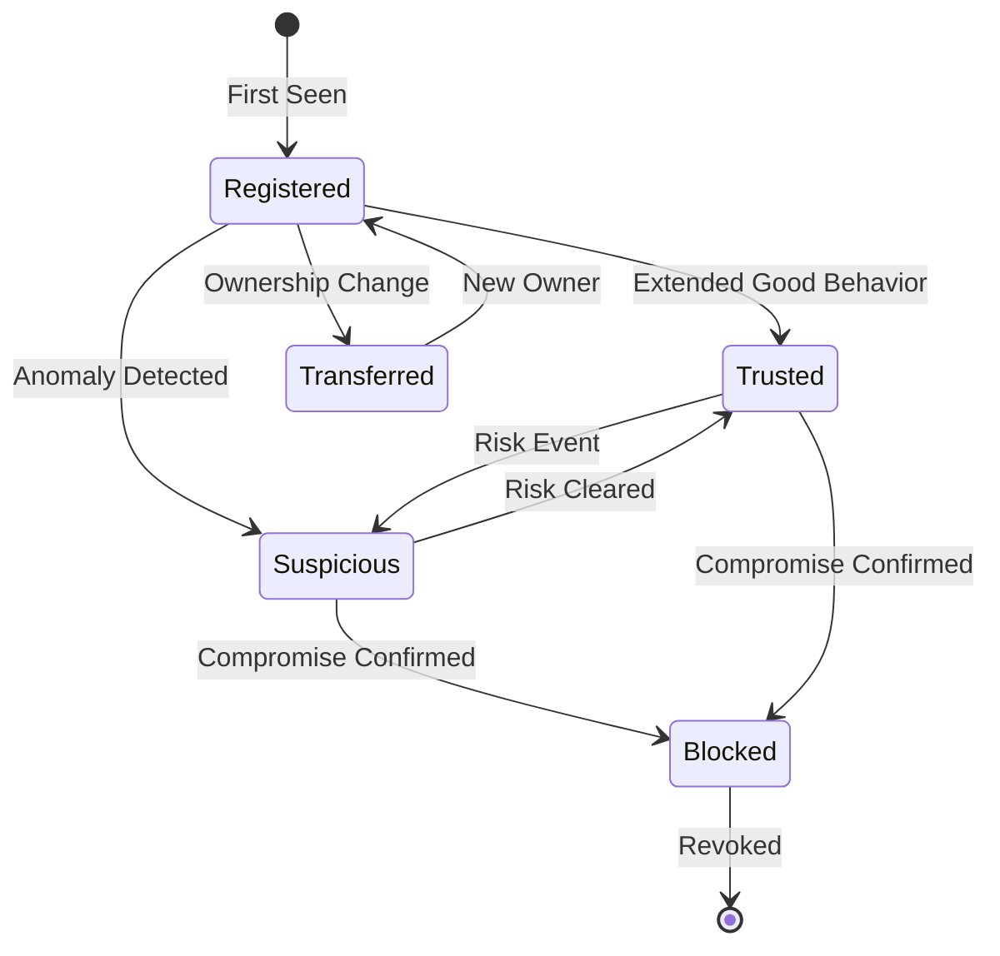
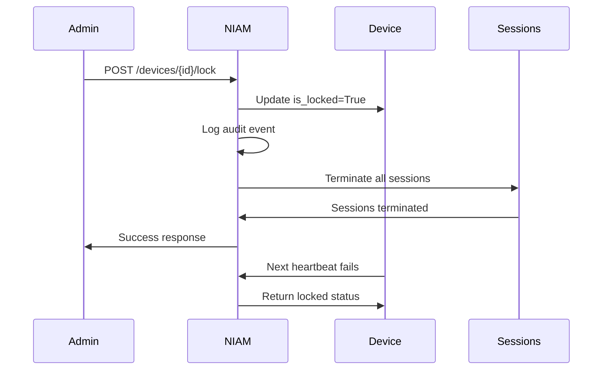

# NIAM — Device Trust

## Overview

The Device Trust framework manages device identity, reputation scoring, attestation, and lifecycle for all devices interacting with the GULA platform. It covers user devices (phones, workstations), IoT devices, lab instruments, and AI/robot identities.

---

## Device Model

Captures comprehensive device profile:

| Field | Description |
|-------|-------------|
| `device_id` | Unique device identifier |
| `device_fingerprint` | Browser/device fingerprint (unique) |
| `device_type` | mobile/desktop/tablet/iot/server |
| `manufacturer`, `model` | Hardware identifiers |
| `os`, `os_version`, `browser`, `browser_version` | Software profile |
| `public_key` | FIDO2/WebAuthn public key |
| `trusted`, `trusted_at` | Trust lifecycle |
| `first_seen_at`, `last_seen_at` | Activity timeline |
| `is_locked` | Remote device lock |

---

## Trust & Risk Scoring

### Device Risk Score Factors

| Factor | Weight | Description |
|--------|--------|-------------|
| Device Age | 10% | Newer devices = higher trust |
| Location Consistency | 20% | Frequent location changes = higher risk |
| Failed Auth Attempts | 25% | Multiple failed logins from device |
| Fingerprint Uniqueness | 15% | Shared fingerprints = suspicious |
| Software Version | 10% | Outdated software = higher risk |
| Known Vulnerabilities | 20% | CVE database cross-reference |

### Trust Levels

| Level | Score | Action |
|-------|-------|--------|
| Trusted | 80-100 | Full access, no MFA prompt |
| Known | 50-79 | Standard access, step-up on sensitive |
| Suspicious | 20-49 | Additional verification required |
| Untrusted | 0-19 | Block or enforce MFA |

---

## Device Lifecycle

---

## Device Operations

### Device Revocation
Revoke a device when compromised or lost. All sessions from that device are terminated. Device is moved to `is_locked = True`.

### Remote Logout
Administrators can remotely log out all sessions associated with a device. Triggers notification to the device owner.

### Device Transfer
Transfer device ownership from one person to another. Maintains device fingerprint but updates owner and resets trust score.

### Lost Device
Mark device as lost → remote lock → remote wipe of local session data → alert on next access attempt.

### Compromised Device
Immediate revocation of all credentials, termination of active sessions, audit alert, and notification to security team.

---

## Device Attestation

For trusted platforms, NIAM supports device attestation:
- **TPM attestation**: Hardware-backed identity verification
- **Android SafetyNet**: Google Play Integrity check
- **iOS DeviceCheck**: Apple device attestation
- **WebAuthn attestation**: FIDO2 authenticator metadata

---

## IoT & Machine Trust

### Analyzer Trust (Lab Instruments)
Laboratory instruments have their own device identity:
- Serial number binding
- Certificate-based authentication
- Heartbeat monitoring
- Calibration status tracking
- Data integrity verification

### Robot Identity
Autonomous robots (transport, cleaning, telepresence):
- Machine identity with certificate
- Operational area permissions
- Remote shutdown capability
- Activity audit trail

### AI Identity
AI agents and assistants:
- API key or certificate authentication
- Defined scope of operations
- Rate limiting and resource quotas
- Audit trail for all AI actions

---

## Remote Lock & Logout

---

## Database Tables

| Table | Purpose |
|-------|---------|
| `niam_devices` | Device registry |
