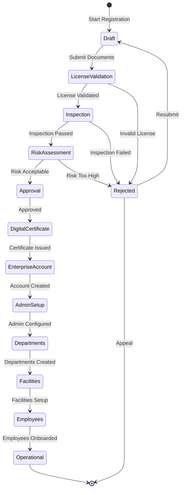

# NIAM — Enterprise Lifecycle

## Overview

The Enterprise Lifecycle governs the complete registration and operational management of organizations within the GULA ecosystem. From initial registration through operational status, every step is tracked, verified, and audited.

---

## Enterprise Registration State Machine

### Step Tracking

Each registration step is recorded in `EnterpriseRegistrationStep`:
- `step_name`, `status` (pending/in_progress/completed/failed)
- `started_at`, `completed_at`, `performed_by`
- `notes`, `output` (JSON step-specific data)

---

## Registration Phases

### Phase 1: License Validation
- Organization submits license document
- System validates license number against issuing authority
- Validated by authorized inspector
- Status: `pending` → `license_validated`

### Phase 2: Inspection
- Physical or remote inspection of facilities
- Inspection report recorded in JSON
- Status: `inspection_pending` → `inspected`

### Phase 3: Risk Assessment
- Automated + manual risk scoring (0-1000)
- Factors: org type, location, license validity, history
- Risk score determines approval conditions
- Status: `risk_assessment_pending` → `risk_assessed`

### Phase 4: Approval & Certification
- Multi-level approval workflow
- Digital certificate issued upon approval
- Enterprise account created automatically
- Status: `approved` → `certificate_issued` → `account_created`

### Phase 5: Operational Setup
- Admin account configured
- Departments created
- Facilities added
- Employees onboarded
- Final status: `operational`

---

## Enterprise Registration Model

`EnterpriseRegistration` tracks:
- `reg_id`, `organization_id`
- Full status state machine
- `license_document`, `license_validated_at`
- `inspection_report` (JSON)
- `risk_assessment`, `risk_score`
- `approved_by`, `approved_at`
- `certificate_id`
- `rejection_reason`

---

## Post-Registration

Once operational, organizations manage through the Enterprise Portal:
- Branches and facilities
- Departments and units
- Subscriptions and billing
- FHIR connections
- API keys and certificates
- Audit log access

See [ADMIN module] for portal management details.

---

## Enterprise Registration Steps Table

| Table | Purpose |
|-------|---------|
| `niam_lifecycle_enterprise_reg` | Main enterprise registration |
| `niam_lifecycle_enterprise_steps` | Per-step tracking |
