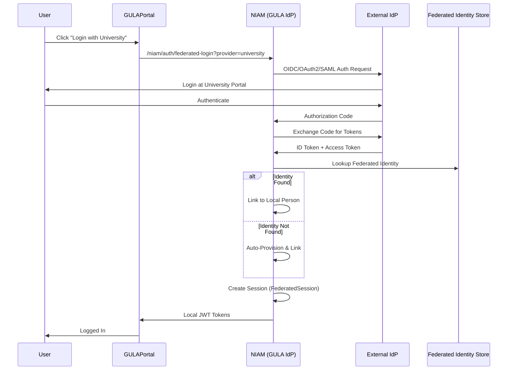
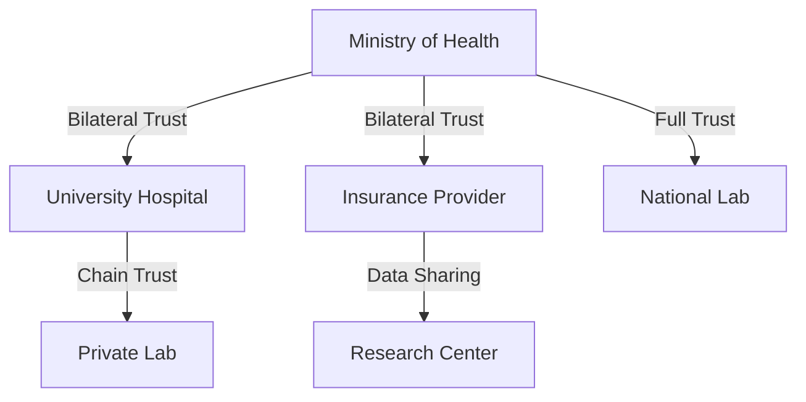

# NIAM — Federation

## Overview

NIAM supports federated identity across multiple identity providers using OAuth2, OpenID Connect, and SAML 2.0 protocols. Organizations can establish cross-org trust relationships, link identities, and enable federated single sign-on across the GULA ecosystem.

---

## Federated Login Flow

---

## Federation Provider Types

| Provider Type | Protocol | Use Case |
|---------------|----------|----------|
| `oidc` | OpenID Connect | Modern web/mobile apps |
| `oauth2` | OAuth 2.0 | API access delegation |
| `saml` | SAML 2.0 | Enterprise/government integration |
| `gula` | GULA Native | Internal GULA subsystem trust |

Supported external providers:
- Government Identity Provider (Civil Registry)
- University Identity (academic institutions)
- Insurance Identity (health insurance companies)
- Hospital Identity (private hospital SSO)
- National ID Gateway (civil affairs)

---

## Federated Provider Model (`FederatedProvider`)

| Field | Description |
|-------|-------------|
| `provider_id` | Unique provider identifier |
| `provider_type` | oauth2/oidc/saml/gula |
| `issuer_url` | Provider issuer URL (unique) |
| `authorization_endpoint` | OAuth2 auth endpoint |
| `token_endpoint` | Token exchange endpoint |
| `jwks_uri` | JWKS key set URI |
| `userinfo_endpoint` | UserInfo endpoint |
| `client_id` / `client_secret_encrypted` | Client credentials |
| `scopes` | Requested scopes |
| `redirect_uris` | Allowed redirect URIs |
| `certificate` | TLS/client certificate |
| `trust_anchor_id` | Trust anchor reference |
| `metadata_url` | SAML metadata URL |

---

## Identity Linking

The `FederatedIdentity` model maps external subjects to local persons:

- `person_id` → Local Person
- `identity_id` → Local Identity (optional)
- `provider_id` → External IdP
- `external_subject_id` → Subject ID at IdP
- `external_attributes` (JSON) → Claims from IdP
- `linked_at`, `last_login_at`
- `unlinked_at` / `unlink_reason` → for delinking

### Identity Linking across Organizations

`IdentityLink` enables cross-organizational identity mapping:
- `source_org_id` → `target_org_id`
- `link_type` (cross_org/federation)
- `external_person_id` / `external_identity_id`
- `verified_at` / `verified_by`

---

## Federated Sessions (`FederatedSession`)

Tracks federated authentication sessions:
- `account_id`, `provider_id`, `fed_identity_id`
- `id_token`, `access_token_hash`, `refresh_token_hash`
- `token_type`, `scope`
- `session_attributes` (JSON extras)
- `started_at`, `expires_at`, `terminated_at`

---

## Cross-Organization Trust (`CrossOrganizationTrust`)

Trust types: `direct`, `bilateral`, `chain`, `web_of_trust`.

Each trust relationship defines:
- `trust_level`: `full` / `limited` / `restricted`
- `attribute_sharing_agreement`
- `permission_mapping`
- `role_mapping`
- `expires_at`, `last_reviewed`

---

## Federation Agreements (`FederationAgreement`)

Legal and technical agreements governing federation:
- `parties` (JSON array of org IDs)
- `agreement_type`: `data_sharing` / `federation` / `interoperability`
- `scope`, `terms`, `security_requirements`
- `signed_by` (JSON), `signed_at`
- `effective_date`, `expiry_date`
- `governing_law`

Supports full lifecycle: `draft` → `active` → `expired`.

---

## Database Tables

| Table | Purpose |
|-------|---------|
| `niam_fed_providers` | External identity providers |
| `niam_fed_identities` | Federated identity mappings |
| `niam_fed_links` | Cross-org identity links |
| `niam_fed_sessions` | Federated login sessions |
| `niam_fed_cross_org_trust` | Cross-org trust relationships |
| `niam_fed_agreements` | Federation agreements |
