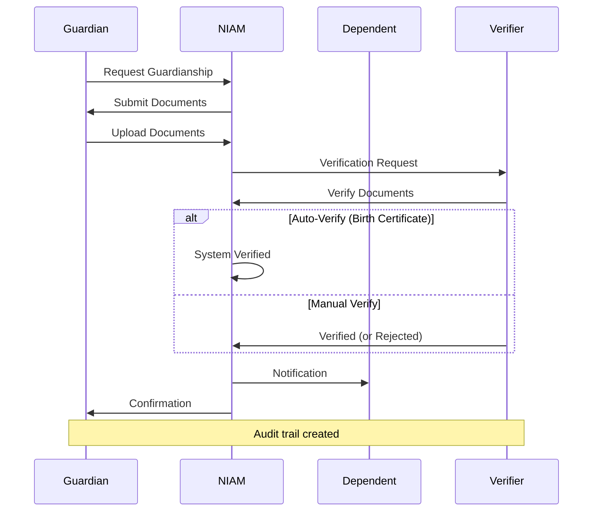

# NIAM — Guardian Accounts

## Overview

Guardian accounts enable authorized individuals to manage identity-related actions on behalf of others. This covers parents managing children's health records, legal guardians for incapacitated persons, caregivers for elderly dependents, and delegated access within family units.

---

## Relationship Types

| Relationship | Type | Description |
|-------------|------|-------------|
| Parent | `parent` | Biological or legal parent of a minor |
| Child | `child` | Minor or adult child of a parent |
| Legal Guardian | `legal_guardian` | Court-appointed legal guardian |
| Dependent | `dependent` | Person under guardianship (elderly, disabled) |
| Caregiver | `caregiver` | Authorized healthcare provider or family caregiver |
| Spouse | `spouse` | Married partner with delegated access |
| Sibling | `sibling` | Brother/sister with healthcare proxy |
| Emergency Contact | `emergency_contact` | Authorized for emergency decisions only |

---

## Guardian Account Model (`GuardianAccount`)

| Field | Description |
|-------|-------------|
| `guardian_id` | Unique relationship identifier |
| `guardian_person_id` | The guardian |
| `dependent_person_id` | The person under guardianship |
| `relationship` | Type of relationship |
| `guardian_type` | legal_guardian / caregiver / parent / court_appointed |
| `start_date` | When guardianship begins |
| `end_date` | When guardianship ends (optional) |
| `delegated_access` | JSON: scopes of delegated authority |
| `consent_inheritance` | Inherit consent decisions from guardian |
| `status` | active / suspended / expired / revoked |
| `verified_by` | Who verified the relationship |
| `verified_at` | Verification timestamp |
| `documents` | JSON: supporting legal documents |

---

## Verification Workflow



---

## Access Delegation Model

Delegated access is defined per guardian relationship as a JSON scope:

```json
{
  "health_records": {
    "view": true,
    "update": false,
    "share": false
  },
  "appointments": {
    "book": true,
    "cancel": true
  },
  "consent": {
    "grant": true,
    "revoke": false
  },
  "prescriptions": {
    "refill": true
  },
  "emergency": {
    "decide": true
  }
}
```

---

## Consent Inheritance

When `consent_inheritance = true`, the guardian's consent decisions propagate to the dependent:
- Guardian grants consent for treatment → dependent is also consented
- Guardian revokes consent → dependent's consent is also revoked
- Inheritance chain is tracked in `consent_records`
- Overridable by dependent when they reach legal age
- Audit logged for every inherited consent action

---

## Family Portal

The family portal provides:
- View all family members and relationships
- Manage delegated access settings
- View consent inheritance chain
- Upload verification documents
- Emergency contact management
- Activity audit for all guardians

---

## Family Links (`FamilyLink`)

Lightweight family relationships (non-guardian):
- `person_id` ↔ `relative_person_id`
- `relationship` (parent/child/sibling/spouse)
- `emergency_contact` boolean flag
- `consent_sharing` boolean flag

---

## Consent Records (`ConsentRecord`)

Tracks consent for healthcare and data sharing:
- `consent_type`: `treatment` / `data_sharing` / `research` / `emergency`
- `granted_to`: Organization or person
- `scope`: JSON definition
- `expires_at`: Optional consent expiry
- Supports revoke and expire

---

## Use Cases

| Scenario | Guardian | Dependent | Mechanism |
|----------|----------|-----------|-----------|
| Child healthcare | Parent | Minor | Parent guardian |
| Elderly care | Adult child | Elderly parent | Legal guardian |
| Emergency proxy | Spouse | Married partner | Emergency consent |
| Disability care | Court guardian | Disabled adult | Court-appointed guardian |
| Temporary care | Caregiver | Patient | Caregiver delegation |
| Family sharing | Any member | Any member | Family link |

---

## Database Tables

| Table | Purpose |
|-------|---------|
| `niam_lifecycle_guardians` | Guardian-dependant relationships |
| `niam_lifecycle_family_links` | Family relationship links |
| `niam_lifecycle_consents` | Consent records |
