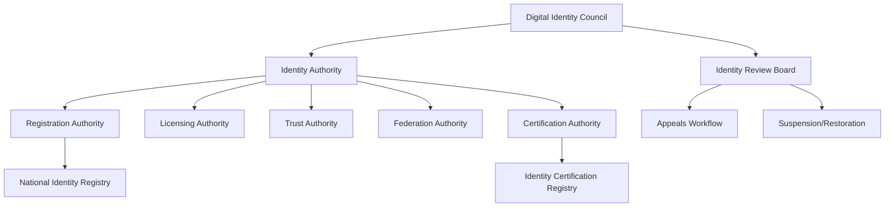
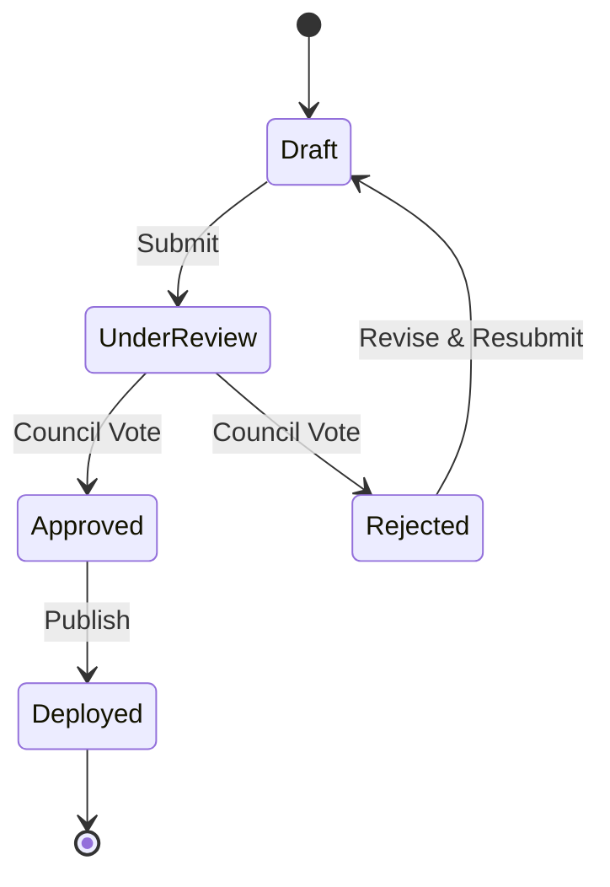
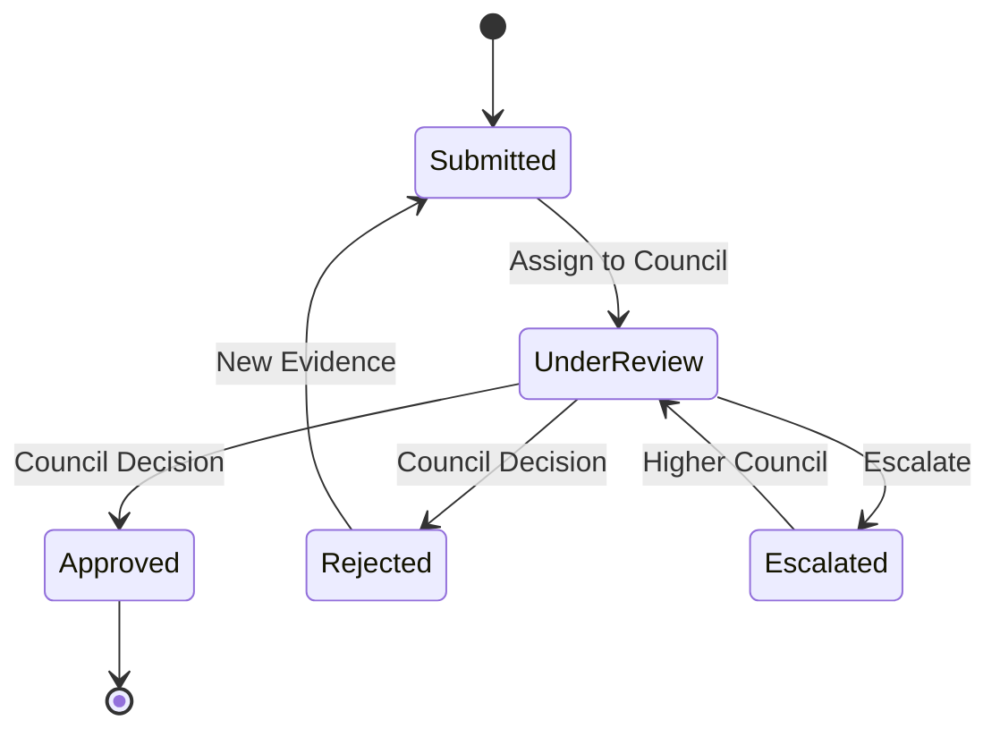
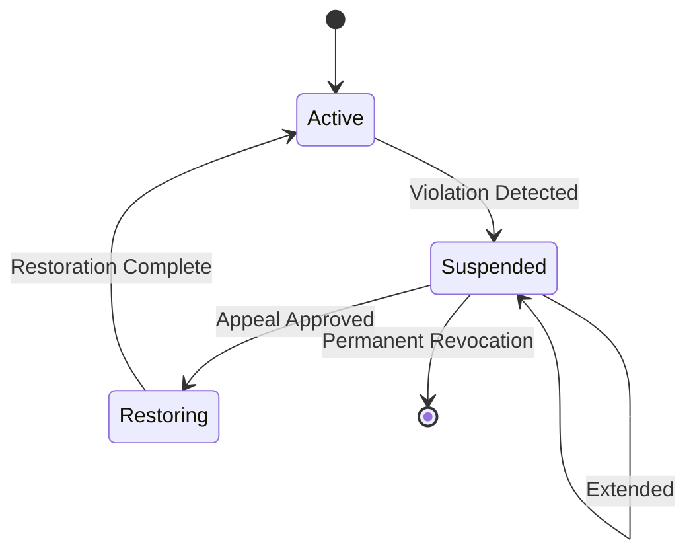

# NIAM — Identity Governance Framework

## Overview

The Identity Governance Framework establishes the sovereign authority structure, policy lifecycle, and dispute resolution mechanisms for the National Identity & Access Management Platform. It defines who sets policy, who certifies identities, and how identity decisions are appealed.

---

## Authority Hierarchy

### Authority Types

| Authority | Type Value | Responsible For |
|-----------|-----------|-----------------|
| Identity Authority | `identity_authority` | Top-level governance, policy ratification |
| Registration Authority | `registration_authority` | National Identity Registry maintenance |
| Licensing Authority | `licensing_authority` | Professional license validation |
| Trust Authority | `trust_authority` | Trust framework management, assurance levels |
| Federation Authority | `federation_authority` | Cross-org federation agreements |
| Certification Authority | `certification_authority` | Digital identity certification |
| Audit Authority | `audit_authority` | Compliance monitoring and audit |

Each authority tracks: `authority_id`, `name_en`, `name_ar`, `jurisdiction`, `parent_authority_id`, `contact_email`, `established_date`, `accredited_by`, `accreditation_expires`, `status` (active/suspended).

---

## Digital Identity Council

The highest governance body. Responsible for:
- Ratifying identity policies
- Appointing authority chairs
- Overseeing the Identity Review Board
- Approving trust framework changes

Fields: `council_id`, `council_type` (governance/technical/advisory), `chairperson_id`, `members` (JSON), `meeting_frequency`, `last_meeting`, `next_meeting`.

---

## Identity Review Board

Handles dispute resolution. Has configurable `quorum_size`, `case_load` tracking, and `meeting_schedule`.

Board types: `appeals`, `disciplinary`, `technical_review`, `accreditation`.

---

## Policy Approval Workflow

States: `draft` → `review` → `approved` → `deployed` (or `rejected`).

Each policy approval tracks: `policy_id`, `submitted_by`, `submitted_at`, `reviewers`, `review_comments`, `approved_by`, `approved_at`, `version`. Supports revision cycles via `rejection_reason`.

---

## Appeals Workflow

Each appeal captures: `appeal_id`, `appellant_person_id`, `identity_id`, `appeal_type` (suspension/rejection/revocation), `reason`, `supporting_documents`, `assigned_to`, `council_id`, `decision`, `decision_by`, `decision_at`.

---

## Suspension/Restoration Workflow

### Suspension
Severity levels: `low`, `medium`, `high`, `critical`. Duration can be time-bound (`duration_hours`, `expires_at`). Automatic expiration via `expire_suspensions()` batch job.

### Restoration
Tracks: `restoration_type` (automatic/manual), `post_restoration_actions`, `requested_by` → `reviewed_by` → `approved_by`. Statuses: `requested` → `approved` → `completed`.

---

## National Identity Registry

Central registry of all national identities. Each entry includes:
- `registration_number` (unique, auto-generated)
- `registry_type` (citizen/foreigner/visitor/newborn)
- `verified_at`, `verified_by`
- `data_quality_score`
- `last_verified` (periodic re-verification)

---

## Identity Certification Registry

Certification of identities by authorized authorities:
- `certification_number` (unique)
- `certifying_authority_id`
- `certification_type`
- `digital_signature` (for non-repudiation)
- `verification_method` (in_person/remote/video/federation)

Supports revocation with `revocation_reason`.

---

## Database Tables

| Table | Purpose |
|-------|---------|
| `niam_gov_authorities` | Identity authorities |
| `niam_gov_councils` | Digital Identity Councils |
| `niam_gov_policy_approvals` | Policy approval workflows |
| `niam_gov_appeals` | Identity appeals |
| `niam_gov_suspensions` | Identity suspensions |
| `niam_gov_restorations` | Identity restoration requests |
| `niam_gov_registry` | National Identity Registry |
| `niam_gov_certifications` | Identity Certification Registry |
| `niam_gov_review_boards` | Identity Review Boards |

All tables use ULID primary keys, soft-delete support, and are governed by `IdentityBaseEntity`.
