# NIAM — Identity Lifecycle

## Overview

The identity lifecycle in NIAM follows a structured progression from person creation through identity verification to account activation, employment, assignment, and eventual deactivation. Each stage is audited.

---

## Lifecycle Flow Diagram

```mermaid
graph LR
    subgraph "Phase 1: Foundation"
        A[Person Created] --> B[Identity Issued]
    end
    subgraph "Phase 2: Verification"
        B --> C[Identity Verified]
        C --> D[Account Created]
    end
    subgraph "Phase 3: Activation"
        D --> E[Email/Phone Verified]
        E --> F[MFA Setup]
        F --> G[Account Active]
    end
    subgraph "Phase 4: Employment"
        G --> H[Employment Created]
        H --> I[Assignment Created]
        I --> J[Role Access Granted]
    end
    subgraph "Phase 5: Session"
        J --> K[Login]
        K --> L[Session Established]
        L --> M[Access Granted]
    end
    subgraph "Phase 6: Termination"
        M --> N[Session Expires/Logout]
        N --> O[Assignment Revoked]
        O --> P[Employment Terminated]
        P --> Q[Account Deactivated]
        Q --> R[Identity Revoked]
    end
```



---

## Phase 1: Foundation

### 1. Person Creation

A Person is the foundational record. Created when an individual is registered in the system.

**Triggers:**
- Citizen self-registration
- Government HR onboarding
- Private sector HR onboarding
- National ID database import
- SNDHS data synchronization

**Process:**
1. Capture biographical data (name, gender, birth date, nationality)
2. Hash and store National ID as `national_id_hash` (HMAC-SHA256, never plaintext)
3. Generate `uuid` (stable, permanent identifier)
4. Create `Person` record in `niam_persons` table
5. Audit: `person_created`

```python
# Example: service call
person = await person_service.create_person(
    given_name="Ali",
    family_name="Al-Mansour",
    full_name_ar="علي المنصور",
    gender="male",
    birth_date=date(1985, 3, 15),
    nationality="IRQ",
    phone="+9647701234567",
    national_id_hash=hmac_sha256("1234567890"),
)
```

### 2. Identity Issuance

An Identity record represents verifiable claims about a person in a specific context.

**Identity Types:**
- `citizen` — general population identity
- `government_workforce` — government employee
- `private_workforce` — private sector healthcare worker
- `enterprise` — organization-level identity
- `machine` — non-human system identity
- `temporary` — short-term visitor
- `guest` — external guest/auditor
- `external_federation` — federated identity

**Process:**
1. Link to existing Person record
2. Set identity type (e.g., `government_workforce`)
3. Set issuing organization (e.g., Ministry of Health)
4. Set issued date and optional expiry
5. Create `IdentityRecord` in `niam_identities` table
6. Audit: `identity_created`

---

## Phase 2: Verification

### 3. Identity Verification

Identity must be verified before an account can be activated.

**Verification Methods:**
- `in_person` — physical document verification
- `nid_check` — National ID database verification
- `biometric` — fingerprint/facial recognition
- `federation` — trusted external identity provider
- `otp` — phone/email OTP
- `video_call` — remote verification

**Process:**
1. Record verification timestamp (`verified_at`)
2. Record who verified (`verified_by`)
3. Record method (`verification_method`)
4. Identity status remains active
5. Audit: `identity_verified`

```python
identity = await identity_service.verify_identity(
    identity_id=identity.id,
    verified_by="verification_officer_uuid",
    verification_method="in_person",
)
```

### 4. Account Creation

An Account is the authentication principal tied to the verified identity.

**Process:**
1. Link to verified `IdentityRecord`
2. Set email, phone, or username as login identifier
3. Hash password with bcrypt via `app.security.auth.hash_password()`
4. Set `password_expires_at` to 90 days from now
5. Account status: `pending_verification`
6. Audit: `account_created`

---

## Phase 3: Activation

### 5. Email/Phone Verification

- Email verified via confirmation link
- Phone verified via OTP
- Set `email_verified=True` or `phone_verified=True`

### 6. MFA Setup

- User enables MFA via authenticator app (TOTP)
- MFA secret stored in `mfa_secret` (encrypted)
- MFA methods recorded in `mfa_methods` (comma-separated)
- Setting `mfa_enabled=True`
- Audit: `account_mfa_enabled`

### 7. Account Active

- All verification flags set to True
- Status transitions from `pending_verification` to `active`
- `activated_at` timestamp recorded
- Account ready for login

---

## Phase 4: Employment & Assignment

### 8. Employment Creation

An Employment represents "Person X works at Organization Y."

**Process:**
1. Link person and organization
2. Set employment type (full_time, part_time, contractor)
3. Set position, department, title
4. Set start date
5. Mark as primary if this is the person's main job
6. Audit: `employment_created`

**Multi-Employment:** A person can have multiple concurrent employments. Each has its own status, start/end dates, and supervisor.

### 9. Assignment Creation

An Assignment represents "Person X holds Role Y at Organization Z/Facility F/Department D."

**Process:**
1. Link to employment (optional)
2. Link to person and organization
3. Set `role_id` (the RBAC role, e.g., "lab_director", "pharmacist")
4. Set scope (facility, department, unit, committee, task_force)
5. Set time boundaries
6. Mark special types: temporary, emergency, delegated
7. Audit: `assignment_created`

### 10. Role Access Granted

- Authorization service can now find this assignment
- `has_permission(person_id, permission)` returns True if any active assignment grants it
- User can access protected resources according to their assigned roles

---

## Phase 5: Session

### 11. Login → Session

See [AUTHENTICATION_FLOW.md](./AUTHENTICATION_FLOW.md) for full details.

1. User provides credentials (email + password)
2. AccountService.authenticate() validates
3. AuthenticationService._create_session() generates JWT + creates UserSession
4. Access token (15 min) and refresh token (7 days) returned
5. Audit: `session_started`

---

## Phase 6: Termination

### 12. Session Expiry/Logout

- Session expires after 7 days
- User can explicitly logout
- Admin can terminate sessions
- All sessions can be terminated at once
- Audit: `session_terminated`

### 13. Assignment Revocation

- Assignment status set to `cancelled` or `completed`
- `is_active` set to False
- Role access removed
- Audit: `assignment_revoked`

### 14. Employment Termination

- Employment status set to `terminated` or `retired`
- Termination reason recorded
- End date set
- Transfer support: employment can be transferred to another organization
- Audit: `employment_terminated`

### 15. Account Deactivation

- Account status set to `deactivated`
- Deactivation reason recorded
- `deactivated_at` timestamp set
- All active sessions terminated
- Person cannot log in
- Audit: `account_locked` (or similar)

### 16. Identity Revocation

- Identity `is_active` set to False
- Identity no longer valid
- Person record remains for historical integrity
- Audit: `identity_revoked`

---

## Deactivation Flows

### Voluntary Deactivation

```
User requests deactivation
  → Verify identity (re-authenticate)
  → Deactivate account
  → Terminate all sessions
  → Record reason: "user_requested"
  → Audit
```

### Administrative Deactivation

```
Admin initiates deactivation
  → Authorize (admin role check)
  → Deactivate account
  → Terminate all sessions
  → Record reason and admin ID
  → Audit
```

### Automatic Deactivation

```
System detects condition
  → Password expiry (90 days) → Warn → Lock
  → Account lockout (5 failures) → Auto-lock for 30 min
  → Identity expiry → Auto-deactivate
  → Employment end date reached → Auto-deactivate assignments
  → Audit
```

### Emergency Deactivation (Break Glass)

```
Emergency deactivation
  → Bypasses normal authorization
  → Requires explicit break-glass reason
  → Immediate session termination
  → Immediate account lock
  → Audit with priority flag
  → Notifies security team
```

---

## State Machine Summary

```
Person: active → deactivated → (restore → active)
Identity: active → suspended → revoked
Account: pending_verification → active → locked/suspended/deactivated
Employment: active → on_leave → terminated/retired/transferred
Assignment: active → completed/cancelled/expired
Session: active → terminated (by user, timeout, admin, security)
```

## Audit Events Per Lifecycle Stage

| Stage | Audit Action |
|---|---|
| Person Created | `person_created` |
| Person Updated | `person_updated` |
| Person Deactivated | `person_deactivated` |
| Identity Created | `identity_created` |
| Identity Verified | `identity_verified` |
| Identity Revoked | `identity_revoked` |
| Account Created | `account_created` |
| Account Locked | `account_locked` |
| Account Unlocked | `account_unlocked` |
| Password Changed | `account_password_changed` |
| MFA Enabled | `account_mfa_enabled` |
| MFA Disabled | `account_mfa_disabled` |
| Employment Created | `employment_created` |
| Employment Terminated | `employment_terminated` |
| Assignment Created | `assignment_created` |
| Assignment Revoked | `assignment_revoked` |
| Session Started | `session_started` |
| Session Terminated | `session_terminated` |
