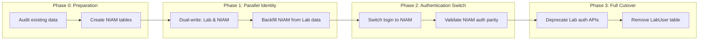

# NIAM — Migration Guide

## Overview

This guide describes how NIAM replaces the old bootstrap identity system (`Lab`/`LabUser` models) and the phased migration approach to transition from the old system to NIAM without breaking existing functionality.

---

## What NIAM Replaces

| Old System | NIAM Replacement | Tables |
|---|---|---|
| `Lab` (flat org) | `NIAMOrganization` (hierarchical org) | `labs` → `niam_organizations` |
| `LabUser` (per-lab user) | `Person` + `IdentityRecord` + `Account` + `Employment` + `Assignment` | `lab_users` → multiple NIAM tables |
| `Lab` user authentication | `Account` + `UserSession` + JWT | Auth flow fully replaced |
| `LabUser.role` column | `Assignment.role_id` (with org/dept scope) | Role is now an assignment |
| `LabUser.password_hash` | `Account.password_hash` (bcrypt, same algorithm) | Password moved to Account |
| Flat permissions | RBAC + ABAC + Policy Engine | Assignment-based access |
| No session tracking | `UserSession` with JTI, device, location | Full session lifecycle |
| No audit | `IdentityAuditEntry` (38 action types) | Complete audit trail |

---

## Migration Phases



---

## Phase 0: Preparation

### Step 1: Database Migration

Create all `niam_*` tables via Alembic migration:

```bash
cd backend && alembic revision --autogenerate -m "create_niam_tables"
alembic upgrade head
```

Required tables: `niam_persons`, `niam_identities`, `niam_accounts`, `niam_organizations`, `niam_employments`, `niam_assignments`, `niam_licenses`, `niam_credentials`, `niam_sessions`, `niam_devices`, `niam_machine_identities`, `niam_policies`, `niam_enterprise_accounts`, `niam_audit_entries`.

### Step 2: Seed Ministry Organization Tree

Seed the top-level organization hierarchy (Ministry of Health → Directorates):

```python
# bootstrap/seed.py - Ministry organization tree
moh = NIAMOrganization(
    org_id="MOH-IRQ",
    name_en="Ministry of Health",
    name_ar="وزارة الصحة",
    org_type="ministry",
)
# ... seed directorates, hospitals, labs
```

### Step 3: Data Audit

Before migration, audit existing `Lab` and `LabUser` data:

| Check | Action |
|---|---|
| Duplicate emails in lab_users | Deduplicate before migration |
| Labs without users | Create placeholder admin |
| Lab type mapping | Map `lab_type` → `NIAMOrganization.org_type` |
| User role mapping | Map `role` → Assignment.role_id |

### Type Mapping

| Old `lab_type` | New `org_type` |
|---|---|
| `government` | `government_laboratory` |
| `private` | `private_laboratory` |
| `hospital` | `government_hospital` (or `private_hospital`) |
| `clinic` | `health_center` |

### Role Mapping

| Old `role` | New `role_id` | Notes |
|---|---|---|
| `master_admin` | `master_admin` | Global platform admin |
| `admin` | `lab_admin` | Per-org admin |
| `province_admin` | `directorate_admin` | Gov-scoped admin |
| `lab_owner` | `lab_owner` | Org owner |
| `lab_manager` | `lab_manager` | Org manager |
| `technician` | `lab_technician` | Lab technician |
| `doctor` | `clinician` | Medical doctor |
| `accountant` | `accountant` | Financial role |
| `receptionist` | `receptionist` | Front desk |
| `guard` | `security_guard` | Security |

---

## Phase 1: Parallel Identity (Dual-Write)

During this phase, both systems operate simultaneously. All identity operations write to both the old `Lab`/`LabUser` tables AND the new NIAM tables.

### Dual-Write Strategy

```python
# Example: Creating a new user in both systems
async def create_user_dual_write(lab_id, email, password, role, name):
    # 1. Create in old system (backward compatibility)
    lab_user = LabUser(
        lab_id=lab_id,
        name=name,
        email=email,
        password_hash=hash_password(password),
        role=role,
    )
    session.add(lab_user)

    # 2. Create in NIAM
    person = Person(given_name=name, ...)
    session.add(person)

    identity = IdentityRecord(person_id=person.id, identity_type="government_workforce", ...)
    session.add(identity)

    account = Account(
        identity_id=identity.id,
        email=email,
        password_hash=hash_password(password),
        status="active",
    )
    session.add(account)

    # 3. Create employment + assignment
    employment = Employment(person_id=person.id, organization_id=niam_org.id, ...)
    session.add(employment)

    assignment = Assignment(
        employment_id=employment.id,
        person_id=person.id,
        role_id=role,  # Mapped role
        organization_id=niam_org.id,
    )
    session.add(assignment)

    await session.flush()

    # 4. Store mapping (LabUser.id ↔ NIAM IDs)
    mapping = IdentityMapping(
        lab_user_id=lab_user.id,
        person_id=person.id,
        account_id=account.id,
    )
    session.add(mapping)
```

### Identity Mapping Table

A cross-reference table tracks the relationship between old and new identities:

```sql
CREATE TABLE niam_identity_mapping (
    lab_user_id    INTEGER REFERENCES lab_users(id),
    person_id      VARCHAR(26) REFERENCES niam_persons(id),
    account_id     VARCHAR(26) REFERENCES niam_accounts(id),
    created_at     TIMESTAMPTZ DEFAULT NOW()
);
```

### Backfill Process

Backfill existing `Lab`/`LabUser` data into NIAM:

```bash
python scripts/backfill_lab_to_niam.py --dry-run  # Preview changes
python scripts/backfill_lab_to_niam.py             # Execute backfill
```

The backfill script:
1. Iterates all `Lab` records → creates `NIAMOrganization` records
2. Iterates all `LabUser` records → creates `Person` + `IdentityRecord` + `Account` + `Employment` + `Assignment`
3. Creates `IdentityMapping` records
4. Validates data integrity (count parity, email uniqueness)
5. Reports any issues (missing data, duplicates, unmapped roles)

---

## Phase 2: Authentication Switch

### Step 1: Deploy NIAM API

The NIAM API routes are already deployed under `/niam/` prefix. They run in parallel with existing auth routes.

### Step 2: Update Frontend Login

The login flow changes from:

```
Old: POST /auth/login → validate LabUser → JWT with lab_id
New: POST /niam/auth/login → validate Account → JWT with account_uuid
```

Frontend migration:
1. Update login endpoint URL from `/auth/login` to `/niam/auth/login`
2. Handle new response format (account_uuid instead of lab_id)
3. Store session_uuid for logout capabilities

### Step 3: Validate Auth Parity

Run validation to ensure both systems produce equivalent results:

```bash
python scripts/validate_niam_auth_parity.py
```

The validator:
1. For each LabUser, attempt to authenticate with same credentials in NIAM
2. Verify that every old login succeeds in NIAM
3. Report any mismatches (wrong password, missing account, role mismatch)
4. Verify that locked accounts in old system are also locked in NIAM

### Step 4: Proxy Auth Through NIAM

Once parity is validated, update existing auth routes to delegate to NIAM:

```python
# Old /auth/login becomes a thin proxy to NIAM
@router.post("/auth/login")
async def legacy_login(body: LoginRequest):
    # Delegate to NIAM
    result = await niam_login(body.login, body.password)
    if not result:
        raise HTTPException(status_code=401)

    # Map back to old format for backward compatibility
    mapping = await get_mapping_by_account_uuid(result["account_uuid"])
    return {
        "access_token": result["access_token"],
        "lab_id": mapping.lab_id,  # Old format
        "user_id": mapping.lab_user_id,  # Old format
        "role": mapping.role,  # Old format
    }
```

---

## Phase 3: Full Cutover

### Step 1: Deprecate Old APIs

- Add deprecation warnings to old auth APIs
- Document migration timeline for client applications
- Set sunset date for old endpoints

### Step 2: Migrate All Services to NIAM IDs

Replace all `lab_user_id` references with `person_uuid` or `account_uuid`:

| Old Reference | New Reference |
|---|---|
| `current_user.id` | `current_account.uuid` |
| `current_user.lab_id` | `current_employment.organization_id` |
| `current_user.role` | `current_assignment.role_id` |
| `LabUser.name` | `Person.given_name + Person.family_name` |

### Step 3: Remove LabUser Table

After all systems are confirmed working with NIAM:

1. Final data integrity check
2. Archive old tables
3. Drop `lab_users` and `labs` tables (or keep as read-only views)

### Step 4: Clean Up Identity Mapping

Once migration is complete:

1. Remove `IdentityMapping` table
2. Remove dual-write code paths
3. Remove old auth proxy code

---

## Backward Compatibility

### During Phase 1-2

- All old APIs remain functional
- Old JWT tokens continue to work (separate signing key)
- Frontend can authenticate with either system
- No data loss — both systems have full data

### JWT Token Compatibility

Old tokens (signed with old `SECRET_KEY`):
- Continue working for the duration of their TTL
- New tokens use NIAM claims format

Middleware can handle both:

```python
async def get_current_user(token: str = Depends(oauth2_scheme)):
    # Try NIAM first
    payload = decode_niam_token(token)
    if payload:
        return await get_niam_account(payload["account_uuid"])

    # Fall back to legacy
    payload = decode_legacy_token(token)
    if payload:
        mapping = await get_mapping_by_lab_user_id(payload["user_id"])
        return mapping.niam_account

    raise InvalidCredentials()
```

### Organization Compatibility

Old `lab_id` references can be resolved to new organization IDs:

```python
# Resolve lab_id to NIAM organization
def resolve_lab_id(lab_id: int) -> NIAMOrganization:
    return db.query(NIAMOrganization).filter(
        NIAMOrganization.legacy_lab_id == lab_id
    ).first()
```

---

## Migration Validation Checklist

- [ ] All NIAM tables created with correct schema
- [ ] Ministry organization tree seeded
- [ ] All existing labs mapped to NIAMOrganization records
- [ ] All existing LabUsers mapped to Person + Account records
- [ ] Password hashes verified (same bcrypt format)
- [ ] Role mappings validated (all old roles have NIAM equivalents)
- [ ] Login parity test passes for all accounts
- [ ] Session creation + termination verified
- [ ] Audit events recorded for all migration operations
- [ ] Frontend login flow updated
- [ ] Old auth APIs deprecated with warnings
- [ ] Rollback plan documented

---

## Rollback Plan

If issues are detected during migration:

1. **During Phase 1-2**: Keep dual-write active — both systems have complete data
2. **During Phase 3 (auth switch)**: Revert frontend login to old endpoints
3. **Full rollback**: Drop NIAM tables, restore from backup
4. **Data preservation**: No data loss — `IdentityMapping` table provides full traceability

```bash
# Rollback script (if needed)
python scripts/rollback_from_niam.py --phase 2
```

---

## Risk Mitigation

| Risk | Mitigation |
|---|---|
| Password hash mismatch | Verify bcrypt compatibility before migration |
| Email duplicates | Audit and deduplicate before Phase 1 |
| Role mapping gaps | Map all old roles explicitly, fail on unknown |
| API client breakage | Maintain backward-compatible proxy during Phases 1-2 |
| Data loss during cutover | Keep old tables as archive for 90 days |
| Performance impact | NIAM queries are indexed; no cross-table joins with old system |
