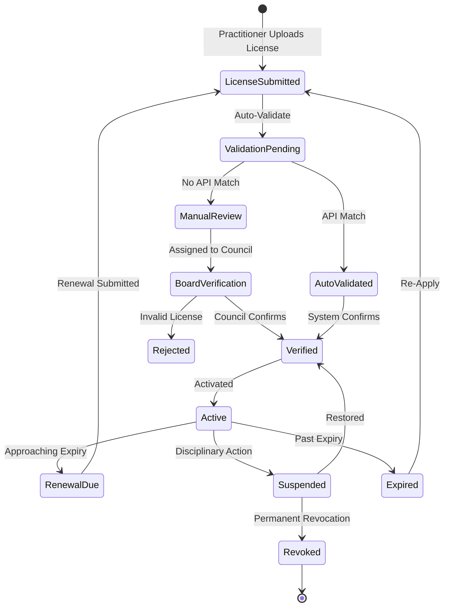

# NIAM — Professional Licenses

## Overview

Professional license management automatically validates healthcare practitioner licenses against issuing authorities. Supports medical, laboratory, pharmacy, dental, nursing, and engineering councils, as well as academic verification and continuing education tracking.

---

## Professional Licensing Workflow

---

## License Types & Authorities

| License Type | Issuing Authority | Auto-Validation Method |
|-------------|-------------------|----------------------|
| Medical | Medical Council | API / Database match |
| Laboratory | Laboratory Council | API / Database match |
| Pharmacy | Pharmacy Council | API / Database match |
| Dental | Dental Council | API / Database match |
| Nursing | Nursing Council | API / Database match |
| Engineering | Engineering Council | API / Database match |
| Academic Degree | Ministry of Education | Institution verification |

---

## Professional License Model (`ProfessionalLicense`)

From the core models (see `app/identity/models/license.py`):

| Field | Description |
|-------|-------------|
| `license_type` | medical/laboratory/pharmacy/dental/nursing/engineering |
| `license_number` | Issued license number |
| `issuing_authority` | Council or body that issued |
| `issue_date` | Original issue date |
| `expiry_date` | License expiration |
| `board_certification` | Board certification ID |
| `degree_type` / `degree_name` / `degree_institution` | Academic credentials |
| `continuing_education_hours` | CME/CEU tracking |
| `status` | active/suspended/revoked/expired |

---

## Continuing Education

NIAM tracks continuing education requirements:
- `continuing_education_hours` accumulated
- Per-license-type CEU requirements
- Automatic reminders before expiry
- Integration with CME providers
- Audit trail of CEU submissions

---

## License Events

| Event | Trigger | Action |
|-------|---------|--------|
| Validation | Registration / Renewal | Auto-check against council API |
| Approval | Validation passed | Status → active |
| Renewal | 90 days before expiry | Notification + simplified validation |
| Suspension | Council disciplinary | Status → suspended, notify employer |
| Revocation | Permanent council action | Status → revoked, terminate employment |
| Restoration | Appeal approved | Status → active |
| Expiration | Past expiry date | Status → expired, auto-notify |

---

## Database Tables

| Table | Purpose |
|-------|---------|
| `niam_licenses` | Professional license records |
