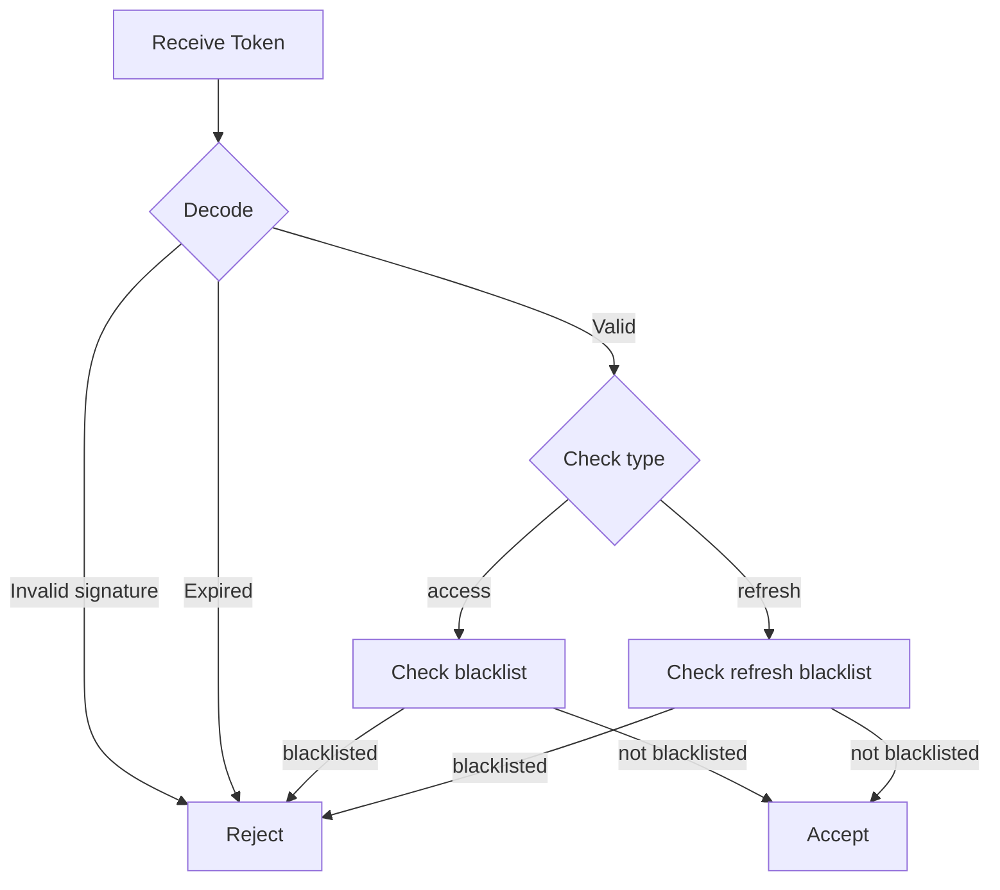

# NIAM — Security Model

## Overview

NIAM implements defense-in-depth security across all layers: credential storage, token management, session lifecycle, account lockout, device trust, and audit trail. All cryptographic operations delegate to the existing `app.security.auth` module for consistency with the rest of the GULA platform.

---

## Password Security

### Hashing

Passwords are hashed using **bcrypt** via `app.security.auth.hash_password()`:

```python
from app.security.auth import hash_password, verify_password

# During account creation
password_hash = hash_password(password)

# During authentication
is_valid = verify_password(password, password_hash)
```

Bcrypt properties:
- Salt is automatically generated per hash
- Cost factor: 12 rounds (configured in shared.auth)
- Output: `$2b$12$...` format (60+ characters)

### Timing-Safe Login

The system uses a pre-computed dummy hash (`_DUMMY_HASH`) to prevent user enumeration through timing attacks:

```python
# In app.security.auth
_DUMMY_HASH = "$2b$12$KOyWdwU2QI3BzsWt.4RGua1dx53C7jHfc8UzpEKylbB5QwaGPJ6G"

# Always verify, even if account not found, to prevent timing attacks
```

### Password Policy

| Policy | Value | Enforcement |
|---|---|---|
| Minimum length | 12 characters | Account creation |
| Expiry | 90 days | Password change on login after expiry |
| History | Not yet enforced | Future enhancement |
| Complexity | Not yet enforced | Future enhancement |

### Password Change

```python
async def change_password(self, account_id, old_password, new_password):
    # Verify old password
    # Hash new password
    # Update password_changed_at
    # Update password_expires_at (now + 90 days)
    # Return success/failure
```

---

## JWT Token Security

### Access Tokens

| Property | Value |
|---|---|
| Algorithm | HS256 (via `JWT_ALGORITHM` config) |
| Signing key | `SECRET_KEY` (from config, minimum 32 chars) |
| Expiry | 15 minutes (`ACCESS_TOKEN_EXPIRE_MINUTES`) |
| Payload | `jti`, `account_uuid`, `identity_id`, `type`, `exp`, `iat` |
| Type claim | `"type": "access"` |

### Refresh Tokens

| Property | Value |
|---|---|
| Algorithm | HS256 |
| Signing key | `REFRESH_TOKEN_SECRET` (separate from access token key) |
| Expiry | 7 days (`REFRESH_TOKEN_EXPIRE_DAYS`) |
| Payload | `jti`, `account_uuid`, `type`, `exp`, `iat` |
| Type claim | `"type": "refresh"` |

### Token Validation



### JTI (JWT ID)

Every token includes a unique `jti` (UUID v4) for:
- Token revocation (via Redis blacklist in `app.security.auth`)
- Session correlation with `UserSession.token_jti`
- Refresh token rotation (old sessions soft-deleted on refresh)

### Token Blacklist

Tokens can be revoked via Redis:

```python
# Revoke token
blacklist_token(jti="...", ttl_seconds=900)

# Check revocation
if is_token_blacklisted(jti):
    return None  # Token is revoked
```

---

## Session Management

### Session Creation

On successful login, a `UserSession` record is created with:
- `token_jti` and `refresh_token_jti` for tracking
- `expires_at` = 7 days from creation
- Client context: `ip_address`, `user_agent`, `device_id`, location

### Session Termination

| Method | Effect |
|---|---|
| User logout | Single session terminated |
| Logout all | All account sessions terminated |
| Session expiry | `is_active=false` after 7 days |
| Password change | Sessions optionally invalidated |
| Account lock | All sessions terminated |
| Admin terminate | Single session terminated by admin |

### Session Tracking

Sessions track:
- Last activity timestamp (for idle timeout)
- IP address and user agent (for anomaly detection)
- Geographic location (for impossible travel detection)
- Risk score (for adaptive authentication)
- MFA usage flag

---

## Account Lockout

### Lockout Flow

```
Failed login → increment counter → counter >= 5 → lock 30 minutes
```

```python
ACCOUNT_LOCKOUT_THRESHOLD = 5
ACCOUNT_LOCKOUT_DURATION_MINUTES = 30

# On failed login
account.failed_login_attempts += 1
if account.failed_login_attempts >= ACCOUNT_LOCKOUT_THRESHOLD:
    account.is_locked = True
    account.locked_until = datetime.now(UTC) + timedelta(
        minutes=ACCOUNT_LOCKOUT_DURATION_MINUTES,
    )
    account.lock_reason = f"Account locked after {ACCOUNT_LOCKOUT_THRESHOLD} failed attempts"
```

### Auto-Unlock

Lock automatically expires after 30 minutes. The `authenticate()` method checks if the lock period has passed and auto-unlocks:

```python
if account.is_locked:
    if account.locked_until and account.locked_until > datetime.now(UTC):
        return None  # Still locked
    # Auto-unlock
    account.is_locked = False
    account.failed_login_attempts = 0
```

### Manual Unlock

Admin can unlock via API: `POST /niam/accounts/{uuid}/unlock`

---

## Password Expiry

Passwords expire after 90 days:

```python
PASSWORD_EXPIRY_DAYS = 90

# On account creation
password_expires_at = datetime.now(UTC) + timedelta(days=PASSWORD_EXPIRY_DAYS)

# On password change
password_expires_at = datetime.now(UTC) + timedelta(days=PASSWORD_EXPIRY_DAYS)
```

Expired password handling (to be implemented in application layer):
1. Allow login but redirect to password change page
2. Require password change before granting access to protected resources
3. Option to send password expiry warning emails (7 days before)

---

## Device Trust

### Device Registration

Devices are identified by a unique `device_fingerprint` derived from browser/device characteristics:

```
device_fingerprint = hash(cpu + gpu + ram + os + display + user_agent + ...)
```

### Trust Levels

| Level | Status | Risk |
|---|---|---|
| Unknown | New device, not trusted | Higher risk, may require MFA |
| Trusted | Explicitly trusted by user or admin | Lower risk, reduced friction |
| Locked | Remotely locked by admin | No access |

### Trust Escalation

```
New device detected
  → Not trusted
  → First successful login with MFA
  → Prompt user: "Trust this device?"
  → If yes: set trusted=True, trusted_at=now
  → Future logins from trusted device: reduced MFA prompts
```

### Device Locking

Admins can remotely lock devices:

```python
device.is_locked = True
# All sessions on this device are invalidated
```

---

## Audit Trail

Every identity-related event is recorded in `niam_audit_entries` with:

- **Who**: `actor_id`, `actor_type` (person, system, machine)
- **What**: `action` (from 38 AuditAction values)
- **When**: `occurred_at` (timestamp)
- **Where**: `ip_address`, `user_agent`, `session_id`
- **Context**: `organization_id`, `changes` (JSON diff)
- **Outcome**: `outcome` (success, failure, denied)

See [AUDIT_MODEL.md](./AUDIT_MODEL.md) for complete details.

---

## Security Constants Summary

| Constant | Value | File | Purpose |
|---|---|---|---|
| `PASSWORD_MIN_LENGTH` | 12 | `account_service.py` | Minimum password length |
| `ACCOUNT_LOCKOUT_THRESHOLD` | 5 | `account_service.py` | Failed attempts before lock |
| `ACCOUNT_LOCKOUT_DURATION_MINUTES` | 30 | `account_service.py` | Lockout duration |
| `PASSWORD_EXPIRY_DAYS` | 90 | `account_service.py` | Password validity |
| `ACCESS_TOKEN_EXPIRE_MINUTES` | 15 | `authentication_service.py` | JWT access token lifetime |
| `REFRESH_TOKEN_EXPIRE_DAYS` | 7 | `authentication_service.py` | JWT refresh token lifetime |
| `SECRET_KEY` | (env var) | `config.py` | Access token signing |
| `REFRESH_TOKEN_SECRET` | (env var) | `config.py` | Refresh token signing |
| `ENCRYPTION_KEY` | (env var) | `config.py` | Field-level encryption |

---

## Security Threats Mitigated

| Threat | Mitigation |
|---|---|
| Password brute force | Account lockout after 5 attempts |
| Credential stuffing | Rate limiting (to be implemented per-app) |
| User enumeration | Timing-safe dummy hash |
| Token theft | Short-lived access tokens + JTI blacklist |
| Session hijacking | Device fingerprint + IP tracking |
| Replay attacks | JWT exp + JTI uniqueness |
| Privilege escalation | Role-based assignment + organization scoping |
| Insider threat | Immutable audit trail + hash chain |
| Data breach (passwords) | bcrypt hashing (no plaintext storage) |
| Data breach (National IDs) | HMAC-SHA256 hash only (no plaintext) |
| Session fixation | New session on every login/refresh |
| Refresh token theft | Refresh token rotation (old soft-deleted) |
