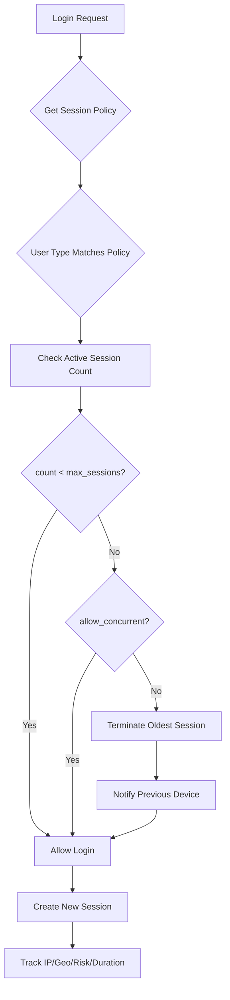

# NIAM — Session Governance

## Overview

Session governance enforces configurable session policies per user type, including single active session enforcement, concurrent session control, geo/IP restrictions, session timeout policies, and automatic cleanup of expired sessions.

---

## Session Policy Model (`SessionPolicy`)

| Field | Description |
|-------|-------------|
| `policy_id` | Unique policy identifier |
| `name` | Human-readable policy name |
| `applies_to` | User type: `citizen` / `government` / `enterprise` / `emergency` / `machine` |
| `max_sessions` | Maximum concurrent sessions (default: 1) |
| `allow_concurrent` | Allow multiple simultaneous sessions |
| `require_mfa` | Require MFA for session creation |
| `session_timeout_minutes` | Absolute session lifetime |
| `inactivity_timeout_minutes` | Idle session timeout |
| `notify_previous_device` | Notify previous device on new login |
| `terminate_previous_on_new_login` | Force terminate old session |
| `enforce_geo_restriction` | Restrict to geographic areas |
| `allowed_geo` | JSON list of allowed geographies |
| `enforce_ip_restriction` | Restrict to IP ranges |
| `allowed_ips` | JSON list of allowed IPs/CIDRs |

---

## Default Session Policies

| User Type | Max Sessions | Concurrent | MFA | Timeout | Previous Termination |
|-----------|-------------|------------|-----|---------|---------------------|
| Citizen | 1 | No | No | 7 days | Yes (notify + terminate) |
| Government Employee | 1 | No | Yes | 8 hours | Yes |
| Enterprise Admin | Configurable (default 3) | Yes | Yes | 24 hours | No |
| Emergency User | Unlimited | Yes | No | 4 hours | No |
| Machine/Service | Configurable | Yes | Cert | 30 days | No |

---

## Session Enforcement Flow

---

## Session Model (`UserSession`)

Each session tracks:
- `token_jti`, `refresh_token_jti` (JWT tracking)
- `session_type`: web / mobile / api
- `ip_address`, `user_agent`, `device_id`
- `location_city`, `location_country`, `location_lat`, `location_lng`
- `started_at`, `last_activity_at`, `expires_at` (7-day TTL by default)
- `terminated_at`, `termination_reason`, `terminated_by`
- `auth_method`, `mfa_used`, `risk_score`

---

## Termination Reasons

| Reason | Description |
|--------|-------------|
| `logout` | User-initiated logout |
| `new_login` | Replaced by new session |
| `expired` | Session TTL expired |
| `inactivity` | Inactivity timeout |
| `admin_terminated` | Administrative termination |
| `security` | Security event (impossible travel, etc.) |
| `device_locked` | Device remote lock triggered |
| `password_change` | Password changed, all sessions invalidated |

---

## Session Cleanup

Automatic cleanup of expired sessions via scheduled job:
- Queries sessions where `expires_at < now()` or `last_activity_at < now() - inactivity_timeout`
- Sets `terminated_at = now()`, `termination_reason = "expired"`
- Logs audit event for each termination
- Configurable batch size and frequency

---

## Adaptive Auth Integration

Session governance integrates with Adaptive Auth (see `niam_adaptive_session_policies`) for:
- Impossible travel detection
- Risk-based step-up authentication
- Real-time session policy evaluation
- Geo-velocity checks

---

## Database Tables

| Table | Purpose |
|-------|---------|
| `niam_user_sessions` | Active/expired user sessions |
| `niam_adaptive_session_policies` | Configurable session policies |
