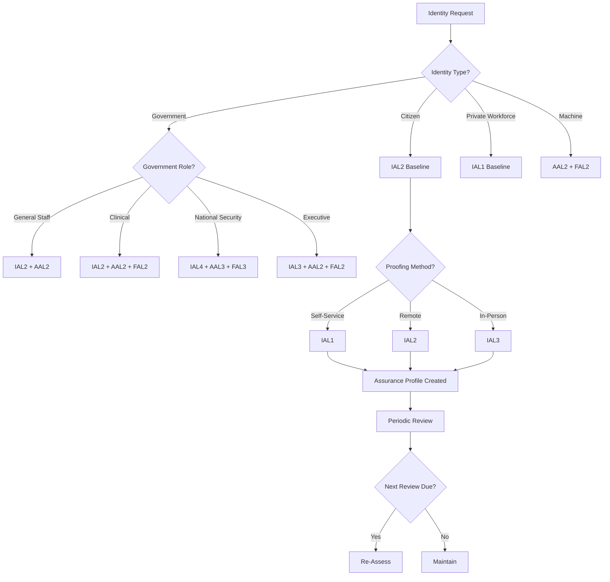
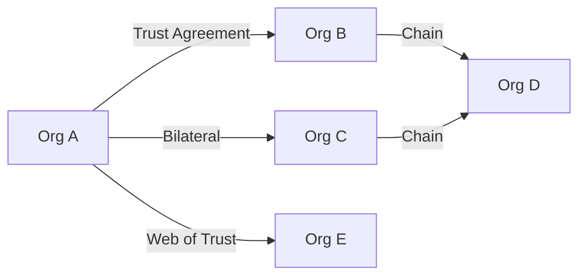

# NIAM — Trust Framework

## Overview

NIAM implements a NIST 800-63-3 compliant trust framework covering Identity Assurance Levels (IAL), Authenticator Assurance Levels (AAL), and Federation Assurance Levels (FAL). The framework manages trust relationships, identity proofing, assurance profiles, and continuous trust evaluation across the entire GULA ecosystem.

---

## Assurance Levels

### Identity Assurance Levels (IAL)

| Level | Definition | Requirements |
|-------|-----------|--------------|
| IAL1 | No identity proofing required | Self-asserted identity, no evidence |
| IAL2 | Identity proofing using remote or in-person verification | Valid government ID, biometric comparison, liveness detection |
| IAL3 | Physical presence identity proofing | In-person with trained operator, biometric capture, document inspection |
| IAL4 | Enhanced identity proofing for national security roles | IAL3 + background check + advanced biometrics + continuous monitoring |

### Authenticator Assurance Levels (AAL)

| Level | Definition | Requirements |
|-------|-----------|--------------|
| AAL1 | Single-factor authentication | Password or PIN |
| AAL2 | Multi-factor authentication | Password + OTP or FIDO2 |
| AAL3 | Phishing-resistant MFA with hardware | FIDO2 security keys or smart cards |

### Federation Assurance Levels (FAL)

| Level | Definition | Requirements |
|-------|-----------|--------------|
| FAL1 | Signed ID token | Bearer token, no audience restriction |
| FAL2 | Signed + encrypted ID token | Audience-bound, pairwise pseudonymous |
| FAL3 | Signed + encrypted + holder-of-key | Proof of possession required |

---

## Assurance Level Assignment Flow



---

## Trust Anchors

NIAM supports hierarchical trust anchor management:

```
Root CA (Self-Signed)
└── Policy CA (Authority-Signed)
    └── Identity CA (Chain)
        ├── Organization Certificates
        ├── Device Certificates
        ├── Machine Certificates
        └── TLS Certificates
```

Each `TrustAnchor` tracks: `anchor_type` (root/intermediate/issuing), `public_key_hash`, `certificate_chain`, `issuer`, `subject`, `valid_from`, `valid_to`, `signed_by`. Supports chain validation via `validate_chain()`.

---

## Identity Proofing

Three proofing methods:

| Method | Suitable For | Evidence Required |
|--------|-------------|-------------------|
| In-Person | IAL3, IAL4 | Physical documents, biometric capture, operator verification |
| Remote | IAL2 | Video call, document upload, liveness detection |
| Self-Service | IAL1 | Self-attestation, no formal evidence |

Proofing records include: `proofing_level`, `method`, `evidence_type`, `evidence_documents`, `verified_by`, `verified_at`, `authority_id`. Supports verify/reject lifecycle.

---

## Federation Trust Model



`FederationTrust` tracks: `trust_type` (direct/bilateral/chain/web_of_trust), `trust_level` (limited/full/restricted), `attribute_sharing_agreement`, `permission_mapping`, `role_mapping`.

---

## Trust Evaluation Scoring

Continuous trust evaluation on a 0-1000 scale:

| Score Range | Rating | Required Action |
|-------------|--------|-----------------|
| 0-200 | Critical | Immediate suspension |
| 201-400 | High | Step-up authentication required |
| 401-600 | Medium | Additional verification |
| 601-800 | Low | Log and monitor |
| 801-1000 | Trusted | Normal operation |

Each `TrustEvaluation` records: `target_type` (person/org/device/machine), `assurance_score`, `confidence_score`, `risk_score`, `evaluation_method`, `findings`, `recommendations`.

---

## Database Tables

| Table | Purpose |
|-------|---------|
| `niam_trust_frameworks` | Trust framework definitions |
| `niam_trust_assurance_profiles` | Identity assurance profiles |
| `niam_trust_anchors` | Trust anchors (root/CA chain) |
| `niam_trust_federation` | Federation trust relationships |
| `niam_trust_proofing` | Identity proofing records |
| `niam_trust_evaluations` | Trust evaluation scores |
