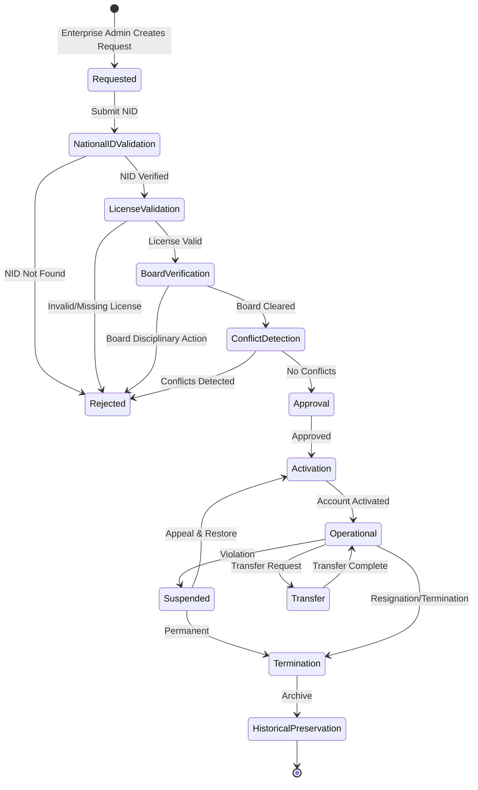
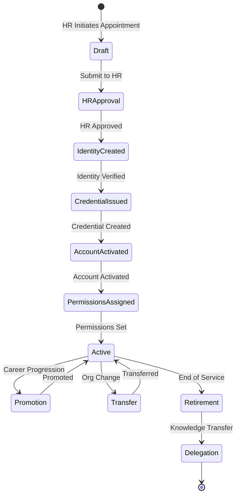

# NIAM — Workforce Lifecycle

## Overview

NIAM supports two distinct workforce lifecycles: **Private Workforce** (enterprise-admin managed) and **Government Workforce** (HR-driven). Both flow through identity verification, licensing checks, conflict detection, and activation before reaching operational status.

---

## Private Workforce Lifecycle

### State Machine

### Request Model (`WorkforceRequest`)

Fields: `request_id`, `request_type`, `requesting_org_id`, `requested_by`, `person_id`, `national_id_hash`, `license_number`, `board_registration`, `employment_rules_check` (JSON), `conflict_report` (JSON), `restrictions` (JSON).

Key checks:
- **Employment Rules**: Ministry of Health employment rules compliance
- **Conflict Detection**: Existing employments, time conflicts, org conflicts
- **Restrictions**: Gag orders, legal restrictions, board sanctions

---

## Government Workforce Lifecycle

### State Machine

### Appointment Model (`GovernmentAppointment`)

Fields: `appointment_id`, `person_id`, `organization_id`, `hr_reference`, `appointment_type`, `position`, `grade`, `salary_scale`, `department`, `start_date`, `end_date`.

Boolean gates for lifecycle progression:
- `hr_approved_by` / `hr_approved_at`
- `identity_created`
- `credential_issued`
- `account_activated`
- `permissions_assigned`

### Career Events

- **Promotion**: `promotion_history` (JSON array of position changes)
- **Transfer**: `transfer_history` (JSON array of org/department changes)
- **Retirement**: End-of-service processing with delegation
- **Delegation**: Knowledge transfer handover to successor

---

## Common Features

### Suspension

Both workforce types support suspension with:
- `suspension_reason`, severity levels
- Time-bound or indefinite
- Appeal workflow (connected to IDENTITY_GOVERNANCE appeals)
- Restoration with audit trail

### Termination

Tracked via `termination_reason` and `termination_date`. Private workforce supports `historical_preserved` flag for archival.

### Historical Preservation

Terminated employments are preserved for audit purposes. The `WorkforceRequest.historical_preserved` flag ensures HR records remain accessible post-termination.

---

## Database Tables

| Table | Purpose |
|-------|---------|
| `niam_lifecycle_workforce_requests` | Private workforce lifecycle |
| `niam_lifecycle_gov_appointments` | Government workforce lifecycle |
