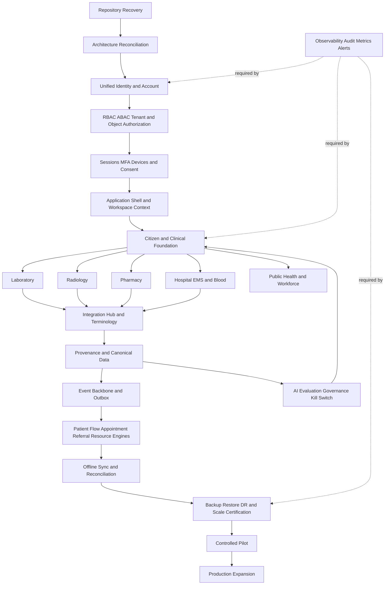

# GULA — Dependency Graph

## الرسم المنطقي

## الاعتماديات الحرجة

| من | إلى | سبب الاعتماد | لا يجوز تجاوز |
|---|---|---|---|
| Repository recovery | كل Wave | حماية العمل وعدم فقد certified work | نعم |
| Identity/account | authorization/sessions | لا يمكن فرض السياق أو session lifecycle قبل هوية موحدة | نعم |
| Authorization | كل domain | الواجهة لا تمنح صلاحية؛ كل resource server-authorized | نعم |
| Shell/workspace | domain UX | منع تكرار search/notifications/tasks/context | لا يُكرر |
| Clinical foundation | lab/radiology/pharmacy/hospital | patient/context/consent/state safety مشتركة | نعم |
| Terminology/integration | result and medication workflows | mapping غير الآمن قد يسبب ضرراً سريرياً | نعم |
| Outbox/event | offline and engines | retries/idempotency/reconciliation | نعم |
| Backup/restore | production scale | لا backup certification بلا restore proof | نعم |
| Observability/audit | كل capability | لا يمكن certification بلا traceability/evidence | نعم |
| AI governance | AI-assisted domain | AI لا يصبح final decision maker | نعم |

## مصادر البيانات والملكية

PostgreSQL هو مصدر البيانات الأساسي، وRedis cache/session coordination وليس بديلاً عن DB. Object storage مناسب للوثائق والوسائط مع retention/provenance. الأحداث تمر عبر outbox/event backbone مع idempotency key وretry/dead-letter. كل tenant/organization/resource scope يُعاد اشتقاقه server-side عند كل طلب.

## ترتيب التنفيذ العملي

يبدأ العمل الآمن باستعادة الحالة والتقارير، ثم reconciliation معماري، ثم الهوية والتفويض والجلسات، ثم shell/workspaces، ثم citizen/clinical، ثم domains، ثم integration/terminology، ثم engines/offline/DR، ثم scale/pilot. لا يُنفذ حذف legacy أو تغيير deployment إلا بعد replacement ومهاجرة واختبار rollback واعتماد واضح.
