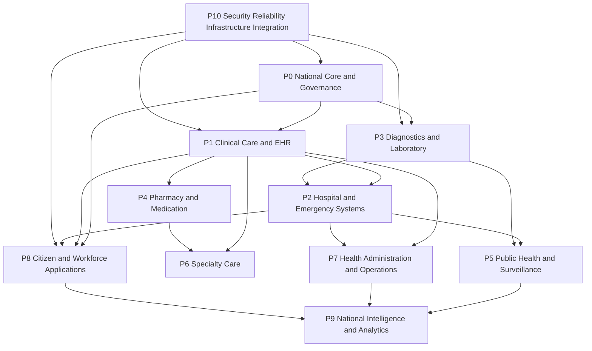

# GULA Master Dependency Graph

Status: **PLANNING MODEL — NOT AN APPROVAL**. Baseline: `a01352578c0df205b92e58444242e1fa6ae7d77b`. This graph orders programs by actual dependency, not by ease or document order. It reuses the master gap register (`GULA_MASTER_GAP_REGISTER.md`) and Wave 06 reconciliation.

## 1. Program dependency levels

| Level | Programs | Dependency rationale |
|---:|---|---|
| L0 — authority and canonical boundary | P0 National Core and Governance, P10 Security/Reliability/Infrastructure/Integration | Nothing may be safely extended before data ownership, canonical reuse, authorization, and release-boundary decisions are fixed. MGR-043/MGR-044/MGR-014/MGR-015/MGR-009 are L0 blockers. |
| L1 — durable identity and trust | P0 identity/persistence workstream, P10 audit/crypto/observability foundations | Requires L0 decisions plus schema/security approvals. Owns MGR-001..MGR-018. |
| L2 — clinical foundation | P1 Clinical Care/EHR, P3 Diagnostics/Laboratory | Requires L1 identity, consent, scope, audit, and durable-link decisions. Owns MGR-019..MGR-028. |
| L3 — hospital/domain and pharmacy | P2 Hospital/Emergency, P4 Pharmacy/Medication | Requires L2 clinical records, orders, results, and safe clinical workflow. |
| L4 — specialty/public health/operations | P5 Public Health, P6 Specialty Care, P7 Health Administration | Requires L2/L3 canonical clinical and operational data plus legal policy. |
| L5 — access channels | P8 Citizen/Workforce Applications | Requires stable L0–L4 contracts and role matrix; UI work must not activate blocked routes. |
| L6 — national intelligence | P9 Analytics/AI | Requires governed, de-identified or aggregated data; analytics must not become a clinical system of record. |

## 2. Mermaid dependency graph

## 3. Critical path to a controlled pilot

1. **Owner/governance decisions** — MGR-043, MGR-044, OD-01..OD-31, NV2-D01..D15.
2. **Canonical security boundary** — MGR-009, MGR-010, MGR-014, MGR-015, MGR-013, MGR-016.
3. **Durable identity/MPI** — MGR-002, MGR-005, MGR-023.
4. **Clinical/LIMS integrity** — MGR-020, MGR-021, MGR-022, MGR-024, MGR-019.
5. **Offline convergence** — MGR-028, MGR-029, MGR-042.
6. **Infrastructure proof** — MGR-030..MGR-037.
7. **Gate packs and owner acceptance** — G1–G12, G12 HOLD-lift decision.

## 4. Parallelization rules

- Parallel execution is permitted only where file ownership is disjoint and no shared contract changes are implicit.
- Two agents must not edit the same authorization, audit, identity, clinical, or migration file without coordination.
- Documentation-only work and synthetic test scaffolding may proceed in parallel with owner-gated design packets.
- No work may mount a route, add a migration, add a dependency, connect to government systems, or use real data while its owner approval is absent.

## 5. Execution waves mapped to programs

| Wave | Primary programs | Category |
|---|---|---|
| Wave A — governance/policy | P0,P10 | A/decision; no code |
| Wave B — identity/durable persistence | P0 | C/D/F approval-gated |
| Wave C — canonical security/audit | P0,P10 | D/E approval-gated except MGR-015 |
| Wave D — clinical/LIMS integration | P1,P3 | D approval-gated |
| Wave E — FHIR interoperability | P1,P10 | D/F approval-gated |
| Wave F — national/directorate isolation | P0,P10 | D/E approval-gated |
| Wave G — offline resilience | P1,P3,P10 | D approval-gated |
| Wave H — infrastructure/DR | P10 | G approval-gated |
| Wave I — performance/security validation | P10 | G approval-gated |
| Wave J — controlled pilot | All | Owner-only |

## 6. Immediate safe work under this graph

- MGR-015 null-scope fail-closed fix and focused tests (P0/P10).
- MGR-027 explicit stub labeling (P1/P3/P10).
- Master reconciliation documents and evidence (all).
- Decision packets for owner-gated items (P0/P10).

No other program implementation is started by this execution.
