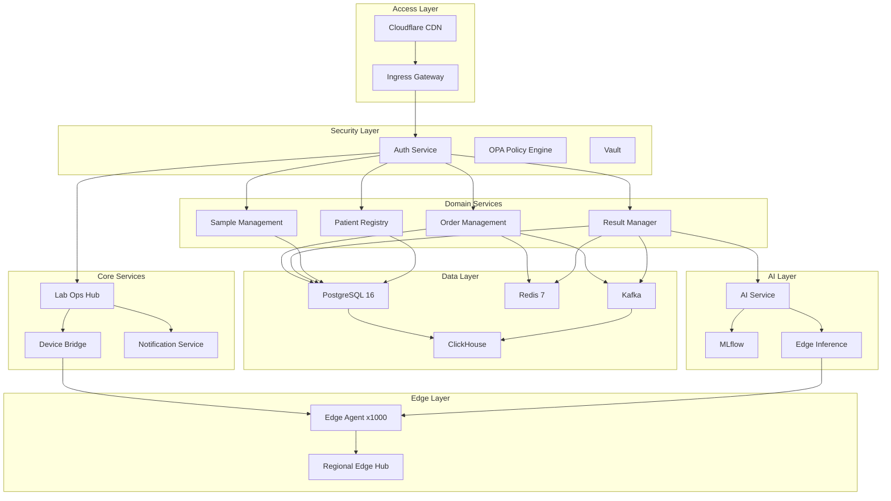
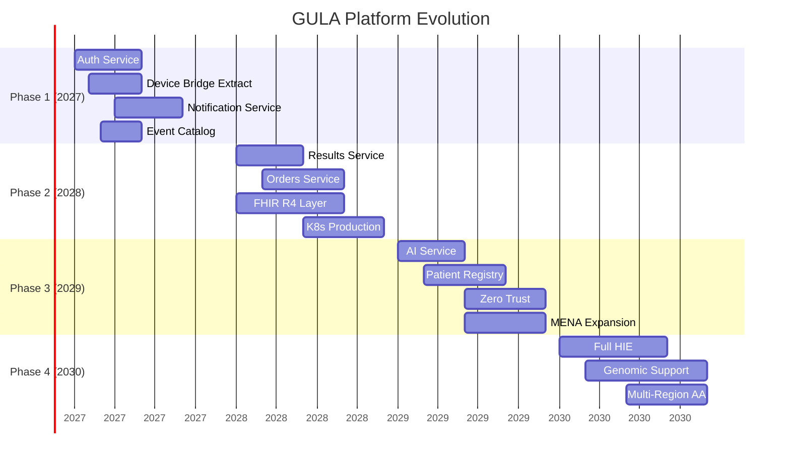
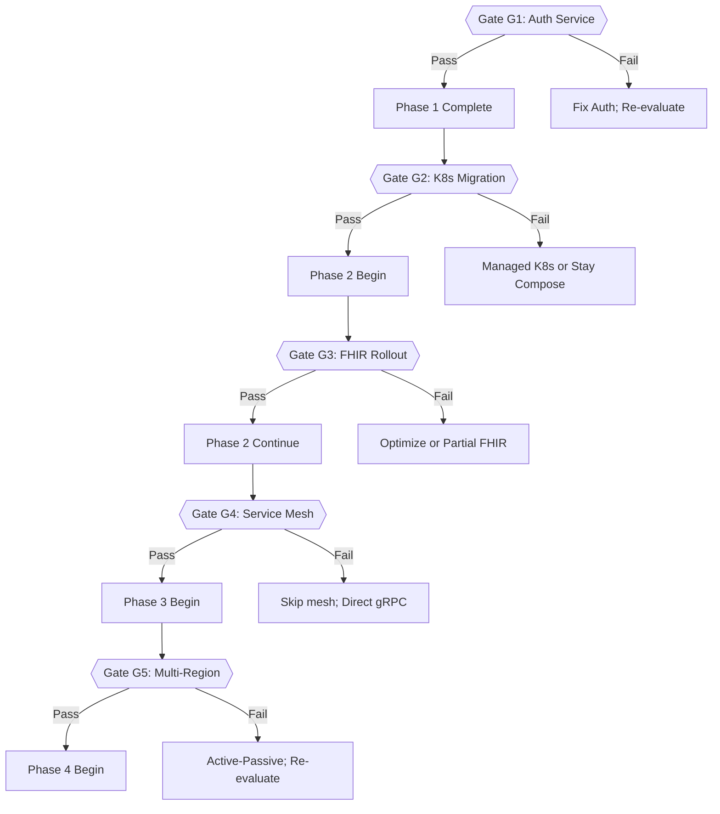

# GULA Platform Knowledge Graph

> Version: 1.0 | Status: Design Document | Last Updated: 2026-07-17
> Purpose: Map relationships between all platform knowledge domains

---

## 1. Graph Schema

### 1.1 Node Types

| Type | Prefix | Description | Example | Color |
|------|--------|-------------|---------|-------|
| **Standard** | `STD` | Healthcare/security/technology standards | LOINC, FHIR R4, ISO 15189 | Blue |
| **Component** | `CMP` | Software/service/infrastructure component | Auth Service, PostgreSQL, Lab Ops Hub | Green |
| **Decision** | `DEC` | Architecture Decision Record | Auth Service extraction strategy | Orange |
| **Person** | `PER` | Stakeholder, team member, role | Platform Architect, Lab Manager | Purple |
| **Team** | `TAM` | Team or group | Platform Team, SRE, Lab Ops | Purple |
| **Domain** | `DOM` | Bounded context or domain area | Order Management, Patient Registry | Cyan |
| **Risk** | `RSK` | Identified risk | Service extraction breaks tenant isolation | Red |
| **Requirement** | `REQ` | Functional/non-functional requirement | Tenant isolation, FHIR R4 compliance | Yellow |
| **Test** | `TST` | Test module or scenario | `test_security.py`, integration tests | Pink |
| **Document** | `DOC` | Documentation | CLAUDE.md, Platform Evolution Plan | Gray |
| **Capability** | `CAP` | Platform feature or capability | FHIR API, Critical Alert System | Teal |
| **Migration** | `MIG` | Database migration | SNDHS Phase 1 migration | Brown |

### 1.2 Edge Types

| Type | Label | Description | Example |
|------|-------|-------------|---------|
| **implements** | `→[implements]→` | Component implements a standard | `Result Manager →[implements]→ LOINC` |
| **depends_on** | `→[depends_on]→` | Component depends on another | `Orders Service →[depends_on]→ Auth Service` |
| **decides** | `→[decides]→` | Decision decides a direction | `ADR-001 →[decides]→ Auth Service Strategy` |
| **references** | `→[references]→` | References for context | `Platform Evolution Plan →[references]→ ISO 15189` |
| **tests** | `→[tests]→` | Test covers a component | `test_security.py →[tests]→ JWT auth` |
| **approves** | `→[approves]→` | Person/team approves a decision | `Platform Architect →[approves]→ ADR-001` |
| **requires** | `→[requires]→` | Requirement needs a standard | `Patient Privacy →[requires]→ AES-256 encryption` |
| **evolves_to** | `→[evolves_to]→` | Component evolves into another | `Monolith →[evolves_to]→ Domain Services` |
| **deprecates** | `→[deprecates]→` | Component deprecates another | `FHIR R4 →[deprecates]→ Proprietary v1 API` |
| **replaces** | `→[replaces]→` | Replacement relationship | `OAuth 2.0 →[replaces]→ JWT-only auth` |
| **triggers** | `→[triggers]→` | Risk/event triggers action | `Lab count > 500 →[triggers]→ K8s Migration` |
| **documents** | `→[documents]→` | Document describes a component | `CLAUDE.md →[documents]→ Monolith Architecture` |
| **belongs_to** | `→[belongs_to]→` | Membership | `Orders Service →[belongs_to]→ Order Management domain` |
| **violates** | `→[violates]→` | Risk violates requirement | `Data leak →[violates]→ Patient Privacy` |
| **mitigates** | `→[mitigates]→` | Control mitigates risk | `Encryption at rest →[mitigates]→ Data breach` |

---

## 2. Graph Sections

### 2.1 Healthcare Standards Map

```
WHO Classifications
    │
    ├──→ ICD-10 ───→[evolves_to]───→ ICD-11
    │
    ├──→ WHO ATC/DDD
    │
    └──→ WHO Essential Diagnostics List
               │
               └──→[references]──→ Lab Test Catalog
                                         │
HL7 Standards                              │
    │                                      │
    ├──→ HL7 v2.5.1 ───→[implements]──→ Device Bridge
    │                                          │
    │                                    ┌─────┴────────┐
    │                                    │               │
    │                              Sysmex ASTM    Roche HL7
    │
    ├──→ HL7 FHIR R4 ───→[replaces]──→ Proprietary API v1
    │         │
    │         ├──→[implements]──→ FHIR Service (planned)
    │         │                       │
    │         │                 ┌─────┴─────────┐
    │         │                 │               │
    │         │           Patient FHIR    Result FHIR
    │         │
    │         └──→[references]──→ SNDHS National HIE
    │
    └──→ HL7 CDA R2 ───→[references]──→ Legacy systems

LOINC ───→[implements]──→ Lab Test Model (loinc_code field)
    │
    └──→[references]──→ CLSI EP28 (reference range methodology)
                              │
                              └──→[references]──→ Iraqi Population Metrics

SNOMED CT ───→[implements]──→ Clinical Finding Model (snomed_ct_code)
    │
    └──→[references]──→ Result Interpretation AI

ISO Standards
    │
    ├──→ ISO 15189 ───→[implements]──→ Lab Quality Management
    │       │                              │
    │       │                        ┌─────┴──────────┐
    │       │                        │                │
    │       │                   QC Monitoring    Proficiency Testing
    │       │
    │       └──→[references]──→ CLSI C24 (statistical QC)
    │
    ├──→ ISO 27001 ───→[implements]──→ Security Management System
    │       │
    │       ├──→[references]──→ NIST SP 800-53
    │       └──→[references]──→ OWASP Top 10
    │
    └──→ ISO 13606 ───→[planned]──→ EHR Interoperability (2030)
```

### 2.2 Architecture Dependency Graph

```
                          ┌──────────────────────┐
                          │   Monolith (Lab Ops)  │
                          │   System of Record    │
                          └──────┬───────────────┘
                                 │
          ┌──────────────────────┼──────────────────────┐
          │                      │                      │
          ▼                      ▼                      ▼
  ┌───────────────┐    ┌─────────────────┐    ┌─────────────────┐
  │  Auth Service  │    │  Device Bridge   │    │  Notification   │
  │  (Phase 1)     │    │  (Production)    │    │  (Phase 1)      │
  └───────┬───────┘    └────────┬────────┘    └────────┬────────┘
          │                     │                      │
          │              ┌──────┴──────┐               │
          │              │             │               │
          ▼              ▼             ▼               ▼
  ┌───────────────┐  ┌────────┐  ┌────────┐  ┌─────────────────┐
  │ Postgres 16   │  │ Redis 7│  │ Edge   │  │  RabbitMQ/Kafka │
  │ (Shared DB)   │◄─┤(Cache) │◄─┤ Agents │  │  (Event Bus)    │
  └───────────────┘  └────────┘  └────────┘  └────────┬────────┘
                                                       │
          ┌────────────────────────────────────────────┼──────┐
          │                     │                      │      │
          ▼                     ▼                      ▼      ▼
  ┌───────────────┐    ┌─────────────────┐    ┌─────────────────┐
  │  Result       │    │  Orders          │    │  Sample         │
  │  Manager      │◄───┤  Service         │◄───┤  Management     │
  │  (Phase 2)    │    │  (Phase 2)       │    │  (Phase 2)      │
  └───────┬───────┘    └────────┬────────┘    └────────┬────────┘
          │                     │                      │
          └─────────────────────┼──────────────────────┘
                                │
                                ▼
              ┌────────────────────────────────┐
              │     Patient Registry / MPI     │
              │     (Phase 3)                  │
              │     ┌──────────────────────┐   │
              │     │ National ID (encrypted)│  │
              │     │ SNDHS Health ID      │   │
              │     │ Patient Dedup Engine │   │
              │     └──────────────────────┘   │
              └───────────────┬────────────────┘
                              │
                              ▼
              ┌────────────────────────────────┐
              │     SNDHS Bridge Service       │
              │     (National HIE Gateway)     │
              └────────────────────────────────┘
```

### 2.3 Decision Impact Graph

```
ADR-001: Auth Service Strategy
    │
    ├──→[decides]──→ Auth Service implementation (build vs. buy)
    │       │
    │       ├──→[impacts]──→ All other services (depend on auth)
    │       ├──→[impacts]──→ JWT token format
    │       ├──→[impacts]──→ OAuth 2.0 vs. OIDC choice
    │       └──→[impacts]──→ Team hiring (OAuth expertise)
    │
    └──→[depends_on]──→ Current `security/auth.py` analysis

ADR-002: Event Bus Technology
    │
    ├──→[decides]──→ Redis Streams vs. Kafka vs. RabbitMQ
    │       │
    │       ├──→[impacts]──→ Outbox pattern implementation
    │       ├──→[impacts]──→ Event schema registry
    │       ├──→[impacts]──→ Message durability guarantees
    │       └──→[impacts]──→ Infrastructure cost
    │
    └──→[references]──→ Current `outbox_service.py` patterns

ADR-005: K8s Distribution
    │
    ├──→[decides]──→ k3s vs. EKS vs. AKS vs. GKE
    │       │
    │       ├──→[impacts]──→ Team training requirements
    │       ├──→[impacts]──→ Multi-region strategy
    │       ├──→[impacts]──→ CI/CD pipeline (ArgoCD vs. native)
    │       └──→[impacts]──→ Operational cost
    │
    └──→[depends_on]──→ Team K8s maturity assessment

Decision Hierarchy:
    High-level Strategy (Phase-level)
        │
        ├──→ Architecture Decisions (ADR)
        │       │
        │       ├──→ Technology Choices
        │       │       │
        │       │       ├──→ Implementation Patterns
        │       │       └──→ Configuration Details
        │       │
        │       └──→ Migration Decisions
        │
        └──→ Timeline Decisions (Phase Gating)
```

### 2.4 Compliance Map

```
Requirement → Standard → Implementation → Verification

REQ-001: Tenant Isolation
    │
    ├──→[requires]──→ ISO 27001 A.9 (Access Control)
    ├──→[requires]──→ ISO 15189 (Lab-specific access)
    │
    └──→[implements]──→ RBAC (9 roles × 13 permissions)
            │
            ├──→[tests]──→ test_security.py::test_lab_isolation
            └──→[tests]──→ test_comprehensive.py::test_tenant_isolation

REQ-002: Audit Trail Integrity
    │
    ├──→[requires]──→ ISO 15189 (Audit requirements)
    ├──→[requires]──→ Iraqi MoH regulation 47/2019
    │
    ├──→[implements]──→ AuditLog model + hash chain
    │       │
    │       ├──→[tests]──→ test_security.py::test_audit_chain
    │       └──→[tests]──→ test_stability_assertions.py::test_audit_integrity
    │
    └──→[evolves_to]──→ Audit v2 (SNDHS Phase 1)
            │
            └──→[tests]──→ Phase 2 audit tests (planned)

REQ-003: Patient Data Encryption at Rest
    │
    ├──→[requires]──→ ISO 27001 A.10 (Cryptography)
    ├──→[requires]──→ Iraqi Data Protection Law
    │
    ├──→[implements]──→ AES-256-GCM with ENCRYPTION_KEY
    │       │
    │       └──→[tests]──→ test_security.py::test_encryption
    │
    └──→[implements]──→ National ID encryption (NID_HMAC_KEY)
            │
            └──→[tests]──→ test_security.py::test_nid_encryption

REQ-004: FHIR R4 Compliance (Future)
    │
    ├──→[requires]──→ HL7 FHIR R4
    ├──→[requires]──→ SNDHS Phase 3
    │
    ├──→[planned]──→ FHIR Service (Phase 2)
    │
    └──→[references]──→ SNDHS Data Dictionary

REQ-005: Critical Alert Delivery
    │
    ├──→[requires]──→ ISO 15189 (Critical result reporting)
    ├──→[requires]──→ Iraqi MoH critical value protocol
    │
    ├──→[implements]──→ CriticalAlertTriggered event
    │       │
    │       ├──→[implements]──→ Notification Service (Phase 1)
    │       ├──→[implements]──→ SMS/WhatsApp delivery (Phase 2)
    │       └──→[tests]──→ test_comprehensive.py::test_critical_alert
    │
    └──→[mitigates]──→ RSK-009: AI false negatives on critical values
```

### 2.5 Test Coverage Map

```
Tests → Routes → Models

test_comprehensive.py
    │
    ├──→[tests]──→ All major route modules
    │       │
    │       ├──→ routes/labs.py
    │       ├──→ routes/orders.py
    │       ├──→ routes/results.py
    │       ├──→ routes/samples.py
    │       ├──→ routes/patients.py
    │       └──→ routes/auth.py
    │
    └──→[tests]──→ All major models
            │
            ├──→ models/lab.py
            ├──→ models/lab_order.py
            ├──→ models/lab_result.py
            ├──→ models/sample.py
            ├──→ models/patient.py
            └──→ models/audit_log.py

test_security.py
    │
    ├──→[tests]──→ JWT encode/decode
    ├──→[tests]──→ JWT rejection (expired, malformed)
    ├──→[tests]──→ RBAC enforcement
    ├──→[tests]──→ Tenant isolation
    ├──→[tests]──→ Encryption at rest
    ├──→[tests]──→ Audit chain integrity
    ├──→[tests]──→ National ID encryption
    └──→[tests]──→ Patient card HMAC verification

test_stress.py
    │
    ├──→[tests]──→ Concurrent order placement (100 workers)
    ├──→[tests]──→ Concurrent result entry (100 workers)
    ├──→[tests]──→ High-volume read queries
    └──→[tests]──→ Circuit breaker behavior under load

test_patient_card.py
    │
    ├──→[tests]──→ Card generation
    ├──→[tests]──→ QR code scanning
    ├──→[tests]──→ HMAC token verification
    └──→[tests]──→ Scan without valid token (rejection)

test_mpi_matcher.py
    │
    ├──→[tests]──→ Exact match
    ├──→[tests]──→ Fuzzy match
    ├──→[tests]──→ No match
    └──→[tests]──→ Duplicate merge
```

---

## 3. Query Patterns

### 3.1 Common Questions and Graph Traversals

**Q1: What standards does the Result Manager implement?**

```
Result Manager (CMP)
    │
    ├──→[implements]──→ LOINC (STD-H-003)
    ├──→[implements]──→ SNOMED CT (STD-H-004)
    ├──→[implements]──→ ISO 15189 (STD-H-008) — QC, reference ranges
    └──→[planned]──→ HL7 FHIR R4 (STD-H-006)
```

**Q2: What happens if the Auth Service goes down?**

```
Auth Service failure
    │
    └──→[depends_on]──→ ALL services (inbound)
            │
            └──→[mitigates]──→ Circuit Breaker (CMP-A-006)
                    │
                    ├──→[implements]──→ DegradedModeMiddleware
                    │       │
                    │       └──→ Allows cached auth for N minutes
                    │
                    └──→[implements]──→ Startup Guard blocks until auth available
```

**Q3: What tests cover the SNDHS integration?**

```
SNDHS Bridge (CMP)
    │
    ├──→[tests]──→ test_comprehensive.py::test_sndhs_lookup
    ├──→[tests]──→ test_security.py::test_nid_encryption
    ├──→[tests]──→ test_security.py::test_nid_lookup
    └──→[tests]──→ (Phase 2) FHIR submission tests (planned)
```

**Q4: What risks are associated with microservice extraction?**

```
Microservice Extraction (Phase 2)
    │
    ├──→[triggers]──→ RSK-001: Tenant isolation breakage
    │       └──→[mitigates]──→ Automated isolation tests in CI
    │
    ├──→[triggers]──→ RSK-003: Performance regression
    │       └──→[mitigates]──→ Pre/post latency benchmarks
    │
    ├──→[triggers]──→ RSK-005: Data consistency
    │       └──→[mitigates]──→ Outbox pattern + sagas
    │
    └──→[triggers]──→ RSK-004: Developer productivity drop
            └──→[mitigates]──→ Feature flag parity, dual development
```

**Q5: What decisions need to be made before K8s migration?**

```
K8s Migration (Phase 2 Gate)
    │
    ├──→[requires]──→ DEC-ADR-005: K8s Distribution (k3s/EKS/AKS/GKE)
    ├──→[requires]──→ DEC-ADR-004: Service Mesh (Istio/Linkerd/None)
    ├──→[requires]──→ DEC-ADR-011: Observability Stack
    ├──→[requires]──→ DEC-ADR-012: Secret Management
    │
    └──→[requires]──→ Team K8s training completion
```

**Q6: Which components are affected by the Financial Engine Phase B?**

```
Financial Engine Phase B (CAP)
    │
    ├──→[depends_on]──→ Auth Service (for authentication)
    ├──→[depends_on]──→ Order Management (for billing)
    ├──→[depends_on]──→ Result Manager (for test-based billing)
    ├──→[depends_on]──→ Notification Service (for receipts)
    │
    ├──→[requires]──→ PCI DSS compliance
    ├──→[requires]──→ Payment gateway integration
    │
    └──→[references]──→ ISO 27001 (financial data security)
```

**Q7: What's the migration path from current API to FHIR?**

```
Proprietary API v1 (current)
    │
    └──→[evolves_to]──→ Proxy/Translation Layer (Phase 2)
            │
            ├──→ Translates GULA to FHIR (read-only)
            │
            └──→[evolves_to]──→ Native FHIR Service (Phase 3)
                    │
                    ├──→ FHIR R4 Patient, Observation, DiagnosticReport
                    └──→[deprecates]──→ Proprietary API v1
```

---

## 4. Implementation Strategy

### 4.1 Phase 0 (Current) — Documentation-Based Graph

For the initial implementation, the knowledge graph exists as this document. Queries are performed manually by reading the document.

**Tools**: Markdown + mermaid diagrams
**Pros**: Zero infrastructure, version-controlled, easy to review
**Cons**: Manual maintenance, no automated queries, limited scalability

### 4.2 Phase 1 (2027) — Structured YAML/JSON Graph

Convert the graph into a structured YAML file that can be parsed programmatically.

```yaml
# Example: knowledge_graph.yaml
nodes:
  - id: CMP-001
    type: Component
    name: Auth Service
    description: OAuth 2.0 / OIDC authentication and authorization
    status: planned_phase1
    tags: [security, core]

edges:
  - source: CMP-002  # Orders Service
    target: CMP-001  # Auth Service
    type: depends_on
    description: All order operations require authentication
```

**Tools**: YAML with validation schema, JSON export
**Pros**: Machine-readable, CI-validatable, easy to generate diagrams
**Cons**: Still manual maintenance, no query engine

### 4.3 Phase 2 (2028) — Neo4j Graph Database

Deploy a Neo4j instance (or use Neo4j AuraDB) and migrate the structured graph.

```cypher
// Example: Query all dependencies of the Result Manager
MATCH (c:Component {name: 'Result Manager'})-[:DEPENDS_ON]->(d:Component)
RETURN c.name as component, d.name as dependency

// Example: Find all tests for SNDHS-related code
MATCH (t:Test)-[:TESTS]->(c:Component)
WHERE c.name CONTAINS 'SNDHS' OR c.name CONTAINS 'National ID'
RETURN t.name as test, c.name as component

// Example: Impact analysis for Auth Service change
MATCH path = (a:Component {name: 'Auth Service'})<-[:DEPENDS_ON*]-(dependent:Component)
RETURN path
```

**Tools**: Neo4j + Cypher query language
**Pros**: Full graph querying, impact analysis, visualization (Neo4j Browser/Bloom)
**Cons**: Operational overhead, sync maintenance

### 4.4 Phase 3 (2029) — Automated Graph Population

Integrate graph population into the CI/CD pipeline:

- **Auto-discover components**: Scan Docker Compose/K8s manifests for services
- **Auto-extract dependencies**: Parse import statements, API calls, event subscriptions
- **Auto-link tests**: Parse pytest markers, test file naming conventions
- **Auto-track decisions**: Extract ADR metadata from markdown frontmatter

**Tools**: Custom CI scripts + Neo4j API
**Pros**: Self-updating, always current
**Cons**: Complex implementation, risk of noise

### 4.5 Phase 4 (2030+) — AI-Enhanced Knowledge Graph

Use the Arabic Clinical LLM and graph ML to:

- **Suggest missing edges**: AI identifies relationships not yet documented
- **Detect anomalies**: Finds inconsistencies between graph and actual system behavior
- **Predict impacts**: Given a proposed change, AI predicts affected components
- **Generate documentation**: AI writes knowledge graph sections from code analysis

---

## 5. Graph Visualization

### 5.1 High-Level Platform Context (mermaid)



### 5.2 Evolution Timeline (mermaid)



### 5.3 Decision Flow (mermaid)



---

## 6. Maintenance Process

### 6.1 Ownership

| Role | Responsibilities |
|------|-----------------|
| **Platform Architect** | Graph schema, major updates, quarterly review |
| **Tech Lead** | Component nodes, dependency edges, weekly updates |
| **QA Lead** | Test coverage edges, link tests to components |
| **Security Lead** | Risk nodes, compliance edges, security standard updates |
| **All Developers** | Add decision nodes when creating ADRs |

### 6.2 Update Triggers

| Event | Action | Owner |
|-------|--------|-------|
| New service created | Add Component node + dependency edges | Tech Lead |
| New ADR created | Add Decision node + edges | Author |
| New test created | Add Test node → Component edge | QA Lead |
| New standard adopted | Add Standard node → reference edges | Platform Architect |
| Dependency change | Update dependency edges | Tech Lead |
| Phase gate passed | Update status of affected nodes | Platform Architect |
| Risk identified | Add Risk node + violation edges | Security Lead |
| Component deprecated | Add `deprecates` edge | Platform Architect |

### 6.3 Quality Checks

| Check | Frequency | Method |
|-------|-----------|--------|
| Broken internal references | Weekly | Script checks all `→[edges]→` match existing nodes |
| Outdated node status | Monthly | Review nodes with `status: planned` older than 1 year |
| Missing dependency edges | Monthly | Compare graph dependencies with runtime dependencies |
| Orphan nodes | Quarterly | Identify nodes with no inbound/outbound edges |
| Full graph review | Quarterly | Platform Architect review |

### 6.4 Tooling Roadmap

| Tool | Phase | Purpose |
|------|-------|---------|
| Markdown (this document) | Current | Human-readable graph definition |
| YAML schema validator | Phase 1 | CI-validate graph structure |
| mermaid-cli | Phase 1 | Auto-generate diagrams from YAML |
| Neo4j + Cypher | Phase 2 | Queryable graph database |
| Neo4j Bloom | Phase 2 | Visual graph exploration |
| Custom CI bot | Phase 3 | Auto-detect and propose graph updates |
| AI graph assistant | Phase 4 | Intelligent graph maintenance |

---

## Appendix A: Complete Node Index (Phase 0)

### Standards (STD)
- STD-H-001: ICD-10 (WHO, 2019, Adopted)
- STD-H-002: ICD-11 (WHO, 2022, Planned)
- STD-H-003: LOINC 2.77 (Regenstrief, Adopted)
- STD-H-004: SNOMED CT 2025 (SNOMED Intl, Adopted)
- STD-H-005: HL7 v2.5.1 (HL7, Adopted)
- STD-H-006: HL7 FHIR R4 (HL7, Planned)
- STD-H-008: ISO 15189:2022 (ISO, Adopted)
- STD-H-009: ISO 27001:2022 (ISO, Adopted)
- STD-H-010: ISO 27799:2016 (ISO, Adopted)
- STD-H-013: CLSI EP28-A3c (CLSI, Adopted)
- STD-S-001: OWASP Top 10 2021 (OWASP, Adopted)
- STD-S-004: NIST SP 800-53 Rev5 (NIST, Adopted)

### Components (CMP)
- CMP-MONO: Lab Ops Hub (Monolith)
- CMP-AUTH: Auth Service (planned Phase 1)
- CMP-DEV: Device Bridge (production)
- CMP-NOTIF: Notification Service (planned Phase 1)
- CMP-ORDER: Order Management (planned Phase 2)
- CMP-RESULT: Result Manager (planned Phase 2)
- CMP-SAMPLE: Sample Management (planned Phase 2)
- CMP-PATIENT: Patient Registry / MPI (planned Phase 3)
- CMP-AI: AI Service (planned Phase 3)
- CMP-FIN: Financial Engine (planned Phase 2)
- CMP-AUDIT: Audit Service (planned Phase 3)
- CMP-STATS: Stats & Analytics (planned Phase 4)
- CMP-SNDHS: SNDHS Bridge (Phase 1)
- CMP-EDGE: Edge Agent (prototype)
- CMP-FHIR: FHIR Service (planned Phase 2)

### Domains (DOM)
- DOM-ORDER: Order Management
- DOM-RESULT: Result Management
- DOM-SAMPLE: Sample Management
- DOM-PATIENT: Patient Registry
- DOM-DEVICE: Device Integration
- DOM-FINANCE: Financial Engine
- DOM-AI: Clinical AI
- DOM-AUDIT: Audit & Compliance

### Decisions (DEC)
- DEC-ADR-001: Auth Service Strategy (Pending)
- DEC-ADR-002: Event Bus Technology (Pending)
- DEC-ADR-004: Service Mesh (Pending)
- DEC-ADR-005: K8s Distribution (Pending)
- DEC-ADR-006: FHIR Server (Pending)

### Risks (RSK)
- RSK-001: Tenant isolation breakage
- RSK-002: Event bus SPOF
- RSK-003: Performance regression
- RSK-004: Developer productivity drop
- RSK-005: Data consistency across services
- RSK-009: AI false negatives on critical values

### Tests (TST)
- TST-COMPREHENSIVE: test_comprehensive.py
- TST-STRESS: test_stress.py
- TST-SECURITY: test_security.py
- TST-PATIENT-CARD: test_patient_card.py
- TST-MPI: test_mpi_matcher.py
- TST-OUTBOX: test_outbox_service.py

---

## Appendix B: Glossary

| Term | Definition |
|------|-----------|
| **Node** | An entity in the knowledge graph (standard, component, decision, etc.) |
| **Edge** | A typed relationship between two nodes |
| **Traversal** | Following edges from a starting node to find related nodes |
| **Path** | A sequence of nodes connected by edges |
| **Subgraph** | A subset of the full graph (e.g., all components in a domain) |
| **Cypher** | Neo4j's graph query language |
| **Property Graph** | Graph model where nodes and edges have key-value properties |

---

*This document is the Phase 0 implementation of the Knowledge Graph. Phase 1 (structured YAML) begins 2027 Q1.*
