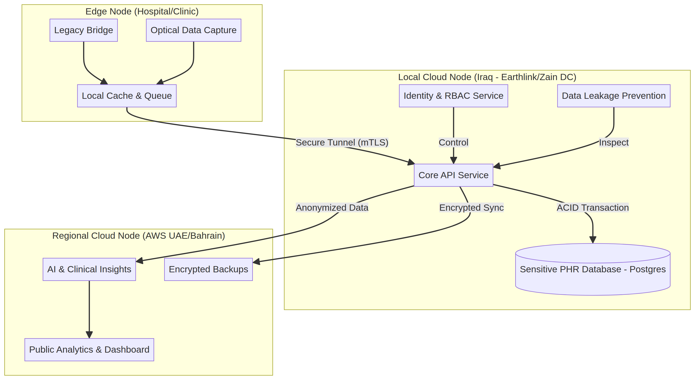

# تقرير متطلبات النشر والتخزين السحابي لمنصة GULA في العراق
**الإصدار:** 1.0.0  
**التاريخ:** أغسطس 2026  
**المؤلف:** Manus AI  

---

## 1. مقدمة واستراتيجية السيادة السحابية
تتطلب البيئة الصحية في العراق معمارية تشغيلية تجمع بين **الامتثال الصارم لسيادة البيانات الوطنية** (بما يتوافق مع أطر حماية البيانات الشخصية والصحية) [1] [2] وبين الكفاءة العالية في الأداء رغم تحديات البنية التحتية والاتصال. يوضح هذا التقرير متطلبات النشر والتخزين السحابي لضمان استقرار منصة **GULA** على مدار الساعة (Uptime ≥ 99.95%).

---

## 2. معمارية النشر الهجين (Hybrid Cloud Architecture)
لتحقيق التوازن الأمثل بين الأمان وسرعة الأداء، تعتمد منصة GULA على نموذج **النشر الهجين (Hybrid Cloud Model)** المكون من ثلاث طبقات رئيسية:

| الطبقة التشغيلية | الموقع الجغرافي | نوع البيانات والمعالجة | التقنيات المستخدمة |
| :--- | :--- | :--- | :--- |
| **1. عقد الحافة (Edge Nodes)** | المستشفيات والمراكز الصحية في العراق | التقاط البيانات الأولية، التخزين المؤقت (Store-and-Forward)، تشفير الحافة. | Raspberry Pi / أجهزة محلية، SQLite مشفر، جسور منافذ تسلسلية. |
| **2. العقدة السحابية المحلية (Local Cloud DC)** | مراكز البيانات المحلية داخل العراق (مثل Earthlink أو Zain DC) | تخزين السجلات الطبية الحساسة للمرضى (PHI)، إدارة الهويات (RBAC)، وقاعدة البيانات المركزية. | PostgreSQL، Docker، Kubernetes، التخزين السيادي المحلي. |
| **3. العقدة الإقليمية الذكية (Regional Cloud Node)** | مراكز البيانات السحابية القريبة (مثل AWS في الإمارات أو البحرين) | معالجة الذكاء الاصطناعي الخفيف، التحليلات الإحصائية المجمعة (Aggregated Analytics)، والنسخ الاحتياطي المشفر. | خدمات الحوسبة السحابية المرنة، التخزين البارد المشفر (AES-256). |

---

## 3. المتطلبات التقنية للعتاد والبرمجيات (Infrastructure Requirements)

### أ. خوادم العقدة المحلية (Local DC Servers)
- **وحدة المعالجة المركزية (CPU):** 16 نواة فاعلة (vCPU) كحد أدنى لكل عقدة معالجة رئيسية.
- **الذاكرة العشوائية (RAM):** 64 جيجابايت ECC RAM لضمان سرعة الاستعلامات وقواعد البيانات.
- **التخزين (Storage):** مصفوفة أقراص فائقة السرعة (`NVMe SSD`) بسعة تبدأ من 2 تيرابايت مع دعم التشفير الصلب (`SED - Self-Encrypting Drives`) ونظام النسخ المتطابق (`RAID 10`).

### ب. برمجيات التشغيل والحاويات
- **نظام التشغيل:** Linux Enterprise (Ubuntu Server 24.04 LTS أو Red Hat Enterprise Linux) لضمان الأمان والاستقرار.
- **إدارة الحاويات:** `Docker Engine` و `Kubernetes (K8s)` لإدارة الخدمات المصغرة (Microservices) والتوسع التلقائي عند الذروة.
- **قواعد البيانات:** `PostgreSQL 16` مع إعدادات النسخ المتماثل الفوري (`Streaming Replication`) لضمان التوافرية العالية واستيفاء معايير (ACID).

---

## 4. استراتيجية إدارة الكوارث واستمرارية الأعمال (Disaster Recovery)
- **النسخ الاحتياطي التلقائي والمقيد:** يتم إجراء نسخ احتياطي مشفر (`AES-256-GCM`) كل 4 ساعات لقواعد البيانات، مع رفع نسخ احتياطية باردة إلى مواقع جغرافية متعددة.
- **العمل في وضع الانقطاع (Offline-First / Degraded Mode):** تضمن طوابير الحافة (`Persistent Queues`) استمرار تسجيل البيانات محلياً في المستشفيات حتى عند انقطاع الاتصال بالكامل، مع إعادة المزامنة الذكية فور عودة الاتصال دون أي فقدان للبيانات.

---

## 5. التوصيات التنفيذية
1. **الاعتماد على المزودين المحليين المعتمدين:** التنسيق مع مزودين محليين يمتلكون بنية تحتية معتمدة داخل العراق لضمان الالتزام التام بقوانين توطين البيانات الصحية [1].
2. **تفعيل المراقبة المستمرة:** ربط البنية التحتية بنظام الإنذار المبكر ورصد الشذوذ المبرمج في منصة GULA لاكتشاف أي محاولات اختراق أو انقطاع في الأداء خلال أقل من 200 مللي ثانية.

---
## المراجع والمصادر
- [1] جريدة الصباح - قانون حماية البيانات الشخصية في العراق: [alsabaah.iq](https://alsabaah.iq/106138-.html) [alsabaah.iq]
- [2] وزارة العدل العراقية - تشريعات حماية البيانات: [moj.gov.iq](https://www.moj.gov.iq/view.9935/) [moj.gov.iq]
