# GULA National Acceptance Matrix V2 — G1–G12

**Document class:** NEW root-level planning document; planning/acceptance-gate design only.
**Programme status:** PROPOSED / PENDING OWNER APPROVAL. No gate is approved, waived, or closed by this document.
**Repository:** `gula-integration` @ `integration/gula-unification-v1`, HEAD `2206654dc713ea2de8c564a3207dfe05fde23549`. Sibling `gula-platform` untouched.
**Standing posture:** HOLD TRUE. `production_ready_items = 0`. GULA Stable v1.0.0 NOT DECLARED. PRODUCTION READY NOT AUTHORIZED.
**Canonical seed:** `/tmp/opencode/gula_v2_seed.md` §§4, 6, 7, 8, 9, 10, 11, 13. Identifiers C01–C15, PRG-00..PRG-10, R-01…R-18, NV2-D01..D15, W0–W4, WS-* are used exactly; no new IDs.
**Status vocabulary (exclusive):** IMPLEMENTED · TESTED · INDEPENDENTLY REVIEWED · ACCEPTED · PRODUCTION READY · PARTIALLY IMPLEMENTED · DOCUMENTED ONLY · PLANNED · BLOCKED.

---

## 0. Non-negotiable acceptance statements

1. **No gate G1–G12 is currently PASSED.** Every gate verdict below is `NOT PASSED`; the status column uses only the exclusive vocabulary for the *current* state of evidence.
2. **No production-ready item exists.** `GOVERNANCE/NATIONAL_INTEGRATION/status_registry.json` records `production_ready_items = 0` and `GOVERNANCE/FINAL_DECISION.md:13,46-47` records HOLD, security NOT CERTIFIED, release candidate HOLD.
3. **`DECISION-READY` is not `ACCEPTED`.** P-02 / AUD-F02 engineering scope is IMPLEMENTED · TESTED · INDEPENDENTLY REVIEWED (2 accepted LOW residuals) — not ACCEPTED, not PRODUCTION READY. P-03 / AUD-F03 remains PREPARED ONLY · NOT IMPLEMENTED; D1–D5 absent; T9 deferred to P-03-CONCURRENCY. `PRG-03` means Diagnostics and Laboratory Systems, never the audit package.
4. **Historical certifications do not count.** `MASTER_RELEASE_CERTIFICATION.md` (2026-07-19), `RC_READINESS_REPORT.md` (2026-07-22), `ENTERPRISE_PRODUCTION_CERTIFICATION_REPORT.md` (2026-07-22), `RELEASE_READINESS_REPORT.md`, `SECURITY_CERTIFICATION.md` (self-reported PLATINUM) and `CERTIFICATION-v1.0.md` (full suite NOT RUN) are conflicts requiring an owner decision under NV2-D09, not current release authority. `GULA_RELEASE_ACCEPTANCE_REPORT.md`, `FINAL_00_MASTER_VERDICT`, `FINAL_ASSURANCE_DECISION` and `GOVERNANCE/FINAL_DECISION.md` are the current November records.
5. Only owner-recorded decisions move an item to ACCEPTED (`GULA_OWNER_DECISION_REGISTER.md` § authority lines 9–11). OD-001 accepts SEC-015/F-01 engineering scope only; OD-002…OD-025 remain BLOCKED.
6. No SQLite substitution for PostgreSQL evidence: `backend/tests/conftest.py` forces SQLite in-memory and overrides DB dependencies; PG16 runs are required for G2/G5/G6/G7.
7. No invented percentages or pass claims. Absent evidence is recorded as `NOT VERIFIED`; no new programme, workstream, or decision is approved by this matrix.

## 1. Gate master matrix

| Gate | Acceptance criterion (summary) | Required evidence artifact | Owner role | Linked C / PRG / R / NV2-D | Current status | Gate verdict | Primary blockers |
|---|---|---|---|---|---|---|---|
| G1 | Approved architecture and versioned contracts C01–C15; single owner per data class; CI contract gate | Signed contracts, architecture blueprint, schema registry, CI gate log | PRG-00 contract owner; PRG-10 independent review | C01–C15; PRG-00, PRG-10; R-01, R-02, R-14, R-18; D01–D04 | PARTIALLY IMPLEMENTED | NOT PASSED | Empty OpenAPI; no approved contracts; A09-011 gate absent from CI |
| G2 | Zero-trust security/privacy: no bypass, consent enforced, audit chain sound, secrets controlled | Security test log, IDOR/cross-tenant results, PG16 chain run, secret-scan log | PRG-10 security owner; PRG-00 consent/audit owner | C05, C06, C07, C13; PRG-00, PRG-10; R-03, R-04, R-07, R-15, R-18; D04, D06, D08, D09, D12, D13 | BLOCKED | NOT PASSED | Security NOT CERTIFIED; HEAD audit fork; uncommitted fixes; HS256-only/OIDC gap |
| G3 | Clinical safety and integrity: validated resources, DICOM/terminology strategy, no silent modification | FHIR conformance log, terminology validation, DICOM parser proof, E2E journey log | PRG-01 clinical owner; PRG-03 diagnostics owner | C01, C04, C06, C10; PRG-01, PRG-03, PRG-04, PRG-05, PRG-06; R-05, R-06, R-12, R-16; D08, D11, D14 | PARTIALLY IMPLEMENTED | NOT PASSED | Stale FHIR report; read-only resources; HL7 simulationOnly; shallow terminology; no E2E journey |
| G4 | Generated API contract matches runtime; version negotiation/deprecation; four schema endpoints work | Live-vs-checked-in OpenAPI diff, route inventory, client compile, contract endpoint results | PRG-00 API owner; PRG-10 integration review | C01–C05, C08, C09, C10, C12; PRG-00, PRG-10; R-02, R-04, R-14; D01, D03, D05 | PARTIALLY IMPLEMENTED | NOT PASSED | 98-byte/2.1.0 spec vs 2.5.0; broken `/contracts/schemas`; no negotiation |
| G5 | Migration DAG valid; production-like upgrade and documented rollback rehearsed on PG16; strict schema gate clean | Alembic DAG report, PG16 rehearsal log, checksum reconciliation, rollback result | PRG-10 database/migration owner | C01, C02, C07, C13, C15; PRG-00, PRG-10; R-01, R-09, R-15, R-18; D03, D05, D09 | BLOCKED | NOT PASSED | MIG-EXISTING NOT MET; 119 strict-gate failures; ownership (ADR-B) unresolved |
| G6 | Proven backup, PITR, restore and failover with measured RTO/RPO; DR gate in CI | Restore/PITR drill log, failover evidence, RTO/RPO report, CI DR job | PRG-10 infrastructure/DR owner | C13, C15; PRG-10; R-09, R-11; D07, D14 | BLOCKED | NOT PASSED | No drill; scripts swallow failures; undefined DR_IP; no CI DR gate |
| G7 | Reproducible national-scale load/chaos results against defined targets | k6/Locust run artifacts, p95/p99/throughput report, capacity model | PRG-10 performance owner; PRG-09 analytics | C09, C12, C14; PRG-09, PRG-10; R-10, R-16; D07, D10 | BLOCKED | NOT PASSED | No execution results; `.benchmarks` empty; performance check warning-only |
| G8 | All channels contract-bound, accessible, RTL-correct and channel-parity tested | Frontend inventory, Playwright results, mobile CI logs, channel parity report | PRG-08 channel owner; PRG-01 clinical owner | C04, C08, C11; PRG-01, PRG-02, PRG-07, PRG-08; R-12, R-13; D05, D10, D14 | PARTIALLY IMPLEMENTED | NOT PASSED | 72 unbound/17 demo/2 contract-bound v3 surfaces; iOS CI metadata missing; no directorate app |
| G9 | Durable offline convergence, quarantine, late-result and network-loss evidence | Sync convergence log, conflict/quarantine results, batch replay log | PRG-00 offline owner; PRG-10, PRG-08 support | C10, C11, C12; PRG-00, PRG-08, PRG-10; R-06, R-08, R-13, R-14; D14 | BLOCKED | NOT PASSED | Four disconnected engines; uncommitted conflict fix; no network-loss test |
| G10 | Live metrics/traces/logs/SLO alerts with incident drill and runbook | `/metrics/prom` scrape, SLO presence, trace sample, alert drill log | PRG-10 observability owner | C09, C12, C14; PRG-09, PRG-10; R-03, R-09, R-10, R-16; D07 | PARTIALLY IMPLEMENTED | NOT PASSED | ServiceMonitor scrapes wrong endpoint; SLO metrics not emitted; webhook placeholder |
| G11 | National operations authorised: provenance clean, owners appointed, legal/scope and env decisions recorded | Provenance report, owner register, ops runbook, synthetic-data policy | PRG-00 national operations owner; Owner (Program Director) | C02, C03, C11, C13; PRG-00, PRG-02, PRG-05, PRG-07, PRG-08; R-01, R-02, R-11, R-17, R-18; D02, D08, D10, D14 | BLOCKED | NOT PASSED | Mixed provenance; OD-002…025 BLOCKED; no national env/data decision |
| G12 | Independent review of all gates, owner acceptance recorded, HOLD lifted only by owner | G1–G11 evidence pack, independent verdicts, owner decision, status registry update | Independent review board; Owner (Program Director); PRG-00 coordination | C05, C06, C07, C08, C10, C15; PRG-00, PRG-10; R-15, R-17, R-18; D04, D09, D12, D13, D15 | BLOCKED | NOT PASSED | HOLD; security NOT CERTIFIED; DECISION-READY ≠ ACCEPTED; historical certification conflict |

## 2. Per-gate detailed acceptance criteria

### G1 Architecture and Contract Validation

| Field | Requirement / finding |
|---|---|
| PASS conditions | C01–C15 approved with versioned schemas and named owner roles; architecture blueprint matches `backend/app/domain_platform/manifest.py` domains; no competing source of truth; contract governance gate enforced in CI; mixed provenance resolved. |
| FAIL conditions | 98-byte `contracts/export/openapi.json` (2.1.0/zero paths) vs `APP_VERSION` 2.5.0; four event stacks; missing `X-Correlation-ID`; 8/10 capability stubs; A09-011 contract gate not in CI; 20 staged R100 + 162 unstaged + 686 untracked entries. |
| Required evidence | Signed contract set, schema registry, architecture diff, `ai-governance`-equivalent CI gate log, provenance report. |
| Linked contracts / programs | C01–C15; PRG-00, PRG-10. |
| Linked risks / decisions | R-01, R-02, R-14, R-18; NV2-D01, D02, D03, D04. |
| Owner role | PRG-00 contract/architecture owner; independent review PRG-10. |
| Current status / gate verdict | PARTIALLY IMPLEMENTED — `backend/app/domain_platform/manifest.py` (11 domains) and `backend/app/capabilities/`; **NOT PASSED**. |
| Blockers | No approved contracts; no G1 CI gate; owner decisions D01–D04 not recorded. |

### G2 Security and Privacy Validation

| Field | Requirement / finding |
|---|---|
| PASS conditions | Zero API-reachable bypasses in committed code; OIDC/JWKS or owner-approved equivalent; cross-worker session state; consent and field-level enforcement independently confirmed; audit-chain concurrency defect fixed and accepted; secrets rotated; security certification recorded. |
| FAIL conditions | `GOVERNANCE/FINAL_DECISION.md:46` security NOT CERTIFIED; HS256 only and JWKS route 503; `backend/app/security/zero_trust.py:14-15,37-45` in-memory demo with revocation commented out; PG16.14 chain fork 1 failed/1 passed (`571f43b6…` vs `5bb1ab4d…`) with uncommitted fix; 91 endpoint fixes working-tree only; DeepSeek rotation UNVERIFIED. |
| Required evidence | Security regression log, IDOR/cross-tenant matrix, PG16 audit run, secret-scan and rotation log, independent security verdict. |
| Linked contracts / programs | C05, C06, C07, C13; PRG-00, PRG-10. |
| Linked risks / decisions | R-03, R-04, R-07, R-15, R-18; NV2-D04, D06, D08, D09, D12, D13. |
| Owner role | PRG-10 security owner; PRG-00 consent/audit owner. |
| Current status / gate verdict | BLOCKED — `GOVERNANCE/FINAL_DECISION.md:13,46`; **NOT PASSED**. |
| Blockers | P-03 / AUD-F03 separate blocked package; P-03-CONCURRENCY unapproved; OD-001 scope-limited; no production OIDC. |

### G3 Clinical Safety and Data Integrity

| Field | Requirement / finding |
|---|---|
| PASS conditions | FHIR R4 Profiles validate on write; terminology meaningful; DICOM strategy approved and parser proven; no silent result modification; complete synthetic patient journey executed; clinical safety sign-off. |
| FAIL conditions | Stale validation report claims `Procedure` 501 that no longer exists; most FHIR resources read-only (`KNOWN_LIMITATIONS` §2); HL7→FHIR `simulationOnly: True` at `backend/app/capabilities/fhir_interoperability/routes.py:83`; terminology `validate()` true for known system with empty concepts; no `pydicom`/`pynetdicom`; HEAD CRDT first-seen-key-wins can overwrite lab result; OD-008 no journey E2E verified. |
| Required evidence | FHIR conformance log, terminology test, DICOM round-trip, result-version immutability test, 15-step synthetic journey log, clinical sign-off. |
| Linked contracts / programs | C01, C04, C06, C10; PRG-01, PRG-03, PRG-04, PRG-05, PRG-06. |
| Linked risks / decisions | R-05, R-06, R-12, R-16; NV2-D08, D11, D14. |
| Owner role | PRG-01 clinical safety owner; PRG-03 diagnostics owner. |
| Current status / gate verdict | PARTIALLY IMPLEMENTED — FHIR source/capability statement; **NOT PASSED**. |
| Blockers | DICOM and terminology strategy undecided (NV2-D11); specialty gaps; no journey evidence; P-03 / AUD-F03 not confused with PRG-03. |

### G4 API and Integration Compatibility

| Field | Requirement / finding |
|---|---|
| PASS conditions | Generated OpenAPI matches live routes and deployment version; version negotiation, `Deprecation`/`Sunset`; correlation/trace headers end-to-end; four schema endpoints valid; no default STUB gateway in a release environment; generated clients compile. |
| FAIL conditions | `contracts/export/openapi.json` 98 bytes/2.1.0/zero paths vs `backend/app/config.py:104` 2.5.0; only `X-Request-ID` echo and `X-API-Version` (`backend/app/middleware.py:200`); broken import at `backend/app/contracts/routes.py:52` affects four endpoints; route counts conflict (1,815/1,817/2,116/1,442; 2,388 static decorators are not a live count); gateways default STUB (`backend/app/gateways/mode.py:6-13`). |
| Required evidence | Live-vs-checked-in OpenAPI diff, route registration measurement, header propagation trace, client compile log, gateway mode configuration proof. |
| Linked contracts / programs | C01–C05, C08, C09, C10, C12; PRG-00, PRG-10. |
| Linked risks / decisions | R-02, R-04, R-14; NV2-D01, D03, D05. |
| Owner role | PRG-00 API owner; PRG-10 integration review. |
| Current status / gate verdict | PARTIALLY IMPLEMENTED — live FastAPI spec and generated clients exist; **NOT PASSED**. |
| Blockers | No negotiation/deprecation; stub spec; broken schema endpoints; no runtime correlation header. |

### G5 Database and Migration Validation

| Field | Requirement / finding |
|---|---|
| PASS conditions | Single-head DAG verified; PG16 fresh/existing upgrade with production-like data; documented rollback proven; strict schema gate zero failures; table ownership recorded; `MIG-EXISTING` MET. |
| FAIL conditions | `MIG-EXISTING` NOT MET (51-row snapshot, ADR-B ownership, NR-011 blocks `alembic check`, rollback decision unrecorded); strict gate 753 passed/119 failed; seven migration skips without DB URL; counts conflict 48/110/111; SQLite conftest overrides DB dependencies; no upgrade on production-like volume. |
| Required evidence | Alembic DAG report, PG16 rehearsal log (forward + rollback), checksum reconciliation, strict schema gate rerun, ownership decision. |
| Linked contracts / programs | C01, C02, C07, C13, C15; PRG-00, PRG-10. |
| Linked risks / decisions | R-01, R-09, R-15, R-18; NV2-D03, D05, D09. |
| Owner role | PRG-10 database/migration owner. |
| Current status / gate verdict | BLOCKED — `GOVERNANCE/FINAL_DECISION.md:33-44`; **NOT PASSED**. |
| Blockers | Ownership unowned; no production-like rehearsal; strict gate failures; partial rewind proven unsafe. |

### G6 Backup and Disaster Recovery

| Field | Requirement / finding |
|---|---|
| PASS conditions | Live PG16 backup → restore → PITR drill with zero errors; RTO/RPO measured against approved targets; failover proven with real IPs; DR job in CI; runbook owned. |
| FAIL conditions | `DATABASE_RECOVERY_REPORT.md:7-11` NOT IMPLEMENTED/BLOCKED; no restore/PITR/RPO/RTO drill; PITR dry-run unless `FORCE_PITR=true`; `test_recovery` creates/checks/drops a table only; `backup-verification.sh` uses mysql clients; `validate-restore.sh` swallows `pg_restore` failures with `|| true`; `dr-failover.sh` undefined `DR_IP`; no CI workflow invokes DR scripts. HA is config-only (Patroni, replication factor 1, single RabbitMQ/MinIO). |
| Required evidence | Restore drill log, PITR timeline, failover result, RTO/RPO measurement, CI DR job log. |
| Linked contracts / programs | C13, C15; PRG-10. |
| Linked risks / decisions | R-09, R-11; NV2-D07, D14. |
| Owner role | PRG-10 infrastructure/DR owner. |
| Current status / gate verdict | BLOCKED — `DATABASE_RECOVERY_REPORT.md:7-11`; **NOT PASSED**. |
| Blockers | No live drill; no approved targets; script defects; no CI gate. |

### G7 Performance and Capacity

| Field | Requirement / finding |
|---|---|
| PASS conditions | Reproducible k6/Locust run artifacts at national scale: error <1%, read p95 <500 ms, write p95 <1000 ms, health p99 <200 ms, throughput >=100 rps; capacity model and approved targets. |
| FAIL conditions | No reproducible result artifacts; `.benchmarks` empty; stored `benchmark-results.json` FAIL; `ADVERSARIOUS PERFORMANCE` report BLOCKED — NOT MEASURED; MISSION-019/020 national-scale load tests not executed; performance check warns only; nightly `continue-on-error`. |
| Required evidence | Raw load output, percentile summary, capacity model, CI performance gate result. |
| Linked contracts / programs | C09, C12, C14; PRG-09, PRG-10. |
| Linked risks / decisions | R-10, R-16; NV2-D07, D10. |
| Owner role | PRG-10 performance owner; PRG-09 analytics support. |
| Current status / gate verdict | BLOCKED — `reports/production_audit_report.md`, `reports/independent-certification-report.md`; **NOT PASSED**. |
| Blockers | No targets approved (NV2-D07); no measured run; warning-only gates. |

### G8 Mobile and Desktop Validation

| Field | Requirement / finding |
|---|---|
| PASS conditions | Each channel bound to approved contracts with recorded operational scope; Playwright/mobile CI passes; RTL and accessibility verified; parity across web/Android/iOS/desktop; directorate/governorate channel decision. |
| FAIL conditions | `frontend-v3/data-source-inventory.json`: 72 unbound, 17 demo-only, 3 safe_bridge, 2 contract-bound; 92 non-operational, 2 blocked-until-server-enforcement; only Patients/Orders pages contract-bound; iOS expected Xcode metadata absent so CI cannot bind; `hospital_desktop/` and `platform/apps/*` not in CI/Compose; root `index.html` links missing `platform/apps/*/dist`; no directorate/governorate app. |
| Required evidence | Channel inventory, Playwright results, mobile CI logs, parity and a11y reports, scope decisions. |
| Linked contracts / programs | C04, C08, C11; PRG-01, PRG-02, PRG-07, PRG-08. |
| Linked risks / decisions | R-12, R-13; NV2-D05, D10, D14. |
| Owner role | PRG-08 channel owner; PRG-01 clinical owner. |
| Current status / gate verdict | PARTIALLY IMPLEMENTED — real Android/iOS/Flutter/v3 sources; **NOT PASSED**. |
| Blockers | 92 non-operational surfaces; iOS CI binding; unwired desktop apps; no channel scope decision. |

### G9 Offline and Synchronization Validation

| Field | Requirement / finding |
|---|---|
| PASS conditions | Durable client and server queues; approved conflict policy with quarantine; convergence proven under network loss and late-arrival; batch replay idempotent; lab results never overwritten by CRDT. |
| FAIL conditions | Four offline engines; process-local primary stores; health_core marks SYNCED after local hash only; HEAD `CRDT_MERGE` first-seen-key-wins can overwrite lab result; `CONFLICT_QUARANTINE` fix uncommitted; SDK sync unused by `frontend-v3`; no local clinical queue in v3; no network-loss convergence result. |
| Required evidence | Convergence and network-loss logs, quarantine results, replay test, client/server queue durability proof. |
| Linked contracts / programs | C10, C11, C12; PRG-00, PRG-08, PRG-10. |
| Linked risks / decisions | R-06, R-08, R-13, R-14; NV2-D14. |
| Owner role | PRG-00 offline owner; PRG-10 and PRG-08 support. |
| Current status / gate verdict | BLOCKED — `/tmp/opencode/gula_v2_evidence_integration.md:13`; **NOT PASSED**. |
| Blockers | No approved conflict policy; uncommitted fix; no convergence proof; no synthetic-data environment decision. |

### G10 Monitoring and Incident Response

| Field | Requirement / finding |
|---|---|
| PASS conditions | `/metrics/prom` scraped by monitoring; declared SLO metrics emitted; runtime tracing joins correlation IDs; fresh alertmanager target; incident drill and runbook owned. |
| FAIL conditions | Helm ServiceMonitor scrapes authenticated JSON `/metrics` instead of `/metrics/prom`; `gula_down` and `gula_request_duration_seconds_bucket` not emitted (`build_prometheus_response` has no call site); no runtime OTel FastAPI instrumentation; alertmanager webhook placeholder; no incident drill. |
| Required evidence | Scrape config and sample, SLO presence test, trace sample, alert firing log, incident drill report. |
| Linked contracts / programs | C09, C12, C14; PRG-09, PRG-10. |
| Linked risks / decisions | R-03, R-09, R-10, R-16; NV2-D07. |
| Owner role | PRG-10 observability owner. |
| Current status / gate verdict | PARTIALLY IMPLEMENTED — health endpoints, JSON/Prometheus metrics, structured logs; **NOT PASSED**. |
| Blockers | Wrong scrape target; missing SLO metrics; no tracing runtime; no drill. |

### G11 National Operations Readiness

| Field | Requirement / finding |
|---|---|
| PASS conditions | Clean provenance; data/contract owners appointed; public-health legal scope, national environments, synthetic-data policy and channel scope recorded; ops runbook and incident command accepted. |
| FAIL conditions | Mixed Git provenance (20 staged R100, 162 unstaged tracked, 686 untracked before V2 docs); `GULA_OWNER_DECISION_REGISTER.md` OD-002…OD-025 BLOCKED; no directorate/governorate app; no national test environment decision; `STATUS/OPEN_BLOCKERS.md` older snapshot; D-020/D-021 pending. |
| Required evidence | Provenance resolution log, owner register, legal/scope decision, environment and synthetic-data policy, ops runbook drill. |
| Linked contracts / programs | C02, C03, C11, C13; PRG-00, PRG-02, PRG-05, PRG-07, PRG-08. |
| Linked risks / decisions | R-01, R-02, R-11, R-17, R-18; NV2-D02, D08, D10, D14. |
| Owner role | PRG-00 national operations owner; Owner (Program Director). |
| Current status / gate verdict | BLOCKED — `GOVERNANCE/FINAL_DECISION.md`, `GULA_OWNER_DECISION_REGISTER.md`; **NOT PASSED**. |
| Blockers | Provenance; 24 blocked owner decisions; no legal/env scope; no national ops approval. |

### G12 Independent Review and Final Acceptance

| Field | Requirement / finding |
|---|---|
| PASS conditions | Independent verdict for every gate G1–G11 with all CRITICAL/HIGH/MEDIUM findings closed; owner-recorded acceptance; NV2-D15; HOLD lifted only by owner; status registry updated from evidence; conflict with historical certifications resolved by NV2-D09. |
| FAIL conditions | `GOVERNANCE/FINAL_DECISION.md:13,46-47` HOLD and security NOT CERTIFIED; P-02 / AUD-F02 DECISION-READY engineering scope with 2 LOW residuals but not ACCEPTED; P-03 / AUD-F03 PREPARED ONLY · NOT IMPLEMENTED; historical GO certifications conflict; `production_ready_items = 0`; no owner acceptance of V2 programme. |
| Required evidence | Complete G1–G11 evidence pack, independent review reports, owner decision record, updated status registry, resolved conflict register. |
| Linked contracts / programs | C05, C06, C07, C08, C10, C15; PRG-00, PRG-10. |
| Linked risks / decisions | R-15, R-17, R-18; NV2-D04, D09, D12, D13, D15. |
| Owner role | Independent review board; Owner (Program Director); PRG-00 coordination. |
| Current status / gate verdict | BLOCKED — `GOVERNANCE/FINAL_DECISION.md`, `GULA_OWNER_DECISION_REGISTER.md`; **NOT PASSED**. |
| Blockers | HOLD; no ACCEPTED status; unresolved decisions; no release authority. |

## 3. Evidence artifact register

| Artifact class | Required for gates | Currently available (evidence) | Gap / status |
|---|---|---|---|
| Test logs (static inventory) | G1–G12 | 353 `test_*.py`, 2,741 test defs across 163 files; 56 Vitest defs; 13 Playwright specs/22 tests; 90 security-named Python test files | Counts are inventory, not pass results; Playwright executed pass/fail NOT VERIFIED. |
| Test execution results | G2, G3, G8 | P-02 related 224 passed/9 skipped/0 failed (115.83s); 91 endpoint fixes working-tree only | Full-suite figures historical (4913…5151); `CERTIFICATION-v1.0.md` full suite NOT RUN; no current pass claim. |
| PG16 runs | G2, G5, G6, G7 | P-02 RED 6 failed/2 passed → GREEN 8 passed; P-03 RED 1 failed/1 passed with hashes `571f43b6…`/`5bb1ab4d…`; Phase C rehearsal 405 tables/51 rows | P-03 is defect evidence only; rehearsal not production-like; fix uncommitted. |
| Route / OpenAPI diff | G1, G4 | Live FastAPI spec; generated client `frontend-v3/src/api/generated/client.ts` 919 lines, `types.ts` 12,412 lines; checked-in stub 98 bytes/2.1.0/zero paths | No accepted diff; route counts conflict; four schema endpoints broken. |
| Migration evidence | G5 | DAG: 111 revisions, head `20261119_0003`, 4 merges, 0 dangling/duplicates; strict gate 753 passed/119 failed | `MIG-EXISTING` NOT MET; ownership and rollback decision open; no PG16 production-like pass. |
| DR drill | G6 | Scripts exist (`backup.sh`, `pitr-recover.sh`, `restore-test.sh`, `dr-*.sh`) | No drill; `DATABASE_RECOVERY_REPORT.md:7-11` NOT IMPLEMENTED/BLOCKED; script defects; no CI gate. |
| Load results | G7 | k6/Locust scripts and thresholds exist | No execution artifacts; `.benchmarks` empty; `benchmark-results.json` FAIL; NOT MEASURED. |
| Independent review | G2, G12 | `INDEPENDENT_VERIFICATION_TEAM_C_TIER_B.md`, `..._B5_REVERIFY.md`, P-02 review reports (DECISION-READY) | Scope-limited engineering verdicts; no gate-level acceptance; `DECISION-READY` ≠ `ACCEPTED`. |
| Observability / incident evidence | G10 | Health, `/metrics` JSON, `/metrics/prom`, structured JSON logs | Scrape target wrong; SLO metrics missing; no OTel runtime; no drill. |
| Governance / provenance evidence | G1, G11, G12 | Protected MD5s verified; six additive checkpoint manifests pass; `status_registry.json` `production_ready_items = 0` | Mixed Git provenance; OD-002…025 BLOCKED; historical certification conflict. |

## 4. Traceability model

```mermaid
flowchart TB
  subgraph PRG["Programs PRG-00..PRG-10"]
    P00["PRG-00 National Core"]
    P01["PRG-01 Clinical Care"]
    P02["PRG-02 Hospital / Emergency"]
    P03["PRG-03 Diagnostics"]
    P04["PRG-04 Pharmacy"]
    P05["PRG-05 Public Health"]
    P06["PRG-06 Specialty Care"]
    P07["PRG-07 Operations"]
    P08["PRG-08 Channels"]
    P09["PRG-09 Intelligence"]
    P10["PRG-10 Security / Reliability"]
  end
  subgraph CON["Contracts C01..C15"]
    C01["C01 Identity"]
    C04["C04 Clinical"]
    C05["C05 Authorization"]
    C06["C06 Consent"]
    C07["C07 Audit"]
    C08["C08 Versioning"]
    C09["C09 Events"]
    C10["C10 Idempotency"]
    C11["C11 Offline"]
    C12["C12 Error / Retry"]
    C13["C13 Retention"]
    C14["C14 Observability"]
    C15["C15 Migration"]
  end
  subgraph GATES["Gates G1..G12"]
    G1["G1 Architecture / Contracts"]
    G2["G2 Security / Privacy"]
    G3["G3 Clinical Safety"]
    G4["G4 API Compatibility"]
    G5["G5 Database / Migration"]
    G6["G6 Backup / DR"]
    G7["G7 Performance"]
    G8["G8 Channels"]
    G9["G9 Offline"]
    G10["G10 Monitoring"]
    G11["G11 National Operations"]
    G12["G12 Independent Acceptance"]
  end
  D15["NV2-D15 owner acceptance - NOT RECORDED"]
  EV["Evidence artifacts: test logs / PG16 / OpenAPI diff / DR / load / review"]
  P00 --> C01 & C05 & C06 & C07 & C08 & C09 & C11 & C13
  P01 & P03 & P04 & P05 & P06 --> C04
  P10 --> C10 & C12 & C14 & C15
  C01 & C04 & C08 --> G1 & G4
  C05 & C06 & C07 & C13 --> G2
  C01 & C04 & C10 --> G3
  C07 & C13 & C15 --> G5
  C13 & C15 --> G6
  C09 & C12 & C14 --> G7 & G10
  C04 & C08 & C11 & C13 --> G8 & G11
  C10 & C11 & C12 --> G9
  G1 & G2 & G3 & G4 & G5 & G6 & G7 & G8 & G9 & G10 & G11 --> G12
  EV -.-> G12
  G12 --> D15
```

**Trace rule:** a gate cannot be marked PASSED unless every linked contract has a cited, versioned conformance artifact and every required evidence class in §3 exists. Historical status cannot substitute for either.

## 5. Decision gating (all pending owner action)

| Decision | Unblocks / governs | Current record |
|---|---|---|
| NV2-D01 Approve V2 architecture and programme boundaries | G1, G4 | PENDING OWNER APPROVAL; not in `GULA_OWNER_DECISION_REGISTER.md` |
| NV2-D02 Resolve mixed Git provenance | G1, G5, G11 | PENDING; OD-002 BLOCKED |
| NV2-D03 Appoint data and contract owners | G1, G4, G5 | PENDING; ADR-B ownership unresolved |
| NV2-D04 Approve release gates and HOLD posture | G1, G2, G12 | PENDING; HOLD already binding |
| NV2-D05 Service extraction vs modular monolith thresholds | G4, G5, G8 | PENDING; OD-003/OD-004 BLOCKED |
| NV2-D06 Approve zero-trust policy, break-glass, service identity | G2 | PENDING |
| NV2-D07 Approve RTO/RPO/availability/P95/P99 and measurement plan | G6, G7, G10 | PENDING |
| NV2-D08 Approve public-health reporting/legal scope | G2, G3, G11 | PENDING; OD-006…025 BLOCKED |
| NV2-D09 Resolve older certification vs HOLD conflict | G2, G5, G12 | PENDING |
| NV2-D10 Approve first parallel workstream set and resources | G7, G8, G11 | PENDING; W0 only planning gate |
| NV2-D11 Approve DICOM/PACS and terminology strategy | G3 | PENDING |
| NV2-D12 Approve P-03 / AUD-F03 D1–D5 separately | G2, G12 | PENDING; package PREPARED ONLY · NOT IMPLEMENTED; D1–D5 absent |
| NV2-D13 Approve P-03-CONCURRENCY separately | G2, G12 | PENDING; T9 deferred; not part of V2 execution |
| NV2-D14 Approve national test environments and synthetic data policy | G3, G6, G8, G9, G11 | PENDING |
| NV2-D15 Approve final Stable v1.0.0 release candidacy only after G1–G12 | G12 | PENDING; cannot be recorded while any gate is NOT PASSED |

## 6. Acceptance sequence and closure rule

1. W0 establishes the evidence baseline only; no implementation. Owner decisions NV2-D01/D02/D03/D04/D07 must precede W1.
2. W1 delivers C01–C09 baselines; W2 produces parallel enabling evidence; W3 domain slices; W4 national integration, load, DR, offline and rollout evidence.
3. Gates are evaluated in order G1 → G12. A FAIL at any gate blocks later gate evaluation for release purposes; it does not stop remediation work.
4. `DECISION-READY` may describe an engineering package (P-02 / AUD-F02), but only an owner-recorded decision produces `ACCEPTED`; no item is `PRODUCTION READY` while `production_ready_items = 0`.
5. Historical certifications are conflicts for NV2-D09, never evidence of a PASSED gate. No percentage or completion score is inferred from document or test counts.
6. On completion of this planning gate: HOLD remains TRUE, Stable v1.0.0 remains NOT DECLARED, PRODUCTION READY remains NOT AUTHORIZED.

## 7. Evidence basis

Audit inputs (read-only, outside repository): `/tmp/opencode/gula_v2_seed.md`, `/tmp/opencode/gula_v2_draft_instructions.md`, `/tmp/opencode/gula_v2_evidence_{integration,backend,domain,security,tests,infra,channels,governance}.md`.

Repository files inspected/cited: `GOVERNANCE/FINAL_DECISION.md`; `GOVERNANCE/GECS/MASTER_CONTROL.md`; `GOVERNANCE/NATIONAL_INTEGRATION/status_registry.json`; `GULA_OWNER_DECISION_REGISTER.md`; `GULA_MASTER_EXECUTION_STATUS.md`; `GULA_RELEASE_ACCEPTANCE_REPORT.md`; `DATABASE_RECOVERY_REPORT.md`; `PHASE_C_DATABASE_REHEARSAL_REPORT.md`; `GOVERNANCE/IDENTITY_REMEDIATION/MPI_FINAL_INDEPENDENT_AUDIT.md`; `GOVERNANCE/IDENTITY_REMEDIATION/MPI_INDEPENDENT_AUDIT_FINDINGS.md`; `P-02_FINAL_CLOSURE_2026_11_24.md`; `P-03_READINESS_2026_11_24.md`; `P-03_CONCURRENCY_DESIGN.md`; `INDEPENDENT_VERIFICATION_TEAM_C_TIER_B.md`; `INDEPENDENT_VERIFICATION_TEAM_C_B5_REVERIFY.md`; `reports/production_audit_report.md`; `reports/independent-certification-report.md`; `frontend-v3/data-source-inventory.json`; `backend/tests/conftest.py`; `backend/app/config.py`; `backend/app/middleware.py`; `backend/app/contracts/routes.py`; `backend/app/security/zero_trust.py`; `backend/app/services/audit_service.py`; `contracts/export/openapi.json`; `k6/load_test.js`; `MASTER_RELEASE_CERTIFICATION.md`; `RC_READINESS_REPORT.md`; `ENTERPRISE_PRODUCTION_CERTIFICATION_REPORT.md`; `SECURITY_CERTIFICATION.md`; `CERTIFICATION-v1.0.md`.
