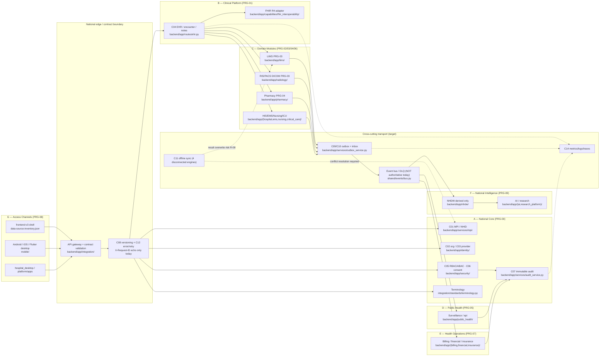

# GULA National Architecture Blueprint V2

**Document class:** Target-state architecture blueprint (planning artifact).
**Status:** PROPOSED / PENDING OWNER APPROVAL. No program, workstream, contract, threshold, or release in this document is approved by virtue of being written here.
**Standing posture:** **HOLD TRUE** · `production_ready_items = 0` · **Stable v1.0.0 NOT DECLARED** · **PRODUCTION READY NOT AUTHORIZED**.
**Authority source:** `GOVERNANCE/FINAL_DECISION.md` (§1/§4/§7/§8/§9/§10 HOLD), `GOVERNANCE/GECS/MASTER_CONTROL.md` (§3/§7/§8 HOLD must not become GO), `GOVERNANCE/NATIONAL_INTEGRATION/status_registry.json`.
**Repository scope:** `/home/samertts/workspace/projects/gula-integration` only. Sibling `gula-platform` is excluded; no source, test, config, migration, protected record, commit, push, PR, merge, or deployment action is authorized by this document.
**Baseline:** branch `integration/gula-unification-v1`, HEAD `2206654dc713ea2de8c564a3207dfe05fde23549`.

---

## 1. Purpose, reading rules, and non-claims

This blueprint defines the **TARGET** national architecture for GULA across layers A–G. Layers A–G are **target scope, not claims of current existence**. A component appearing in a layer table asserts only that (a) the target requires that capability and (b) some cited repository path is candidate evidence for it; it does **not** assert that the capability is complete, registered, integrated, tested end to end, reviewed, accepted, or fit for national operation.

Reading rules (mandatory):

1. Every status in this document uses the exclusive V2 vocabulary: IMPLEMENTED · TESTED · INDEPENDENTLY REVIEWED · ACCEPTED · PRODUCTION READY · PARTIALLY IMPLEMENTED · DOCUMENTED ONLY · PLANNED · BLOCKED. Distinction labels SOURCE / WORKING PROTOTYPE / DOCUMENTED DESIGN / TEST-ONLY / PRODUCTION-VERIFIED are **not** statuses.
2. No status is upgraded without a cited path. API existence is not clinical service completion. `DECISION-READY` is not `ACCEPTED`.
3. `PRODUCTION READY` is unreleased in this V2 set: `GOVERNANCE/NATIONAL_INTEGRATION/status_registry.json` records `production_ready_items = 0`. Historical `PRODUCTION_READY`/certification claims (`ENTERPRISE_PRODUCTION_CERTIFICATION_REPORT.md`, `MASTER_RELEASE_CERTIFICATION.md`, `SECURITY_CERTIFICATION.md`, `DEVOPS_CERTIFICATION.md`) are **conflicts requiring owner decision NV2-D09**, not current status.
4. `P-02 / AUD-F02` is IMPLEMENTED · TESTED · INDEPENDENTLY REVIEWED (engineering scope), **not** ACCEPTED, **not** PRODUCTION READY; two accepted LOW residuals (`P-02_FINAL_CLOSURE_2026_11_24.md`, `P-02_INDEPENDENT_REVIEW_2026_11_24.md`).
5. `P-03 / AUD-F03` remains PREPARED ONLY · NOT IMPLEMENTED; D1–D5 absent from `GULA_OWNER_DECISION_REGISTER.md` §9; T9 deferred to a separate P-03-CONCURRENCY package (`P-03_READINESS_2026_11_24.md`, `P-03_CONCURRENCY_DESIGN.md`). **This is never `PRG-03`**, which is Diagnostics and Laboratory Systems.
6. `NOT VERIFIED` is used where the audit found no execution evidence; no completion percentages are asserted.

### 1.1 Priority order of principles

| # | Principle | Target statement | Evidence / constraint |
|---|---|---|---|
| AP-1 | Modular platform, monolith default | Default to a modular monolith with enforced module boundaries; extract a service only when a measured threshold is met. Extraction thresholds are PROPOSED pending NV2-D05. | Existing active surface is one FastAPI app: `backend/app/main.py`, `backend/app/factory.py` (`create_app()` ~line 1097, `_register_routes()` ~lines 519–836 with ~100 `include_router` calls). |
| AP-2 | No rebuild-from-zero | Reuse, re-point, and contract-wrap existing assets; do not restart the platform. | `GULA_AUDIT_REMEDIATION_ROADMAP.md`, `GULA_COMPLETION_PLAN.md`, `GULA_COMPONENT_INVENTORY.md` §4. |
| AP-3 | Preserve dormant and strategic assets | Dormant modules are strategic assets; archive, re-point, or improve without deletion. | `backend/app/domain_platform/config/dormancy.json`, `backend/app/domain_platform/policies/dormancy_policy.py`, `backend/app/national_data/`, `archive/`. |
| AP-4 | Patient-centred | Patient identity, consent, and care continuity precede workflow automation. | `backend/app/services/mpi/`, `backend/app/identity/services/consent_service_v2.py`, `backend/app/care_continuum/`. |
| AP-5 | Laboratory is a domain, not a utility | LIMS owns orders/results/QC semantics; other layers consume contracted results. | `backend/app/lims/`, `backend/app/domain_platform/manifest.py` (domain `laboratory`). |
| AP-6 | Single authoritative owner per data class | Derived copies never become competing sources of truth (seed §8). | `backend/app/nhdw/`, `backend/app/national_data/` (dormant), `backend/app/health_data/`. |
| AP-7 | Contract-first and fail-closed | Versioned schemas, backward compatibility, idempotent consumers, fail-closed authorization. | `backend/app/security/abac.py` defaults DENY; `contracts/export/openapi.json` is a 98-byte stub → gap, not proof. |
| AP-8 | Target scope only | Architecture is descriptive of intent; existence is decided by the module registry V2. | `GULA_NATIONAL_MODULE_REGISTRY_V2.md` (companion deliverable). |

**PROPOSED extraction thresholds (NV2-D05, NOT APPROVED):** a module may be extracted only when at least two of the following hold and G1 revalidation passes: independent team ownership plus independent release cadence; a distinct scaling or availability profile with evidence (`NOT VERIFIED` today — no reproducible national load artifact, `reports/production_audit_report.md` MISSION-019/020 not executed); a regulated isolation or data-residency boundary requiring a separate failure domain; proven inter-module latency/contention that the monolith cannot satisfy. No threshold is currently measured as met.

---

## 2. Target layer maps (A–G)

Statuses are for the **cited candidate evidence**, not for the target layer as a whole. All layers are target scope.

### A — National Core (PRG-00)

| Target component | Candidate evidence path | Evidence-based status | Target responsibility |
|---|---|---|---|
| Patient identity / MPI / NHID | `backend/app/services/mpi/`, `GULA_MPI_FINAL_INDEPENDENT_AUDIT.md`, `GULA_MPI_INDEPENDENT_AUDIT_FINDINGS.md` | IMPLEMENTED · TESTED · INDEPENDENTLY REVIEWED (protected audit MD5s unchanged: `1a02c015…`, `ea3969d0…`); NOT ACCEPTED | C01 owner; authoritative patient identity |
| Organization / facility hierarchy | `backend/app/identity/`, `backend/app/services/hospital_service.py` | IMPLEMENTED (source); ownership split NOT RESOLVED — NV2-D03 | C02 owner |
| Provider registry | `backend/app/capabilities/provider_management/`, `backend/app/identity/professional_registry/` (per domain evidence) | PARTIALLY IMPLEMENTED (registry in domain evidence; capability is a stub per `backend/app/capabilities/`) | C03 owner |
| RBAC / ABAC / authorization decision | `backend/app/security/rbac.py`, `backend/app/security/abac.py`, `backend/app/identity/services/authorization_decision.py` | IMPLEMENTED · TESTED (HEAD-code); B1/B2/B3/B5 engineering-reviewed with residuals, no PRODUCTION READY (`INDEPENDENT_VERIFICATION_TEAM_C_TIER_B.md`) | C05 owner; deny-by-default |
| Consent | `backend/app/identity/services/consent_service_v2.py`, `backend/app/identity/models/consent.py` | IMPLEMENTED · TESTED; full field-level enforcement NOT independently confirmed (`FIELD_SECURITY.md`) | C06 owner |
| Audit (immutable national evidence) | `backend/app/services/audit_service.py`, `scripts/audit_verifier.py`, `backend/app/identity/services/canonical_audit.py` | IMPLEMENTED · TESTED at HEAD with an unlocked-tail concurrency defect (`P-03_READINESS_2026_11_24.md`); fix is uncommitted → BLOCKED for acceptance | C07 owner; no domain owns audit truth |
| Terminology | `integration/standards/terminology.py` | PARTIALLY IMPLEMENTED (in-memory static CodeSystem registry; `validate()` true for known system with empty concepts) | Terminology owner (NV2-D11) |
| Contract registry / versioning | `contracts/api/v1/catalog.json`, `contracts/events/catalog.json`, `contracts/export/openapi.json` (98 bytes), `health_core/contracts/version.py` (LOCAL_SYNTHETIC_ONLY) | PARTIALLY IMPLEMENTED / DOCUMENTED DESIGN; C08 is not operational | C08 owner |

### B — Clinical Platform (PRG-01)

| Target component | Candidate evidence path | Evidence-based status | Target responsibility |
|---|---|---|---|
| EHR / encounter / clinical note | `backend/app/routes/ehr.py`, `backend/app/ehr/models/`, `backend/app/services/ehr_service.py`, `backend/app/capabilities/encounter_management/` | PARTIALLY IMPLEMENTED (EHR source present; encounter capability is an empty CRUD stub per backend evidence) | C04 authoring of encounter/note/diagnosis/care plan |
| Clinical orders and results | `backend/app/capabilities/clinical_foundation/`, `backend/app/national/domain/{clinic,visit,appointment,encounter}.py` | PARTIALLY IMPLEMENTED (capability stub; national domain source present) | C04 authoring; execution delegated to C/D layers |
| FHIR interoperability | `backend/app/capabilities/fhir_interoperability/`, `routes/ehr_fhir.py`, `national/fhir/**`, `interoperability/fhir_http/router.py`, `health_core/fhir/{serializers,deserializers}.py` | IMPLEMENTED · TESTED (registered in factory); most resources read-only, stale validation report → not completion | C04 transport for suitable resources |
| Care continuum (MCH/immunization/chronic/home) | `backend/app/care_continuum/models/{maternal,immunization,chronic_disease,care_journey}.py`, `backend/app/routes/care_continuum.py` | IMPLEMENTED · TESTED per domain evidence | Longitudinal care; feeds D layer by authorized events |
| Clinical safety / alerting | `CLINICAL_ALERT_RELIABILITY_REPORT.md`, `backend/app/security/clinical_gateway.py` (gateway) | DOCUMENTED ONLY / partial source; clinical journey not E2E verified (`GULA_COMPONENT_INVENTORY.md` §4, OD-008) | G3 evidence owner |

### C — Domain Modules (PRG-02, PRG-03, PRG-04, PRG-06)

| Target component | Candidate evidence path | Evidence-based status | Target responsibility |
|---|---|---|---|
| Hospital / bed / assets (HIS) | `backend/app/services/hospital_service.py`, `backend/app/routes/hospital.py`, `backend/app/hospital/models/__init__.py`, `hospital_desktop/` | IMPLEMENTED (strong source+test per domain evidence) | Facility operations |
| Emergency / EMS | `backend/app/ems/`, `backend/app/national/intelligence/` | IMPLEMENTED · TESTED per domain evidence | PRG-02 prehospital workflow |
| Nursing | `backend/app/nursing/` | IMPLEMENTED · TESTED per domain evidence | PRG-02 ward workflow |
| Critical care / ICU | `backend/app/critical_care/` | IMPLEMENTED · TESTED per domain evidence | PRG-02 ICU workflow |
| Diagnostics / LIMS | `backend/app/lims/`, `lab_service.py`, `sample_service.py`, `test_result_service.py`, `quality_control_service.py` | IMPLEMENTED · TESTED (strong source+test) | PRG-03 order/result/QC truth (C04) |
| Radiology / RIS-PACS | `backend/app/radiology/` incl. `pacs.py` DICOMStorageService | IMPLEMENTED (source); DICOM dependency contradiction — NV2-D11 | PRG-03 imaging truth, DICOM objects |
| Pharmacy / medication | `backend/app/pharmacy/`, `backend/app/pharmacy/inventory.py` | IMPLEMENTED · TESTED per domain evidence | PRG-04 medication/dispensation truth |
| Blood bank | `backend/app/blood_bank/`, `backend/tests/blood_bank/` | IMPLEMENTED · TESTED; owner PRG-03/PRG-02 UNRESOLVED — NV2-D03 | Transfusion chain of custody |
| Specialty gaps (oncology, cardiology, nephrology, mental health, dental, rehabilitation) | `GULA_COMPONENT_INVENTORY.md` §4; `GULA_COMPONENT_INVENTORY.md` analytics/enum references only | DOCUMENTED ONLY / PARTIALLY IMPLEMENTED; Dental #10, Rehabilitation #13, Mental health #14 NOT IMPLEMENTED | PRG-06, R-12 |

### D — Public Health (PRG-05)

| Target component | Candidate evidence path | Evidence-based status | Target responsibility |
|---|---|---|---|
| Surveillance | `backend/app/public_health/`, `backend/app/national/intelligence/public_health/surveillance.py` | IMPLEMENTED (source+test per domain evidence) | Case/event ingestion from authorized clinical events |
| Epidemiology | `backend/app/services/epidemiology.py` | IMPLEMENTED (source) | Aggregate analysis |
| Immunization programme | `backend/app/care_continuum/models/immunization.py`, `backend/app/public_health/` | IMPLEMENTED · TESTED (domain evidence) | PRG-05 reporting; legal scope NV2-D08 |
| Legal reporting / DHIS2 export | `backend/app/routes/compliance.py` (~line 551+) | PARTIALLY IMPLEMENTED | Reporting scope requires NV2-D08 |

### E — Health Operations (PRG-07)

| Target component | Candidate evidence path | Evidence-based status | Target responsibility |
|---|---|---|---|
| Billing / financial / payments | `backend/app/billing/`, `backend/app/financial/` | IMPLEMENTED (source; duplicated stacks flagged in backend evidence) | Financial operations; no forced FHIR on administrative data |
| Insurance | `backend/app/insurance/` | BLOCKED (Insurance #16 per `GULA_COMPONENT_INVENTORY.md` §4) | PRG-07; owner decision pending |
| Workforce / HR | `backend/app/governance/models/workforce.py` | PARTIALLY IMPLEMENTED | Workforce registry |
| Procurement | `GULA_COMPONENT_INVENTORY.md` (partial) | PARTIALLY IMPLEMENTED / DOCUMENTED ONLY | Supply chain |
| Biomedical / devices | `backend/app/biomedical/`, `backend/app/devices/`, `gateways/lab_device_gateway.py` (HMAC + replay) | IMPLEMENTED (source); device outbox `simulation_only=True` | Device lifecycle; C09/C12 boundary |
| Quality | `backend/app/clinical/quality/` | IMPLEMENTED (source) | Quality management |

### F — National Intelligence (PRG-09)

| Target component | Candidate evidence path | Evidence-based status | Target responsibility |
|---|---|---|---|
| NHDW / health data platform | `backend/app/nhdw/`, `backend/app/health_data/` | IMPLEMENTED (source); derived-only rule not yet enforced by contract | Derived analytics only; never primary clinical source |
| National data (dormant) | `backend/app/national_data/` | DOCUMENTED ONLY / dormant (dormancy.json) | Preserve; no activation |
| Research platform | `backend/app/research_platform/` | IMPLEMENTED (source per domain evidence) | Research access under consent/ABAC |
| AI / AI fabric | `backend/app/ai/`, `backend/app/ai_fabric/` | PARTIALLY IMPLEMENTED; R-16 AI governance/clinical safety open; DeepSeek rotation UNVERIFIED (`GULA_MASTER_EXECUTION_STATUS.md:173`) | Decision support under clinical safety gate G3 |
| National intelligence | `backend/app/national/intelligence/` | IMPLEMENTED (source) | Population insight |

### G — Access Channels (PRG-08)

| Target component | Candidate evidence path | Evidence-based status | Target responsibility |
|---|---|---|---|
| Web shell | `frontend-v3/src/routes/index.tsx` (94 paths, 80 RoleGuard usages), `frontend-v3/src/api/generated/client.ts` (919 lines), `frontend-v3/data-source-inventory.json` | WORKING PROTOTYPE — 72 unbound, 17 demo-only, 3 safe_bridge, 2 contract-bound; 92 non-operational, 2 blocked-until-server-enforcement | Channel shell, not 94 operational workflows |
| Contract-bound web pages | `frontend-v3/src/pages/patients/PatientsPage.tsx`, `frontend-v3/src/pages/orders/OrdersPage.tsx` | IMPLEMENTED · TESTED (only two contract-bound surfaces) | Reference binding for other channels |
| Android | `mobile/android/` (Retrofit/Room/Hilt/WorkManager, cert pinning, 43 @Test; `mobile-android.yml`) | IMPLEMENTED · TESTED (CI-managed source) | Field/clinical channel |
| iOS | `mobile/ios/` (61 tests; expected Xcode workspace/project metadata absent) | PARTIALLY IMPLEMENTED — CI cannot bind | Clinical channel; G8 blocker |
| Flutter desktop | `mobile/desktop/` (24 GoRoute paths, Drift offline queue, 9 tests; `mobile-flutter-desktop.yml`) | IMPLEMENTED · TESTED (CI-managed source) | Desktop clinical channel |
| Hospital desktop | `hospital_desktop/` (~2,055-line views, `offline.py` 534 lines, 3 unittest methods, no CI/Compose) | PARTIALLY IMPLEMENTED — source, not wired | Facility channel |
| Platform apps | `platform/apps/{citizen,doctor,hospital,laboratory,ministry,nurse,pharmacy,radiology}` | IMPLEMENTED (source only); no test scripts/dist/CI | Persona channels; not deployed |
| Directorate/governorate app | NOT FOUND | PLANNED / NOT VERIFIED | G11 national operations gap |

---

## 3. Cross-cutting mechanisms

| Mechanism | Target behaviour | Current evidence and status | Governing contract / gate |
|---|---|---|---|
| Identity & federation | Signed tokens, JTI blacklist, permission-version revocation, refresh rotation, MFA, OAuth2 PKCE, service accounts | IMPLEMENTED · TESTED HEAD-code: `shared/auth/jwt.py`, `backend/app/security/auth.py`, `backend/app/security/session.py`, `backend/app/security/mfa_service.py`, `backend/app/security/oauth2_provider.py`, `backend/app/security/service_accounts.py`; HS256 only, no OIDC/JWKS (`backend/app/config.py:178`, JWKS route 503) | C01/C03; NV2-D06; G2 |
| RBAC/ABAC | Deny-by-default, purpose/scope/relationship verification, fail-closed on audit failure | IMPLEMENTED · TESTED: `backend/app/security/abac.py`, `identity/services/authorization_decision.py`, `identity/adaptive_auth/b4_guard.py`, `security/platform_access.py`, `identity/api/step_up.py` | C05; R-04; G2 |
| Consent | Versioned, subject-granted, purpose-allowlisted, time-capped, canonical audit on grant/withdraw/check | IMPLEMENTED · TESTED: `identity/services/consent_service_v2.py`, `identity/models/consent.py`; field-level enforcement NOT independently confirmed (`FIELD_SECURITY.md`) | C06; R-07; G2/G3 |
| Audit | Immutable hash chain + HMAC anchors, append-only PG triggers, independent verifier | IMPLEMENTED at HEAD with concurrency defect and uncommitted fix (`services/audit_service.py`, `scripts/audit_verifier.py`, `P-03_READINESS_2026_11_24.md`); P-03 / AUD-F03 separate BLOCKED package | C07; R-03; G2/G12 |
| Terminology | Authoritative CodeSystem/ValueSet service | PARTIALLY IMPLEMENTED (`integration/standards/terminology.py` in-memory registry) | C04; NV2-D11; G1 |
| Events | Single authoritative event store with correlation, DLQ, retry | NOT IMPLEMENTED: three buses plus one outbox are disconnected (`shared/events/bus.py`, `backend/app/kernel/event_bus/`, `health_core` synthetic events, `backend/app/services/outbox_service.py`); no async broker dependency (`aio_pika` missing); kernel publish never populates its own outbox/inbox/DLQ | C09; R-14; G4/G10 |
| Outbox | Transactional outbox, 5-attempt retry, dead-letter, idempotent consumers | PARTIALLY IMPLEMENTED: `backend/app/services/outbox_service.py`, `backend/app/models/outbox.py`, `integration_inbox.py`, `worker.py`; `OutboxWorker` marks done with zero successful handlers; dual worker in `core/startup.py:270-272`; inbound inbox stages but does not auto-apply | C09/C10/C12; R-14 |
| Observability | Metrics, structured logs, propagated traces, SLO alerting | PARTIALLY IMPLEMENTED: `/metrics` JSON + `/metrics/prom`, structured JSON logging; Helm ServiceMonitor scrapes wrong endpoint, SLO metrics not emitted, no runtime OTel instrumentation (`helm/gula-platform`, infra evidence) | C14; G10 |
| Offline | Durable queue, deterministic conflict resolution, convergence proof | NOT IMPLEMENTED at national scope: four disconnected engines, HEAD `CRDT_MERGE` first-seen-key-wins can overwrite lab result; fix only uncommitted; no durable production queue (`integration` evidence) | C11; R-08; G9 |
| API versioning | Explicit request negotiation, Deprecation/Sunset, stable contract | PARTIALLY IMPLEMENTED: live OpenAPI from FastAPI, `X-API-Version: 2.5.0` emitted, checked-in `openapi.json` v2.1.0 with zero paths; `contracts/routes.py:52` broken import breaks 4 endpoints | C08; G4 |
| Data ownership | One owner per class; derived copies never authoritative | PARTIALLY IMPLEMENTED: owner rules defined in seed §8; owners not appointed (`GULA_OWNER_DECISION_REGISTER.md`, OD-003…OD-025 BLOCKED) | NV2-D03; G1/G5 |

---

## 4. Target data flow (Mermaid)

**Diagram caveat:** edges describe TARGET flow. Arrows into the audit service are append-only evidence writes; no domain owns audit truth. The offline edges are dashed because C11 convergence is not proven and the HEAD merge rule can overwrite a lab result. The event bus is not an authoritative event store today.

---

## 5. National integration contract map (C01–C15)

All contracts are **target definitions pending owner approval**; statuses cite current evidence.

| ID | Contract | Proposed owner | Evidence-based status | Cited evidence |
|---|---|---|---|---|
| C01 | Patient Identity | PRG-00 | IMPLEMENTED · TESTED · INDEPENDENTLY REVIEWED (not ACCEPTED) | `backend/app/services/mpi/`; `GULA_MPI_FINAL_INDEPENDENT_AUDIT.md`; protected MD5 `1a02c015…` |
| C02 | Organization | PRG-00 | PARTIALLY IMPLEMENTED | `backend/app/identity/`; `backend/app/services/hospital_service.py`; owner split unresolved |
| C03 | Provider | PRG-00 | PARTIALLY IMPLEMENTED | `backend/app/capabilities/provider_management/` (stub); `backend/app/identity/` |
| C04 | Clinical Resource | PRG-01 | PARTIALLY IMPLEMENTED | `backend/app/routes/ehr.py`; `backend/app/capabilities/fhir_interoperability/`; read-only resources per KNOWN_LIMITATIONS §2 |
| C05 | Authorization | PRG-00 | IMPLEMENTED · TESTED (residuals) | `backend/app/security/abac.py`; `backend/app/identity/services/authorization_decision.py`; `INDEPENDENT_VERIFICATION_TEAM_C_TIER_B.md` |
| C06 | Consent | PRG-00 | IMPLEMENTED · TESTED (field-level NOT confirmed) | `backend/app/identity/services/consent_service_v2.py`; `FIELD_SECURITY.md` |
| C07 | Audit | PRG-00 / PRG-10 | IMPLEMENTED with defect; acceptance BLOCKED | `backend/app/services/audit_service.py`; `P-03_READINESS_2026_11_24.md` |
| C08 | API Versioning | PRG-00 / PRG-10 | PARTIALLY IMPLEMENTED | `contracts/export/openapi.json` (98-byte stub); `contracts/routes.py:52`; `X-API-Version: 2.5.0` middleware |
| C09 | Event | PRG-10 | NOT IMPLEMENTED (three buses + outbox disconnected) | `shared/events/bus.py`; `backend/app/kernel/event_bus/`; `backend/app/services/outbox_service.py` |
| C10 | Idempotency | PRG-10 | PARTIALLY IMPLEMENTED | `backend/app/models/integration_inbox.py`; `integration/inbox.py` (stages, no auto-apply) |
| C11 | Offline Synchronization | PRG-08 / PRG-10 | PARTIALLY IMPLEMENTED / NOT VERIFIED convergence | `GULA_OFFLINE_SYNC_REASSESSMENT.md`; native clients in `mobile/`; `hospital_desktop/offline.py` |
| C12 | Error and Retry | PRG-10 | PARTIALLY IMPLEMENTED | `backend/app/services/outbox_service.py` (5 attempts); `gateways/lab_device_gateway.py` (HMAC + replay) |
| C13 | Data Retention | PRG-00 / PRG-10 | DOCUMENTED ONLY | `backend/app/services/outbox_service.py` (30-day purge) is partial evidence; retention policy owner not appointed |
| C14 | Observability | PRG-10 | PARTIALLY IMPLEMENTED | `/metrics/prom`; `helm/gula-platform` ServiceMonitor mis-target; no emitted SLO metrics |
| C15 | Migration and Compatibility | PRG-10 | PARTIALLY IMPLEMENTED | 111 Python revisions, single head `20261119_0003`, 4 merge revisions, 0 dangling/duplicate IDs; documented counts conflict 48/110/111 |

**Contract rules (parallel-team dependency rule):** parallel development is allowed only against approved contracts and versioned schemas. No team may change C01–C15, protected governance records, or shared National Core semantics locally. Changes to shared contracts require contract review + version bump + G1 revalidation. Data migrations and shared schema changes are serialized checkpoints.

---

## 6. Standards policy

| Domain | Standard | Target policy | Evidence / caveat |
|---|---|---|---|
| Clinical resources (patient, encounter, observation, diagnostic report, medication request) | FHIR R4 | Use FHIR R4 where a suitable resource exists; map at the boundary, keep domain truth authoritative | `backend/app/capabilities/fhir_interoperability/`, `routes/ehr_fhir.py`, `national/fhir/**`, `health_core/fhir/{serializers,deserializers}.py`; most resources read-only, stale validation report claims a removed Procedure 501 |
| Imaging | DICOM | DICOM for imaging objects and QIDO/WADO/STOW; strategy requires NV2-D11 | `backend/app/radiology/pacs.py`, `integration/gateway/dicom_gateway.py`; no `pydicom`/`pynetdicom` dependency; docs contradictory (KNOWN_LIMITATIONS) |
| Devices and lab instruments | HL7 v2 / ASTM as applicable | Generic HL7 v2 parse/serialize/ACK and ASTM where the device supports it; HMAC + replay protection mandatory | `integration/standards/{hl7,astm}.py`, `gateways/lab_device_gateway.py`, `lims/integration/*`; HL7→FHIR HTTP returns `simulationOnly: True`; device outbox `simulation_only=True` |
| Administrative data (organization, workforce, billing, insurance, inventory) | Not FHIR | **Do not force FHIR onto administrative data**; use contracted JSON/events with explicit versioning | `backend/app/{billing,financial,insurance}/`, `backend/app/governance/models/workforce.py` |
| Terminology | CodeSystem/ValueSet | Authoritative terminology service; no in-memory stub as national truth | `integration/standards/terminology.py` (empty concepts) |
| IHE profiles / DHIS2 | As applicable | Profile-driven integration; legal reporting scope NV2-D08 | `integration/standards/ihe.py`, `backend/app/routes/compliance.py` |
| Contract format | OpenAPI / AsyncAPI / FHIR CapabilityStatement | Contract-first, schema validation, backward compatibility, explicit versioning | `contracts/export/{openapi,asyncapi,fhir}.json` are 98/102/305-byte stubs — must be replaced before G1 |

---

## 7. Deployment topology — today versus target

| Aspect | Today (evidence) | Target (proposed, pending NV2-D07/NV2-D10) |
|---|---|---|
| Application topology | Single FastAPI monolith plus parallel experimental trees (`backend/core/api/`, `backend/gateway/`, `backend/services/*/main.py`, top-level `services/*`, `api/demo-api/`, `server/index.ts`) | Modular monolith with enforced boundaries; extraction only via AP-1 thresholds and NV2-D05 |
| HA | Config-only: `config/postgres-ha/patroni.yml`, backup/PITR configs, cross-region replication; PG primary+replica, PgBouncer to primary only, Redis Sentinel quorum 1, Kafka RF 1, single RabbitMQ/MinIO, Keycloak `-dev`, Vault `-dev` | Measured HA with real failover evidence, quorum >=2, redundant broker/object store, no dev-mode identity/secret services |
| Containers / orchestration | 15 Dockerfiles, 9 Compose files, Helm `helm/gula-platform` (HPA 2–10, PDB, ServiceMonitor, PVCs), k8s manifests, Terraform | Same asset base, corrected drift, DR and performance gates promoted from warning-only to hard |
| Backup / DR | Scripts exist (`scripts/backup.sh`, `pitr-recover.sh`, `restore-test.sh`, `validate-restore.sh`, `dr-*.sh`) but `DATABASE_RECOVERY_REPORT.md:7-11` NOT IMPLEMENTED/BLOCKED; no drill; known script defects (mysql clients, `|| true`, undefined `DR_IP`) | Proven restore/PITR drill, declared RTO/RPO/P95/P99 via NV2-D07, G6 evidence |
| Performance | Targets exist (k6 read p95 <500ms, write p95 <1000ms, health p99 <200ms) but no reproducible artifacts; `.benchmarks` empty | Reproducible load/chaos artifacts, G7 hard gate |
| Observability | `/metrics/prom` plus JSON logs; ServiceMonitor mis-target, SLO metrics not emitted, no runtime OTel FastAPI instrumentation | Contracted C14 metrics/logs/traces with correlation and DLQ alerting, G10 |
| CI trust | 32 workflows; hard gates for lint/tsc/build/pytest/safety/bandit; advisory nightly/performance; no DR gate; Semgrep rules with no workflow invocation | R-17 closed with executed security tooling and signed provenance |

### 7.1 Environment separation (target)

| Environment | Purpose | Evidence boundary |
|---|---|---|
| `local` | Developer loop, synthetic data only | `backend/tests/conftest.py` forces SQLite in-memory — explicitly NOT PostgreSQL evidence |
| `ci` | Contract, unit, static gates | `.github/workflows/`; G1/G2/G4 partial today; DR/performance advisory only |
| `integration` (target, NOT VERIFIED) | PostgreSQL 16/17 with real locks, sequences, DDL, append-only audit triggers; no PHI | Required to close R-03/R-09 and the SQLite substitution gap |
| `staging` (target, NOT VERIFIED) | Contract-bound synthetic 15-step journey, offline convergence, failover/PITR drill | G5/G6/G9/G11 evidence |
| `production` (target, NOT AUTHORIZED) | Controlled rollout only after G1–G12 and owner acceptance NV2-D15 | `GOVERNANCE/FINAL_DECISION.md`; `status_registry.json` `production_ready_items = 0` |

No production database, service, provider, financial, or external network call was used in preparing this document; none is authorized by it.

---

## 8. Migration and in-flight provenance warning

**Do not treat the working tree as a stable baseline.** At drafting time the repository has mixed provenance:

- 20 staged R100 renames (name-status MD5 `56c524d6ffe9872c3a3ac6eff8c8f203`) moving `national/workflow_runtime`, `identity/workflows` engine/models, `platform/workflow.py` into `archive/legacy/workflow_runtime/`; the canonical replacement `backend/app/workflows/` is **untracked**.
- 162 unstaged tracked changes and 686 untracked entries before V2 documents (collapsed untracked view: 313).
- `backend/app/national_data/` and `health_core/` are untracked/dormant and must be preserved.
- `GOVERNANCE/NATIONAL_INTEGRATION/status_registry.json` worktree SHA-256 differs from the committed HEAD blob — the protected version exists only uncommitted; preserve it.
- Protected MD5s must remain unchanged: FINAL_DECISION `effdfeaf10234678d83b2668c4489552`, MPI_FINAL_INDEPENDENT_AUDIT `1a02c01563c93b07a7cdb92c0462bf36`, MPI_INDEPENDENT_AUDIT_FINDINGS `ea3969d09aaf7b0b28a065838b44a594`.
- The complete `backend/app/national/api/routes/__init__.py` (16 sub-routers) has **no factory import** — a whole national API surface is unregistered.
- 8 of 10 capability scaffolds are empty CRUD stubs advertised as metadata by `backend/app/kernel/capabilities_registry_populator.py`.
- Route counts conflict across reports (1,442 / 1,804 / 1,815 / 1,817 paths); 2,388 static decorators include unregistered surfaces. No live import measurement was performed.

**Rule:** NV2-D02 (resolve mixed Git provenance) is a prerequisite to any save, merge, or baseline re-cut. This V2 set is additive documentation only and must not be used to justify progressing any in-flight migration.

---

## 9. Target-versus-current gap table

| Gap ID | Target requirement | Current evidence | Risk / decision |
|---|---|---|---|
| GAP-01 | Approved target architecture and program boundaries | This blueprint is PROPOSED only | NV2-D01; R-18 |
| GAP-02 | Single authoritative MPI/org/provider contracts | MPI reviewed; org/provider split and unappointed owners | NV2-D03; R-02 |
| GAP-03 | Registered national API surface | 16 national sub-routers unregistered in factory | R-02; G4 |
| GAP-04 | Functional capability catalogue | 8/10 capabilities are empty CRUD stubs | R-12; W1/W3 |
| GAP-05 | Authoritative event store, DLQ, correlation | Three buses + one outbox disconnected; no `X-Correlation-ID`; `request.state.correlation_id` unset | C09; R-14; G10 |
| GAP-06 | Transactional outbox correctness | `OutboxWorker` marks done with zero successful handlers; dual worker | C10/C12; R-14 |
| GAP-07 | Durable offline convergence | Four disconnected engines; HEAD CRDT overwrites results; fix uncommitted | C11; R-08; G9 |
| GAP-08 | PostgreSQL-backed verification | `backend/tests/conftest.py` forces SQLite | R-09; G5 |
| GAP-09 | Audit chain concurrency safety | HEAD defect reproduced on PG16.14; fix uncommitted; P-03 / AUD-F03 separate | C07; R-03; NV2-D12 |
| GAP-10 | Zero-trust enforcement | `zero_trust.py` in-memory demo sessions; revocation commented out; no OIDC/JWKS | C05; R-04; NV2-D06 |
| GAP-11 | National-scale performance evidence | No reproducible load/chaos artifacts | R-10; G7 |
| GAP-12 | Proven backup/PITR/DR | Scripts only; NOT IMPLEMENTED/BLOCKED | R-11; G6 |
| GAP-13 | Operational channels | v3 92 non-operational surfaces; iOS CI binding missing; no directorate app; `platform/apps` not wired | R-13; G8/G11 |
| GAP-14 | DICOM and terminology strategy | Missing DICOM deps, contradictory docs; in-memory terminology | NV2-D11; G1 |
| GAP-15 | Contract artefacts | Export stubs 98/102/305 bytes; checked-in OpenAPI zero paths; 4 broken schema endpoints | C08; G1/G4 |
| GAP-16 | Status conflict resolution | Historical certifications vs HOLD | NV2-D09; R-15 |
| GAP-17 | Clean provenance | 20 staged R100, 162 unstaged, 686 untracked | NV2-D02; R-01 |
| GAP-18 | Clinical safety / E2E journey | 13 Playwright specs are navigation checks; no complete journey; OD-008 BLOCKED | G3; R-16 |

---

## 10. Decision dependencies (NV2)

| Decision | Blocks in this blueprint | Referenced sections |
|---|---|---|
| NV2-D01 Approve V2 target architecture and program boundaries | All layer ownership, W1/W3 start | §2, §9 |
| NV2-D02 Resolve mixed Git provenance before any save/merge | Baseline integrity, all migrations | §8, GAP-17 |
| NV2-D03 Appoint data and contract owners | C01–C15 ownership, blood bank owner, org/provider split | §2, §5 |
| NV2-D04 Approve controlled release gates and HOLD posture | G1–G12 activation | §7.1, §11 |
| NV2-D05 Service extraction vs modular monolith thresholds | AP-1, deployment topology | §1, §7 |
| NV2-D06 National zero-trust policy incl. break-glass and service identity | C05/C06/C07 enforcement | §3 |
| NV2-D07 RTO/RPO/availability/P95/P99 and measurement plan | HA/DR/performance targets | §7, GAP-11/12 |
| NV2-D08 Public-health reporting/legal scope | D layer reporting, DHIS2 export | §2D |
| NV2-D09 Older certification vs HOLD conflict | Status authority of every module row | §1 rules 3–5 |
| NV2-D10 First parallel workstream set and resources | WS-CORE-01…WS-GOV-01 | §10.1 |
| NV2-D11 DICOM/PACS and terminology strategy | C04 imaging, terminology service | §6 |
| NV2-D12 P-03 / AUD-F03 D1–D5 separately | Audit chain closure (not V2 execution start) | §3, GAP-09 |
| NV2-D13 P-03-CONCURRENCY separately | Concurrent writer fix promotion | §3, §8 |
| NV2-D14 National test environments and synthetic data policy | `integration`/`staging`, E2E harness | §7.1 |
| NV2-D15 Stable v1.0.0 release candidacy only after G1–G12 | Any release activity | §1, §7.1 |

### 10.1 First parallel workstream set (proposal, pending NV2-D10)

WS-CORE-01 identity contracts (PRG-00) · WS-SEC-01 zero-trust test harness (PRG-10) · WS-AUD-01 audit-chain evidence design, documentation/test only — **no P-03 / P-03-CONCURRENCY execution** (PRG-00/PRG-10) · WS-OBS-01 observability contract (PRG-10) · WS-DB-01 migration safety/DR runbook design (PRG-10) · WS-E2E-01 synthetic 15-step journey skeleton (PRG-01/PRG-10) · WS-API-01 OpenAPI/contract-first tooling (PRG-00/PRG-10) · WS-GOV-01 documentation index/decision register/backlog (PRG-00). Critical path: W0 → NV2-D01/D02/D03/D04/D07 → W1 (C01–C09) → W3 → W4 → G1–G12 → owner acceptance. W2 (independent enabling work: audit readiness, security test harness, observability, migration safety, E2E synthetic journey harness, API conformance tooling, documentation) proceeds in parallel with W1 using contract stubs only and no domain source changes.

---

## 11. Release gate mapping (target, not activated)

| Gate | Name | Primary evidence required today | Current posture |
|---|---|---|---|
| G1 | Architecture and Contract Validation | Approved blueprint + real C01–C15 artefacts (not 98-byte stubs) | NOT MET |
| G2 | Security and Privacy Validation | OIDC/JWKS or approved alternative, zero-trust enforcement, consent field-level proof | NOT MET; security NOT CERTIFIED (`FINAL_DECISION.md:46`) |
| G3 | Clinical Safety and Data Integrity | Complete synthetic journey, result-modification protection, DLQ/conflict proof | NOT MET; OD-008 BLOCKED |
| G4 | API and Integration Compatibility | Registered national router, version negotiation, working schema endpoints | NOT MET |
| G5 | Database and Migration Validation | PostgreSQL-backed suite, strict schema gate (119 failures recorded) | NOT MET |
| G6 | Backup and Disaster Recovery | Executed restore/PITR drill | NOT MET (`DATABASE_RECOVERY_REPORT.md`) |
| G7 | Performance and Capacity | Reproducible k6/load/chaos artifacts | NOT MET |
| G8 | Mobile and Desktop Validation | iOS CI binding, channel parity, a11y | NOT MET |
| G9 | Offline and Synchronization Validation | Durable queue, convergence proof, result-overwrite fix accepted | NOT MET |
| G10 | Monitoring and Incident Response | C14 contract, emitted SLO metrics, alerting | NOT MET |
| G11 | National Operations Readiness | Directorate/governorate channel, DR runbook, ownership | NOT MET |
| G12 | Independent Review and Final Acceptance | Owner-recorded acceptance; status conflict resolved | NOT MET |

**No gate is passed. No release is authorized. PRODUCTION READY is not assigned to any component in this blueprint.**

---

## 12. Evidence basis

Files and reports inspected for this blueprint (all under `gula-integration`, read-only):

- Governance/authority: `GOVERNANCE/FINAL_DECISION.md`, `GOVERNANCE/GECS/MASTER_CONTROL.md`, `GOVERNANCE/NATIONAL_INTEGRATION/status_registry.json`, `GULA_OWNER_DECISION_REGISTER.md`, `GULA_MASTER_EXECUTION_STATUS.md`, `GULA_RELEASE_ACCEPTANCE_REPORT.md`, `CRITICAL_FILE_SHA256.txt`, `CHECKPOINT_2026_11_20` manifest.
- Backend active surface: `backend/app/main.py`, `backend/app/factory.py`, `backend/app/services/mpi/`, `backend/app/identity/`, `backend/app/security/{auth,abac,rbac}.py`, `backend/app/identity/services/{authorization_decision,consent_service_v2,canonical_audit}.py`, `backend/app/services/audit_service.py`, `scripts/audit_verifier.py`, `backend/app/capabilities/`.
- Domain breadth: `backend/app/domain_platform/manifest.py`, `backend/app/domain_platform/config/dormancy.json`, `backend/app/{lims,radiology,pharmacy,blood_bank,ems,nursing,critical_care,public_health,care_continuum,billing,financial,insurance,nhdw,health_data,national_data,ai,research_platform}/`, `GULA_COMPONENT_INVENTORY.md`.
- Integration: `backend/app/integration/connectors/{lis,pacs}.py`, `integration/gateway/{dicom_gateway,amqp_gateway}.py`, `gateways/lab_device_gateway.py`, `shared/events/bus.py`, `backend/app/kernel/event_bus/`, `backend/app/services/outbox_service.py`, `backend/app/models/integration_inbox.py`, `integration/standards/{hl7,astm,dicom,terminology,ihe}.py`, `contracts/export/{openapi,asyncapi,fhir}.json`, `contracts/routes.py`, `health_core/contracts/version.py`.
- Channels: `frontend-v3/src/routes/index.tsx`, `frontend-v3/data-source-inventory.json`, `frontend-v3/src/pages/patients/PatientsPage.tsx`, `frontend-v3/src/pages/orders/OrdersPage.tsx`, `mobile/android/`, `mobile/ios/`, `mobile/desktop/`, `hospital_desktop/`, `platform/apps/`.
- Tests/quality: `backend/tests/conftest.py`, `ADVERSARIAL_TEST_REPORT.md`, `reports/production_audit_report.md`, `reports/independent-certification-report.md`, `QA_AUDIT*` reports, `P-02_FINAL_CLOSURE_2026_11_24.md`, `P-02_INDEPENDENT_REVIEW_2026_11_24.md`, `P-03_READINESS_2026_11_24.md`, `P-03_CONCURRENCY_DESIGN.md`.
- Security/infra: `GOVERNANCE/SECURITY_REVIEW_REPORT.md`, `INDEPENDENT_VERIFICATION_TEAM_C_TIER_B.md`, `FIELD_SECURITY.md`, `backend/app/security/zero_trust.py`, `config/postgres-ha/patroni.yml`, `helm/gula-platform/`, `DATABASE_RECOVERY_REPORT.md`, `DEVOPS_CERTIFICATION.md`, `GULA_SECURITY_CI_READINESS_PLAN.md`.

All evidence files under `/tmp/opencode/gula_v2_seed.md` and `/tmp/opencode/gula_v2_evidence_*.md` were read in full. No status in this document is derived from an unexecuted historical claim; where execution evidence is absent, the value is `NOT VERIFIED`.
