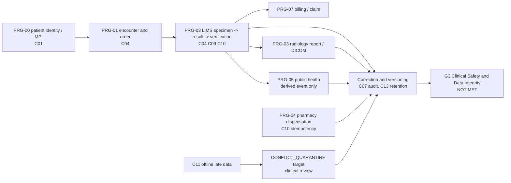

# GULA National Clinical Safety and Data Integrity Plan V2

**Document:** `GULA_NATIONAL_CLINICAL_SAFETY_PLAN_V2.md` (new root-level planning document)
**Status:** `PROPOSED / PENDING OWNER APPROVAL` — planning gate only; no implementation, no execution, no release authority.
**Repository:** `/home/samertts/workspace/projects/gula-integration` only. Sibling `gula-platform` is out of scope and read-only.
**Baseline:** branch `integration/gula-unification-v1`, HEAD `2206654dc713ea2de8c564a3207dfe05fde23549`.

> **BINDING POSTURE:** `HOLD TRUE`; `production_ready_items = 0`; Stable v1.0.0 **NOT DECLARED**;
> **PRODUCTION READY NOT AUTHORIZED**. No clinical workflow in this plan is verified end to end;
> no target below is approved. `GOVERNANCE/FINAL_DECISION.md:13,46`,
> `GULA_MASTER_EXECUTION_STATUS.md:7`, `GULA_OWNER_DECISION_REGISTER.md:9–11`,
> `GOVERNANCE/NATIONAL_INTEGRATION/status_registry.json`, `GOVERNANCE/GECS/MASTER_CONTROL.md:3,7,8`.
>
> **TARGETS NOT ACHIEVED.** Sections 4–8 are target safety invariants and target acceptance criteria.
> Source existence is not clinical service completion; a passing unit suite is not a verified
> patient journey; a documented clinical decision is not current owner sign-off for national release.

---

## 0. Purpose, ownership and scope

This plan defines the patient-safety and data-integrity target state for national GULA deployment,
and the evidence required before gate **G3 Clinical Safety and Data Integrity** can be considered.
Clinical data ownership follows seed §8: NHID/MPI/patient identity, consent, authorization and audit
are National Core (PRG-00); encounter, order and prescription authoring are Clinical Platform
(PRG-01) with domain modules as scoped authors; laboratory orders/results/QC and imaging/radiology
reports are Diagnostics (PRG-03); medication/dispensation is Pharmacy (PRG-04); blood bank remains
PRG-03/PRG-02 pending an owner decision; public health is PRG-05 derived from authorized clinical
events; analytics is PRG-09 derived only. Audit is an immutable national evidence service under
PRG-00/PRG-10 and is not owned by any clinical domain.

**Naming discipline:** `PRG-03` is Diagnostics and Laboratory Systems. `P-02 / AUD-F02` and
`P-03 / AUD-F03` are separate historical audit packages; `P-03-CONCURRENCY` is a separate unapproved
design package. This plan executes none of them (NV2-D12/D13).

**Status vocabulary (seed §4):** IMPLEMENTED · TESTED · INDEPENDENTLY REVIEWED · ACCEPTED ·
PRODUCTION READY · PARTIALLY IMPLEMENTED · DOCUMENTED ONLY · PLANNED · BLOCKED. Provenance labels
SOURCE, WORKING PROTOTYPE, DOCUMENTED DESIGN, TEST-ONLY and PRODUCTION-VERIFIED are not statuses.

---

## 1. Safety posture established by evidence

| Observation | Evidence | Consequence |
|---|---|---|
| Broad clinical source and unit coverage exists for LIMS, Pharmacy, Radiology, Blood Bank, Care Continuum, EMS, Nursing, ICU and Public Health | `gula_v2_evidence_domain.md:3`, `backend/app/lims/`, `backend/app/pharmacy/`, `backend/app/radiology/`, `backend/app/blood_bank/`, `backend/app/care_continuum/` | SOURCE present; no completed end-to-end journey |
| `GULA_COMPONENT_INVENTORY.md §4`: 18 national services engineering IMPLEMENTED/TESTED but **0 verified E2E journeys**, 0 verified frontend consumption, 0 owner approval | `GULA_COMPONENT_INVENTORY.md §4` | G3 cannot be satisfied by module-level tests |
| No complete registration→order→sample→result→verification→billing→report journey exists; Playwright specs are navigation/surface checks and explicitly block direct reads until server enforcement is proven; OD-008 BLOCKED | `gula_v2_evidence_tests.md:10`, `frontend-v3/data-source-inventory.json` | WS-E2E-01 required; no current G3 evidence |
| Default test fixture forces in-memory SQLite and overrides DB dependencies; PG locking, sequences, isolation, triggers and DDL are not exercised | `backend/tests/conftest.py`, `gula_v2_evidence_tests.md:6` | No SQLite substitution accepted for PG clinical evidence |
| PG-backed evidence exists only for P-02 / AUD-F02 engineering scope (RED 6 failed/2 passed; GREEN 8 passed; related 224 passed/9 skipped; independent verdict DECISION-READY, 2 LOW residuals) | `AUDIT_EXECUTION_RECORDS/P-02_FINAL_CLOSURE_2026_11_24.md`, `AUDIT_EXECUTION_RECORDS/P-02_INDEPENDENT_REVIEW_2026_11_24.md` | Not clinical E2E evidence; not ACCEPTED |
| P-03 / AUD-F03 remains PREPARED ONLY / NOT IMPLEMENTED; D1–D5 absent | `AUDIT_EXECUTION_RECORDS/P-03_READINESS_2026_11_24.md`, `GULA_OWNER_DECISION_REGISTER.md §9` | Audit-chain safety cannot be claimed |
| HEAD offline merge is `CRDT_MERGE` first-seen-key-wins and can overwrite a lab result; `CONFLICT_QUARANTINE` exists only in the uncommitted working tree | HEAD `backend/app/services/offline_sync_service.py:19,176` vs WT `:20-25,200,238`; `gula_v2_evidence_integration.md:13` | R-08 open; no offline convergence proof |
| HL7→FHIR bridge reports `simulationOnly: True`; external gateways default STUB; simulated broker and offline-sync stacks are not authoritative | `gula_v2_evidence_backend.md:9`, `gula_v2_evidence_integration.md:4-9` | Integration-path safety not verified |
| Historical clinical decisions are engineering/AD-level records dated 2026-07-17, including Arabic-first terminology, test catalog and critical-value alert protocol | `docs/decisions/CLINICAL_DECISIONS.md` (AD-CLN-001/002/003/004) | DOCUMENTED ONLY; not national clinical sign-off |

---

## 2. Target safety invariants

All invariants below are **TARGETS NOT ACHIEVED** unless a source citation is given, and even a
source citation does not grant clinical acceptance.

| ID | Safety invariant | Source evidence today | Target acceptance evidence |
|---|---|---|---|
| SI-01 | Patient identity correctness: one authoritative NHID/MPI identity, no duplicate or ambiguous canonical chain, explicit merge governance | `backend/app/services/mpi/{models,matcher,resolver,canonical_service,blocking,reliability,api}.py`; protected `GOVERNANCE/IDENTITY_REMEDIATION/MPI_FINAL_INDEPENDENT_AUDIT.md`, `MPI_INDEPENDENT_AUDIT_FINDINGS.md` | PG16 identity-resolution suite plus owner-approved merge governance; protected MD5s `1a02c015…` / `ea3969d0…` unchanged |
| SI-02 | Result integrity: no silent modification of a released result; all changes are append/correction with reason, actor and version | `backend/app/lims/models.py:1243-1296` (result/signature/audit models), `backend/app/lims/services.py:326,372,573-588` (version increment, correction reason) | Adversarial attempt suite §5 on PG16; original rows immutable; audit entry per change |
| SI-03 | Corrections, provenance and versioning: correction requires reason, only finalized artifacts may be corrected, signatures distinguish validation/release/correction/amendment | `backend/app/lims/models.py:1315-1337`, `backend/app/lims/services.py:573-588` | Correction journey in synthetic E2E, version chain verified, audit chain verified |
| SI-04 | Late/offline data conflict quarantine: conflicting late results are never silently merged or overwritten; they are quarantined for clinical review | HEAD first-seen-wins `CRDT_MERGE` (`backend/app/services/offline_sync_service.py:19,176`); WT `CONFLICT_QUARANTINE` (`:20-25,200,238`) uncommitted | PG16 network-loss convergence test; conflict row with status `CONFLICT_QUARANTINED`; independent review and owner acceptance |
| SI-05 | CDS advisory-only unless the clinical owner decides otherwise: AI interpretation is a suggestion needing human approval, never an autonomous diagnosis | `docs/decisions/CLINICAL_DECISIONS.md` AD-CLN-004 (SUGGESTION + human approval, engineering decision) | Current owner decision (NV2-D03/D08), labeled output, suppression of autonomous write, clinical validation record |
| SI-06 | Emergency access vs consent: consent denied by default; break-glass is server-verified, subject-bound, read-scoped, justified and time-bounded | `backend/app/security/consent_dep.py:1-31`, `backend/app/security/break_glass_guard.py:97-205` (see also security plan ZT-G06 residual) | NV2-D06 policy approval plus executed B2/B5 matrix on PG16 |
| SI-07 | Break-glass audit: every allowed, failed and expired attempt emits immutable audit with actor, subject, scope and reason | `backend/app/security/consent_dep.py:125-175`, `backend/app/identity/services/canonical_audit.py:73-80,244-255` | C07 conformance and audit-chain verification under concurrency; R-03 disposition |
| SI-08 | Medication/dispensation duplicate prevention: idempotency key and unique constraint permit exactly one dispensation per prescription event | `backend/app/pharmacy/services.py:700-704,864-890`, `backend/app/pharmacy/dispensing.py` | Concurrent dual-submit PG16 test, replay test, audit entry, R-04 disposition |
| SI-09 | Specimen/sample chain of custody: collection, transport, receipt, rejection and verification statuses with actor and timestamp | `backend/app/lims/models.py:833-896` (Specimen, `verified_at`/`verified_by`), `backend/app/lims/state_machine.py`, `backend/app/services/sample_service.py`, `backend/app/lims/integration/{astm,hl7,device_registry}.py` | Barcode/specimen journey with state-transition assertions and device-ingestion provenance |
| SI-10 | DICOM/report attribution: imaging objects and reports carry author, facility, modality and version; no unattributed release | `backend/app/radiology/{models,services,pacs,device,routes}.py`, `backend/app/radiology/clinical_read_gate.py`, `backend/app/integration/gateway/dicom_gateway.py` | Synthetic DICOM QIDO/STOW/report flow; author attribution asserted; NV2-D11 strategy owner decision |
| SI-11 | Critical-result delivery and acknowledgment: critical values alert, escalate and audit; safety operations are not shed | `docs/decisions/CLINICAL_DECISIONS.md` AD-CLN-003, `backend/app/routes/critical_alerts.py`, `CLINICAL_ALERT_RELIABILITY_REPORT.md` | Executed alert/ack/escalation journey; current reliability report disposition; no provider calls in test |
| SI-12 | Blood bank compatibility and issue discipline: compatibility result gates issue; state machine governs lifecycle | `backend/app/blood_bank/{compatibility.py,domain/state_machine.py,application/service.py,api/routes.py}` | Synthetic compatibility/issue test; owner decision on PRG-03/PRG-02 ownership |
| SI-13 | No cross-domain data ownership drift: derived analytics and public-health copies never become competing clinical truth | seed §8, `backend/app/health_data/`, `backend/app/nhdw/`, `backend/app/public_health/`, `backend/app/national_data/` (dormant) | Owner-appointed data/contract owners (NV2-D03) and lineage evidence |

---

## 3. Source evidence by domain

| Domain (program) | Actual paths | What is present / what is absent |
|---|---|---|
| MPI / patient identity (PRG-00) | `backend/app/services/mpi/`, `GOVERNANCE/IDENTITY_REMEDIATION/MPI_FINAL_INDEPENDENT_AUDIT.md`, `MPI_AND_IDENTITY_AUDIT.md` | Canonical resolution, matching, blocking, reliability modules and independent audit records; protected MD5s must not change; merge governance owner decision pending |
| LIMS (PRG-03) | `backend/app/lims/{models,services,state_machine,quality,workflows,events,fhir_mappers,routes}.py`, `backend/app/lims/integration/*`, `backend/app/services/{lab_service,sample_service,test_result_service,quality_control_service}.py` | Version columns, result validation, correction reason, signatures, QC and ASTM/HL7 ingestion source; no executed unauthorized-modification or full journey proof |
| Pharmacy (PRG-04) | `backend/app/pharmacy/{models,services,dispensing,clinical,inventory,routes}.py` | Idempotency key and prescription/dispensation source; duplicate-race proof absent |
| Radiology / PACS (PRG-03) | `backend/app/radiology/*`, `backend/app/integration/gateway/dicom_gateway.py`, `docs/radiology-platform/ARCHITECTURE.md` | DICOM connector source and clinical read gate; no pydicom/pynetdicom dependency and contradictory device-bridge DICOM documentation (`gula_v2_evidence_integration.md:12`); NV2-D11 unresolved |
| Blood bank (PRG-03/PRG-02) | `backend/app/blood_bank/*`, `backend/tests/blood_bank/` | Compatibility/state-machine source; ownership split explicitly unresolved in seed §8 |
| Care continuum (PRG-01/PRG-05) | `backend/app/care_continuum/models/{maternal,immunization,chronic_disease,care_journey,referral,primary_care}.py`, `backend/app/routes/care_continuum.py` | MCH/immunization/chronic/home-care models and routes; journey evidence absent |
| Health core / synthetic contracts (PRG-00) | `backend/app/health_core/`, `backend/app/health_core/contracts/version.py:6-8` | Contract logic strongest in synthetic form and marked `LOCAL_SYNTHETIC_ONLY`; events never published to a real broker (`gula_v2_evidence_integration.md:5`) |
| Offline synchronization (PRG-08/PRG-10) | `backend/app/services/offline_sync_service.py`, `backend/app/core/sync_engine/` | HEAD first-seen-wins merge; WT quarantine fix only; four disconnected offline implementations; no durable production queue (`gula_v2_evidence_integration.md:13`) |
| Audit evidence (PRG-00/PRG-10) | `backend/app/services/audit_service.py`, `scripts/audit_verifier.py`, `backend/migrations/versions/20250322_0002_perf_indexes_audit_protection.py` | Chain and append-only triggers at source; HEAD concurrency fork defect ZT-G03/R-03; P-03-CONCURRENCY design only |

---

## 4. Required 15-step synthetic patient journey — **TARGET NOT ACHIEVED**

Executable scenario skeleton and fixtures are WS-E2E-01 deliverables (W0 design, W2 execution).
All inputs must be synthetic, no PHI, no provider/financial calls, PG16 disposable database, real
app factory and dependency graph; assertions must be retained as artifacts for G3/G9/G12.

| Step | Synthetic action | Safety assertion / required evidence | Primary gate |
|---|---|---|---|
| 1 | Register synthetic patient and resolve against MPI | Single NHID/canonical citizen, no duplicate chain, identity claim linkage recorded | G3, G1 |
| 2 | Capture consent and purpose for the encounter | Active consent row for exact subject/grantee/purpose/scope; deny path audited | G2, G3 |
| 3 | Create OPD/emergency encounter under authenticated clinician | Actor and facility are server-derived; role and workspace scope enforced | G2, G4 |
| 4 | Place clinical order (lab + imaging + medication) | Order authored by PRG-01 within scope; C04 schema valid; idempotency key accepted | G4, G3 |
| 5 | Route lab order to LIMS | Order state transition recorded; lab ownership enforced; no silent drop | G4, G9 |
| 6 | Collect and receive specimen | Specimen status, barcode, collector, timestamps and `verified_at`/`verified_by` fields populated; chain of custody complete | G3 |
| 7 | Ingest ASTM/HL7 device result and run QC | Device identity verified; result mapped to catalog; QC rules evaluated; no simulation-only path in the asserted flow | G3, G4 |
| 8 | Create result with version and validation state | Released result immutable; version is 1; any write attempt increments version with reason; audit entry written | G3, G5 |
| 9 | Verify and release result; exercise critical-value branch | Verifier role required; critical alert created, acknowledged and escalated per AD-CLN-003; no shedding | G3, G10 |
| 10 | Apply a correction/amendment to the released result | Original preserved; correction_reason and corrected_by/at set; signature type is correction/amendment; chain verifies | G3, G5, G12 |
| 11 | Prescribe and dispense medication, replay the same key | Exactly one dispensation across sequential and concurrent replay; duplicate rejected and audited | G3, G10 |
| 12 | Attach synthetic DICOM objects and issue radiology report | Objects and report carry author, facility, modality and version; read gate enforced; attribution asserted | G3, G4 |
| 13 | Cross-match synthetic blood units and issue | Compatibility decision gates issue; state machine rejects illegal transition | G3, G11 |
| 14 | Generate claim and deliver patient report; emit authorized public-health notification | Billing data matches service events; report retrieval requires consent; PHI not exposed in notification payload; public-health record derived only | G3, G4, G11 |
| 15 | Replay a late offline result that conflicts with the released result | Conflict quarantined, never first-seen overwrite; clinical review task raised; audit entry written; PG16 convergence proof | G9, G3, G5 |

Scenario branches to record separately: (a) unauthorized actor attempts steps 6/8/9/12/14 and is denied;
(b) break-glass read at step 9 without consent is allowed only with verified session and audited;
(c) network loss during step 15 with two converging writers. Each branch must produce a persisted
result artifact, not a narrative claim.

---

## 5. PG16 evidence requirements and no-PHI rule

| Requirement | Target rule | Current position |
|---|---|---|
| Database dialect | All clinical safety, locking, trigger and idempotency assertions run on disposable **PostgreSQL 16**; SQLite remains dev/test only | `backend/tests/conftest.py` forces SQLite; A09-004 records PG16 schema gate 119 failures (`gula_v2_evidence_tests.md:12`) |
| Audit / uniqueness | Unique constraints, append-only triggers and transaction isolation verified with concurrent writers; no silent fallback | HEAD audit fork defect; P-03-CONCURRENCY design only |
| Migration chain | Single-head 111-revision chain (`20261119_0003`) verified on PG16; schema gate failures resolved or explicitly accepted by owner | `gula_v2_evidence_backend.md:8`, `GOVERNANCE/DATABASE_COMPATIBILITY_REPORT.md` |
| Historical PG evidence | P-02 engineering-scope PG results may be cited only as audit-package evidence, never as clinical E2E proof | `AUDIT_EXECUTION_RECORDS/P-02_IMPLEMENTATION_EVIDENCE_2026_11_24.md` |
| Synthetic data | Freshest fixtures created under `NV2-D14` policy; no real patient, provider, national ID, credential, financial record or external service call; no production DB/service | `NV2-D14` BLOCKED; test reports must state synthetic environment |
| Artifact retention | Journey traces, request/response IDs, DB state snapshots and verifier output retained with run date, HEAD SHA and environment pin | Not currently present for a full journey |
| No SQLite substitution | Any claim of PG behavior backed by SQLite run is rejected during review | Explicit planning constraint (seed §14) |

---

## 6. Clinical validation and owner sign-off needs

| Need | Why it blocks G3/G12 | Evidence status |
|---|---|---|
| Appointed data and contract owners (NV2-D03) for C01 patient identity, C04 clinical resource, C06 consent, C07 audit, C09 event, C10 idempotency, C11 offline sync and C13 retention | No party currently authorized to accept clinical correctness or resolve ownership conflicts (blood bank PRG-03/PRG-02; DICOM strategy) | BLOCKED in owner register |
| Clinical validation of result verification, correction, critical alert, specimen custody, dispensation duplicate prevention and report attribution by a qualified clinical authority | Existing `docs/decisions/CLINICAL_DECISIONS.md` entries are engineering ADRs dated 2026-07-17 with engineering/product/medical-advisor approval; they do not constitute current national clinical validation for the V2 target | DOCUMENTED ONLY; current sign-off NOT VERIFIED |
| Public-health reporting/legal scope (NV2-D08) | Step 14 notification payload and mandatory-case rules depend on legal scope | BLOCKED |
| Zero-trust policy incl. break-glass and service identity (NV2-D06) | SI-06/SI-07 emergency access is a clinical safety control as well as a security control | BLOCKED |
| Synthetic data and national test environments (NV2-D14) | No PG16 journey may be executed without approved environment and data policy | BLOCKED |
| Unresolved status conflict (NV2-D09) | Historical PRODUCTION_READY/certification claims conflict with current HOLD; owner must decide which record has authority | BLOCKED |
| P-03 / AUD-F03 D1–D5 and P-03-CONCURRENCY (NV2-D12/D13) | Audit chain and append-only guarantees underpin SI-02/SI-03/SI-07; separate packages remain unapproved | SEPARATE / BLOCKED |
| AI governance/clinical safety (R-16) | SI-05 advisory-only CDS requires current AI policy decision, not only AD-CLN-004 engineering text | Owner decision pending |

---

## 7. Gate mapping — target acceptance criteria (all currently unmet)

| Gate | Clinical safety acceptance criterion (target) | Current evidence position |
|---|---|---|
| **G3 Clinical Safety and Data Integrity** | 15-step synthetic journey executed on PG16 with all assertions and branches; all SI-01…SI-13 invariants demonstrated; clinical validation recorded | NOT MET: 0 verified E2E journeys (`GULA_COMPONENT_INVENTORY.md §4`), OD-008 BLOCKED |
| **G4 API and Integration Compatibility** | C04/C09/C10/C11 contracts schema-validated and backward compatible; no simulation-only path asserted as real; HL7/ASTM/DICOM mappings validated with synthetic fixtures | NOT MET: empty `contracts/export/*` stubs, simulated bridge, STUB external gateways (`gula_v2_evidence_integration.md:4-14`) |
| **G5 Database and Migration Validation** | PG16 schema gate clean, 111-revision chain applied, triggers and idempotency constraints verified under concurrent writers | NOT MET: 119 schema-gate failures recorded; audit fork defect at HEAD |
| **G9 Offline and Synchronization Validation** | PG16 offline convergence with network loss; conflicts quarantined; no first-seen overwrite of results; durable queue semantics defined | NOT MET: HEAD `CRDT_MERGE`; WT `CONFLICT_QUARANTINE` uncommitted; four disconnected offline stacks |
| **G11 National Operations Readiness** | Clinical escalation/acknowledgment and public-health notification runbooks exercised with synthetic data; facility and provider ownership resolved | NOT MET: no journey artifact; owner decisions unresolved |
| **G12 Independent Review and Final Acceptance** | Independent clinical and engineering review of journey artifacts, protected MD5s unchanged, owner decisions recorded, HOLD lifted only by authorized owner | NOT MET: HOLD TRUE; `production_ready_items = 0`; no owner acceptance |

---

## 8. Risk and decision links

| Risk | Clinical safety link | Required disposition |
|---|---|---|
| R-03 Audit chain concurrency (T9) | Undermines SI-02/SI-03/SI-07 provenance | NV2-D13 separate decision; no P-03 implementation here |
| R-05 Patient identity merge conflict | SI-01 identity correctness and MPI merge governance | Protected MPI audits preserved; owner data-owner appointment |
| R-06 Silent result modification | SI-02/SI-03 result integrity | PG16 adversarial modification suite; WS-SEC-01 overlap |
| R-07 Consent / emergency-access conflict | SI-06/SI-07 | NV2-D06; B2/B5 residual disposition |
| R-08 Offline conflict / late data | SI-04 and step 15 | Commitment-independent PG16 proof before G9; WT fix not sufficient |
| R-16 AI governance / clinical safety | SI-05 advisory-only CDS and alert reliability | Current owner policy decision and clinical validation record |

| Decision | Needed from owner | Blocking effect |
|---|---|---|
| NV2-D03 | Appoint data owners and contract owners | No authority for SI ownership or clinical acceptance |
| NV2-D06 | Approve national zero-trust policy incl. break-glass and service identity | SI-06/SI-07 cannot be accepted |
| NV2-D08 | Approve public-health reporting/legal scope | Step 14 notification and PRG-05 scope undefined |
| NV2-D14 | Approve national test environments and synthetic data policy | No PG16 journey execution; G3/G9 remain unmeetable |

---

## 9. Workstreams and sequencing

| Workstream | Wave | Deliverable in this plan | Dependency |
|---|---|---|---|
| WS-E2E-01 synthetic 15-step journey skeleton and fixtures | W0 design → W2 execution | Scenario spec with §4 assertions, synthetic fixtures, PG16 harness, artifact format | NV2-D03, NV2-D14, C01/C04/C06/C07/C09/C10/C11 baselines |
| WS-AUD-01 audit-chain design evidence and contract conformance | W0 → W2 | Documentation/test design for SI-02/SI-03/SI-07 provenance; **no P-03 or P-03-CONCURRENCY implementation** | NV2-D09, NV2-D12, NV2-D13 |
| WS-DB-01 migration safety and PG16 gate | W2 | PG16 schema/migration/trigger evidence plan, no SQLite substitution | NV2-D14, G5 |
| WS-SEC-01 zero-trust harness | W2 | Unauthorized result modification, duplicate prescription, unauthorized export and break-glass cases | NV2-D06, shared by §4 steps 9/11/14 |
| WS-CORE-01 identity contracts and conformance suite | W1 | C01 identity and merge governance conformance inputs for SI-01 | C01–C09 approvals |

Parallel work is allowed only against approved versioned contracts; teams may not change C01–C15,
protected governance records or National Core semantics locally (seed §13). Clinical journey
execution is a serialized checkpoint after contracts and environments are approved.

---

## 10. Evidence basis

Files and reports inspected as the basis for this document (read-only; no tests, CI, migrations,
deployments, provider calls or production database access were executed):
`GOVERNANCE/FINAL_DECISION.md`, `GULA_MASTER_EXECUTION_STATUS.md`, `GULA_OWNER_DECISION_REGISTER.md`,
`GOVERNANCE/GECS/MASTER_CONTROL.md`, `GOVERNANCE/NATIONAL_INTEGRATION/status_registry.json`,
`GULA_COMPONENT_INVENTORY.md`, `ADVERSARIAL_TEST_REPORT.md`, `CLINICAL_ALERT_RELIABILITY_REPORT.md`,
`docs/decisions/CLINICAL_DECISIONS.md`, `docs/radiology-platform/ARCHITECTURE.md`,
`GOVERNANCE/IDENTITY_REMEDIATION/MPI_FINAL_INDEPENDENT_AUDIT.md`,
`GOVERNANCE/IDENTITY_REMEDIATION/MPI_INDEPENDENT_AUDIT_FINDINGS.md`,
`GOVERNANCE/ADVERSARIAL_ASSURANCE/MPI_AND_IDENTITY_AUDIT.md`,
`AUDIT_EXECUTION_RECORDS/P-02_FINAL_CLOSURE_2026_11_24.md`,
`AUDIT_EXECUTION_RECORDS/P-02_IMPLEMENTATION_EVIDENCE_2026_11_24.md`,
`AUDIT_EXECUTION_RECORDS/P-03_READINESS_2026_11_24.md`,
`AUDIT_EXECUTION_RECORDS/P-03_CONCURRENCY_DESIGN.md`, `frontend-v3/data-source-inventory.json`,
`backend/tests/conftest.py`, `backend/app/services/mpi/`, `backend/app/lims/`,
`backend/app/pharmacy/`, `backend/app/radiology/`, `backend/app/blood_bank/`,
`backend/app/care_continuum/`, `backend/app/health_core/`,
`backend/app/services/{offline_sync_service.py,audit_service.py,sample_service.py,test_result_service.py}`,
`backend/app/security/{consent_dep.py,break_glass_guard.py}`,
`backend/app/identity/services/canonical_audit.py`, `backend/migrations/versions/`,
and the read-only audit evidence set `/tmp/opencode/gula_v2_evidence_{domain,backend,tests,integration,security,governance,channels}.md`.
Absent evidence is recorded as `NOT VERIFIED`; no source module, test count or historical decision
has been converted into a current clinical-safety or release claim.
