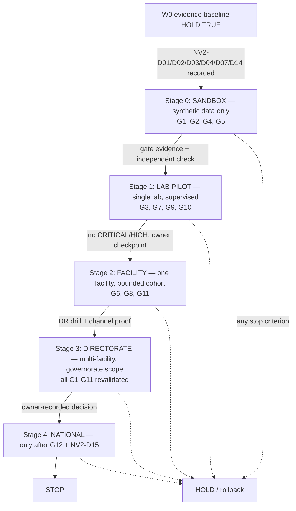

# GULA National Controlled Release Plan V2

> **STATUS: PROPOSED / PENDING OWNER APPROVAL — PLANNING GATE ONLY.**
> **HOLD TRUE.** `production_ready_items = 0`. Stable v1.0.0 **NOT DECLARED**. **PRODUCTION READY NOT AUTHORIZED.**
> This document defines gates, staging, stop and rollback controls. It grants **no activation authority**: it cannot
> open a gate, promote an environment, convert HOLD to GO, authorize deployment, or accept a release.
> **G12 (Independent Review and Final Acceptance) CANNOT PASS while the owner decision is absent.**
> No source/test/config/migration/protected-file change, no commit/push/PR/merge/deploy, no P-03 or
> P-03-CONCURRENCY execution, no production DB/service, no PHI/secrets/provider/financial calls in this gate.
> Repository scope: `/home/samertts/workspace/projects/gula-integration` only; sibling `gula-platform` is read-only.

## 0. Document control

| Field | Value |
|---|---|
| Governing gate set | G1–G12 exactly as defined in seed §7 (reproduced in §2) |
| Program scope | PRG-00 … PRG-10 (all), with PRG-10 owning release engineering controls |
| Wave / workstream linkage | W0 → W1 → W2 → W3 → W4 → G1–G12 → owner acceptance; WS-GOV-01 maintains registers/manifests |
| Binding governance | `GOVERNANCE/FINAL_DECISION.md`, `GOVERNANCE/GECS/MASTER_CONTROL.md`, `GULA_OWNER_DECISION_REGISTER.md`, `GOVERNANCE/NATIONAL_INTEGRATION/status_registry.json` |
| Decisions required before any gate can pass | NV2-D01, NV2-D02, NV2-D03, NV2-D04, NV2-D06, NV2-D07, NV2-D08, NV2-D09, NV2-D14, NV2-D15 (as applicable per gate) |
| Evidence status | Every gate: `NOT PASSED` / `NOT VERIFIED`; the plan itself: `PROPOSED / PENDING OWNER APPROVAL` |
| Naming rule | `PRG-03` = Diagnostics and Laboratory Systems; audit packages are `P-02 / AUD-F02` and `P-03 / AUD-F03` only |

## 1. HOLD enforcement and no-release statement

| Binding record | Exact constraint | Effect on this plan |
|---|---|---|
| `GOVERNANCE/FINAL_DECISION.md:13` | HOLD — do not release | No stage promotion is authorized by this document |
| `GOVERNANCE/FINAL_DECISION.md:46` | Security NOT CERTIFIED | G2 cannot be asserted as passed |
| `GOVERNANCE/FINAL_DECISION.md` §7/§8/§9/§10 | Release candidate HOLD; sign-off required; MIG-EXISTING NOT MET | G5/G6/G12 remain blocked |
| `GOVERNANCE/GECS/MASTER_CONTROL.md` §3/§7/§8 | HOLD must not become GO; prohibits commit/push/merge/PR/deploy and touching `gula-platform` | All implementation and git-write actions out of scope |
| `GULA_OWNER_DECISION_REGISTER.md:9-11` | Register prepares decisions; only owner-recorded approval moves BLOCKED→ACCEPTED; never self-awards PRODUCTION READY; never converts HOLD to GO | Owner roles below are **proposed** accountabilities pending appointment (NV2-D03/D04) |
| `GOVERNANCE/NATIONAL_INTEGRATION/status_registry.json` | `production_ready_items = 0`, not-authorized list, final instruction STOP before deployment | No item may be counted as production ready |
| Protected MD5s | FINAL_DECISION `effdfeaf10234678d83b2668c4489552`; MPI_FINAL_INDEPENDENT_AUDIT `1a02c01563c93b07a7cdb92c0462bf36`; MPI_INDEPENDENT_AUDIT_FINDINGS `ea3969d09aaf7b0b28a065838b44a594` | Unchanged; any mismatch is an immediate hard STOP |

**Explicit G12 rule:** an owner decision (NV2-D15, recorded in `GULA_OWNER_DECISION_REGISTER.md` after G1–G11 are
independently evidenced, plus NV2-D09 conflict resolution) is a precondition of G12. **While that owner decision is
absent, G12 is `NOT PASSED` / `NOT VERIFIED` by definition and cannot be waived, inferred from older reports, or
satisfied by engineering sign-off.** `DECISION-READY` is not `ACCEPTED`; API existence is not clinical completion;
P-02 / AUD-F02 is `IMPLEMENTED · TESTED · INDEPENDENTLY REVIEWED` but not ACCEPTED / not PRODUCTION READY;
P-03 / AUD-F03 is `PREPARED ONLY · NOT IMPLEMENTED` (D1–D5 absent, T9 deferred to P-03-CONCURRENCY, a separate
blocked package).

## 2. Authoritative gate identifiers (seed §7, verbatim labels)

| ID | Gate | ID | Gate |
|---|---|---|---|
| G1 | Architecture and Contract Validation | G7 | Performance and Capacity |
| G2 | Security and Privacy Validation | G8 | Mobile and Desktop Validation |
| G3 | Clinical Safety and Data Integrity | G9 | Offline and Synchronization Validation |
| G4 | API and Integration Compatibility | G10 | Monitoring and Incident Response |
| G5 | Database and Migration Validation | G11 | National Operations Readiness |
| G6 | Backup and Disaster Recovery | G12 | Independent Review and Final Acceptance |

All twelve gates are currently `NOT PASSED` / `NOT VERIFIED`. No gate below is closed; each subsection specifies
what an owner-appointed reviewer would need in order to *consider* closure in a later, separately authorized phase.

## 3. Gate definitions (purpose · evidence · PASS/FAIL · owner · status · linkage · rollback/stop)

### 3.1 G1 — Architecture and Contract Validation

- **Purpose:** prove target layers A–G, program boundaries PRG-00…PRG-10, single-owner data classes and C01–C15 are approved and mutually consistent.
- **Required evidence:** `GULA_NATIONAL_ARCHITECTURE_BLUEPRINT_V2.md`, `GULA_NATIONAL_MODULE_REGISTRY_V2.md`, `GULA_NATIONAL_INTEGRATION_CONTRACT_V2.md`, `GULA_NATIONAL_DATA_GOVERNANCE_PLAN_V2.md`; data-owner/contract-owner register entries; DAG and dependency graph.
- **PASS:** owner-recorded NV2-D01/D03; every data class has exactly one authoritative owner; derived copies (PRG-09 analytics) are not primary clinical sources; no local team edits to C01–C15.
- **FAIL:** unapproved boundaries; `DECISION-READY` presented as ACCEPTED; competing sources of truth; contract change without version bump + G1 revalidation.
- **Owner role:** National Architect / Contract Board (PRG-00), appointment pending NV2-D03.
- **Current status:** `NOT PASSED` / `NOT VERIFIED`.
- **Linked:** C01–C15 · PRG-00, PRG-10 · R-02, R-18 · NV2-D01, NV2-D03, NV2-D05.
- **Rollback/stop:** STOP dependent W1–W3 work; restore W0 evidence baseline; no shared-semantics edits while stopped.

### 3.2 G2 — Security and Privacy Validation

- **Purpose:** demonstrate zero-trust, least privilege, privacy and audit-bypass controls at national scope.
- **Required evidence:** `GULA_NATIONAL_ZERO_TRUST_SECURITY_PLAN_V2.md`; B1/B2/B3/B5 independent reports (zero API-reachable bypasses, 2 accepted LOW residuals); P-02 closure records; consent/break-glass design; executed security tooling results (currently config-only in `security-hardening.yml`, `ci.yml`, `codeql.yml`, `nightly.yml`).
- **PASS:** owner-recorded NV2-D06; IDOR/cross-tenant/audit-bypass/unauthorized-result-modification/duplicate-prescription/unauthorized-export harness executed with no CRITICAL/HIGH/MEDIUM; HS256-only limitation explicitly risk-accepted or replaced; DeepSeek rotation verified; WT-only fixes independently reviewed and accepted.
- **FAIL:** `security NOT CERTIFIED` (current binding record); uncommitted remediation treated as accepted; OIDC/JWKS gap ignored; in-memory zero-trust session store treated as production state.
- **Owner role:** Security and Privacy Owner (PRG-10), appointment pending NV2-D03/D04.
- **Current status:** `NOT PASSED` / `NOT VERIFIED`.
- **Linked:** C05, C06, C07, C13 · PRG-10, PRG-00 · R-04, R-07, R-17 · NV2-D06, NV2-D09.
- **Rollback/stop:** immediate HOLD restoration on any bypass finding; freeze promotion; preserve residuals as accepted ONLY by owner.

### 3.3 G3 — Clinical Safety and Data Integrity

- **Purpose:** prove clinical decisions, results and identities cannot be silently altered or misattributed.
- **Required evidence:** `GULA_NATIONAL_CLINICAL_SAFETY_PLAN_V2.md`; synthetic 15-step journey (registration → order → sample → result → verification → billing → report); LIMS/Westgard/result-verification tests; FHIR R4 resource conformance; owner-assigned clinical data ownership.
- **PASS:** complete E2E journey executed with server-enforced authorization; no unbound page used as proof; result modification and ID merge conflicts handled by approved rules; clinical sign-off recorded.
- **FAIL:** OD-008 "No journey is E2E verified" remains BLOCKED; 92 non-operational v3 surfaces or demo bridges counted as clinical proof; `PRG-03` confused with `P-03 / AUD-F03`.
- **Owner role:** Clinical Safety Officer with Diagnostics lead (PRG-01/PRG-03), appointment pending NV2-D03.
- **Current status:** `NOT PASSED` / `NOT VERIFIED`.
- **Linked:** C01, C04, C06, C11 · PRG-01, PRG-03, PRG-04, PRG-05 · R-05, R-06, R-07, R-08 · NV2-D03, NV2-D08, NV2-D11.
- **Rollback/stop:** STOP on any patient-safety defect; quarantine affected synthetic dataset; revert to last approved contract baseline.

### 3.4 G4 — API and Integration Compatibility

- **Purpose:** prove stable, versioned, backward-compatible contracts and trustworthy event/idempotency behavior.
- **Required evidence:** live OpenAPI from `backend/app/factory.py` and generated clients (`frontend-v3/src/api/generated/`); C08/C09/C10/C12 conformance; event/outbox consolidation evidence; correlation and DLQ/retry artifacts.
- **PASS:** single authoritative event/outbox path; checked-in vs live API spec reconciled; `X-Correlation-ID` propagated; request negotiation/Deprecation/Sunset defined; broken `contracts/routes.py:52` and empty checked-in `openapi.json` (2.1.0, 0 paths) resolved; 2,388 decorator count reconciled with live route measurement.
- **FAIL:** stub catalogs (`contracts/export/{openapi,asyncapi,fhir}.json` = 98/102/305 bytes) presented as contracts; simulated broker (ImportError→success) counted as integration; four disconnected event stacks left unresolved.
- **Owner role:** API and Integration Contract Owner (PRG-00/PRG-10), appointment pending NV2-D03.
- **Current status:** `NOT PASSED` / `NOT VERIFIED`.
- **Linked:** C08, C09, C10, C12 · PRG-00, PRG-10 · R-14, R-18 · NV2-D01, NV2-D03.
- **Rollback/stop:** STOP on incompatible change; version bump + G1 revalidation; no silent schema edit in any domain.

### 3.5 G5 — Database and Migration Validation

- **Purpose:** prove the migration chain is safe, reversible and PG16-verified.
- **Required evidence:** 111 revisions, single head `20261119_0003`, single root `20250322_0000`, 4 merge revisions (`20260815_0003`, `20260815_0015`, `20260819_0001`, `20260908_0001`), 0 dangling parents/duplicate IDs; PG16 forward + downgrade rehearsal; W1 strict-schema re-run.
- **PASS:** 119 strict-schema failures resolved; seven A09-013 skips executed with DB URL; `MIG-EXISTING` moved from PARTIAL/NOT MET by owner-recorded evidence; no SQLite substitution.
- **FAIL:** 753 passed / **119 failed** W1 result used as a pass; `MIG-EXISTING NOT MET` ignored; new head or duplicate revision introduced.
- **Owner role:** Database and Migration Owner (PRG-10), appointment pending NV2-D03.
- **Current status:** `NOT PASSED` / `NOT VERIFIED`.
- **Linked:** C15, C13 · PRG-10, PRG-00 · R-09, R-11 · NV2-D02, NV2-D07, NV2-D14.
- **Rollback/stop:** serialized checkpoint only; on failure, single-step revert of that checkpoint and re-run from frozen revision; no parallel schema edits.

### 3.6 G6 — Backup and Disaster Recovery

- **Purpose:** prove restore, PITR, RPO/RTO and failover at national scale.
- **Required evidence:** real PG16 backup; destructive restore with checksum/row verification; forced PITR; measured RPO/RTO vs NV2-D07 targets; application read/write smoke; audit-chain continuity (C07); CI-invocable, environment-gated job.
- **PASS:** all §4 defects of the infrastructure plan closed (`|| true` masks removed, `mysql` mismatch removed, `DR_IP` defined, dry-run replaced); owner sign-off with drill artifact.
- **FAIL:** `DATABASE_RECOVERY_REPORT.md:7-11` **NOT IMPLEMENTED / BLOCKED**; `pitr-recover.sh` dry-run default; `validate-restore.sh:26-27` swallows `pg_restore` failures; no workflow invokes DR scripts.
- **Owner role:** Disaster Recovery and Operations Owner (PRG-10), appointment pending NV2-D03/D04.
- **Current status:** `NOT PASSED` / `NOT VERIFIED`.
- **Linked:** C07, C13, C15 · PRG-10, PRG-00 · R-09, R-11 · NV2-D07, NV2-D14.
- **Rollback/stop:** STOP any drill on undefined external mutation targets; restore source environment from verified backup; no production data used.

### 3.7 G7 — Performance and Capacity

- **Purpose:** prove national load behavior against approved P95/P99/throughput/error targets.
- **Required evidence:** executed k6/Locust runs (`k6/load_test.js`, `tests/load/*`) with environment geometry; stored artifacts replacing empty `.benchmarks`; warning-only performance check converted to hard gate.
- **PASS:** read P95 <500 ms, write P95 <1000 ms, health P99 <200 ms, error <1%, ≥100 rps, all measured on PG16; capacity model accepted.
- **FAIL:** stored `benchmark-results.json` **FAIL**; MISSION-019/020 not executed; `GOVERNANCE ADVERSARIOUS PERFORMANCE` BLOCKED — NOT MEASURED; `nightly.yml` continue-on-error used as evidence.
- **Owner role:** Performance and Capacity Owner (PRG-10), appointment pending NV2-D03/D07.
- **Current status:** `NOT PASSED` / `NOT VERIFIED`.
- **Linked:** C12, C14 · PRG-09, PRG-10 · R-10 · NV2-D07.
- **Rollback/stop:** STOP on regression beyond target; revert the measured change set; keep prior capacity baseline until re-measured.

### 3.8 G8 — Mobile and Desktop Validation

- **Purpose:** prove every access channel is operational, contract-bound and channel-consistent.
- **Required evidence:** `frontend-v3/data-source-inventory.json` reconciliation; Android (`mobile/android`, 43 @Test), iOS (`mobile/ios`, 61 tests), Flutter desktop (`mobile/desktop`, 9 tests), Expo (4 tests); hospital_desktop and `platform/apps/*` CI binding; directorate/governorate persona coverage.
- **PASS:** all promoted surfaces contract-bound (not unbound/demo-only/safe_bridge); iOS Xcode metadata present so CI can bind; Arabic/RTL verified per channel; persona gaps closed.
- **FAIL:** 72 unbound, 17 demo-only, 3 safe_bridge, 2 contract-bound; 92 non-operational and 2 blocked-until-server-enforcement surfaces counted as working; root `index.html` links to missing `platform/apps/*/dist`.
- **Owner role:** Access Channels Owner (PRG-08), appointment pending NV2-D03.
- **Current status:** `NOT PASSED` / `NOT VERIFIED`.
- **Linked:** C01, C05, C06, C08, C11 · PRG-08, PRG-00, PRG-10 · R-13, R-08 · NV2-D03, NV2-D14.
- **Rollback/stop:** STOP promotion of any channel with unbound surfaces; roll back to prior reviewed build artifact only.

### 3.9 G9 — Offline and Synchronization Validation

- **Purpose:** prove conflict resolution, idempotent replay and late-data safety under network loss.
- **Required evidence:** single authoritative offline contract; durable production queue evidence; conflict simulation with lab-result overwrite scenarios; convergence and DLQ artifacts.
- **PASS:** CRDT_MERGE overwrite path fixed and committed/reviewed (currently only uncommitted CONFLICT_QUARANTINE); no synthetic `SYNCED` after local hash; SDKs consumed by the real channel; deterministic conflict rules owner-approved.
- **FAIL:** four disconnected offline engines; HEAD first-seen-key-wins can overwrite lab results; `health_core` synthetic-only tests used as production proof; no durable queue.
- **Owner role:** Offline Synchronization Owner (PRG-08/PRG-10), appointment pending NV2-D03.
- **Current status:** `NOT PASSED` / `NOT VERIFIED`.
- **Linked:** C10, C11, C12 · PRG-08, PRG-03, PRG-10 · R-06, R-08 · NV2-D03, NV2-D14.
- **Rollback/stop:** STOP on divergence or silent overwrite; quarantine affected records; never auto-apply inbound without validation (`integration/inbox.py` stages only).

### 3.10 G10 — Monitoring and Incident Response

- **Purpose:** prove SLO visibility, alerting and incident response at national scope.
- **Required evidence:** ServiceMonitor scraping `/metrics/prom` with Bearer secret; live `gula_down` and `gula_request_duration_seconds_bucket`; runtime OTel with vendor-neutral OTLP/HTTP; tested alertmanager webhook; on-call roster and runbooks.
- **PASS:** Helm `values.yaml:211-215` path corrected; `build_prometheus_response` wired and asserted by test; alerts exercised in a controlled environment.
- **FAIL:** current scrape of authenticated JSON `/metrics`; SLO series defined in `metrics_service.py:312-317,390-392` but never emitted (no call site at `:353`); placeholder webhook; `0.0.0.0` OTel receivers.
- **Owner role:** SRE and Observability Owner (PRG-10), appointment pending NV2-D03/D07.
- **Current status:** `NOT PASSED` / `NOT VERIFIED`.
- **Linked:** C12, C14 · PRG-10, PRG-09 · R-09, R-10, R-11 · NV2-D06, NV2-D07.
- **Rollback/stop:** STOP on telemetry gap or secret exposure; revert scrape change; restore fail-closed production metrics behavior.

### 3.11 G11 — National Operations Readiness

- **Purpose:** prove operating model, environment separation, HA closure, staffing and ministry/directorate readiness.
- **Required evidence:** HA gap closure HA-01…HA-09 (infrastructure plan §3), executed runbooks, 32-workflow inventory reconciled with `reports/ci/ci-cd-status-report.md` (6 workflows), DR ownership, environment segregation, legal/public-health scope.
- **PASS:** owner-recorded NV2-D04/D08/D14; no config-only HA counted as live; no production DB/service used in gate evidence; directorate persona supported.
- **FAIL:** Keycloak `start-dev`, Vault `-dev`, Sentinel quorum 1, Kafka RF 1, single RabbitMQ/MinIO, PgBouncer primary-only, broad `0.0.0.0` publication; OD-006…OD-025 remain BLOCKED; D-020/D-021 pending.
- **Owner role:** National Operations Director with PRG-07/PRG-10 leads, appointment pending NV2-D03/D04.
- **Current status:** `NOT PASSED` / `NOT VERIFIED`.
- **Linked:** C07, C13, C14 · PRG-00, PRG-07, PRG-10 · R-09, R-10, R-11, R-13, R-17, R-18 · NV2-D04, NV2-D08, NV2-D14.
- **Rollback/stop:** STOP promotion; return to HOLD; preserve last approved environment snapshot and access logs.

### 3.12 G12 — Independent Review and Final Acceptance

- **Purpose:** independent, owner-recorded final acceptance after G1–G11 evidence.
- **Required evidence:** independent review report; owner decision NV2-D15 recorded in `GULA_OWNER_DECISION_REGISTER.md`; NV2-D09 conflict resolution; protected MD5 verification; final gate matrix signed; acceptance manifest.
- **PASS (future, conditional):** G1–G11 independently verified; **owner decision present**; historical certifications reconciled (§5); no open CRITICAL/HIGH finding; explicit Stable v1.0.0 release-candidate declaration by owner.
- **FAIL (current and mandatory while absent):** **no owner decision → G12 cannot pass.** Newer 2026-07 GO certifications are not authority; engineering `DECISION-READY` is not ACCEPTED; sign-off by any engineering role is insufficient.
- **Owner role:** Independent Review Board + accountable Owner (NV2-D15), not appointable by this document.
- **Current status:** `NOT PASSED` / `NOT VERIFIED`.
- **Linked:** C01–C15 · all PRG-00…PRG-10 · R-15, R-18 · NV2-D04, NV2-D09, NV2-D15.
- **Rollback/stop:** automatic STOP + HOLD restoration if owner decision is absent, withdrawn, or scoped differently from what was reviewed.

## 4. Controlled national release staging (no activation authority)

**Stage rules:** each stage needs distinct credentials, dataset classification and named approval (NV2-D03/D14);
promotion is a checkpoint, never an implicit consequence of a passing test; stage artifacts are immutable and hashed;
no stage uses production data or live clinical patients in this gate; no document in the V2 set — including this one —
authorizes entry into any stage. `HOLD` is restored by default on any stop condition (§7).

## 5. Historical certification conflict handling

Older `GO`/certification claims are **superseded** and must be logged as conflicts (NV2-D09), never used as current
release authority:

| Superseded historical record | Current overriding record |
|---|---|
| `MASTER_RELEASE_CERTIFICATION.md` (2026-07-19) | `GOVERNANCE/FINAL_DECISION.md` (HOLD) |
| `RC_READINESS_REPORT.md` (2026-07-22) | `GULA_RELEASE_ACCEPTANCE_REPORT.md`, `FINAL_00_MASTER_VERDICT`, `FINAL_ASSURANCE_DECISION` |
| `ENTERPRISE_PRODUCTION_CERTIFICATION_REPORT.md` (2026-07-22) | `GOVERNANCE/NATIONAL_INTEGRATION/status_registry.json` (`production_ready_items = 0`) |
| `RELEASE_READINESS_REPORT.md`, several 2026-07-22 `*CERTIFICATION.md` reports | `GOVERNANCE/FINAL_DECISION.md` §1/§4/§7/§8/§9/§10 |
| `SECURITY_CERTIFICATION.md` (self-reported PLATINUM / PASS 100%), `SECURITY.md` (54+ tests) | Binding record: security **NOT CERTIFIED**; independent B-tier reports are engineering-scope only |
| `CERTIFICATION-v1.0.md` (full suite NOT RUN) | Current pass figures not re-run; 5151+28 explicitly historical |

Additional conflict sources: divergent status vocabularies (owner register 7 terms; engineering ladder
IMPLEMENTED→TESTED→INDEPENDENTLY REVIEWED→ACCEPTED→PRODUCTION READY; GECS legend) must not be conflated;
`CRITICAL_FILE_SHA256.txt` has 3 historical failures superseded by `CHECKPOINT_2026_11_20` lines 4–6;
`STATUS/OPEN_BLOCKERS.md` is an older snapshot. Six additive checkpoint manifests pass: REBUILD 4/4, REV3 3/3,
P02 closure 6/6, P03 readiness 2/2, P03 design 3/3, CHECKPOINT_2026_11_20 6/6.

## 6. Freeze and provenance preconditions (NV2-D02)

| Observed condition (pre-V2 docs) | Required handling before any save/merge/promotion |
|---|---|
| 20 staged R100 renames to `archive/legacy/workflow_runtime/` (name-status MD5 `56c524d6ffe9872c3a3ac6eff8c8f203`); canonical `backend/app/workflows/` untracked | Freeze and reconcile as one serialized checkpoint; no parallel edits to shared semantics |
| 162 unstaged tracked changes | Classify and record provenance; no silent inclusion in gate evidence |
| 686 untracked (`-uall`) paths before V2 docs; collapsed untracked 313 | Complete inventory; separate deliverables from source/config/migrations |
| Worktree SHA-256 differs from committed HEAD blob for protected governance records | Preserve protected uncommitted version; do not overwrite with HEAD blob |
| HEAD `2206654dc713ea2de8c564a3207dfe05fde23549`, branch `integration/gula-unification-v1` | Record exact revision in every gate artifact; sibling `gula-platform` HEAD `f478676b6fc375338648dde46fbf076c015a3f91` remains read-only |
| Protected MD5s (§1) | Verify before and after every gate action; mismatch = hard STOP |
| Prior manifests (§5) | Treat as additive evidence only; never as release authority |

**NV2-D02 is a hard precondition for all gates:** while mixed provenance is unresolved, every gate status remains
`NOT PASSED` / `NOT VERIFIED` regardless of technical evidence.

## 7. Incident and stop criteria

| Trigger | Immediate action | Owner role |
|---|---|---|
| Owner decision absent/withdrawn, or any HOLD→GO claim without owner record | STOP; restore HOLD; log conflict | Release control / Owner |
| Protected MD5 mismatch or manifest hash mismatch | STOP; preserve both versions; no overwrite | Governance owner (PRG-00) |
| Patient-safety defect, silent result modification, identity merge error | STOP affected stage; quarantine synthetic dataset; escalate | Clinical Safety (PRG-01/PRG-03) |
| Audit-bypass, IDOR, cross-tenant exposure, forged audit row | STOP; fail closed; revoke credentials in scope | Security owner (PRG-10) |
| Restore/PITR failure, `pg_restore` masked by `|| true`, undefined `DR_IP` | STOP drill; no promotion claim; keep source backup immutable | DR owner (PRG-10) |
| New Alembic head, duplicate id, or schema failure (119 open) | STOP migration checkpoint; revert single step | DB owner (PRG-10) |
| SLO breach or missing telemetry series | STOP promotion; retain prior baseline | SRE owner (PRG-10) |
| Channel surface unbound/demo-only counted as operational | STOP channel promotion | Channels owner (PRG-08) |
| Any source/config/migration/protected-file change in this gate | STOP; revert; report as violation | Release control |

## 8. Rollback strategy

1. **Default posture rollback:** every stop returns to HOLD (`production_ready_items = 0`); no partial GO state is retained.
2. **Evidence rollback:** gate artifacts are versioned and hash-recorded; a failed gate is reverted to the last checkpoint manifest (§5), never silently amended.
3. **Contract rollback:** C01–C15 changes require version bump + G1 revalidation; no local rollback of shared semantics.
4. **Migration rollback:** serialized checkpoint with forward and down-revision rehearsal on PG16; a single revert restores the prior revision; no destructive data migration without owner approval (out of scope here).
5. **Infrastructure rollback:** configuration-only changes revert per image/compose/Helm manifest; HA-01…HA-09 mitigations must be independently reversible; archive-first for any removal (ADR-028 discipline).
6. **Stage rollback:** sandbox/lab/facility/directorate stages roll back to the prior reviewed artifact and access snapshot; national stage cannot be entered without G12 + NV2-D15, so no national rollback is in scope.
7. **DR drill rollback:** isolated environment only; restore the source from a verified backup; external DNS-style mutations (e.g. `DR_IP`) must be pre-defined, reviewed and reversible before invocation.
8. **Preservation rule:** rollback never deletes protected governance records, dormant strategic assets, archives, or audit evidence; immutable audit (C07) is append-only.

## 9. Release checklist (all boxes currently unchecked)

| # | Precondition | Status | Gate |
|---|---|---|---|
| 1 | NV2-D01/D02/D03/D04/D07/D14 owner-recorded; HOLD explicitly reaffirmed | `NOT VERIFIED` | all |
| 2 | Protected MD5s re-verified; prior manifests intact | `NOT VERIFIED` | G12 |
| 3 | C01–C15 baselines approved; single owner per data class | `NOT VERIFIED` | G1 |
| 4 | G2 CRITICAL/HIGH findings closed; WT-only fixes reviewed/accepted | `NOT VERIFIED` | G2 |
| 5 | 15-step synthetic journey executed with server enforcement | `NOT VERIFIED` | G3 |
| 6 | Live OpenAPI reconciled; event/outbox consolidated; correlation propagated | `NOT VERIFIED` | G4 |
| 7 | Alembic single head/dag verified; W1 753/119 → 0 failures; PG16 forward+down | `NOT VERIFIED` | G5 |
| 8 | Real restore + forced PITR + measured RPO/RTO; script masks removed | `NOT VERIFIED` | G6 |
| 9 | k6/Locust executed; hard performance gate; targets approved | `NOT VERIFIED` | G7 |
| 10 | Channel inventory: no unbound/demo surface promoted; iOS CI binding fixed | `NOT VERIFIED` | G8 |
| 11 | Offline conflict fix committed/reviewed; durable queue proven | `NOT VERIFIED` | G9 |
| 12 | `/metrics/prom` scrape + SLO series + OTel + tested alerts | `NOT VERIFIED` | G10 |
| 13 | HA gaps closed; runbooks exercised; environment separation enforced | `NOT VERIFIED` | G11 |
| 14 | Historical certification conflicts resolved (NV2-D09) | `NOT VERIFIED` | G12 |
| 15 | Independent review + **owner decision NV2-D15** recorded | `NOT VERIFIED — CANNOT PASS WITHOUT OWNER DECISION` | G12 |

## 10. Evidence basis

Inspected read-only (all paths repository-relative under `gula-integration`):

- `GOVERNANCE/FINAL_DECISION.md` §1/§4/§7/§8/§9/§10, `GOVERNANCE/GECS/MASTER_CONTROL.md` §3/§7/§8, `GOVERNANCE/NATIONAL_INTEGRATION/status_registry.json`, `GOVERNANCE/NATIONAL_INTEGRATION_ROADMAP.md`, `GULA_OWNER_DECISION_REGISTER.md:9-11`, `GULA_RELEASE_ACCEPTANCE_REPORT.md`, `FINAL_00_MASTER_VERDICT`, `FINAL_ASSURANCE_DECISION`.
- Historical/superseded: `MASTER_RELEASE_CERTIFICATION.md`, `RC_READINESS_REPORT.md`, `ENTERPRISE_PRODUCTION_CERTIFICATION_REPORT.md`, `RELEASE_READINESS_REPORT.md`, `SECURITY_CERTIFICATION.md`, `SECURITY.md`, `CERTIFICATION-v1.0.md`, `STATUS/OPEN_BLOCKERS.md`, `CRITICAL_FILE_SHA256.txt`, `CHECKPOINT_2026_11_20`.
- Engineering evidence: `P-02_FINAL_CLOSURE_2026_11_24.md`, `P-02_IMPLEMENTATION_EVIDENCE_2026_11_24.md`, `P-02_AFTER_REV3.md`, `P-02_INDEPENDENT_REVIEW_2026_11_24.md`, `P-03_READINESS_2026_11_24.md`, `P-03_CONCURRENCY_DESIGN.md`, `P-03_SCOPE_AND_DEPENDENCY_REVIEW.md`, `INDEPENDENT_VERIFICATION_TEAM_C_TIER_B.md`, `INDEPENDENT_VERIFICATION_TEAM_C_B5_REVERIFY.md`, `EXECUTION_LEDGER.md`.
- Release-dependent artifacts: `DATABASE_RECOVERY_REPORT.md:7-11`, `scripts/{backup,continuous-backup,pitr-recover,restore-test,backup-verification,validate-restore,dr-failover,dr-failback,dr-test}.sh`, `backend/migrations/versions/`, `backend/tests/conftest.py`, `frontend-v3/data-source-inventory.json`, `mobile/android`, `mobile/ios`, `mobile/desktop`, `mobile-expo`, `hospital_desktop/`, `platform/apps/`, `k6/load_test.js`, `.github/workflows/` (32), `reports/ci/ci-cd-status-report.md`, `GULA_SECURITY_CI_READINESS_PLAN.md`, `ADVERSARIAL_TEST_REPORT.md`, `reports/production_audit_report.md`, `reports/independent-certification-report.md`.
- Cross-document constraints: `/tmp/opencode/gula_v2_seed.md` §§1–15 and `gula_v2_evidence_{governance,infra,tests,channels,security,backend,integration,domain}.md`.
