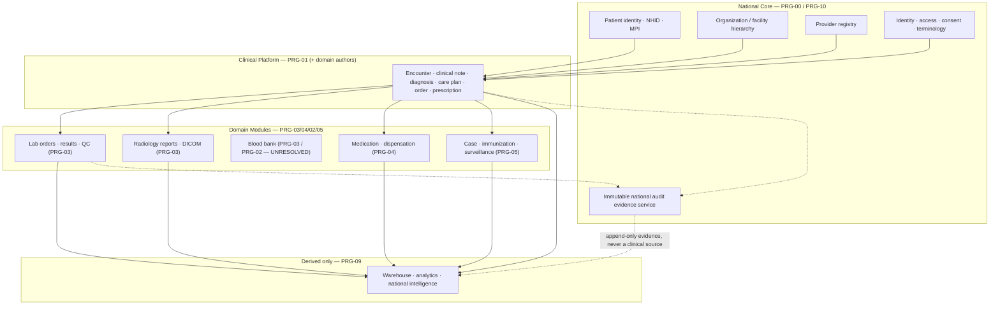

# GULA National Data Governance Plan V2

> **Document status:** `PROPOSED / PENDING OWNER APPROVAL` — planning gate only.
> **Release posture:** `HOLD TRUE`; `production_ready_items = 0`; `Stable v1.0.0 NOT DECLARED`; `PRODUCTION READY NOT AUTHORIZED`.
> **Authority:** This document proposes a target data-ownership model. It grants no release authority, approves no program, and changes no source, test, config, migration, or protected governance record. All statuses below are evidence-labelled, not upgraded.

---

## 0. Scope and authority boundary

This plan defines the national data ownership and source-of-truth model for the GULA integration repository (`/home/samertts/workspace/projects/gula-integration`, HEAD `2206654dc713ea2de8c564a3207dfe05fde23549`, branch `integration/gula-unification-v1`). The sibling `gula-platform` is read-only reference only (HEAD `f478676b6fc375338648dde46fbf076c015a3f91`).

Governing constraints carried forward verbatim:

| Constraint | Evidence / source |
|---|---|
| HOLD — do not release | `GOVERNANCE/FINAL_DECISION.md` §1/§4/§7/§8/§9/§10 |
| `production_ready_items = 0`, final instruction STOP before deployment | `GOVERNANCE/NATIONAL_INTEGRATION/status_registry.json` |
| Commit/push/merge/PR/deploy prohibited; HOLD must not become GO | `GOVERNANCE/GECS/MASTER_CONTROL.md` §3/§7/§8 |
| Data ownership and legal scope are BLOCKED | `GULA_ARCHITECTURE_DECISIONS.md` (as reported in evidence audit) |
| Protected MD5s unchanged | `AUDIT_EXECUTION_RECORDS/CHECKPOINT_2026_11_20_SHA256.txt` lines 4–6 |

No data class in this plan is declared `PRODUCTION READY`. Ownership assignments are proposals pending `NV2-D03` (appoint data owners and contract owners). A documented API is **not** clinical service completion (seed §4).

---

## 1. Ownership doctrine (seed §8)

**Canonical rule:** *One authoritative owner per data class; derived copies never become competing sources of truth.* A derived store may cache, index, project, or aggregate an owned class, but it must (a) retain a provenance pointer to the authoritative owner, (b) expose no independent write authority for the owned attributes, and (c) reconcile only from owner-published events or snapshots.

**Rule for parallel teams:** no team may write an attribute it does not own. Cross-domain writes travel through the owning service's versioned contract (C01–C15); shared contract edits require contract review, version bump, and `G1` revalidation (seed §13).

---

## 2. Authoritative owner table

Status labels use seed §4 vocabulary plus distinction labels (SOURCE / WORKING PROTOTYPE / DOCUMENTED DESIGN / TEST-ONLY). Paths are repository-relative and were read-only verified.

| # | Data class | Authoritative owner | Canonical source evidence | Consumers | Contract(s) | Evidence status / caveat |
|---|---|---|---|---|---|---|
| 1 | Patient identity, NHID, MPI | **National Core (PRG-00)** | `backend/app/services/mpi/`; protected MPI audit records (`AUDIT_EXECUTION_RECORDS/CHECKPOINT_2026_11_20_SHA256.txt`) | All domains, channels | C01, C05, C07 | SOURCE present; MPI merge conflict risk `R-05`; protected findings must not be rewritten |
| 2 | Organization / facility hierarchy | **National Core (PRG-00)** | org/provider code mixed in monolith; `backend/app/domain_platform/manifest.py` (11 domains, 8-section blueprints) | All domains, G8 channels | C02, C05, C14 | SOURCE mixed — W1 consolidation required; `provider_management` capability is a registered-metadata stub (8/10 stubs) |
| 3 | Provider registry | **National Core (PRG-00)** | `backend/app/capabilities/provider_management/`; B4/professional verification guards in `backend/app/identity/adaptive_auth/b4_guard.py` | PRG-01, PRG-03/04, channels | C03, C05, C07 | WORKING PROTOTYPE + DOCUMENTED DESIGN; verification is the only privilege-activation path per security evidence |
| 4 | Identity, access, authorization | **National Core (PRG-00)** | `backend/app/identity/`; `backend/app/security/rbac.py`, `security/abac.py` (DENY defaults); `identity/services/authorization_decision.py` | All | C05, C08, C14 | SOURCE + INDEPENDENTLY REVIEWED engineering scope B1/B2/B3/B5; residuals remain; no PRODUCTION READY |
| 5 | Consent | **National Core (PRG-00)** | `backend/app/identity/services/consent_service_v2.py`, `identity/models/consent.py` (versioned subject/grantee/purpose/domain, 72h cap) | PRG-01, PRG-05, channels | C06, C05, C07 | SOURCE; field-level enforcement is DOCUMENTED DESIGN, full runtime enforcement not independently confirmed |
| 6 | Terminology | **National Core (PRG-00)** | `integration/standards/terminology.py`; `backend/app/health_core/contracts/version.py:6-8` = `LOCAL_SYNTHETIC_ONLY` | All clinical domains | C04, C08, C15 | DOCUMENTED DESIGN / synthetic-only registry — validation returns true for known system with empty concepts |
| 7 | Encounter, clinical note, diagnosis, care plan, order, prescription | **Clinical Platform (PRG-01)**; domain modules author within scope | `backend/app/capabilities/encounter_management/` (stub scaffold); `backend/app/national/domain/{clinic,visit,appointment,encounter}.py`; unregistered `national/api/routes/__init__.py` (16 sub-routers) | PRG-03/04/05, G8 channels | C04, C09, C10, C11 | SOURCE exists but registration gap; no capability registered beyond `fhir_interoperability` and `search_service` |
| 8 | Lab orders, results, QC | **Diagnostics (PRG-03)** | `backend/app/lims/`; `lab_service.py`, `sample_service.py`, `test_result_service.py`, `quality_control_service.py` | PRG-01, PRG-05, PRG-09, channels | C04, C09, C10, C11, C07 | Strong SOURCE + TEST evidence; silent result-modification risk `R-06`; no verified E2E journey |
| 9 | Radiology reports and DICOM objects | **Diagnostics (PRG-03)** | `backend/app/radiology/` incl. `pacs.py` (`DICOMStorageService`); `integration/connectors/pacs.py` (QIDO/WADO/STOW via httpx); `integration/gateway/dicom_gateway.py` | PRG-01, PRG-09 | C04, C09, C14, C15 | SOURCE; no `pydicom`/`pynetdicom` dependency; docs contradictory on device-bridge DICOM support — `NV2-D11` needed |
| 10 | Medication and dispensation | **PRG-04** | `backend/app/pharmacy/`, `pharmacy/inventory.py`; duplicate-prescription abuse case in `ADVERSARIAL_TEST_REPORT.md` | PRG-01, PRG-05, PRG-09 | C04, C09, C10, C07 | Strong SOURCE + TEST; duplicate prescription remains an unexecuted anti-abuse case (testing strategy V2 §6) |
| 11 | Blood bank | **PRG-03 / PRG-02 — UNRESOLVED (see §3)** | `backend/app/blood_bank/`, `backend/tests/blood_bank/` | PRG-01, PRG-02, PRG-03 | C04, C09, C11, C07 | Strong SOURCE + TEST; owner arbitration required before any write-authority assignment |
| 12 | Public-health case, immunization, surveillance | **PRG-05**, sourced only from authorized clinical events | `backend/app/public_health/`; `backend/app/national/intelligence/public_health/surveillance.py`; `backend/app/services/epidemiology.py`; `care_continuum/models/immunization.py` | PRG-09, ministry channels | C04, C09, C13, C14 | SOURCE; legal reporting scope BLOCKED pending `NV2-D08`; no forced mirroring of clinical truth |
| 13 | Analytics / warehouse / national intelligence | **PRG-09 — DERIVED ONLY** | `backend/app/nhdw/`; `backend/app/national_data/` (dormant, do not delete); `backend/app/ai/`, `ai_fabric/`, `research_platform/` | Operations, ministry reporting | C09, C13, C14, C15 | DERIVED ONLY — never a primary clinical source; provenance chain mandatory |
| 14 | Immutable audit evidence | **National evidence service under PRG-00 / PRG-10; no domain owns audit truth** | `backend/app/services/audit_service.py` (SHA-256 hash chain + HMAC anchors); `scripts/audit_verifier.py`; PG append-only triggers (`20250322_0002`, `20260505_0005`) | All (read), governance | C07, C10, C14 | SOURCE with **HEAD DEFECT** (unlocked tail read); WT fix uncommitted; `P-03 / AUD-F03` is a separate blocked package — do not confuse with `PRG-03` |

Dormant/strategic assets (`backend/app/domain_platform/config/dormancy.json`, `archive/{legacy,experimental,scripts}/`) are retained per policy; this plan assigns them no new write authority.

---

## 3. Unresolved owner arbitration — blood bank (`PRG-03` vs `PRG-02`)

Seed §8 assigns blood bank to "`PRG-03`/`PRG-02` as agreed in owner decision". No such agreement is recorded. Per the owner register (`GULA_OWNER_DECISION_REGISTER.md`), only owner-recorded decisions move `BLOCKED` → `ACCEPTED`; therefore this plan **flags the class as unresolved** and does not fabricate an owner.

| Option | Owner | Rationale | Cost / risk |
|---|---|---|---|
| A (proposed) | `PRG-03` Diagnostics | Blood bank is a laboratory service (`backend/app/blood_bank/`); aligns with LIMS result/QC handling and `R-06` controls | Requires explicit PRG-02 hand-off of inventory/transfusion events |
| B | `PRG-02` Hospital & Emergency | Transfusion is a bedside/hospital act | Splits result truth from LIMS; raises late-data conflict risk `R-08` |
| C | Joint with single tie-break owner | Shared stewardship | Ambiguous authority — conflicts with seed §8 single-owner rule |

**Gate:** no blood-bank write contract may be frozen until `NV2-D03` records the arbitration. Until then, all blood-bank data is `BLOCKED` for cross-domain writes; reads remain SOURCE-only. This is an owner decision, not an engineering choice.

---

## 4. Contract mapping — C01–C15 data obligations

| Contract | Data-governance obligation | Owning owner |
|---|---|---|
| C01 Patient Identity | NHID/MPI canonical writes; merge provenance; no local alias minting | PRG-00 |
| C02 Organization | Facility hierarchy single source; no local org drift | PRG-00 |
| C03 Provider | Registry verification events; privilege activation only via owner | PRG-00 |
| C04 Clinical Resource | FHIR R4 for suitable resources; domain-authored clinical truth | PRG-01 (+ domain authors) |
| C05 Authorization | Owner-scoped read/write grants; DENY defaults; step-up | PRG-00 |
| C06 Consent | Versioned purpose/domain grants; withdrawal propagates to all derived copies | PRG-00 |
| C07 Audit | Append-only evidence, correlation IDs, no domain-owned audit truth | PRG-00 / PRG-10 |
| C08 API Versioning | Explicit version on every published data view; no silent field removal | PRG-00 / PRG-10 |
| C09 Event | Owner-published events only; outbox; no competing event stores | PRG-00 / PRG-10 |
| C10 Idempotency | Idempotent writes for every owned-class mutation; inbox staging | PRG-00 / PRG-10 |
| C11 Offline Synchronization | Conflict/quarantine semantics; late-data merge under owner rules | PRG-00 / PRG-10 |
| C12 Error and Retry | Retry policies, DLQ, dead-letter reconciliation to owner | PRG-10 |
| C13 Data Retention | Retention/legal scope; public-health reporting limits | PRG-00 / PRG-10 (`NV2-D08`) |
| C14 Observability | Data-quality and lineage telemetry on owned classes | PRG-10 |
| C15 Migration and Compatibility | Backward-compatible schema evolution; derived-copy rebuild on owner change | PRG-00 / PRG-10 |

Current contract reality is immature: `contracts/export/{openapi,asyncapi,fhir}.json` are 98/102/305-byte stubs, `backend/app/health_core/contracts/version.py:6-8` is `LOCAL_SYNTHETIC_ONLY`, and `contracts/routes.py:52` has a wrong import breaking 4 schema endpoints (evidence: integration audit). C01–C15 are targets, not existing guarantees.

---

## 5. Retention and legal scope — `NV2-D08`

| Item | Proposed policy | Status |
|---|---|---|
| Public-health case / immunization / surveillance retention | Defined by owner-approved legal reporting scope; not inferred from engineering defaults | `BLOCKED` — `NV2-D08` required |
| Clinical record retention | Owner (PRG-01) publishes retention policy; derived copies obey C13 | `DOCUMENTED DESIGN` |
| Audit evidence retention | Append-only chain retained per national evidence policy; no domain deletion path | SOURCE (triggers present), legal term `NOT VERIFIED` |
| Deletion / rectification | Owner-authorised; derived copies reconcile by tombstone/event; never silent in-place rewrite of clinical truth | `PLANNED` |
| Cross-border / ministry reporting | No external transfer without owner decision | `BLOCKED` |

This plan does not assert any statutory retention period. Any period requires `NV2-D08` and citation of the governing instrument. Legal scope is explicitly recorded as BLOCKED in `GULA_ARCHITECTURE_DECISIONS.md`.

---

## 6. Quality, lineage, and provenance

**Definition (proposed):** every datum served by a non-owning component carries at minimum `(owner_program, source_class, source_record_id, source_version, observed_at, published_via_contract, pipeline_run_id)`.

| Quality dimension | Owner obligation | Current evidence |
|---|---|---|
| Accuracy | Owner validates at write; derived copies never "correct" owned attributes | LIMS test estate strongest; 18 national services IMPLEMENTED/TESTED but 0 verified E2E journeys (`GULA_COMPONENT_INVENTORY.md` §4) |
| Completeness | Derived copies report coverage vs owner count | `NOT VERIFIED` |
| Lineage | Event/outbox pointer retained; rebuildable from owner | 4 disconnected event/outbox stacks — no authoritative event store (integration audit) |
| Timeliness | Late-data SLA per class, published via C09/C11 | `NOT VERIFIED` |
| Provenance integrity | Hash/anchor on audit; version vectors on clinical facts | Audit hash chain SOURCE at HEAD but concurrency defect (§7) |

**Action (W1/W2):** define a `national_data_provenance` schema under C14 and a lineage report consumed by PRG-09. No derived store may be promoted to an owner on the basis of freshness alone.

---

## 7. Conflict resolution and late-data handling

### 7.1 Offline defect and fix boundary

| Item | Evidence | Status |
|---|---|---|
| HEAD conflict merge is **first-seen-key-wins** and can overwrite a lab result | `gula_v2_evidence_integration.md` §13 (CRDT_MERGE at HEAD) | HEAD DEFECT — do not treat as safe |
| `CONFLICT_QUARANTINE` fix exists **only uncommitted** in working tree | integration audit | WORKING PROTOTYPE — uncommitted, unreviewed |
| Offline implementations are disconnected | `backend/app/` — **4 offline engines** (backend audit §9); SDK sync naive client-wins/remote-wins, unused by `frontend-v3` | DOCUMENTED DESIGN / TEST-ONLY |
| Event publication | backend audit §9 — **3 event buses**; integration audit counts **four** disconnected event/outbox stacks | conflicting counts — flagged, not reconciled |
| Broker simulation | `shared/events/bus.py` swallows handler exceptions; outbox worker can mark done with zero successful handlers; no async broker dependency (`aio_pika` missing) | TEST-ONLY / simulated |

**Proposed rule:** authoritative owner wins on conflict; non-owner replicas quarantine the losing value and emit a C11 conflict event with both versions. Clinical results (PRG-03) and medications (PRG-04) never auto-merge; they require quarantine + review. This rule is `PLANNED` until the WT fix is independently reviewed and accepted in a separate, authorised change — **not** by this planning document.

### 7.2 Event-store convergence

- **No authoritative event store exists.** Convergence tests must be defined against C09/C10/C11 contracts before any bus consolidation (testing strategy V2 §7).
- The three-event-bus / four-stack discrepancy (§7.1) must be resolved in `W1` with a recorded inventory; seed §13 forbids local edits to shared semantics to force agreement.
- Inbound idempotency is staged only: `backend/app/models/integration_inbox.py` + `integration/inbox.py` validate but do not auto-apply (integration audit §9).
- Correlation is incomplete: `X-Request-ID` echoed, but no `X-Correlation-ID` header and `request.state.correlation_id` never set in middleware — blocks provenance assertions in C07/C14.

---

## 8. Master data and terminology policy

| Domain of data | Representation policy | Rationale |
|---|---|---|
| Clinical facts suitable for FHIR R4 | FHIR R4 resources via `backend/app/health_core/fhir/`, `routes/ehr_fhir.py`, `national/fhir/**` | Seed §6; real routes/mappers/serializers/tests exist |
| Imaging | DICOM for objects and QIDO/WADO/STOW (`integration/connectors/pacs.py`, `integration/gateway/dicom_gateway.py`) | Seed §6; dependency gap (`pydicom`/`pynetdicom`) flagged for `NV2-D11` |
| HL7 v2 / ASTM device feeds | Parse/serialize/ACK at the edge (`integration/standards/{hl7,astm}.py`, `gateways/lab_device_gateway.py` HMAC + replay) | Preserve device integration; do not force FHIR at the wire |
| Administrative data (org, facility, provider, billing, workforce) | Native canonical models + C02/C03 contracts — **no forced FHIR** | Seed §6 explicit |
| Terminology | Owner-published CodeSystem/ValueSet with real concept sets | Current registry is in-memory static with empty concepts (`LOCAL_SYNTHETIC_ONLY`) — `NV2-D11` |

FHIR capability statement is ~30KB, but a stale validation report claims `Procedure` 501 that no longer exists and most resources are read-only per `KNOWN_LIMITATIONS` §2 (integration audit §11). Published conformance must be regenerated, not inherited.

---

## 9. PHI and secrets prohibition

- **No PHI, secrets, provider calls, financial calls, external network, production DB/service, or SQLite substitution for PostgreSQL evidence** is permitted in this planning gate (seed §1; draft instructions §5).
- Production startup already exits on missing/weak `SECRET_KEY`, `REFRESH_TOKEN_SECRET`, `ENCRYPTION_KEY`, `NID_HMAC_KEY`, `AUDIT_ANCHOR_KEY` (`backend/app/config.py:135-165,169-198,238-266`).
- National-ID tokens use canonical Fernet + HMAC (`shared/security/encryption.py:9-43`). Symmetric HS256 only; OIDC/JWKS unavailable by design (`backend/app/config.py:178`, `routes/oauth2.py:246-250` — JWKS 503). This is fail-closed but **not** production OIDC readiness.
- DeepSeek key rotation is `UNVERIFIED` (`GULA_MASTER_EXECUTION_STATUS.md:173`) — do not use as evidence of secret hygiene.
- `.env` ignored (`.gitignore:2`); `.env.example:6-9` placeholders only. Documentation and fixtures must use synthetic identifiers exclusively.

---

## 10. Migration and backward compatibility (C15)

- Migrations: **111 Python revisions**, single head `20261119_0003`, single root `20250322_0000`, 4 merge revisions, 0 dangling parents, 0 duplicate IDs (backend audit §8). Documented counts conflict (48 / 110 / 111) — flagged.
- Ownership changes must be schema-evolution checkpoints, **not parallel edits** (seed §13): a serialised gate with derived-copy rebuild plan and rollback path.
- Append-only audit triggers (`20250322_0002`, `20260505_0005`) must survive ownership re-assignment; no migration may weaken them.
- Backward-compatibility contract: published fields may be added, not silently removed; version bump + `G1` revalidation required for breaking changes (C08/C15).
- `MIG-EXISTING` is `NOT MET` per `GOVERNANCE/FINAL_DECISION.md` — this plan does not close it.

---

## 11. Gate mapping (specified gates)

| Gate | Data-governance evidence required before it can pass | Current disposition |
|---|---|---|
| **G1 Architecture and Contract Validation** | Approved C01–C15 with owner names; blood-bank arbitration recorded; terminology policy accepted | `NOT VERIFIED` — contracts are stubs |
| **G3 Clinical Safety and Data Integrity** | Owner-wins/quarantine rule enforced; lab result modification control (`R-06`); no silent merge at HEAD | `NOT VERIFIED` — HEAD first-seen-key-wins defect |
| **G5 Database and Migration Validation** | 111-revision DAG verified with no destructive ownership migration; PG16 path exercised (see testing V2 §3) | `PARTIALLY IMPLEMENTED` — DAG valid; PG16 conftest warning |
| **G8 Mobile and Desktop Validation** | Channel reads bound to owner contracts; `frontend-v3` 72 unbound / 17 demo-only surfaces resolved for owned classes | `NOT VERIFIED` — `frontend-v3/data-source-inventory.json` |
| **G9 Offline and Synchronization Validation** | WT `CONFLICT_QUARANTINE` fix independently reviewed; 4 offline engines aligned to C11; event bus count reconciled | `BLOCKED` — uncommitted fix / no authoritative event store |
| **G11 National Operations Readiness** | Lineage/provenance reporting live; `NV2-D08` legal scope signed; no PHI in fixtures | `BLOCKED` — owner decisions outstanding |

Other gates (G2, G4, G6, G7, G10, G12) are owned by the sibling V2 documents; this plan supplies their data-ownership inputs only.

---

## 12. Risk register subset (exact seed IDs)

| Risk | Relevance to data ownership | Required control |
|---|---|---|
| **R-01** Mixed Git provenance | 20 staged R100 + 162 unstaged + untracked tree; ownership edits could be lost in provenance churn | `NV2-D02` before any save/merge; immutable owner register |
| **R-02** National Core contract immaturity | C01–C07 are targets; export JSON stubs | Contract-first W1; `G1` gate |
| **R-05** Patient identity merge conflict | MPI is authoritative; merge errors propagate to every domain | Owner-wins + provenance on NHID merge; protected MPI records unchanged |
| **R-06** Silent result modification | PRG-03 lab truth can be overwritten by offline first-seen-key-wins | Quarantine + append-only version history; `G3`/`G9` |
| **R-08** Offline conflict / late data | 4 offline engines, 3 event buses (4 stacks), no authoritative event store | C09/C10/C11 convergence suite; serialised bus consolidation |
| **R-14** Event/outbox immaturity | Zero successful handlers can be marked done; no async broker dependency | Outbox conformance + DLQ reconciliation under PRG-10 |
| **R-15** Protected-record/status conflict | Older `PRODUCTION_READY` certifications conflict with HOLD; protected MD5s must not be rewritten | Treat as owner conflict (`NV2-D09`), never as current status |

No new risk IDs are introduced; add only `R-19+` if a later evidence audit requires it.

---

## 13. Decisions required from owner

| Decision | Asked of owner in this plan |
|---|---|
| `NV2-D03` | Appoint data owners for all 14 classes; arbitrate blood bank `PRG-03`/`PRG-02` (§3) |
| `NV2-D08` | Approve public-health reporting and legal retention scope (§5) |
| `NV2-D11` | Approve DICOM/PACS and terminology strategy (§8) |
| `NV2-D09` | Resolve historical certification vs HOLD conflict (R-15) |
| `NV2-D02` | Resolve mixed provenance before any owner-register modification is saved/merged (R-01) |

`PRG-03` throughout this document means **Diagnostics and Laboratory Systems**. The audit package is always written `P-03 / AUD-F03` (PREPARED ONLY · NOT IMPLEMENTED; D1–D5 absent; T9 deferred to `P-03-CONCURRENCY`). They are not interchangeable.

---

## 14. Evidence basis

Files and reports inspected (read-only) for this plan:

- Seed and drafting constraints: `/tmp/opencode/gula_v2_seed.md` (§§1, 4, 6, 7, 8, 9, 10, 11, 13, 15), `/tmp/opencode/gula_v2_draft_instructions.md`.
- Evidence audits: `gula_v2_evidence_domain.md`, `gula_v2_evidence_backend.md`, `gula_v2_evidence_integration.md`, `gula_v2_evidence_tests.md`, `gula_v2_evidence_infra.md`, `gula_v2_evidence_governance.md`, `gula_v2_evidence_security.md`, `gula_v2_evidence_channels.md` (all under `/tmp/opencode/`).
- Governance: `GOVERNANCE/FINAL_DECISION.md`, `GOVERNANCE/GECS/MASTER_CONTROL.md`, `GOVERNANCE/NATIONAL_INTEGRATION/status_registry.json`, `GULA_OWNER_DECISION_REGISTER.md`, `GULA_ARCHITECTURE_DECISIONS.md`, `GULA_MASTER_EXECUTION_STATUS.md`, `AUDIT_EXECUTION_RECORDS/CHECKPOINT_2026_11_20_SHA256.txt`, `AUDIT_EXECUTION_RECORDS/CRITICAL_FILE_SHA256.txt`.
- Source/structure: `backend/app/domain_platform/manifest.py`, `backend/app/domain_platform/config/dormancy.json`, `backend/app/services/mpi/`, `backend/app/capabilities/`, `backend/app/lims/`, `backend/app/radiology/pacs.py`, `backend/app/blood_bank/`, `backend/app/pharmacy/`, `backend/app/public_health/`, `backend/app/nhdw/`, `backend/app/national_data/`, `backend/app/identity/services/consent_service_v2.py`, `backend/app/security/abac.py`, `backend/app/services/audit_service.py`, `backend/app/services/outbox_service.py`, `backend/app/integration/connectors/{lis,pacs}.py`, `backend/app/health_core/contracts/version.py`, `backend/migrations/versions/`, `scripts/audit_verifier.py`, `frontend-v3/data-source-inventory.json`, `contracts/export/openapi.json`, `contracts/api/v1/catalog.json`, `contracts/events/catalog.json`, `GULA_COMPONENT_INVENTORY.md`.
- Audit-package records (referenced only, **not executed**): `AUDIT_EXECUTION_RECORDS/P-02_FINAL_CLOSURE_2026_11_24.md`, `AUDIT_EXECUTION_RECORDS/P-03_READINESS_2026_11_24.md`, `AUDIT_EXECUTION_RECORDS/P-03_CONCURRENCY_DESIGN.md`, `AUDIT_EXECUTION_RECORDS/P-03_SCOPE_AND_DEPENDENCY_REVIEW.md`.
