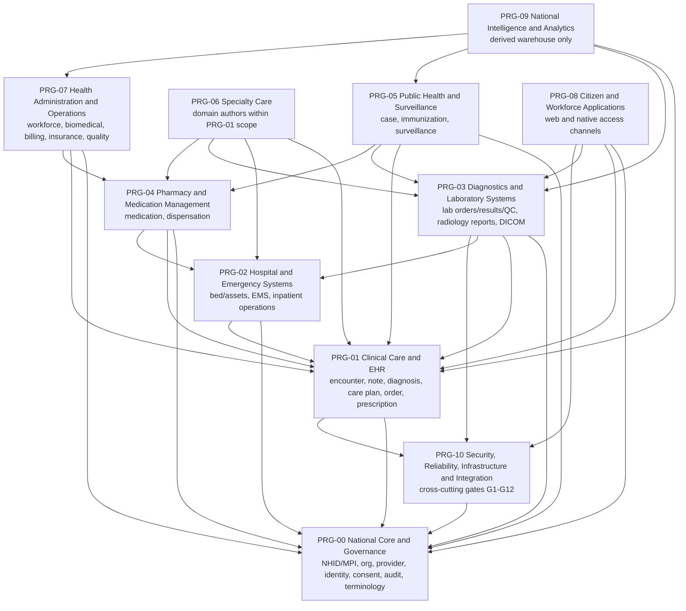
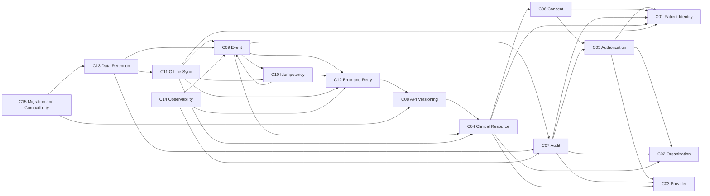
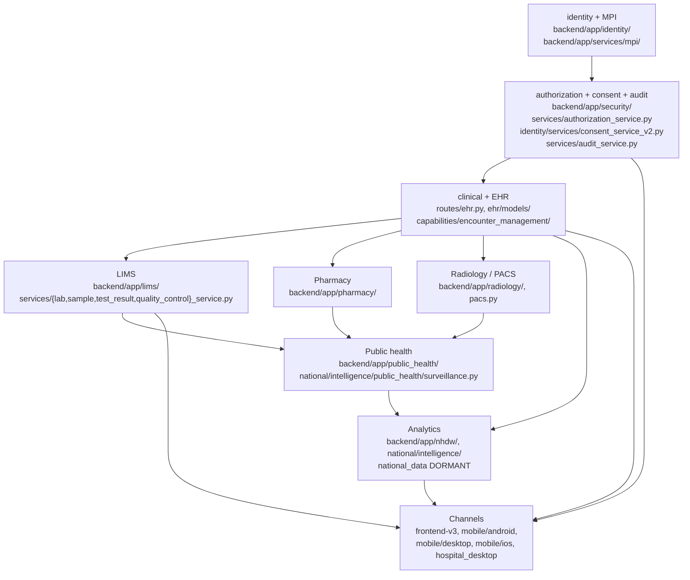
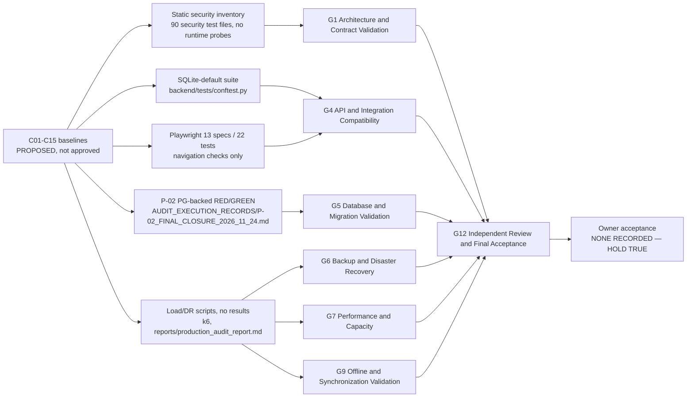
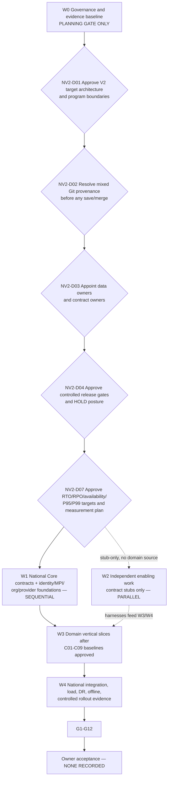

# GULA National Transformation V2 — Dependency Graph

Status: **PROPOSED / PENDING OWNER APPROVAL** — planning gate only; this document creates no implementation authority.

Standing posture (binding, must not be restated as GO): `GOVERNANCE/FINAL_DECISION.md:13,46` — **HOLD TRUE**; `GOVERNANCE/NATIONAL_INTEGRATION/status_registry.json` — `production_ready_items = 0`; `GULA_MASTER_EXECUTION_STATUS.md:7` — **Stable v1.0.0 NOT DECLARED**; **PRODUCTION READY NOT AUTHORIZED**. No status below is upgraded without a path citation. All program IDs are `PRG-00`..`PRG-10`; `P-03 / AUD-F03` is a separate blocked audit package and is **not** `PRG-03`.

## 1. Reading rules

- Edge direction is **consumer → provider**: an arrow `A --> B` means A requires B's contract, data ownership, or gate evidence before A can be accepted.
- "Depends on" is a **planned** dependency under this proposal; it does not assert that the current monolith already respects it. Current violations are itemised in §7.
- Evidence labels: SOURCE = committed implementation; WORKING PROTOTYPE / WT-code = uncommitted; TEST-ONLY = diagnostic or synthetic; DOCUMENTED DESIGN = plan only; PRODUCTION-VERIFIED = none claimed in this document. `NOT VERIFIED` is used where no path evidence exists.
- Parallel execution is legal only against approved, versioned contracts (seed §13). Shared `C01`–`C15`, protected governance records, and National Core semantics are serialized checkpoints.

## 2. Program dependency graph (PRG-00 → PRG-10)

### 2.1 Edge rationale (evidence-grounded)

| Edge | Rationale | Evidence |
|---|---|---|
| PRG-01 → PRG-00 | Encounter/clinical note/diagnosis require authoritative NHID/MPI, org/provider registry, authorization, consent and immutable audit (seed §8). | `backend/app/services/mpi/`, `backend/app/identity/`, `backend/app/services/audit_service.py:1-8,31-38` |
| PRG-02 → PRG-01 | Bed/EMS workflows attach to an encounter authored by PRG-01. | `backend/app/ems/`, `backend/app/services/hospital_service.py`, `backend/app/capabilities/encounter_management/` |
| PRG-03 → PRG-01 / PRG-02 | Lab/radiology orders originate in clinical care; inpatient location and transport context come from hospital/EMS. | `backend/app/lims/`, `backend/app/radiology/`, `backend/app/services/lab_service.py`, `backend/app/services/test_result_service.py` |
| PRG-04 → PRG-01 / PRG-02 / PRG-00 | Dispensation is triggered by a prescription; formulary stock is operational; consent/audit are National Core. | `backend/app/pharmacy/`, `backend/app/identity/services/consent_service_v2.py:24-46` |
| PRG-05 → PRG-01/03/04 → PRG-00 | Public-health case/immunization data is sourced from authorised clinical events, never created as a competing primary record. | `backend/app/public_health/`, `backend/app/national/intelligence/public_health/surveillance.py`, `backend/app/services/epidemiology.py` |
| PRG-06 → PRG-01/02/03/04 | Specialty modules are domain authors inside clinical scope; six specialties are currently analytics/enum/documentation-level only. | `backend/app/domain_platform/manifest.py` (11 canonical domains), `GULA_COMPONENT_INVENTORY.md` §4 (Dental #10, Rehabilitation #13, Mental health #14 NOT IMPLEMENTED) |
| PRG-07 → PRG-00/01/04 | Org/provider truth is National Core; billing/quality consume clinical and medication events. | `backend/app/governance/models/workforce.py`, `backend/app/billing/`, `backend/app/financial/`, `backend/app/clinical/quality/` |
| PRG-08 → PRG-00/01/03/10 | Channels are read/write projections; workspace-scoped reads and role guards are client-side enforcement only until server proof exists. | `frontend-v3/src/routes/index.tsx` (94 paths, 80 RoleGuard usages), `frontend-v3/src/api/workspaceScopedReads.ts`, `frontend-v3/data-source-inventory.json` |
| PRG-09 → domain producers | Warehouse/AI are derived; `national_data` is dormant and must not become a primary source. | `backend/app/nhdw/`, `backend/app/national/intelligence/`, `backend/app/domain_platform/config/dormancy.json` |
| PRG-10 ↔ all | Cross-cutting security, reliability and gates; audit truth itself is owned by PRG-00/PRG-10, not by domains. | `GOVERNANCE/GECS/MASTER_CONTROL.md` §3/§7/§8, `backend/app/security/zero_trust.py:14-15,37-45` |

## 3. Contract dependency graph (C01–C15)

**Contract-graph constraints.** C01–C03 are roots owned by PRG-00 (seed §8). C05, C06 and C07 gate every PHI-producing domain contract. C09 depends on C07 because audit events must be immutable; it currently has **four disconnected implementations** (conflict X-01 in §7), so C09 is `DOCUMENTED ONLY / NOT VERIFIED` as a national contract. C08 is blocked by a checked-in OpenAPI stub (`contracts/export/openapi.json`, 98 bytes) and broken schema endpoints (`backend/app/contracts/routes.py:52`). C10/C11/C12 are test-only at best; C12 lacks a national correlation header (`X-Request-ID` only echoed; `request.state.correlation_id` never set — integration evidence). C14 cannot be signed off while Helm scrapes authenticated JSON `/metrics` instead of `/metrics/prom` (infra evidence). No C01–C15 contract is `ACCEPTED`; owner register `GULA_OWNER_DECISION_REGISTER.md` §9 records no acceptance.

## 4. Module / source dependency graph (as-built evidence)

**As-built caveats (must travel with the graph):**

- The arrows describe intended ownership flow, **not** verified runtime call paths. No live import measurement was executed in the source audit; static decorator scan found 2,388 route decorators and documented live route counts conflict (1,442–2,116 endpoints — backend evidence). `NOT VERIFIED`.
- `backend/app/factory.py:519-836` holds ~100 `include_router` calls; only `fhir_interoperability` and `search_service` of 10 capability scaffolds are registered. Eight capabilities are empty CRUD stubs advertised via `kernel/capabilities_registry_populator.py` (backend evidence).
- Channel layer is **not** 94 operational workflows: `frontend-v3/data-source-inventory.json` classifies 72 unbound, 17 demo-only, 3 safe_bridge, 2 contract-bound; only `src/pages/patients/PatientsPage.tsx` and `src/pages/orders/OrdersPage.tsx` are contract-bound (channels evidence).
- Native clients are source-only for deployment purposes: Android 43 `@Test`, Flutter desktop 9 tests, iOS 61 tests with missing Xcode metadata; `hospital_desktop/` has 3 unittest methods and no CI/Compose binding (channels evidence). No channel is PRODUCTION-VERIFIED in this repository.

## 5. Evidence dependency graph (contracts → tests → gates → acceptance)

**Evidence rules on this graph:** a gate cannot be marked PASS by a document that merely describes a script. `backend/tests/conftest.py` forces SQLite in-memory and overrides DB dependencies, so the default suite does **not** exercise PostgreSQL locking, sequences, isolation, triggers or DDL — P-02 PG-backed evidence is the only PG-specific RED/GREEN record and is `IMPLEMENTED · TESTED · INDEPENDENTLY REVIEWED`, **not** `ACCEPTED`, with two accepted LOW residuals. P-03 / AUD-F03 remains `PREPARED ONLY · NOT IMPLEMENTED` (D1–D5 absent, T9 deferred). Historical full-suite pass figures (4913 … 5151+28) are not re-runs and are not current pass claims; `CERTIFICATION-v1.0.md` records full suite NOT RUN. `G12` cannot close: `GOVERNANCE/FINAL_DECISION.md:7-11` and owner register §9 record no acceptance; HOLD remains TRUE.

## 6. Wave and critical-path graph (W0 → W4)

- Critical path per seed §11: `W0 → NV2-D01/D02/D03/D04/D07 → W1 (C01–C09) → W3 → W4 → G1–G12 → owner acceptance`.
- W2 is the **only** parallel lane: WS-CORE-01, WS-SEC-01, WS-AUD-01, WS-OBS-01, WS-DB-01, WS-E2E-01, WS-API-01, WS-GOV-01 (seed §12). WS-AUD-01 is documentation/test design only; no P-03 or P-03-CONCURRENCY implementation.
- All decision diamonds are **BLOCKED** in `GULA_OWNER_DECISION_REGISTER.md` (OD-002…OD-025); only OD-001 accepted engineering scope for SEC-015/F-01. No V2 decision is approved.

## 7. Cycle and conflict register

| ID | Conflict / cycle | Concrete evidence | Effect on graph | Required handling |
|---|---|---|---|---|
| X-01 | **Four event stacks, no authoritative event store** | kernel in-memory bus; durable SQL outbox (`services/outbox_service.py`, poll 10 s / batch 50 / 5 attempts / 30-day purge / skip_locked); `health_core` synthetic deterministic events; `core/sync_engine` in-memory LWW. Shared bus swallows handler exceptions; `OutboxWorker` marks done with zero successful handlers; kernel publish never fills its own outbox/inbox/DLQ; dual workers `worker.py` and `core/startup.py:270-272`; `aio_pika` missing. | Breaks C09 edge and C10/C12 guarantees; G4/G10 cannot close. | Select one authoritative broker contract under PRG-10 + NV2-D06; no domain-local event truth; serialized checkpoint. |
| X-02 | **Four offline engines, divergent merge semantics** | `core/sync_engine` LWW; `health_core` conflict/contract logic (strongest, synthetic only); SDK naive `client_wins`/`remote_wins` unused by frontend-v3; HEAD `CRDT_MERGE` first-seen-key-wins can overwrite a lab result. `CONFLICT_QUARANTINE` fix exists **only uncommitted**. No durable production offline queue; primary stores process-local. | Breaks C11; R-05/R-08 critical path; G9 cannot close. | Decide merge policy at contract level; separate P-03 / AUD-F03 package; never merge WT fix as V2 work. |
| X-03 | **Duplicated EHR / billing / audit stacks** | `backend/app/ehr/`, `routes/ehr.py`, `routes/ehr_fhir.py`; `billing/`, `financial/`, `payments/`, `insurance/`; `services/audit_service.py` + `shared/audit/service.py` + national audit paths; parallel `backend/core/api/`, `backend/gateway/`, `backend/services/*/main.py`, `services/*`, `api/demo-api/`, `server/index.ts` experimental stubs (`docs/evolution/PLATFORM_EVOLUTION_PLAN.md:305`). | Multiple candidate owners for C04/C07/C13; seed §8 single-owner rule violated. | PRG-00 data-owner decision NV2-D03 before any W3 slice; archive-first, behaviour-preserving migration only. |
| X-04 | **Unregistered national router** | `backend/app/national/api/routes/__init__.py` declares 16 sub-routers with no factory import (backend evidence). | Advertised national surface is not live; G1/G4 evidence cannot be drawn from those paths. | Register or explicitly retire via owner decision; count only live `factory.py` routes in gate evidence. |
| X-05 | **In-flight workflow archive / mixed provenance** | 20 staged R100 renames to `archive/legacy/workflow_runtime/` (name-status MD5 `56c524d6ffe9872c3a3ac6eff8c8f203`); canonical `backend/app/workflows/` untracked; 162 unstaged tracked + 686 untracked (`-uall`) before V2 docs (313 collapsed); HEAD `2206654dc713ea2de8c564a3207dfe05fde23549`. | Invalidates any "clean tree" assumption; blocks safe promotion and cross-team diffs. | NV2-D02 hard gate before any save/merge; no V2 team edits shared paths until resolved. |
| X-06 | **Documented-only vs source status drift** | `contracts/export/{openapi,asyncapi,fhir}.json` are 98/102/305-byte stubs; `health_core/contracts/version.py:6-8` `LOCAL_SYNTHETIC_ONLY`; `DEVOPS_CERTIFICATION.md` python:3.14/14 Dockerfiles vs actual python:3.12-slim/15; historical GO certifications superseded by November records. | Contract graph appears stronger than it is; G1 evidence contaminated. | Use evidence labels from §1; treat historical certification as conflict, not current status. |
| X-07 | **Capability metadata vs implementation** | 8/10 `backend/app/capabilities/` scaffolds are empty CRUD stubs, advertised via `kernel/capabilities_registry_populator.py`. | False readiness signal for PRG-01/03/06 slices. | Capability inventory must state SOURCE vs stub; gate on tested behaviour, not registry metadata. |

## 8. Parallel-safe vs serialized-work matrix

| Workstream / task | Wave | Depends on | Parallel-safe? | Reason / checkpoint |
|---|---|---|---|---|
| WS-GOV-01 documentation index, decision register, backlog | W0 | seed IDs only | **Yes** | Adds new docs only; no protected record edits. |
| WS-CORE-01 C01–C03 identity/org/provider contracts + conformance | W1 | NV2-D01/D02/D03 | **No — serialized** | Changes C01–C03 National Core semantics; contract review + version bump + G1 revalidation. |
| WS-SEC-01 zero-trust test harness (IDOR, cross-tenant, audit-bypass, result modification, duplicate prescription, export) | W2 | C01–C07 stubs, synthetic data | **Yes** | Test-only, no domain source changes; shares harness with G2. |
| WS-AUD-01 audit-chain design evidence and contract conformance | W2 | C07 stub | **Yes, design only** | Must not execute P-03 / P-03-CONCURRENCY; D1–D5 deferred to NV2-D12/D13. |
| WS-OBS-01 metrics/logs/traces contract + dashboard schema | W2 | C14 stub | **Yes** | Schema/design; fix ServiceMonitor target as a serialized config change later. |
| WS-DB-01 migration safety, PITR/DR runbook validation design | W2 | C15 stub, NV2-D07 | **Yes, design only** | No live DB; no SQLite substitution; DR drill is W4. |
| WS-E2E-01 synthetic 15-step journey skeleton and fixtures | W2 | synthetic data policy | **Yes** | Skeleton only; asserts server enforcement, not navigation. |
| WS-API-01 OpenAPI/contract-first validation and versioning tooling | W2 | C08 stub | **Yes, tooling only** | Must not overwrite checked-in 2.1.0/0-path openapi artifact silently. |
| Domain vertical slices (PRG-01/02/03/04/05/06/07) | W3 | C01–C09 approved, NV2-D05 | **Conditionally** | Parallel only inside owned domain boundaries; no shared contract/schema edits. |
| Channels (PRG-08 web/native) | W3/W4 | C01/C05/C06 + live server enforcement | **Conditionally** | Client-side guards are not authorization; server proof required before binding. |
| Analytics (PRG-09) | W3/W4 | domain contracts approved | **No until domains close** | Derived-only; never a competing source of truth. |
| Shared schema / migration edits | W1/W3 | NV2-D03 | **No — serialized checkpoint** | Seed §13: migration and shared schema changes are serialized, not parallel edits. |
| Load / DR / offline national evidence | W4 | NV2-D07, all W3 slices | **No — serialized** | Requires stable environment, single measurement window. |
| Release / acceptance | G1–G12 | owner decisions | **No** | `GOVERNANCE/GECS/MASTER_CONTROL.md` §3/§7/§8: HOLD must not become GO. |

## 9. Critical-path task table (slack notes are qualitative, not scores)

| # | Task | Wave | Immediate predecessor | Gate / decision | Slack | Slack note |
|---|---|---|---|---|---|---|
| 1 | Freeze V2 identifiers and evidence baseline | W0 | — | HOLD posture | **None** | Seed IDs are shared by all 18 documents; any drift fans out. |
| 2 | Approve architecture and program boundaries | W0 | 1 | NV2-D01 | **None** | No W1 work may start before boundaries are accepted. |
| 3 | Resolve mixed Git provenance | W0 | 2 | NV2-D02 | **None** | Hard blocker: 20 staged R100 + 686 untracked; no save/merge until clean. |
| 4 | Appoint data and contract owners | W0 | 3 | NV2-D03 | **None** | Blocks C01/C02/C03/C07 ownership and X-03 resolution. |
| 5 | Approve controlled gates and HOLD posture | W0 | 4 | NV2-D04 | **None** | Required before any gate evidence is collected. |
| 6 | Approve RTO/RPO/availability/P95/P99 + measurement plan | W0 | 5 | NV2-D07 | **None** | Blocks DR/load design; current targets exist but no reproducible results. |
| 7 | C01–C03 identity/org/provider contracts | W1 | 6 | G1/G4 | **None** | Root of contract graph; all domain edges depend on it. |
| 8 | C05/C06/C07 authorization, consent, audit contracts | W1 | 7 | G1/G2 | **Very low** | Audit-chain concurrency defect unfixed at HEAD; T9 separate. |
| 9 | C04/C08/C09/C10/C11/C12 baselines | W1 | 7, 8 | G1/G4 | **Low** | Four event stacks and four offline engines must converge on one contract each. |
| 10 | W2 harnesses (security, observability, DB, E2E, API) | W2 | 6 | G2/G6/G7/G9 | **High** | Can run while W1 serializes; must not mutate shared contracts. |
| 11 | PRG-01 clinical/EHR vertical slice | W3 | 9 | G3/G4 | **Low** | 8/10 capability scaffolds are stubs; real behaviour must be tested. |
| 12 | PRG-03 LIMS/RIS slice | W3 | 9, 11 | G3/G4/G9 | **Low** | CRDT overwrite of lab results is unfixed at HEAD; G9 blocked. |
| 13 | PRG-02/04/05/06/07 slices | W3 | 11, 12 | G3/G4 | **Medium** | Specialty gaps; billing/audit duplication; partially parallel by domain. |
| 14 | PRG-08 channels binding | W3/W4 | 11, 12 | G8 | **Medium** | 92 non-operational surfaces; no complete E2E journey. |
| 15 | PRG-09 derived analytics | W4 | 13 | G4/G10 | **Medium** | Derived only; national_data dormant. |
| 16 | National integration, load, DR, offline evidence | W4 | 14, 15 | G6/G7/G9/G10 | **None** | No reproducible artefacts today; single serialized measurement window. |
| 17 | G1–G12 independent review and owner acceptance | W4 | 16 | G12 | **None** | No owner acceptance recorded; HOLD TRUE until explicitly lifted. |

## 10. Evidence basis

All items below were read (read-only) or verified on disk in `/home/samertts/workspace/projects/gula-integration` at HEAD `2206654dc713ea2de8c564a3207dfe05fde23549`; sibling `gula-platform` was not touched.

- `/tmp/opencode/gula_v2_seed.md` (canonical IDs, ownership rule §8, constraints §11–13), `/tmp/opencode/gula_v2_draft_instructions.md`.
- `/tmp/opencode/gula_v2_evidence_backend.md` (factory routes, capability scaffolds, 111 migrations / 4 merges, conflict list), `/tmp/opencode/gula_v2_evidence_domain.md` (11 canonical domains, specialty gaps, dormancy), `/tmp/opencode/gula_v2_evidence_integration.md` (four event stacks, offline merge, versioning, FHIR), `/tmp/opencode/gula_v2_evidence_security.md` (authorization/consent/audit evidence, audit-chain defect, zero-trust gaps), `/tmp/opencode/gula_v2_evidence_tests.md` (SQLite conftest, P-02/P-03 results, E2E/load gaps), `/tmp/opencode/gula_v2_evidence_infra.md` (HA config-only, DR scripts, observability mismatch), `/tmp/opencode/gula_v2_evidence_channels.md` (frontend-v3 inventory, native clients), `/tmp/opencode/gula_v2_evidence_governance.md` (owner register, FINAL_DECISION, status registry).
- Paths verified on disk: `backend/app/services/mpi/`, `backend/app/security/zero_trust.py`, `backend/app/services/audit_service.py`, `backend/app/national/api/routes/__init__.py`, `backend/app/domain_platform/manifest.py`, `backend/app/contracts/routes.py`, `backend/tests/conftest.py`, `frontend-v3/data-source-inventory.json`, `GOVERNANCE/FINAL_DECISION.md`, `GOVERNANCE/GECS/MASTER_CONTROL.md`, `GOVERNANCE/NATIONAL_INTEGRATION/status_registry.json`, `GULA_OWNER_DECISION_REGISTER.md`, `GULA_MASTER_EXECUTION_STATUS.md`, `GULA_COMPONENT_INVENTORY.md`, `ADVERSARIAL_TEST_REPORT.md`, `DATABASE_RECOVERY_REPORT.md`, `AUDIT_EXECUTION_RECORDS/P-02_FINAL_CLOSURE_2026_11_24.md`, `AUDIT_EXECUTION_RECORDS/P-03_READINESS_2026_11_24.md`, `AUDIT_EXECUTION_RECORDS/P-03_CONCURRENCY_DESIGN.md`, `GOVERNANCE/PRODUCTION_READINESS/FINAL_00_MASTER_VERDICT.md`, `GOVERNANCE/ADVERSARIAL_ASSURANCE/FINAL_ASSURANCE_DECISION.md`, `reports/production_audit_report.md`, `reports/independent-certification-report.md`.
