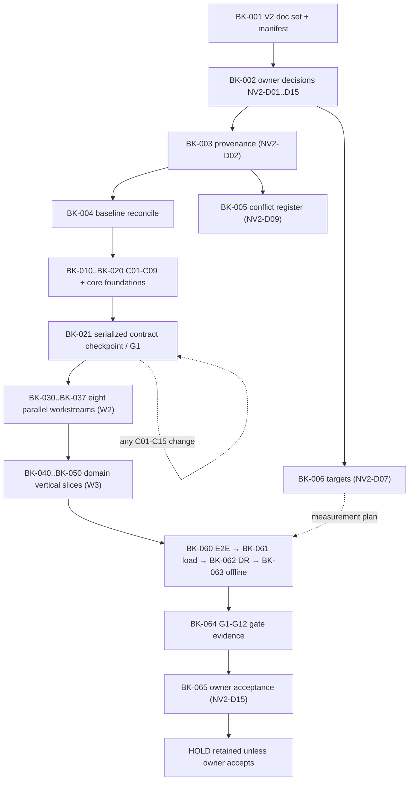

# GULA National Transformation V2 — Execution Backlog

**Document:** `GULA_NATIONAL_EXECUTION_BACKLOG_V2.md` (new root-level document, deliverable 16 of 18 + manifest)
**Status:** `PROPOSED / PENDING OWNER APPROVAL` — this backlog schedules work; it does not authorize it.
**Companion:** `GULA_NATIONAL_MASTER_EXECUTION_PLAN_V2.md`.
**Repository:** `/home/samertts/workspace/projects/gula-integration` only; sibling `gula-platform` read-only.

---

## 1. Standing posture (carried into every V2 document)

**HOLD TRUE** · **`production_ready_items = 0`** · **Stable v1.0.0 NOT DECLARED** · **PRODUCTION READY NOT AUTHORIZED** · security **NOT CERTIFIED** (`GOVERNANCE/FINAL_DECISION.md:13,46`; `GOVERNANCE/NATIONAL_INTEGRATION/status_registry.json`; `GULA_MASTER_EXECUTION_STATUS.md:7`).

Every backlog item is `PLANNED` or `BLOCKED`. **No item is `DONE`, `ACCEPTED`, or `PRODUCTION READY`.** No status may be upgraded without a cited artifact. `DECISION-READY` ≠ `ACCEPTED`. Historical certification claims are conflicts for owner decision (NV2-D09), not status.

---

## 2. Backlog conventions and ID space

- Task IDs are `BK-001`, `BK-002`, … assigned once and never reused. IDs are append-only; new work gets `BK-<next>`.
- Program IDs are `PRG-00` … `PRG-10` (alias `P0` … `P10`). Audit packages are always `P-02 / AUD-F02` and `P-03 / AUD-F03`. **`PRG-03` (Diagnostics and Laboratory Systems) is never the audit package `P-03 / AUD-F03`.**
- Contract IDs `C01` … `C15`; release gates `G1` … `G12`; risks `R-01` … `R-18`; owner decisions `NV2-D01` … `NV2-D15`; waves `W0` … `W4`; workstreams `WS-CORE-01`, `WS-SEC-01`, `WS-AUD-01`, `WS-OBS-01`, `WS-DB-01`, `WS-E2E-01`, `WS-API-01`, `WS-GOV-01`.
- Status vocabulary (exclusive): `IMPLEMENTED · TESTED · INDEPENDENTLY REVIEWED · ACCEPTED · PRODUCTION READY · PARTIALLY IMPLEMENTED · DOCUMENTED ONLY · PLANNED · BLOCKED`. Distinction labels: SOURCE / WORKING PROTOTYPE / DOCUMENTED DESIGN / TEST-ONLY / PRODUCTION-VERIFIED.
- Owner-role values are roles, not named people: `OWNER` (accountable decision-maker), `PRG-xx LEAD`, `CORE ARCHITECT`, `SEC LEAD`, `QA LEAD`, `SRE LEAD`, `DATA OWNER`, `INDEPENDENT REVIEWER`.
- All evidence paths are repository-relative. "NOT VERIFIED" is used where no artifact exists. No completion percentages or pass results are invented.
- Every task is verifiable by at least one file, command, or evidence artifact (columns *Deliverable* / *Evidence required* / *Definition of Done*).

### 2.1 Parallel rule reminder

Parallel work is permitted only against approved contracts and versioned schemas (§6). No team changes `C01`–`C15`, protected governance records, or National Core semantics locally. Contract changes require contract review + version bump + G1 revalidation. Migrations and shared schema changes are **serialized checkpoints** (§6).

---

## 3. First parallel workstream set (seed §12 — exact IDs, pending owner NV2-D10)

| Workstream | Exact scope | Program | Runs in |
|---|---|---|---|
| WS-CORE-01 | Patient/org/provider identity contracts and conformance suite | PRG-00 | W1 (then W2 conformance) |
| WS-SEC-01 | Zero-trust test harness: IDOR, cross-tenant, audit-bypass, unauthorized result modification, duplicate prescription, unauthorized export | PRG-10 | W2 |
| WS-AUD-01 | Audit-chain design evidence and contract conformance — **documentation/test design only; no P-03 or P-03-CONCURRENCY implementation** | PRG-00 / PRG-10 | W2 |
| WS-OBS-01 | Metrics/logs/traces contract and national dashboard schema | PRG-10 | W2 |
| WS-DB-01 | Migration safety, PITR/DR runbook validation design | PRG-10 | W2 |
| WS-E2E-01 | Synthetic 15-step patient journey scenario skeleton and fixtures | PRG-01 / PRG-10 | W2 |
| WS-API-01 | OpenAPI/contract-first validation and versioning tooling | PRG-00 / PRG-10 | W1–W2 |
| WS-GOV-01 | Documentation index, decision register, backlog maintenance | PRG-00 | W0–W4 |

These run in parallel because they depend only on approved contracts/IDs and synthetic data, not on domain source changes.

---

## 4. Ordered backlog — `BK-001` … `BK-065`

Status is uniformly `PLANNED` except where an owner/locked dependency makes it `BLOCKED`. Gate column lists gates that must eventually pass; a gate listed here is **not** passed.

### 4.1 W0 — Governance and evidence baseline (planning gate only; no implementation)

| ID | Wave | Program | Workstream | Task | Deliverable | Depends-on | Owner-role | Evidence required | Gate | Definition of Done | Status |
|---|---|---|---|---|---|---|---|---|---|---|---|
| BK-001 | W0 | PRG-00 | WS-GOV-01 | Freeze V2 document set and build SHA-256 manifest | 18 V2 documents + `CHECKPOINT_GULA_NATIONAL_V2_2026_11_24_SHA256.txt` | — | WS-GOV-01 lead | Manifest hashing docs 1–18 only; verified `sha256sum -c` command output | — | All 18 files present, English-only, each ending `## Evidence basis`; manifest covers exactly docs 1–18 | PLANNED |
| BK-002 | W0 | PRG-00 | WS-GOV-01 | Record owner decisions NV2-D01…D15 in decision register | Updated `GULA_NATIONAL_DECISION_REGISTER_V2.md` + `GULA_OWNER_DECISION_REGISTER.md` entry | — | OWNER | Owner-signed decision entries; no engineering self-approval | — | Each decision recorded as ACCEPTED or retained BLOCKED by owner only | BLOCKED |
| BK-003 | W0 | PRG-00 | WS-GOV-01 | Resolve mixed Git provenance before any save/merge | Provenance reconciliation record (20 staged R100 + 162 unstaged + 686 untracked) | BK-002 (NV2-D02) | OWNER / PRG-00 LEAD | `git status --porcelain=v1 -uall` reconciliation; name-status MD5 `56c524d6ffe9872c3a3ac6eff8c8f203` | — | Provenance signed off; no staged/unstaged ambiguity remains | BLOCKED |
| BK-004 | W0 | PRG-00 / PRG-10 | WS-GOV-01 | Reconcile route-count and migration-count contradictions into one baseline | Baseline reconciliation report | BK-003 | CORE ARCHITECT | Counts cited: 1,442/1,815/1,817/2,116 routes; 48/110/111 migrations (head `20261119_0003`) | G1 | Single reconciled count with method and command recorded | PLANNED |
| BK-005 | W0 | PRG-00 | WS-GOV-01 | Register historical certification vs HOLD conflict | Conflict register entry for NV2-D09 | BK-001 | OWNER / INDEPENDENT REVIEWER | `MASTER_RELEASE_CERTIFICATION.md`, `RC_READINESS_REPORT.md`, `ENTERPRISE_PRODUCTION_CERTIFICATION_REPORT.md`, `RELEASE_READINESS_REPORT.md` vs November records | — | Conflict logged, not silently resolved; owner decision requested | PLANNED |
| BK-006 | W0 | PRG-10 | WS-DB-01 | Approve RTO/RPO/availability/P95/P99 targets and measurement plan | Approved measurement plan | BK-002 (NV2-D07) | OWNER / SRE LEAD | Targets from `k6/load_test.js` (read p95<500ms, write<1000ms, health p99<200ms); target values labeled not achieved | G7, G6 | Owner-approved numeric targets + instrumentation path recorded | BLOCKED |

### 4.2 W1 — National Core contracts + identity/MPI/org/provider foundations

| ID | Wave | Program | Workstream | Task | Deliverable | Depends-on | Owner-role | Evidence required | Gate | Definition of Done | Status |
|---|---|---|---|---|---|---|---|---|---|---|---|
| BK-010 | W1 | PRG-00 | WS-CORE-01 | C01 Patient Identity Contract + conformance suite | Versioned C01 schema + conformance tests | BK-003, BK-004 | DATA OWNER / CORE ARCHITECT | `backend/app/services/mpi/`, `backend/tests/contracts/`, conformance run artifact | G1, G4 | Schema validated; MPI merge-conflict rule (R-05) specified; version recorded | PLANNED |
| BK-011 | W1 | PRG-00 | WS-CORE-01 | C02 Organization Contract | Versioned C02 schema + conformance tests | BK-010 | DATA OWNER | Organization/facility hierarchy owner = PRG-00; hierarchy fixture | G1, G4 | Schema validated; consumed-by-all rule documented | PLANNED |
| BK-012 | W1 | PRG-00 | WS-CORE-01 | C03 Provider Contract | Versioned C03 schema + conformance tests | BK-010 | DATA OWNER | `backend/app/capabilities/provider_management/` stubs noted as prototype | G1, G4 | Schema validated; provider registry ownership assigned | PLANNED |
| BK-013 | W1 | PRG-00 | WS-CORE-01 | C05 Authorization Contract | Versioned C05 schema + policy conformance | BK-010, BK-002 (NV2-D06) | SEC LEAD | `backend/app/security/abac.py` DENY defaults; `backend/app/identity/services/authorization_decision.py:199-314,559-603` | G1, G2 | Fail-closed policy conformance proven with harness cases (R-04) | PLANNED |
| BK-014 | W1 | PRG-00 | WS-CORE-01 | C06 Consent Contract | Versioned C06 schema + conformance | BK-010 | DATA OWNER / SEC LEAD | `backend/app/identity/services/consent_service_v2.py:24-46,62-81`; consent/emergency conflict rule (R-07) | G1, G2 | Versioned consent + break-glass distinction documented and tested | PLANNED |
| BK-015 | W1 | PRG-00 / PRG-10 | WS-AUD-01 | C07 Audit Contract (design/conformance only) | Versioned C07 schema + design evidence | BK-010; **P-03/P-03-CONCURRENCY explicitly excluded** | CORE ARCHITECT / SEC LEAD | `backend/app/services/audit_service.py` chain; `scripts/audit_verifier.py:3-14` | G1, G2, G3 | Contract documented; no audit-chain implementation executed | PLANNED |
| BK-016 | W1 | PRG-00 / PRG-10 | WS-API-01 | C08 API Versioning Contract + OpenAPI conformance tooling | Versioning policy + validation tool | BK-004 | CORE ARCHITECT | `contracts/export/openapi.json` stub; `X-API-Version: 2.5.0` middleware; checked-in openapi 2.1.0 zero paths | G1, G4 | Request negotiation/Deprecation/Sunset defined; tool flags empty/stale specs | PLANNED |
| BK-017 | W1 | PRG-10 | WS-CORE-01 | C09 Event Contract + authoritative event-store design | Versioned C09 schema + design record | BK-006, BK-004 | CORE ARCHITECT / SRE LEAD | `shared/events/bus.py`, `backend/app/services/outbox_service.py`; four disconnected stacks | G1, G4, G10 | Event identity/outbox/DLQ semantics defined; R-14 addressed in design | PLANNED |
| BK-018 | W1 | PRG-01 | WS-CORE-01 | C04 Clinical Resource Contract | Versioned C04 schema; FHIR R4 where suitable, no forced FHIR on administrative data | BK-010 | DATA OWNER / PRG-01 LEAD | `backend/app/health_core/fhir/`, `routes/ehr_fhir.py`, `KNOWN_LIMITATIONS` §2 | G1, G4 | Resource mapping table with FHIR/administrative boundary explicit | PLANNED |
| BK-019 | W1 | PRG-00 | WS-CORE-01 | MPI foundation stabilization | MPI service evidence pack | BK-010 | DATA OWNER | `backend/app/services/mpi/`; audit findings on identity merge | G3, G5 | NHID/MPI owner confirmed; merge rules tested with synthetic data | PLANNED |
| BK-020 | W1 | PRG-00 | WS-CORE-01 | Organization/provider registry foundation | Registry evidence pack | BK-011, BK-012 | DATA OWNER | org/provider mixed ownership in active monolith | G3, G5 | Single authoritative registry owner recorded; consumers enumerated | PLANNED |
| BK-021 | W1 | PRG-00 | WS-GOV-01 | **Serialized checkpoint:** contract-change gate and version bump | Contract change record + G1 revalidation | Any C01–C15 change | CORE ARCHITECT | contract review decision + `sha256sum -c` on contract artifacts | G1 | No contract change applied without review + bump + G1 revalidation | PLANNED |

### 4.3 W2 — Independent enabling work (parallel; contract stubs + synthetic data only)

| ID | Wave | Program | Workstream | Task | Deliverable | Depends-on | Owner-role | Evidence required | Gate | Definition of Done | Status |
|---|---|---|---|---|---|---|---|---|---|---|---|
| BK-030 | W2 | PRG-10 | WS-SEC-01 | Zero-trust harness scaffold (IDOR, cross-tenant, audit-bypass, unauthorized result modification, duplicate prescription, unauthorized export) | Harness + 6 scenario cases | BK-013, BK-015 | SEC LEAD | `backend/app/security/zero_trust.py:14-15,37-45`; 90 security test files inventory | G2 | All six cases encoded; each runs against synthetic data only | PLANNED |
| BK-031 | W2 | PRG-00 / PRG-10 | WS-AUD-01 | Audit-chain design evidence and contract conformance (design only) | Design note + conformance matrix | BK-015; P-03/P-03-CONCURRENCY **not started** | SEC LEAD / INDEPENDENT REVIEWER | `P-03_READINESS_2026_11_24.md` defect evidence; WT fix uncommitted | G2, G3 | Design cites PG16 defect and fail-closed requirement; no implementation | PLANNED |
| BK-032 | W2 | PRG-10 | WS-OBS-01 | Metrics/logs/traces contract + national dashboard schema | Observability contract + schema | BK-006 | SRE LEAD | `/metrics/prom`; Helm ServiceMonitor scrapes authenticated `/metrics` not `/metrics/prom`; SLO metrics not emitted | G10 | Contract defines /metrics/prom scrape, trace propagation, dashboard schema | PLANNED |
| BK-033 | W2 | PRG-10 | WS-DB-01 | Migration-safety and PITR/DR runbook validation design | Design + validation checklist | BK-006 | SRE LEAD | `DATABASE_RECOVERY_REPORT.md:7-11` NOT IMPLEMENTED/BLOCKED; `scripts/pitr-recover.sh`, `scripts/restore-test.sh`, `scripts/validate-restore.sh` | G5, G6 | Design enumerates script defects; no live DR executed in this gate | PLANNED |
| BK-034 | W2 | PRG-01 / PRG-10 | WS-E2E-01 | Synthetic 15-step patient journey skeleton + fixtures | Scenario spec + fixtures | BK-018 | QA LEAD / PRG-01 LEAD | 13 Playwright specs are navigation-only; `OD-008` no journey E2E verified | G3, G11 | Journey steps enumerated; fixtures synthetic; no PHI | PLANNED |
| BK-035 | W2 | PRG-00 / PRG-10 | WS-API-01 | Contract-first OpenAPI/AsyncAPI validation and versioning tooling | Validation tool + CI-ready config | BK-016 | CORE ARCHITECT | `contracts/export/{openapi,asyncapi,fhir}.json` 98/102/305-byte stubs; `contracts/routes.py:52` broken import | G1, G4 | Tool rejects stub/empty specs and broken endpoints; version policy enforced | PLANNED |
| BK-036 | W2 | PRG-00 | WS-GOV-01 | Documentation index / decision register / backlog maintenance | Index + register + this backlog kept current | BK-001 | WS-GOV-01 lead | 18 V2 docs + manifest; prior checkpoint manifests | — | IDs consistent across all docs; no orphan BK/NV2/R ID | PLANNED |
| BK-037 | W2 | PRG-10 | WS-SEC-01 | Extend harness with anti-abuse/negative cases (brute force, enumeration, broker outage, migration interruption) | Extended case list | BK-030 | SEC LEAD | `ADVERSARIAL_TEST_REPORT.md` §3 partially covered; no anti-abuse suite found | G2, G10 | Negative cases defined; results marked NOT VERIFIED until executed | PLANNED |

### 4.4 W3 — Domain vertical slices (parallel within program boundaries; after C01–C09 baselines)

| ID | Wave | Program | Workstream | Task | Deliverable | Depends-on | Owner-role | Evidence required | Gate | Definition of Done | Status |
|---|---|---|---|---|---|---|---|---|---|---|---|
| BK-040 | W3 | PRG-01 | — | Clinical/EHR vertical slice | Slice + E2E fixture evidence | BK-018, BK-034 | PRG-01 LEAD | `backend/app/routes/ehr.py`, `backend/app/ehr/`, `services/ehr_service.py` | G3, G4 | One verifiable clinical journey step with cited artifact | PLANNED |
| BK-041 | W3 | PRG-02 | — | Hospital/HIS + EMS slice | Slice evidence | BK-010, BK-011, BK-040 | PRG-02 LEAD | `backend/app/services/hospital_service.py`, `backend/app/ems/`, `backend/app/nursing/`, `backend/app/critical_care/` | G3, G11 | Inpatient and EMS flows consume core contracts; no local core edits | PLANNED |
| BK-042 | W3 | PRG-03 | — | Diagnostics/LIMS slice (orders, results, QC) | Slice evidence | BK-010, BK-011, BK-013 | PRG-03 LEAD | `backend/app/lims/`, `lab_service.py`, `sample_service.py`, `test_result_service.py`, `quality_control_service.py` | G3, G4 | Result-modification and QC behavior verified with synthetic data (R-06) | PLANNED |
| BK-043 | W3 | PRG-03 | — | Radiology/PACS DICOM slice (NV2-D11) | Slice evidence + DICOM strategy note | BK-011, BK-010; NV2-D11 | PRG-03 LEAD | `backend/app/radiology/` incl. `pacs.py` DICOMStorageService; no `pydicom`/`pynetdicom` dep | G3, G4, G1 | DICOM QIDO/WADO/STOW strategy owner-approved; dependencies reconciled | BLOCKED |
| BK-044 | W3 | PRG-03 / PRG-02 | — | Blood-bank owner decision flag | Decision request entry | BK-002 (owner decision) | OWNER / PRG-03 LEAD | `backend/app/blood_bank/`, `backend/tests/blood_bank/` | G1 | Ownership (PRG-03/PRG-02) recorded; left unresolved if owner defers | BLOCKED |
| BK-045 | W3 | PRG-04 | — | Pharmacy/medication slice + duplicate-prescription check | Slice evidence | BK-013, BK-040 | PRG-04 LEAD | `backend/app/pharmacy/`; WS-SEC-01 duplicate-prescription case | G2, G3 | Duplicate prescription prevented in synthetic journey | PLANNED |
| BK-046 | W3 | PRG-05 | — | Public-health reporting slice (NV2-D08) | Slice evidence + legal scope note | BK-040, BK-017; NV2-D08 | PRG-05 LEAD | `backend/app/public_health/`, `backend/app/national/intelligence/public_health/surveillance.py` | G3, G11 | Case/immunization derived from authorized clinical events only | BLOCKED |
| BK-047 | W3 | PRG-07 | — | Health-operations slice (workforce, assets, billing, quality) | Slice evidence | BK-011, BK-013 | PRG-07 LEAD | `backend/app/governance/models/workforce.py`, `backend/app/biomedical/`, `backend/app/billing/`, `backend/app/clinical/quality/` | G3, G11 | Operations consumers use core contracts; no duplicate audit truth | PLANNED |
| BK-048 | W3 | PRG-08 | — | Access-channel contract-bound surface slice | Channel evidence pack | BK-013, BK-016, BK-034 | PRG-08 LEAD | `frontend-v3/data-source-inventory.json` 2 contract-bound (patients, orders); 72 unbound, 17 demo-only | G8, G4 | Additional surfaces moved to contract-bound with cited evidence | PLANNED |
| BK-049 | W3 | PRG-09 | — | Analytics/warehouse derived-only slice | Slice evidence + ownership note | BK-017, BK-040 | PRG-09 LEAD | `backend/app/health_data/`, `backend/app/nhdw/`, `backend/app/national_data/` dormant | G3, G4 | No primary clinical writes; derived-only status documented | PLANNED |
| BK-050 | W3 | PRG-06 | — | Specialty-care gap register and first slice selection | Gap register + slice proposal | BK-002 (NV2-D10 resources) | PRG-06 LEAD | `GULA_COMPONENT_INVENTORY.md` §4: Dental #10, Rehabilitation #13, Mental health #14 NOT IMPLEMENTED; gaps analytics/enum/doc-level | G1 | Gaps classified by evidence label; first slice owner-selected | BLOCKED |

### 4.5 W4 — National integration, load, DR, offline, controlled rollout

| ID | Wave | Program | Workstream | Task | Deliverable | Depends-on | Owner-role | Evidence required | Gate | Definition of Done | Status |
|---|---|---|---|---|---|---|---|---|---|---|---|
| BK-060 | W4 | PRG-00 / PRG-01 / PRG-10 | WS-E2E-01 | Execute complete synthetic 15-step national journey | E2E evidence artifact | BK-040…BK-049 | QA LEAD / INDEPENDENT REVIEWER | Previously 0 journeys E2E verified (OD-008) | G4, G11, G3 | One full registration→order→sample→result→verification→billing→report journey with cited run | PLANNED |
| BK-061 | W4 | PRG-10 | — | National load/capacity evidence at approved targets | Load report | BK-006, BK-060 | SRE LEAD | `k6/load_test.js` targets; MISSION-019/020 not executed | G7 | Reproducible artifact with p95/p99/error rate; no invented pass values | PLANNED |
| BK-062 | W4 | PRG-10 | WS-DB-01 | DR/PITR restore drill at national scale | DR drill report | BK-033, BK-006 | SRE LEAD | `DATABASE_RECOVERY_REPORT.md` NOT IMPLEMENTED/BLOCKED; no restore drill evidence | G6 | Backup→restore→verify with RPO/RTO measured against approved targets | PLANNED |
| BK-063 | W4 | PRG-01 / PRG-10 | — | Offline and synchronization validation | Offline convergence evidence | BK-034, BK-017 | QA LEAD | HEAD CRDT_MERGE first-seen-key-wins can overwrite lab result; uncommitted quarantine fix; no durable production queue | G9, G3 | Conflict/quarantine behavior proven on PostgreSQL; no SQLite substitution | PLANNED |
| BK-064 | W4 | PRG-00 / PRG-10 | — | Execute G1–G12 and controlled-rollout evidence pack | Gate evidence pack | BK-060…BK-063 | INDEPENDENT REVIEWER / OWNER | G1…G12 definitions in master plan | G1–G12 | Each gate has pass/fail evidence with path citations; HOLD unchanged until owner | PLANNED |
| BK-065 | W4 | PRG-00 | — | Owner acceptance / Stable v1.0.0 release-candidacy decision (NV2-D15) | Owner decision entry | BK-064 | OWNER | `GULA_OWNER_DECISION_REGISTER.md` authority rule lines 9–11 | G12 | Owner records decision; absent decision ⇒ posture remains HOLD | BLOCKED |

---

## 5. Task sequencing W0 → W4 (summary)

| Wave | Entry | Exit | What may run in parallel | What may NOT run in parallel |
|---|---|---|---|---|
| W0 | V2 docs registered PROPOSED | NV2-D01/D02/D03/D04/D07 recorded; provenance resolved | Documentation/index tasks (BK-001, BK-005, BK-036) | No implementation, no contract/migration/source edits |
| W1 | W0 exit | C01–C09 approved/versioned; foundations evidenced | BK-010…BK-020 against approved stubs | Contract changes (BK-021) are serialized checkpoints |
| W2 | Approved stubs + synthetic policy (NV2-D14) | All 8 workstream outputs with evidence | BK-030…BK-037 (8 workstreams) | No domain source changes; no P-03/P-03-CONCURRENCY |
| W3 | C01–C09 baselines approved | Domain slices with E2E fixture evidence | BK-040…BK-050 within program boundaries | Shared contract/National Core semantics edits; migrations |
| W4 | W3 slices complete + measurement plan | G1–G12 evidence + owner acceptance | Documentation packaging only | Load, DR, offline, integration exercises sharing environments/DBs |

---

## 6. Explicitly serialized checkpoints (contract changes and migrations)

These are **not** parallel-editable. Each is a gate in its own right.

| Checkpoint | Trigger | Serializing rule | Revalidation | Related BK |
|---|---|---|---|---|
| CP-CONTRACT | Any change to C01–C15 | Contract review + version bump before merge; no local edits | G1 revalidation | BK-021, BK-010…BK-018 |
| CP-MIGRATION | Any shared-schema/migration change | Single serialized migration editor; verify single DAG head `20261119_0003`, 0 dangling, 0 duplicate IDs | G5 | BK-019, BK-020, BK-062 |
| CP-AUDIT-CONTRACT | Any C07 change | Design-only evidence; P-03/P-03-CONCURRENCY excluded | G2 + G3 | BK-015, BK-031 |
| CP-PROVENANCE | Before any save/merge in W0/W1 | Owner sign-off on 20 staged R100 + 162 unstaged + 686 untracked | checkpoint manifest | BK-003 |
| CP-RELEASE | Before G12/owner acceptance | All gates evidenced; HOLD not auto-converted to GO | G1–G12 | BK-064, BK-065 |

---

## 7. Acceptance and rollback per task

Acceptance is per-task and evidence-based; rollback is a planning instruction only (no rollback executed in this gate).

| ID | Acceptance evidence (file / command / artifact) | Rollback planning instruction |
|---|---|---|
| BK-001 | `sha256sum -c CHECKPOINT_GULA_NATIONAL_V2_2026_11_24_SHA256.txt` | Discard draft manifest; retain docs; re-issue with new hash set |
| BK-002 | Owner-signed entries in `GULA_NATIONAL_DECISION_REGISTER_V2.md` | Revert register entry to BLOCKED by owner only |
| BK-003 | Reconciliation record + `git status --porcelain=v1 -uall` | Restore pre-reconciliation working-tree snapshot (no force-push) |
| BK-004 | Reconciliation report with count method | Restore prior baseline document |
| BK-005 | Conflict register entry | Remove entry only by owner decision |
| BK-006 | Approved measurement plan | Withdraw plan; keep HOLD |
| BK-010…BK-018 | Versioned contract file + conformance run artifact + version record | Revert contract version; G1 revalidation; no silent in-place edit |
| BK-019, BK-020 | Foundation evidence pack with cited paths | Revert to prior documented state; re-run G3/G5 |
| BK-021 | Contract change record + G1 result | Revert change; restore prior version; re-run G1 |
| BK-030…BK-037 | Harness/tool/design artifact with case list | Remove new harness files; no domain source touched |
| BK-040…BK-050 | Slice evidence with E2E fixture + gate citation | Revert slice to stub/documented-design label; no shared core edits |
| BK-060 | Full-journey run artifact | Mark journey NOT VERIFIED; retain synthetic fixtures |
| BK-061 | Load report with reproducible command | Withdraw report; restore target-only status |
| BK-062 | DR drill report | Mark DR NOT VERIFIED; restore runbook design state |
| BK-063 | Offline convergence evidence on PostgreSQL | Mark NOT VERIFIED; do not substitute SQLite result |
| BK-064 | Gate evidence pack (G1–G12) | Mark affected gate NOT VERIFIED; HOLD remains |
| BK-065 | Owner decision entry | Absence of decision ⇒ HOLD posture retained |

---

## 8. Mapping BK tasks to NV2 decisions and gates G1–G12

| BK ID(s) | NV2 decision(s) | Gate(s) |
|---|---|---|
| BK-001 | — | — |
| BK-002 | NV2-D01…D15 (recording) | — |
| BK-003 | NV2-D02 | — |
| BK-004 | NV2-D01 | G1 |
| BK-005 | NV2-D09 | — |
| BK-006 | NV2-D07 | G6, G7 |
| BK-010 | NV2-D01, NV2-D03 | G1, G4 |
| BK-011 | NV2-D01, NV2-D03 | G1, G4 |
| BK-012 | NV2-D01, NV2-D03 | G1, G4 |
| BK-013 | NV2-D03, NV2-D06 | G1, G2 |
| BK-014 | NV2-D03 | G1, G2 |
| BK-015 | NV2-D03; not NV2-D12/D13 | G1, G2, G3 |
| BK-016 | NV2-D01 | G1, G4 |
| BK-017 | NV2-D01, NV2-D07 | G1, G4, G10 |
| BK-018 | NV2-D01, NV2-D11 | G1, G4 |
| BK-019, BK-020 | NV2-D03 | G3, G5 |
| BK-021 | NV2-D01 | G1 |
| BK-030, BK-037 | NV2-D06 | G2, G10 |
| BK-031 | NV2-D12/D13 explicitly excluded | G2, G3 |
| BK-032 | NV2-D07 | G10 |
| BK-033 | NV2-D07 | G5, G6 |
| BK-034 | NV2-D14 | G3, G11 |
| BK-035 | NV2-D01 | G1, G4 |
| BK-036 | — | — |
| BK-040 | NV2-D01 | G3, G4 |
| BK-041 | NV2-D01 | G3, G11 |
| BK-042 | NV2-D03 | G3, G4 |
| BK-043 | NV2-D11 | G1, G3, G4 |
| BK-044 | NV2-D01 (owner flag) | G1 |
| BK-045 | NV2-D06 | G2, G3 |
| BK-046 | NV2-D08 | G3, G11 |
| BK-047 | NV2-D03 | G3, G11 |
| BK-048 | NV2-D01 | G4, G8 |
| BK-049 | NV2-D03 | G3, G4 |
| BK-050 | NV2-D10 | G1 |
| BK-060 | — | G3, G4, G11 |
| BK-061 | NV2-D07 | G7 |
| BK-062 | NV2-D07 | G6 |
| BK-063 | NV2-D14 | G3, G9 |
| BK-064 | NV2-D04 | G1–G12 |
| BK-065 | NV2-D15 | G12 |

Gate index: **G1** Architecture and Contract Validation · **G2** Security and Privacy Validation · **G3** Clinical Safety and Data Integrity · **G4** API and Integration Compatibility · **G5** Database and Migration Validation · **G6** Backup and Disaster Recovery · **G7** Performance and Capacity · **G8** Mobile and Desktop Validation · **G9** Offline and Synchronization Validation · **G10** Monitoring and Incident Response · **G11** National Operations Readiness · **G12** Independent Review and Final Acceptance.

---

## 9. Mermaid — executable order

---

## Evidence basis

All citations are repository-relative to `/home/samertts/workspace/projects/gula-integration`; no files were modified.

- **Posture / decisions:** `GOVERNANCE/FINAL_DECISION.md` (§1/§4/§7–§10, :13, :46); `GOVERNANCE/GECS/MASTER_CONTROL.md`; `GOVERNANCE/NATIONAL_INTEGRATION/status_registry.json`; `GULA_MASTER_EXECUTION_STATUS.md:7`; `GULA_OWNER_DECISION_REGISTER.md` (authority line 9–11, §9); `GULA_RELEASE_ACCEPTANCE_REPORT.md`.
- **Prior packages (separate, blocked):** `AUDIT_EXECUTION_RECORDS/P-02_FINAL_CLOSURE_2026_11_24.md`, `AUDIT_EXECUTION_RECORDS/P-02_IMPLEMENTATION_EVIDENCE_2026_11_24.md`, `AUDIT_EXECUTION_RECORDS/P-02_AFTER_REV3.md`, `AUDIT_EXECUTION_RECORDS/P-02_INDEPENDENT_REVIEW_2026_11_24.md`, `AUDIT_EXECUTION_RECORDS/P-03_READINESS_2026_11_24.md`, `AUDIT_EXECUTION_RECORDS/P-03_CONCURRENCY_DESIGN.md`, `AUDIT_EXECUTION_RECORDS/P-03_SCOPE_AND_DEPENDENCY_REVIEW.md`.
- **Checkpoints:** `AUDIT_EXECUTION_RECORDS/CHECKPOINT_2026_11_20_SHA256.txt`, `CHECKPOINT_REBUILD_2026_11_21_SHA256.txt`, `CHECKPOINT_REV3_2026_11_21_SHA256.txt`, `CHECKPOINT_P02_CLOSURE_2026_11_24_SHA256.txt`, `CHECKPOINT_P03_DESIGN_2026_11_24_SHA256.txt`, `CHECKPOINT_P03_READINESS_2026_11_24_SHA256.txt`, `CRITICAL_FILE_SHA256.txt`.
- **Backend / contracts:** `backend/app/main.py`, `backend/app/factory.py`, `backend/app/services/mpi/`, `backend/app/security/abac.py`, `backend/app/identity/services/authorization_decision.py`, `backend/app/identity/services/consent_service_v2.py`, `backend/app/services/audit_service.py`, `scripts/audit_verifier.py`, `backend/app/capabilities/provider_management/`, `backend/app/health_core/fhir/`, `backend/app/routes/ehr_fhir.py`, `contracts/export/openapi.json`, `contracts/export/asyncapi.json`, `contracts/export/fhir.json`, `contracts/routes.py`.
- **Domain slices:** `backend/app/lims/`, `backend/app/radiology/pacs.py`, `backend/app/blood_bank/`, `backend/app/pharmacy/`, `backend/app/public_health/`, `backend/app/governance/models/workforce.py`, `backend/app/nursing/`, `backend/app/critical_care/`, `backend/app/ems/`, `backend/app/services/hospital_service.py`, `backend/app/health_data/`, `backend/app/nhdw/`, `backend/app/national_data/`, `backend/app/domain_platform/config/dormancy.json`.
- **Tests / quality / gates:** `backend/tests/contracts/`, `backend/tests/test_domain_platform.py`, `backend/tests/conftest.py` (SQLite-forced), `frontend-v3/data-source-inventory.json`, `ADVERSARIAL_TEST_REPORT.md`, `CERTIFICATION-v1.0.md` (full suite NOT RUN), `DATABASE_RECOVERY_REPORT.md`, `k6/load_test.js`, `reports/production_audit_report.md`, `reports/independent-certification-report.md`, `.github/workflows/` (32 workflows, configuration only).
- **Inventory / roadmaps:** `GULA_COMPONENT_INVENTORY.md` §4, `GULA_AUDIT_REMEDIATION_ROADMAP.md`, `GULA_COMPLETION_PLAN.md`, `GULA_ARCHITECTURE_DECISIONS.md`, `ARCHITECTURE.md`, `DESIGN.md`, `docs/adr/`, `helm/gula-platform/Chart.yaml`.
- **Authoritative seed (outside repository, read-only):** `/tmp/opencode/gula_v2_seed.md` and `/tmp/opencode/gula_v2_evidence_*.md` (8 evidence files).
