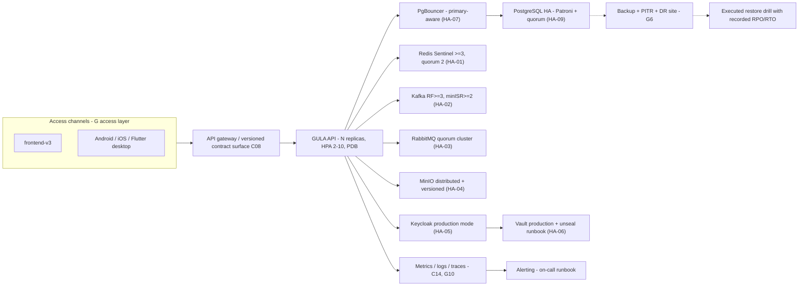

# GULA National Infrastructure and Reliability Plan V2

> **STATUS: PROPOSED / PENDING OWNER APPROVAL — PLANNING GATE ONLY.**
> **HOLD TRUE.** `production_ready_items = 0`. Stable v1.0.0 **NOT DECLARED**. **PRODUCTION READY NOT AUTHORIZED.**
> This document defines a *target* infrastructure/reliability design. It grants no release, deployment, failover,
> environment-promotion or production-access authority. No implementation, CI change, deploy, DR drill, production
> database/service access, or SQLite substitution for PostgreSQL evidence is performed or authorized here.
> Repository scope: `/home/samertts/workspace/projects/gula-integration` only; sibling `gula-platform` is read-only.

## 0. Document control

| Field | Value |
|---|---|
| Program set | PRG-00 (National Core and Governance), PRG-09 (National Intelligence and Analytics), PRG-10 (Security, Reliability, Infrastructure and Integration) |
| Anchoring wave / workstreams | W0 (governance and evidence baseline), W2 (enabling work), W4 (national integration/DR/load evidence); WS-OBS-01, WS-DB-01, WS-SEC-01, WS-GOV-01 |
| Contracts touched by target design | C07 (Audit), C08 (API Versioning), C11 (Offline Synchronization), C12 (Error and Retry), C13 (Data Retention), C14 (Observability), C15 (Migration and Compatibility) |
| Governing decisions | NV2-D02 (provenance freeze), NV2-D04 (release gates/HOLD), NV2-D07 (RTO/RPO/availability/P95/P99), NV2-D14 (environments/synthetic data), NV2-D15 (release candidacy) |
| Risks owned here | R-09, R-10, R-11, R-17 (plus R-18 escalation where owner decisions block progress) |
| Gates with primary dependency here | G5, G6, G7, G10, G11 (gates are defined authoritatively in `GULA_NATIONAL_CONTROLLED_RELEASE_PLAN_V2.md`, seed §7) |
| Evidence status | Artifacts = `DOCUMENTED ONLY` / source config present; live HA/DR/load/tracing = `NOT VERIFIED`; all targets = `PLANNED` |

## 1. Posture and authority boundary

The standing release posture is binding and unchanged by this plan:

- `GOVERNANCE/FINAL_DECISION.md:13` — HOLD, do not release; `:46` security NOT CERTIFIED; release candidate HOLD.
- `GOVERNANCE/GECS/MASTER_CONTROL.md` §3/§7/§8 — HOLD must not become GO; commit/push/merge/PR/deploy and touching `gula-platform` are prohibited.
- `GOVERNANCE/NATIONAL_INTEGRATION/status_registry.json` — `production_ready_items = 0`, not-authorized list, final instruction STOP before deployment.
- `GULA_OWNER_DECISION_REGISTER.md:9-11` — only an owner-recorded decision may move BLOCKED→ACCEPTED; the register never self-awards PRODUCTION READY and never converts HOLD to GO.
- Protected MD5s are unchanged: `FINAL_DECISION` `effdfeaf10234678d83b2668c4489552`, `MPI_FINAL_INDEPENDENT_AUDIT` `1a02c01563c93b07a7cdb92c0462bf36`, `MPI_INDEPENDENT_AUDIT_FINDINGS` `ea3969d09aaf7b0b28a065838b44a594`.

**No target in this document may be executed before** NV2-D01/D02/D04/D07/D14 are recorded by the owner and the
freeze/provenance preconditions of the release plan are met. Historical `PRODUCTION_READY`/certification claims are
recorded as conflicts requiring NV2-D09, never as current status. P-02 / AUD-F02 is
`IMPLEMENTED · TESTED · INDEPENDENTLY REVIEWED` (not ACCEPTED, not PRODUCTION READY); P-03 / AUD-F03 is
`PREPARED ONLY · NOT IMPLEMENTED`; P-03-CONCURRENCY is a separate unapproved package. `PRG-03` below always means
Diagnostics and Laboratory Systems, never the audit package `P-03 / AUD-F03`.

## 2. Current artifact inventory (source/config evidence, not runtime proof)

| Artifact class | Observed evidence | Status label | Reliability implication |
|---|---|---|---|
| Container images | 15 Dockerfiles; tree uses `python:3.12-slim` / `node:22.13-alpine` | `DOCUMENTED ONLY` | Base versions conflict with `DEVOPS_CERTIFICATION.md` (claims 3.14/node:24/14 Dockerfiles) — doc drift |
| Compose | 9 Compose files, including `docker-compose.yml` and `docker-compose.full.yml` | `DOCUMENTED ONLY` | Full stack uses PG17/Redis7 with mandatory passwords, but several secrets default empty; dev-oriented services |
| Kubernetes | `helm/gula-platform/` (Chart.yaml, values.yaml, templates): HPA 2–10, PDB, ServiceMonitor templates, PVCs; plus k8s manifests | `DOCUMENTED ONLY` | Renderable topology only; no live cluster evidence, no scrape result, no failover drill |
| Infrastructure as code | Terraform, Cloudflare and DigitalOcean definitions | `DOCUMENTED ONLY` | No applied-plan/state evidence in this gate |
| Database HA config | `config/postgres-ha/patroni.yml`, backup/PITR configs, cross-region replication config | `DOCUMENTED ONLY` | Config only; `docker-compose.full.yml` provides PG primary+replica but no proven promotion |
| Full local stack | `docker-compose.full.yml` | `DOCUMENTED ONLY` | Single-node Kafka, single RabbitMQ/MinIO, dev-mode Keycloak/Vault (§3) |
| CI | 32 workflow YAMLs under `.github/workflows/` | `DOCUMENTED ONLY` | `reports/ci/ci-cd-status-report.md` (2026-07-17) describes 6 — stale; no DR/backup gate |
| Language pinning drift | Root `pyproject.toml` targets py314 while `requires-python >=3.12` and CI uses 3.12 | `DOCUMENTED ONLY` | Reproducibility risk; must be normalized before G5/G7 evidence is trusted |

**Conclusion:** the repository contains an unusually broad *design surface* but no executed national HA, DR, load,
or production-tracing evidence. `FINAL_ACCEPTANCE_REPORT.md` does not declare production ready.

## 3. Explicit configuration-only HA gaps

These are **config findings**, not a claim that the system is continuously available. Each must be closed or
formally risk-accepted by the owner before the corresponding gate can be reconsidered.

| ID | Observed configuration | Evidence path | Gap and required target state |
|---|---|---|---|
| HA-01 | Redis Sentinel written as `sentinel monitor gula-redis redis 6379 1` (quorum 1) | `docker-compose.full.yml:162-172` | Single Sentinel/quorum cannot reach a reliable failover decision; a separate documented template (`config/redis-sentinel/sentinel.conf`) describes quorum 2 / 3 Sentinels but is **not** the full compose runtime. Target: ≥3 Sentinels, quorum 2, verified failover with client reconnect. |
| HA-02 | Kafka `DEFAULT_REPLICATION_FACTOR: 1`, `MIN_INSYNC_REPLICAS: 1`, offsets/transaction topics = 1; comment confirms single-node dev | `docker-compose.full.yml:256-274` | No broker redundancy; target RF ≥3, min.insync ≥2, verified under broker loss; aligns with R-14 event/outbox maturity. |
| HA-03 | Single RabbitMQ instance in full stack (Cluster template exists but is not deployed) | `docker-compose.full.yml`; `config/rabbitmq-cluster/docker-compose.rabbitmq-ha.yml`, `config/rabbitmq-cluster/definitions.json` (quorum queues) | Quorum-queue design is documented only; target ≥3 nodes with durable quorum queues and verified consumer recovery. |
| HA-04 | Single MinIO instance in full stack | `docker-compose.full.yml` | No erasure/multi-node object redundancy; target distributed MinIO with versioning + immutable backup and verified restore. |
| HA-05 | Keycloak launched with `command: start-dev` | `docker-compose.full.yml:394` | Development mode is not a production identity authority; target production mode, external DB, HA, backup, and NV2-D06 zero-trust policy alignment. |
| HA-06 | Vault launched as `vault server -dev` with a dev root token | `docker-compose.full.yml:421` | Dev Vault holds root token in a process argument; target sealed-production Vault, unseal procedure, rotation, and audited access. |
| HA-07 | PgBouncer points to the primary only | `config/pgbouncer/pgbouncer.ini`; `docker-compose.full.yml` | PgBouncer cannot follow a Patroni promotion; target primary-aware routing (e.g. Patroni callbacks/service discovery), verified read/write split and failover reconnect. |
| HA-08 | Broad `0.0.0.0` publication | `config/pgbouncer/pgbouncer.ini:8`, `config/redis-sentinel/sentinel.conf:8`, `config/redis-cluster/redis-cluster.conf:16`, `config/rabbitmq/rabbitmq.conf:11`, `config/opentelemetry/otel-collector-config.yml` | Data-plane and telemetry endpoints exposed beyond loopback; target least-exposure binding with network policy, mTLS/service identity (NV2-D06). |
| HA-09 | No live failover evidence | `config/postgres-ha/patroni.yml`, `docker-compose.full.yml`, no executed report | All HA remains `DOCUMENTED ONLY`; no promotion, split-brain, quorum-loss or client-reconnect drill has been recorded. |

### 2.1 Target topology (design intent — not deployed)

## 4. Backup and DR: why existing scripts do **not** prove restore

Scripts exist and are useful as design inputs, but none of them constitutes restore evidence at national scale.
`DATABASE_RECOVERY_REPORT.md:7-11` states **NOT IMPLEMENTED / BLOCKED**: no restore, PITR, RPO/RTO measurement or
backup drill was executed; the only DB touchpoint was a throwaway SQLite file for a step-up migration test (which
cannot substitute for PostgreSQL evidence).

| Script / record | What it actually does | Why it does not prove restore |
|---|---|---|
| `scripts/backup.sh`, `scripts/continuous-backup.sh`, backup/PITR config | Produce/copy backups | Creation is not restoration; no recorded successful restore from a produced artifact |
| `scripts/pitr-recover.sh` | PITR is a **dry run** unless `FORCE_PITR=true` | Default path never applies recovery; no evidence of a forced, verified PITR drill |
| `scripts/restore-test.sh` (`test_recovery`) | Creates, checks and drops a table | Tests DDL/row visibility in a narrow scope, not full-database or multi-schema recovery, RPO or RTO |
| `scripts/backup-verification.sh:84-116,173` | Uses `mysql` clients against `$TEST_DB_NAME` | Wrong engine for a PostgreSQL platform (`mysql` / `information_schema` / `SHOW TABLES`); result is not PG restore evidence |
| `scripts/validate-restore.sh:26-27,88` | `createdb ... \|\| true`; `pg_restore ... \|\| true`; `dropdb ... \|\| true` | `pg_restore` failures are swallowed — a FAIL can be reported as success; no exit-code integrity |
| `scripts/dr-failover.sh:49` | Updates Cloudflare DNS using `$DR_IP` | `DR_IP` is undefined in the script path; no executed failover record, no data-integrity or split-brain check |
| `scripts/dr-failback.sh`, `scripts/dr-test.sh` | DR helpers exist | No CI invocation found in any of the 32 workflows; no drill artifact, timestamp, RPO/RTO measurement or sign-off |
| `DATABASE_RECOVERY_REPORT.md:7-11` | Explicit status `NOT IMPLEMENTED` / `BLOCKED` | Current authoritative record; overrides any older optimistic claim |
| `GOVERNANCE/FINAL_DECISION.md` §1/§4/§7/§8/§9/§10 | HOLD, security NOT CERTIFIED, sign-off required, **MIG-EXISTING NOT MET** | Release authority is withheld; migration/readiness claims cannot be upgraded |
| Strict-schema gate (W1) | 753 passed / **119 failed** | Schema conformance gate is failing; cannot underwrite migration or DR integrity |
| `MIG-EXISTING` | `PARTIAL` / `NOT MET` (FINAL_DECISION and recovery report) | Existing-data migration is not proven; a restore of partly-migrated state is not a recovery guarantee |

**G6 therefore remains `NOT PASSED` / `NOT VERIFIED`.** The target DR evidence package (to be produced only under an
approved environment and NV2-D07 targets) must include: (1) a real PG16 backup taken from a controlled source;
(2) destructive restore into an isolated environment with byte/row/checksum verification; (3) a forced PITR to a
declared timestamp; (4) measured RPO and RTO against approved targets; (5) application-level read/write smoke after
restore; (6) audit-chain continuity verification (C07); (7) removal of all `|| true` masks and engine mismatch;
(8) recorded operator sign-off and a repeatable CI-invocable, environment-gated job. No production DB is used in this gate.

## 5. Observability target (C14, G10)

### 5.1 Current state — verified source facts

- `backend/app/routes/metrics.py:107` `GET /metrics` is authenticated JSON; `:123-129` `GET /metrics/prom` is the
  Prometheus text endpoint, Bearer-token protected in production (503 when `METRICS_BEARER_TOKEN` unset) and open in dev.
- `helm/gula-platform/templates/backend/servicemonitor.yaml` scrapes `.Values.backend.serviceMonitor.path`;
  `helm/gula-platform/values.yaml:211-215` sets `path: /metrics` — i.e. the **authenticated JSON** endpoint, not
  `/metrics/prom` (`helm/gula-platform/templates/_helpers.tpl:181` default `/metrics`). The scrape contract is broken.
- `backend/app/services/metrics_service.py:390-392` defines `gula_down` and at `:312-317`
  `gula_request_duration_seconds_bucket`, but `build_prometheus_response` (`:353`) has **no call site** anywhere in
  the repository — the SLO series are not exposed by the live endpoint.
- No runtime FastAPI OTel instrumentation is active; `config/opentelemetry/otel-collector-config.yml` exists but its
  receivers bind `0.0.0.0` (HA-08), and the alertmanager webhook is a placeholder.
- Structured JSON logging is real; Prometheus fail-closed in production is a positive control to preserve.

### 5.2 Target contract and acceptance

| Target element | Required implementation/evidence | Gate | Status |
|---|---|---|---|
| Correct scrape path | ServiceMonitor path `/metrics/prom`; Bearer token delivered via Secret; 200 with expected content type in a controlled cluster | G10 | `NOT VERIFIED` |
| SLO series live | `gula_down` and `gula_request_duration_seconds_bucket{le=...}` emitted from the live `/metrics/prom` response with a test asserting their presence | G10 | `NOT VERIFIED` |
| Correlation/trace propagation | C14/C12 contract: `X-Request-ID` echoed today, but `X-Correlation-ID` is absent and `request.state.correlation_id` is never set; target: full propagation across API → DB → outbox → consumer → DICOM/HL7 bridge | G4/G10 | `NOT VERIFIED` |
| Runtime OTel | Env-gated FastAPI + httpx + SQLAlchemy instrumentation, vendor-neutral OTLP/HTTP exporter, no production endpoint in this gate | G10 | `NOT VERIFIED` |
| Alerting | SLO-based alerts for availability, P95/P99, DB/Redis/Kafka/RabbitMQ/MinIO health, outbox lag, audit-chain fork; runbook + on-call roster + tested webhook | G10/G11 | `NOT VERIFIED` |
| Log retention | C13 classification, immutable audit separated from operational logs, retention enforcement evidence | G2/G10 | `NOT VERIFIED` |

## 6. Target reliability and performance objectives — **requires NV2-D07**

All values below are **PROPOSED TARGETS, NOT APPROVED, NOT MEASURED**. No completion score or pass result is implied.
They exist solely so NV2-D07 can approve or replace them together with a measurement plan.

| Objective | Proposed target (pending NV2-D07) | Measurement precondition | Current evidence |
|---|---|---|---|
| Availability | ≥ 99.9% monthly, excluding approved maintenance window | Controlled-environment uptime series + error budget policy | `NOT VERIFIED` |
| RTO | ≤ 4 h for national core restore; ≤ 1 h for single-component failover | Executed failover + restore drill with timestamps | `DATABASE_RECOVERY_REPORT.md` NOT IMPLEMENTED/BLOCKED |
| RPO | ≤ 15 min for transactional data; ≤ 1 h for analytical derivatives | WAL archiving + measured PITR recovery point | No drill; `pitr-recover.sh` dry-run by default |
| Read P95 | < 500 ms | k6/Locust executed against PG16 with representative dataset | Target defined in `k6/load_test.js`; no executed result |
| Write P95 | < 1000 ms | Same, with write contention and outbox load | Target defined; no executed result |
| Health P99 | < 200 ms | Same, under load | Target defined; no executed result |
| Throughput | ≥ 100 rps at defined concurrency | Reproducible artifact with environment spec | `quality-gates` target; no artifact |
| Error rate | < 1% | Same | `k6/load_test.js` target; no artifact |

**Performance evidence status:** `.benchmarks` is empty; stored `benchmark-results.json` records **FAIL**;
`GOVERNANCE ADVERSARIOUS PERFORMANCE` is `BLOCKED — NOT MEASURED`; `reports/production_audit_report.md` records
MISSION-019/020 national-scale load tests **not executed**; `reports/independent-certification-report.md` records no
national-scale load/chaos results. `nightly.yml` and the performance check are `continue-on-error`/warning-only —
target G7 requires a **hard** gate before any promotion.

## 7. Migration safety (C15, G5)

| Fact | Evidence | Consequence for planning |
|---|---|---|
| 111 Python revisions | `backend/migrations/versions/` | Inventory must be frozen before any migration work; counts conflict across docs (48 vs 110 vs 111) |
| Single head `20261119_0003`, single root `20250322_0000` | Alembic DAG scan | Linear-ish DAG with **one** head is a prerequisite; any new head blocks G5 |
| Valid DAG: 4 merges (`20260815_0003`, `20260815_0015`, `20260819_0001`, `20260908_0001`), 0 dangling parents, 0 duplicate IDs | Alembic DAG scan | Merges are legitimate; must be preserved with explicit down-revision ordering |
| `MIG-EXISTING` PARTIAL / NOT MET | `GOVERNANCE/FINAL_DECISION.md` | Existing-data migration cannot be claimed; no production data touch in this gate |
| W1 strict schema: 753 passed / 119 failed | W1 evidence / quality-gate record | Failures must be triaged and re-run before G5 |
| `backend/tests/conftest.py` forces SQLite in-memory | `backend/tests/conftest.py` | Default suite does **not** exercise PG locking, sequences, triggers or PG DDL; G5 requires PG16-backed runs (no SQLite substitution) |
| A09-013: seven migration skips without DB URL; A09-004 PG16 schema gate 119 failures | QA audit evidence | Skips are not passes; must be converted to executed PG checks |

**Target migration control:** contract-first schema change (C15) → serialized checkpoint (never a parallel edit) →
forward upgrade on PG16 → rollback/downgrade rehearsal → schema-conformance re-run → audit of head count and DAG →
evidence artifact with environment and hash. Data migration and shared-schema changes are serialized checkpoints per
seed §13; no team may change C01–C15 locally.

## 8. Container and deployment hardening target

| Target | Requirement | Current gap evidence |
|---|---|---|
| Multi-stage, minimal runtime | Builder/runtime separation, pinned digests, no toolchain in final image | Base-version drift (§2); 15 Dockerfiles need normalized, reviewed baselines |
| Non-root + read-only | `USER` non-root, read-only root FS where possible, dropped capabilities | Must be verified per image; not assumed from documentation |
| Health/ready/deep | Liveness/readiness/startup probes aligned with `/health` paths in `helm/gula-platform/values.yaml` | Probe path exists; runtime result not verified |
| Image provenance | SBOM, signature/attestation, CI-invocable scan; supply-chain trust (R-17) | 32 workflows configure Gitleaks/Safety/Bandit/CodeQL/Trivy, but `GULA_SECURITY_CI_READINESS_PLAN.md:3,9` = execution `NOT IMPLEMENTED/BLOCKED`; Semgrep rules have no workflow invocation; pre-commit has detect-private-key, not Gitleaks |
| Secret handling | Secrets from Vault/K8s Secret; no dev root token; rotation evidence | `Vault -dev`, Keycloak `start-dev`, empty default secrets, DeepSeek rotation UNVERIFIED |

## 9. Environment separation (hard precondition)

- This gate uses **no production DB, no production service, no PHI, no provider/financial calls, no external network**.
- Target promotion path is defined in the controlled release plan: sandbox → lab pilot → facility → directorate →
  national. Each stage requires distinct credentials, data classification and approval; no cross-stage data copy
  without NV2-D14 synthetic-data policy and NV2-D03 data-owner assignment.
- PG16 is the only acceptable PostgreSQL evidence source for G5/G6; SQLite results remain `TEST-ONLY` and cannot
  be upgraded.
- Any DR/failover rehearsal must be executed in an isolated environment with `DR_IP`-style external mutation
  explicitly defined, reviewed and reversible before invocation (HA-06/HA-09).

## 10. Gate dependencies owned by this plan

| Gate | Primary focus here | Current status | Blocking evidence |
|---|---|---|---|
| G5 Database and Migration Validation | 111-revision DAG, head, PG16 schema, MIG-EXISTING, no skips | `NOT PASSED` / `NOT VERIFIED` | W1 753/119; MIG-EXISTING PARTIAL/NOT MET; SQLite-default suite |
| G6 Backup and Disaster Recovery | Real restore, forced PITR, RPO/RTO measurement, CI invocation | `NOT PASSED` / `NOT VERIFIED` | `DATABASE_RECOVERY_REPORT.md` NOT IMPLEMENTED/BLOCKED; script defects §4 |
| G7 Performance and Capacity | Executed k6/Locust, hard gate, capacity model | `NOT PASSED` / `NOT VERIFIED` | Stored benchmark FAIL; `.benchmarks` empty; warning-only CI |
| G10 Monitoring and Incident Response | Scrape path, SLO series, OTel, alerts, on-call | `NOT PASSED` / `NOT VERIFIED` | Helm `/metrics` vs `/metrics/prom`; uncalled `build_prometheus_response`; placeholder webhook |
| G11 National Operations Readiness | HA closure, runbooks, staffing, environment separation | `NOT PASSED` / `NOT VERIFIED` | Config-only HA (§3); 32-workflow doc drift; no DR/DRI evidence |

Full purpose/evidence/PASS-FAIL/owner/rollback definitions for G1–G12 are in
`GULA_NATIONAL_CONTROLLED_RELEASE_PLAN_V2.md`.

## 11. Risks, decisions and stop conditions

| ID | Risk | Mitigation target | Current disposition |
|---|---|---|---|
| R-09 | PostgreSQL/Audit availability coupling (C07 hash chain depends on DB writes; concurrent fork defect at HEAD) | Independent HA for DB + audit, fail-closed writes, P-03 packages separate and unapproved | `NOT MITIGATED` in this gate |
| R-10 | Unmeasured national load/capacity | Executed load/chaos with recorded geometry (G7) + NV2-D07 targets | `NOT VERIFIED` |
| R-11 | Backup/DR not proven at national scale | §4 evidence package + real drill (G6) | `BLOCKED` / `NOT IMPLEMENTED` |
| R-17 | Supply-chain/CI trust | Image provenance, hard security gates, executed tooling evidence | `NOT VERIFIED` (configuration only) |
| R-18 | Owner decisions unresolved | Escalate NV2-D02/D04/D07/D14/D15; no self-approval | `BLOCKED` |

**Stop conditions:** any new head or duplicate revision id in the Alembic DAG; any restore script masking errors;
any production DB/service touch; any `HOLD`→`GO` claim without an owner-recorded decision; any drift between
documented and actual Dockerfiles/workflows that is used to underwrite a gate; any attempt to execute P-03 or
P-03-CONCURRENCY under this plan.

**Required owner decisions:** NV2-D02 (freeze/provenance before any save/merge), NV2-D04 (gate/HOLD approval),
NV2-D07 (RTO/RPO/availability/P95/P99 + measurement plan), NV2-D14 (environments/synthetic data), NV2-D15
(release candidacy only after G1–G12). NV2-D09 must resolve historical certification conflicts before any status
upgrade.

## 12. Evidence basis

Inspected read-only (all paths repository-relative under `gula-integration`):

- `GOVERNANCE/FINAL_DECISION.md`, `GOVERNANCE/GECS/MASTER_CONTROL.md`, `GOVERNANCE/NATIONAL_INTEGRATION/status_registry.json`, `GULA_OWNER_DECISION_REGISTER.md`.
- `DATABASE_RECOVERY_REPORT.md`, `GULA_RELEASE_ACCEPTANCE_REPORT.md`, `FINAL_ACCEPTANCE_REPORT.md`, `DEVOPS_CERTIFICATION.md`, `reports/ci/ci-cd-status-report.md`.
- `docker-compose.yml`, `docker-compose.full.yml`, `config/postgres-ha/patroni.yml`, `config/pgbouncer/pgbouncer.ini`, `config/redis-sentinel/sentinel.conf`, `config/redis-sentinel/docker-compose.redis-ha.yml`, `config/rabbitmq/rabbitmq.conf`, `config/rabbitmq-cluster/docker-compose.rabbitmq-ha.yml`, `config/opentelemetry/otel-collector-config.yml`, `config/streaming/kafka-optimization.md`, broad `0.0.0.0` bindings in `config/`.
- `helm/gula-platform/Chart.yaml`, `helm/gula-platform/values.yaml` (`:211-215`), `helm/gula-platform/templates/backend/servicemonitor.yaml`, `helm/gula-platform/templates/_helpers.tpl:181`, HPA/PDB/PVC templates.
- `scripts/backup.sh`, `scripts/continuous-backup.sh`, `scripts/pitr-recover.sh`, `scripts/restore-test.sh`, `scripts/backup-verification.sh:84-116,173`, `scripts/validate-restore.sh:26-27,88`, `scripts/dr-failover.sh:49`, `scripts/dr-failback.sh`, `scripts/dr-test.sh`; no CI invocation in `.github/workflows/` (32 YAMLs).
- `backend/app/routes/metrics.py:107,123-129`, `backend/app/services/metrics_service.py:312-317,353,390-392` (no `build_prometheus_response` call site), `backend/tests/conftest.py`.
- `backend/migrations/versions/` (111 revisions, head `20261119_0003`, root `20250322_0000`, 4 merges), `k6/load_test.js`, `tests/load/*`, `.benchmarks`, `benchmark-results.json`, `reports/production_audit_report.md`, `reports/independent-certification-report.md`, `GULA_SECURITY_CI_READINESS_PLAN.md`.
- Cross-document constraints: `/tmp/opencode/gula_v2_seed.md` §§1–15 and `gula_v2_evidence_{infra,governance,tests,channels,security,backend,integration,domain}.md`.
