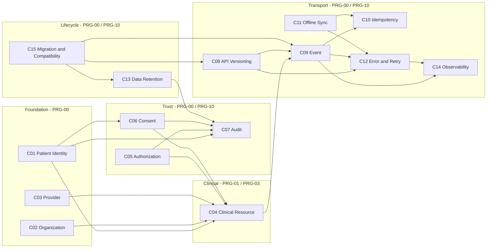

# GULA National Integration Contract V2 — C01–C15

**Document class:** NEW root-level planning document; planning gate only.
**Programme status:** PROPOSED / PENDING OWNER APPROVAL. No programme, wave or workstream is approved by this document.
**Repository:** `gula-integration` @ `integration/gula-unification-v1`, HEAD `2206654dc713ea2de8c564a3207dfe05fde23549`. Sibling `gula-platform` untouched.
**Standing posture:** HOLD TRUE. `production_ready_items = 0`. GULA Stable v1.0.0 NOT DECLARED. PRODUCTION READY NOT AUTHORIZED. No gate G1–G12 is PASSED.
**Canonical seed:** `/tmp/opencode/gula_v2_seed.md` §§4, 6, 7, 8, 9, 10, 13. No new IDs introduced.
**Status vocabulary (exclusive):** IMPLEMENTED · TESTED · INDEPENDENTLY REVIEWED · ACCEPTED · PRODUCTION READY · PARTIALLY IMPLEMENTED · DOCUMENTED ONLY · PLANNED · BLOCKED. `DECISION-READY` is a review label, not `ACCEPTED`. No status is upgraded without a path citation.

---

## 0. Purpose and authority boundary

Defines the proposed national integration contract set C01–C15 for target layers A–G (seed §5). It is a contract-first design artefact for W1–W4; it authorises no implementation, migration, deployment or release, and changes no source, test, config, migration, protected governance record, prior report or manifest.

**Decision and workstream dependency index (seed §§10, 12):** this contract set is `BLOCKED` until the owner records `NV2-D01` (V2 target and boundaries) and `NV2-D03` (data/contract owners); `NV2-D05` (modular-platform default and extraction thresholds) governs how C08/C09/C15 are implemented without random service splitting. Execution is assigned through the seed workstreams: `WS-CORE-01` (C01–C03 ownership/conformance), `WS-API-01` (C08/C12 versioning and OpenAPI conformance), `WS-OBS-01` (C14), `WS-DB-01` (C15 and PostgreSQL migration safety), `WS-E2E-01` (C01–C12 synthetic journey), `WS-SEC-01`/`WS-AUD-01` (C05/C06/C07 controls and audit evidence design), and `WS-GOV-01` (contract register and decision maintenance). None of these workstreams is approved by this document.

**Data ownership (seed §8), applied without exception:** one authoritative owner per data class; derived copies never become competing sources of truth. NHID/MPI/patient identity, organisation/facility hierarchy, provider registry, identity/access/authorization/consent/audit/terminology = National Core (PRG-00). Encounter/note/diagnosis/care plan/order/prescription = Clinical Platform (PRG-01), with domain modules as authors in scope. Lab/QC and radiology/DICOM = Diagnostics (PRG-03). Medication/dispensation = PRG-04; public health = PRG-05; analytics = PRG-09 derived only; audit truth = immutable national service under PRG-00/PRG-10, owned by no domain.

## 1. Normative conventions (all contracts)

### 1.1 Standards selection

- **FHIR R4** is mandatory for suitable clinical resources (Patient, Organization, Practitioner, Encounter, Observation, DiagnosticReport, CarePlan, MedicationRequest, Immunization, Consent, AuditEvent, Provenance). Imaging metadata uses ImagingStudy/DiagnosticReport; pixel data stays DICOM.
- **DICOM** (QIDO-RS/WADO-RS/STOW-RS, Study/Series/Instance UIDs, transfer syntax) governs imaging objects. FHIR is never a pixel transport.
- **Do NOT force FHIR onto administrative data.** Facility hierarchy, workforce, assets, beds, HR, procurement, finance, insurance administration and KPIs use versioned JSON Schema. FHIR `Organization`/`Practitioner` are projections, never the administrative source of truth.
- HL7 v2 and ASTM are edge syntaxes normalised at the boundary; a simulated edge message is not a clinical fact.

### 1.2 Contract-first and validation

Every contract has versioned JSON Schema, AsyncAPI event schema where C09 applies, FHIR Profiles/StructureDefinitions where R4 applies, valid/invalid examples, a conformance suite, and OpenAPI generated from the running application. Stub specifications are not contracts. Producer and consumer validation is fail-closed; unknown optional fields are ignored only under a declared minor-version policy.

### 1.3 Versioning and compatibility policy

SemVer-shaped `MAJOR.MINOR.PATCH`: PATCH = docs/examples; MINOR = additive, backward-compatible; MAJOR = breaking. Breaking changes need a new major, a two-release overlap and recorded owner approval before old-version removal. No silent rename, type/requiredness/enum/meaning change. Contract header, OpenAPI `info.version` and deployment metadata must agree. Current divergence: `contracts/export/openapi.json` declares `2.1.0` while `backend/app/config.py:104` sets `APP_VERSION = "2.5.0"` (`/tmp/opencode/gula_v2_evidence_integration.md:6`).

### 1.4 Required headers / correlation / trace (baseline for all contracts)

| Field | Requirement |
|---|---|
| `X-Request-ID` | Present today (echoed); retained as per-hop request ID. |
| `X-Correlation-ID` | **Required new**: unique per end-to-end business transaction, propagated by producers, consumers, outbox workers and offline batches. Absent today: middleware sets `X-API-Version` only (`backend/app/middleware.py:200`), echoes `X-Request-ID`, and never sets `request.state.correlation_id`. |
| `traceparent` / `tracestate` | W3C Trace Context; mapped to `X-Correlation-ID` in logs. |
| `X-API-Version` | Emitted today; must become negotiated and validated under C08. |
| `Idempotency-Key` | Required on every create/command and event publication; actor + operation + day scope. |
| `X-Actor-Id` / `X-Service-Id` | Authenticated actor or service identity; service identity required under NV2-D06. |
| `X-Purpose-of-Use` | treatment, payment, operations, public-health reporting or research; constrained by C06. |
| Workspace/tenant scope | National/facility/workspace context on every call; must match C05 decision and C07 entry. |

## 2. Contract register (proposed)

| ID | Name | Authoritative owner role | Primary gates | Programs | Status |
|---|---|---|---|---|---|
| C01 | Patient Identity | National Core data owner (PRG-00) | G1, G3, G4, G5 | PRG-00, PRG-01, PRG-08 | PARTIALLY IMPLEMENTED |
| C02 | Organization | National Core facility-hierarchy owner (PRG-00) | G1, G4, G5, G11 | PRG-00, PRG-02, PRG-07 | PARTIALLY IMPLEMENTED |
| C03 | Provider | National Core provider-registry owner (PRG-00) | G1, G2, G4, G11 | PRG-00, PRG-01, PRG-08 | PARTIALLY IMPLEMENTED |
| C04 | Clinical Resource | Clinical Platform clinical-model owner (PRG-01) | G1, G3, G4, G8 | PRG-01, PRG-03, PRG-04, PRG-06 | PARTIALLY IMPLEMENTED |
| C05 | Authorization | National Core authorization owner (PRG-00), PRG-10 review | G1, G2, G4, G12 | PRG-00, PRG-10 | PARTIALLY IMPLEMENTED |
| C06 | Consent | National Core consent/privacy owner (PRG-00) | G1, G2, G3, G12 | PRG-00, PRG-01, PRG-05 | PARTIALLY IMPLEMENTED |
| C07 | Audit | National immutable-audit owner (PRG-00 + PRG-10) | G1, G2, G5, G12 | PRG-00, PRG-10 | PARTIALLY IMPLEMENTED |
| C08 | API Versioning | National Core API owner (PRG-00) | G1, G4, G8, G12 | PRG-00, PRG-10 | PARTIALLY IMPLEMENTED |
| C09 | Event | National Core integration owner (PRG-00 + PRG-10) | G1, G4, G7, G10 | PRG-00, PRG-10 | PARTIALLY IMPLEMENTED |
| C10 | Idempotency | National Core integration owner (PRG-00) | G1, G4, G9, G12 | PRG-00, PRG-10 | PARTIALLY IMPLEMENTED |
| C11 | Offline Synchronization | National Core offline-platform owner (PRG-00 + PRG-10) | G1, G8, G9, G11 | PRG-00, PRG-08, PRG-10 | PARTIALLY IMPLEMENTED |
| C12 | Error and Retry | National Core integration owner (PRG-00 + PRG-10) | G1, G4, G7, G10 | PRG-00, PRG-10 | PARTIALLY IMPLEMENTED |
| C13 | Data Retention | National data-governance owner (PRG-00), PRG-10 enforcement | G1, G2, G5, G6, G11 | PRG-00, PRG-10 | PLANNED |
| C14 | Observability | National operations/observability owner (PRG-10) | G1, G7, G10, G11 | PRG-10, PRG-09 | PARTIALLY IMPLEMENTED |
| C15 | Migration and Compatibility | National DB/migration owner (PRG-10); NV2-D03 ownership decision | G1, G5, G6, G12 | PRG-00, PRG-10 | PARTIALLY IMPLEMENTED |

## 3. Cross-contract dependency model

C01–C03 are sequential prerequisites for C04 and C06; C05–C07 gate all clinical reads/writes; C08–C12 form the transport layer observed by C14. C13 and C15 are serialized lifecycle checkpoints (seed §13), never parallel edits.

## 4. Contract definitions

Each heading is the contract ID/name. Every row states the required field(s) explicitly.

### C01 Patient Identity Contract

| Field | Requirement |
|---|---|
| Purpose | One national identity spine (NHID/MPI) with local-identifier crosswalk and merge provenance; source of truth for downstream patient references. |
| Authoritative owner role | National Core data owner (PRG-00); merge/unmerge requires recorded owner authority. |
| Scope / non-goals | Identity, crosswalk, match/merge/unmerge, provenance. Not clinical record ownership (PRG-01), registration UI, or analytics master (PRG-09 derived only). |
| Canonical model / standard | FHIR R4 `Patient`/`Identifier` profile for clinical projection; administrative crosswalk in JSON Schema; no FHIR on MPI linkage internals. |
| Versioning / compatibility; headers / correlation / trace | §1.3; additive identifier system = MINOR, merge-semantics change = MAJOR with dual read. §1.4 + `X-MPI-Match-Policy` and immutable merge-event correlation ID. |
| Validation rules; idempotency semantics | One authoritative NHID per identity; unique NHID; assigning authority and effective period per identifier; evidence on merge. `Idempotency-Key` on match/link/merge; replay returns stored NHID/event ID; no second merge. |
| Error / retry / DLQ; security / consent / audit | Conflict → 409 + conflict token, retry only after owner decision; invalid identifier → 422; unresolved conflict → identity DLQ. Minimum-necessary disclosure; purpose via C06; every change emits signed C07 AuditEvent with evidence/previous hash. |
| Conformance tests; migration / rollback | Duplicate NHID, crosswalk round-trip, merge/unmerge replay, tenant isolation, FHIR projection, DLQ routing. Serialized checkpoint; reversible crosswalk scripts; rollback preserves audit; PG16 only. |
| Gate mapping | G1 ownership/schema · G3 identity safety · G4 projection · G5 migration. |
| Repository evidence & gap | `backend/app/services/mpi/`, `backend/app/identity/`; audit verdict REJECT at `GOVERNANCE/IDENTITY_REMEDIATION/MPI_FINAL_INDEPENDENT_AUDIT.md` and findings at `.../MPI_INDEPENDENT_AUDIT_FINDINGS.md`; no approved owner record or conformance suite; correlation header absent. Gaps R-05, R-18/NV2-D03. |
| Status | PARTIALLY IMPLEMENTED — source plus REJECT audit citation; not ACCEPTED. |

### C02 Organization Contract

| Field | Requirement |
|---|---|
| Purpose | Authoritative ministry → directorate → governorate → hospital → facility/department hierarchy. |
| Authoritative owner role | National Core facility-hierarchy owner (PRG-00); all domains consume. |
| Scope / non-goals | Facility master, hierarchy edges, effective dating. Not bed/asset ops (PRG-02), HR (PRG-07), or local display labels as authority. |
| Canonical model / standard | Administrative JSON Schema hierarchy + national codes; FHIR R4 `Organization` projection only; explicitly no FHIR on administrative hierarchy. |
| Versioning / compatibility; headers / correlation / trace | §1.3; re-parenting is MAJOR when authorization scope changes, else MINOR with effective dating. §1.4 + `X-Facility-Id`, `X-Hierarchy-Version`. |
| Validation rules; idempotency semantics | Single parent; no cycles; effective intervals non-overlapping per assignment; every facility resolves to one directorate. Replayed upsert/edge change is a no-op with same version/correlation ID. |
| Error / retry / DLQ; security / consent / audit | Cycle/duplicate parent → 422/409 with path; unresolved edge → governance DLQ. Changes are privileged writes and emit C07; reads scoped by C05 workspace. |
| Conformance tests; migration / rollback | Cycle detection, re-parent dating, projection parity, cross-domain denial, edge rollback. Edge migrations serialized; down-migration restores snapshot and keeps audit. |
| Gate mapping | G1, G4, G5, G11. |
| Repository evidence & gap | `backend/app/services/hospital_service.py`, `backend/app/routes/hospital.py`, `backend/app/governance/models/workforce.py`; org/provider code described as mixed (`/tmp/opencode/gula_v2_evidence_backend.md:5`); table ownership unowned (ADR-B) at `GOVERNANCE/FINAL_DECISION.md:33-36`; no directorate/governorate channel (`/tmp/opencode/gula_v2_evidence_channels.md:8`). Gaps R-02, R-18. |
| Status | PARTIALLY IMPLEMENTED — cited service/route sources; no approved registry contract. |

### C03 Provider Contract

| Field | Requirement |
|---|---|
| Purpose | One authoritative provider registry: qualifications, licence status, verification state, facility affiliations. |
| Authoritative owner role | National Core provider-registry owner (PRG-00); domains author only within granted scope. |
| Scope / non-goals | Registry, credentials, licence verification, privilege inputs. Not scheduling, rosters or HR truth. |
| Canonical model / standard | Administrative JSON Schema registry; FHIR R4 `Practitioner`/`PractitionerRole` projection; no FHIR on licence/HR administration. |
| Versioning / compatibility; headers / correlation / trace | §1.3; licence enum extension = MINOR, verification-rule change = MAJOR. §1.4 + `X-Provider-Id`, `X-Verification-State`. |
| Validation rules; idempotency semantics | Unique licence per authority; privilege only after verification; stale verification fails closed; affiliation resolves via C02. Verification keyed by provider+licence+evidence hash; replay never re-activates. |
| Error / retry / DLQ; security / consent / audit | Unverifiable licence → 422 + DENY; registry outage → fail closed, bounded retry; unresolved evidence → provider DLQ. Verification is only privilege-activation path; every verification/denial emits C07. |
| Conformance tests; migration / rollback | Duplicate licence, forged-row attenuation, self-verification denial, stale fail-closed, projection parity, audit. State migration serialized; rollback preserves denials and never grants silently. |
| Gate mapping | G1, G2, G4, G11. |
| Repository evidence & gap | `backend/app/capabilities/provider_management/` is among 8 empty CRUD stubs advertised in `backend/app/kernel/capabilities_registry_populator.py`; B3 near-majority flag and B5 forged-row/`citizen_ulid` provenance residuals at `INDEPENDENT_VERIFICATION_TEAM_C_TIER_B.md:204-206` and `INDEPENDENT_VERIFICATION_TEAM_C_B5_REVERIFY.md:215-222`. Gaps R-04, R-15, R-18. |
| Status | PARTIALLY IMPLEMENTED — stub and independent-review citations. |

### C04 Clinical Resource Contract

| Field | Requirement |
|---|---|
| Purpose | Canonical clinical facts: encounter, note, diagnosis, care plan, order, result, prescription, immunization, with provenance. |
| Authoritative owner role | Clinical Platform clinical-model owner (PRG-01); PRG-03 authors lab/radiology facts in scope; analytics derived only. |
| Scope / non-goals | Clinical semantics/lifecycle. Not pixel storage (DICOM), administrative records, billing truth, or public-health case ownership. |
| Canonical model / standard | FHIR R4 + national Profiles for suitable resources; DICOM for imaging objects; HL7 v2/ASTM normalised at edge. |
| Versioning / compatibility; headers / correlation / trace | §1.3; Profile change = MAJOR, new optional extension = MINOR, retired resource = two-release overlap. §1.4 + `X-Encounter-Id`, `X-Resource-Profile`, `X-Provenance-Hash`. |
| Validation rules; idempotency semantics | Profile validation at write; references resolve via C01–C03; result modification creates a new version with reason, never silent overwrite. Commands keyed; resubmission returns original resource version/event ID. |
| Error / retry / DLQ; security / consent / audit | Invalid profile → 422; unauthorized → 403 + audit; unsupported → 501 with maintained capability statement; bad edge payload → clinical DLQ with raw hash. Purpose via C06, auth via C05, FHIR Provenance + C07 on every write. |
| Conformance tests; migration / rollback | Resource round-trip, reference resolution, result immutability, capability drift, DLQ routing, DICOM metadata separation. Schema change serialized with C15; historical facts never rewritten. |
| Gate mapping | G1, G3, G4, G8. |
| Repository evidence & gap | FHIR routes/mappers/serializers and ~30 KB capability statement (`/tmp/opencode/gula_v2_evidence_integration.md:11`); stale report claims `Procedure` 501 that no longer exists; most resources read-only (`KNOWN_LIMITATIONS` §2); HL7→FHIR `simulationOnly: True` at `backend/app/capabilities/fhir_interoperability/routes.py:83`; 8/10 capability stubs. Gaps R-06, R-12, R-16, NV2-D11. |
| Status | PARTIALLY IMPLEMENTED — API existence is not clinical service completion. |

### C05 Authorization Contract

| Field | Requirement |
|---|---|
| Purpose | One deny-by-default decision contract for human and service actors across tenants, workspaces, purposes and break-glass. |
| Authoritative owner role | National Core authorization owner (PRG-00), independently reviewed by PRG-10. |
| Scope / non-goals | Decision, scope, delegation, step-up, service identity. Not token issuance mechanics (PRG-10) or consent grant lifecycle (C06). |
| Canonical model / standard | Versioned JSON Schema decision request/response (`allow/deny`, reason code, policy version, obligations); administrative data, no FHIR. |
| Versioning / compatibility; headers / correlation / trace | §1.3; relaxing a rule = MAJOR with independent review, new deny reason = MINOR. §1.4 + `X-Decision-Id` in response and logs. |
| Validation rules; idempotency semantics | Deny on unknown permission, actor mismatch, inactive session, invalid purpose/scope/relationship, unverified professional, audit failure; cross-account restricted to enumerated roles with fresh step-up. Decision reproducible by actor/action/resource/context hash. |
| Error / retry / DLQ; security / consent / audit | Policy or audit failure → fail closed, retry after recovery; deny spikes → security DLQ/alert (C14). Least privilege, zero trust, server-verified break-glass; every decision emits C07. |
| Conformance tests; migration / rollback | IDOR/cross-tenant matrix, delegation chain, step-up freshness, B4 cross-account deny, audit-failure fail-closed, unknown permission. Policy version pinned; rollback never retroactively allows; serialized schema checkpoint. |
| Gate mapping | G1, G2, G4, G12. |
| Repository evidence & gap | RBAC re-export, ABAC DENY, `backend/app/identity/services/authorization_decision.py:199-314,559-603`, B4 guard `.../adaptive_auth/b4_guard.py:14-26,162-252`; 91 endpoint fixes working-tree only; `backend/app/security/zero_trust.py:14-15,37-45` in-memory demo with revocation commented out (`/tmp/opencode/gula_v2_evidence_security.md:6-18`). Gaps R-03, R-04, R-07, R-18, NV2-D06. |
| Status | PARTIALLY IMPLEMENTED — security NOT CERTIFIED. |

### C06 Consent Contract

| Field | Requirement |
|---|---|
| Purpose | Patient-controlled, purpose-specific, time-bounded permission to disclose/process clinical data. |
| Authoritative owner role | National Core consent/privacy owner (PRG-00). |
| Scope / non-goals | Grant/withdraw/check/versioning and break-glass interaction. Not authentication (C05) or legal retention (C13). |
| Canonical model / standard | FHIR R4 `Consent` profile for exchange; internal grant in JSON Schema; no FHIR on administrative audit/report metadata. |
| Versioning / compatibility; headers / correlation / trace | §1.3; new purpose = MINOR, grant-scope semantic change = MAJOR. §1.4 + `X-Purpose-of-Use`, `X-Consent-Version` on clinical reads. |
| Validation rules; idempotency semantics | Subject-only grant; one active version per subject/grantee/purpose/domain; purpose allowlist; 72h cap unless approved; withdrawal immediate. Replay returns stored version; old grant cannot undo withdrawal. |
| Error / retry / DLQ; security / consent / audit | Missing/expired consent → DENY+403; propagation failure → fail closed, bounded retry; unpropagated withdrawal → consent DLQ + alert. All grant/withdraw/check/emergency access emits C07; break-glass distinct and server-verified. |
| Conformance tests; migration / rollback | Subject-only grant, expiry, withdrawal propagation, purpose mismatch, emergency conflict, field-level enforcement, audit. Versions immutable; rollback never reactivates withdrawn consent. |
| Gate mapping | G1, G2, G3, G12. |
| Repository evidence & gap | `backend/app/identity/services/consent_service_v2.py:24-46,62-81,121-177`, `backend/app/identity/models/consent.py:34-53`, `backend/app/security/break_glass_guard.py`; `FIELD_SECURITY.md` documentation only and full enforcement NOT independently confirmed (`/tmp/opencode/gula_v2_evidence_security.md:11`). Gaps R-07, R-15, NV2-D08. |
| Status | PARTIALLY IMPLEMENTED — service/model citations; enforcement not confirmed. |

### C07 Audit Contract

| Field | Requirement |
|---|---|
| Purpose | One immutable, verifiable national evidence stream for security, clinical and administrative actions. |
| Authoritative owner role | National immutable-audit owner (PRG-00 + PRG-10); no domain owns audit truth. |
| Scope / non-goals | Entry schema, hash chain, anchors, append-only enforcement, verification. Not application logging (C14) or analytics copies (derived only). |
| Canonical model / standard | Versioned JSON Schema + FHIR R4 `AuditEvent` projection; append-only PostgreSQL triggers; no FHIR on chain/anchor internals. |
| Versioning / compatibility; headers / correlation / trace | §1.3; chain/hash-algorithm change = MAJOR with dual verification. §1.4 + decision ID (C05), consent version (C06), previous hash on every entry. |
| Validation rules; idempotency semantics | `previous_hash` equals last verified entry; HMAC anchor valid; UPDATE/DELETE rejected; secrets redacted; gap/fork fails closed. Entry ID + correlation ID deduplicate; retry uses original entry ID. |
| Error / retry / DLQ; security / consent / audit | Verification failure → fail closed; concurrent-write conflict → serialized retry; fork → audit DLQ preserving immutable evidence. Protected keys, redaction at write, C05-governed read, read-only verifier. |
| Conformance tests; migration / rollback | PG16 concurrent writers, append-only triggers, anchor verification, redaction, replay dedup, read denial. Never rewrite/delete audit; schema change appends version; migration serialized with C15. |
| Gate mapping | G1, G2, G5, G12. |
| Repository evidence & gap | SHA-256 chain/HMAC `backend/app/services/audit_service.py:1-8,31-38`; append-only migrations `20250322_0002:73-104`, `20260505_0005:1-20`; verifier `scripts/audit_verifier.py:3-14`. HEAD defect unlocked tail read (`audit_service.py:106-112,219-229`), PG16.14 reproduction 1 failed/1 passed, stored `571f43b6…` vs `5bb1ab4d…`; fix uncommitted. P-02 / AUD-F02 engineering scope IMPLEMENTED · TESTED · INDEPENDENTLY REVIEWED, DECISION-READY with 2 LOW residuals, **not ACCEPTED**. P-03 / AUD-F03 PREPARED ONLY · NOT IMPLEMENTED; T9 deferred. Gaps R-03, R-14, R-18, NV2-D12/D13. |
| Status | PARTIALLY IMPLEMENTED — HEAD defect unfixed; WT fix unaccepted. |

### C08 API Versioning Contract

| Field | Requirement |
|---|---|
| Purpose | Predictable, negotiable, observable API evolution across HTTP, FHIR and generated clients. |
| Authoritative owner role | National Core API owner (PRG-00); tooling with PRG-10. |
| Scope / non-goals | Version declaration/negotiation, OpenAPI generation, deprecation/sunset, client drift. Not business semantics (C04) or events (C09). |
| Canonical model / standard | OpenAPI 3.1 generated from live app as HTTP authority; FHIR capability statement for FHIR endpoints; JSON Schema for admin APIs. |
| Versioning / compatibility; headers / correlation / trace | §1.3 + `Accept-version`, `Deprecation`/`Sunset`, two-release overlap. §1.4; `X-API-Version` must equal `info.version` and deployment metadata. |
| Validation rules; idempotency semantics | No path/spec mismatch; no stub spec accepted; every operation has schemas/errors/operation ID; schema endpoints work. Version resolution deterministic; replay uses same handler version. |
| Error / retry / DLQ; security / consent / audit | Unsupported version → 400/426 with supported list; generation failure fails CI. Governance-reader for schema reads, operator-only export; version changes audited. |
| Conformance tests; migration / rollback | Live-vs-checked-in diff, negotiation, deprecation headers, four `/contracts/schemas` checks, client compilation. Spec regeneration serialized; rollback moves spec and client types together. |
| Gate mapping | G1, G4, G8, G12. |
| Repository evidence & gap | `contracts/export/openapi.json` 98 bytes, version `2.1.0`, zero paths vs `APP_VERSION = "2.5.0"` (`backend/app/config.py:104`); `X-API-Version` at `backend/app/middleware.py:200`; no negotiation/Deprecation/Sunset; mostly root-level routes (only `/api/v1/canonical-patients`, `/api/ai/v2` versioned); broken import affects four schema endpoints (`backend/app/contracts/routes.py:52`). Gaps R-02, R-14, A09-011 gate absent from CI. |
| Status | PARTIALLY IMPLEMENTED — stub-spec and middleware citations. |

### C09 Event Contract

| Field | Requirement |
|---|---|
| Purpose | One authoritative, durable, per-aggregate ordered event fabric with transactional outbox and idempotent consumers. |
| Authoritative owner role | National Core integration owner (PRG-00 + PRG-10). |
| Scope / non-goals | Envelope, topics, outbox/inbox, DLQ, ordering. Not offline client queues (C11) or request/response (C08). |
| Canonical model / standard | CloudEvents-style envelope + generated AsyncAPI 2.6; FHIR resource payloads only where C04 applies; JSON Schema for admin events. |
| Versioning / compatibility; headers / correlation / trace | §1.3; additive field = MINOR, semantic change = MAJOR with dual consumers. §1.4 + event ID, aggregate ID, sequence, schema version. |
| Validation rules; idempotency semantics | Schema validation at publish/consume; no swallowed handler exception; outbox mark-done requires one successful handler. Durable inbox keyed by event ID; at-least-once delivery, effective at-most-once application. |
| Error / retry / DLQ; security / consent / audit | Bounded exponential backoff; poison events to durable DLQ with hash; broker outage fails closed for critical events, never false success. Service identity required; C06 purpose limits; publish/consume/DLQ transitions emit C07. |
| Conformance tests; migration / rollback | Publish→deliver→ack, duplicate event, handler-exception propagation, broker outage, DLQ, ordering, schema validation. Outbox/inbox and topic renames serialized; drain in-flight before downgrade. |
| Gate mapping | G1, G4, G7, G10. |
| Repository evidence & gap | Four stacks: kernel in-memory bus, durable SQL outbox (10s poll, 50 batch, 5 attempts, 30-day purge, `skip_locked`), health_core synthetic events, core/sync_engine LWW. `shared/events/bus.py` swallows handler exceptions; OutboxWorker can mark done with zero successes; kernel publish never fills its outbox/inbox/DLQ; dual workers `backend/app/worker.py` and `backend/app/core/startup.py:270-272`; `aio_pika` missing (`/tmp/opencode/gula_v2_evidence_integration.md:8`). Gaps R-14, R-03, R-08. |
| Status | PARTIALLY IMPLEMENTED — no authoritative event store. |

### C10 Idempotency Contract

| Field | Requirement |
|---|---|
| Purpose | Replayed commands, events and offline batches produce exactly one business effect. |
| Authoritative owner role | National Core integration owner (PRG-00). |
| Scope / non-goals | Key semantics, dedup store, response replay, conflict classification. Not authorization (C05) or durable offline queue (C11). |
| Canonical model / standard | Versioned JSON Schema idempotency record; cross-cutting transport concern, no FHIR. |
| Versioning / compatibility; headers / correlation / trace | §1.3; key-derivation change = MAJOR with dual read. §1.4 + mandatory `Idempotency-Key` on creates/commands/publications/offline batches. |
| Validation rules; idempotency semantics | Key = actor/service + operation + supplied key; stored response returned byte-identically; different payload/same key → 409 fingerprint mismatch. At-most-once application, at-least-once delivery, durable tenant-scoped records. |
| Error / retry / DLQ; security / consent / audit | In-flight replay → 409 retry-after; mismatch → conflict DLQ with both hashes; no silent overwrite. No PHI in keys; replay emits audit with original correlation ID. |
| Conformance tests; migration / rollback | Double submit, concurrent duplicate, fingerprint mismatch, TTL boundary, event/batch replay. Dedup migration serialized; no in-flight key loss; no reapplication across version boundary. |
| Gate mapping | G1, G4, G9, G12. |
| Repository evidence & gap | `backend/app/models/integration_inbox.py` + `backend/app/integration/inbox.py` stage/validate but do not auto-apply; device gateway has HMAC + replay protection; HEAD `CRDT_MERGE` first-seen-key-wins can overwrite a lab result; `CONFLICT_QUARANTINE` fix uncommitted; SDK naive client_wins/remote_wins unused by `frontend-v3` (`/tmp/opencode/gula_v2_evidence_integration.md:9,13`). Gaps R-06, R-08, R-14. |
| Status | PARTIALLY IMPLEMENTED — uncommitted conflict fix not accepted. |

### C11 Offline Synchronization Contract

| Field | Requirement |
|---|---|
| Purpose | Deterministic convergence of field/clinic/offline work with national truth, including conflict quarantine and late results. |
| Authoritative owner role | National Core offline-platform owner (PRG-00 + PRG-10). |
| Scope / non-goals | Durable client queue, sync envelope, conflict policy, reconciliation evidence. Not primary clinical storage (C04) or broker (C09). |
| Canonical model / standard | Versioned JSON Schema sync envelope carrying canonical resource versions; FHIR resources unchanged where C04 applies; no FHIR on queue metadata. |
| Versioning / compatibility; headers / correlation / trace | §1.3; conflict-policy change = MAJOR with owner decision. §1.4 + `X-Sync-Batch-Id`, `X-Device-Id`, last server version, per-record correlation. |
| Validation rules; idempotency semantics | No silent overwrite; critical results and signed facts server-authoritative; conflicts quarantined; schema validation before apply. Batch replay via C10 keys; partial batch failure retryable without duplicating applied records. |
| Error / retry / DLQ; security / consent / audit | Network loss → durable retry with backoff; conflict → quarantine DLQ with both versions/hashes; never mark SYNCED on local hash only. Device keys, encrypted storage, logout revocation; each apply/rejection emits C07. |
| Conformance tests; migration / rollback | Network-loss convergence, late result, conflicting edits, quarantine, batch replay, cross-device replay, local-hash SYNCED rejection. Queue migration preserved pending batches; no forced client data loss. |
| Gate mapping | G1, G8, G9, G11. |
| Repository evidence & gap | Four offline engines, process-local stores; health_core marks SYNCED after local hash only; SDK sync unused by `frontend-v3`; no local clinical queue in v3; Android/iOS/Flutter clients have offline code but no convergence evidence (`/tmp/opencode/gula_v2_evidence_integration.md:13`, `/tmp/opencode/gula_v2_evidence_channels.md:5`). Gaps R-08, R-13, NV2-D14. |
| Status | PARTIALLY IMPLEMENTED — prototypes only, no approved durable contract. |

### C12 Error and Retry Contract

| Field | Requirement |
|---|---|
| Purpose | Uniform structured errors, bounded retries and dead-letter semantics across APIs and events. |
| Authoritative owner role | National Core integration owner (PRG-00 + PRG-10). |
| Scope / non-goals | Error envelope, status/reason taxonomy, retry policy, DLQ. Not business validation (per contract) or incident process (C14). |
| Canonical model / standard | Versioned JSON error envelope (`code`, `reason`, `retryable`, `retry_after`, `correlation_id`, `decision_id`, `details`); FHIR `OperationOutcome` only on FHIR endpoints. |
| Versioning / compatibility; headers / correlation / trace | §1.3; new reason = MINOR, retryability change = MAJOR. §1.4 + `Retry-After`, `X-Error-Class` on every error. |
| Validation rules; idempotency semantics | No success on failed dependency; no unbounded retry; no retry on deterministic 4xx except 409/429. Every retry carries original `Idempotency-Key`; completed operation returns stored result. |
| Error / retry / DLQ; security / consent / audit | Exponential backoff with jitter/cap; exhausted retries → DLQ with context; critical clinical failures alert (C14). No PHI/secrets/topology in errors; denied access emits C07; DLQ role-restricted. |
| Conformance tests; migration / rollback | Envelope schema, retry budget, backoff bounds, DLQ routing, no false success, redaction. Taxonomy migration serialized with C08/C09; old codes accepted during overlap. |
| Gate mapping | G1, G4, G7, G10. |
| Repository evidence & gap | Outbox retry (5 attempts) and purge exist; AMQP gateway reports success on ImportError; kernel bus swallows handler exceptions; no authoritative DLQ across stacks; taxonomy not contract-governed (`/tmp/opencode/gula_v2_evidence_integration.md:8`). Gaps R-14, R-10, NV2-D07. |
| Status | PARTIALLY IMPLEMENTED — outbox/AMQP citations, uniform taxonomy NOT VERIFIED. |

### C13 Data Retention Contract

| Field | Requirement |
|---|---|
| Purpose | Legally and clinically defensible retention, archival and disposal policy per data class. |
| Authoritative owner role | National data-governance owner (PRG-00), enforced by PRG-10; legal scope requires NV2-D08. |
| Scope / non-goals | Retention classes, legal holds, archival format, disposal evidence. Not backup mechanics (G6); C07 audit truth overrides disposal. |
| Canonical model / standard | Administrative JSON Schema policy register; immutable audit never disposed by domain policy; DICOM retention under NV2-D11. |
| Versioning / compatibility; headers / correlation / trace | §1.3; shortening retention = MAJOR with owner/legal decision. §1.4 + `X-Retention-Class`, `X-Legal-Hold-Id`. |
| Validation rules; idempotency semantics | No deletion before expiry; legal hold suspends disposal; disposal produces tamper-evident evidence with correlation ID. Disposal commands replay-safe; no second disposal record. |
| Error / retry / DLQ; security / consent / audit | Policy lookup failure → fail closed (retain); disputed hold → governance DLQ; no automatic deletion on ambiguity. Every disposal/hold emits C07; subject rights via governance workflow. |
| Conformance tests; migration / rollback | Hold suspension, expiry boundary, disposal evidence, audit immutability, DICOM/clinical parity. Policy rollback restores prior rules without resurrecting disposed data. |
| Gate mapping | G1, G2, G5, G6, G11. |
| Repository evidence & gap | Only local signal is 30-day outbox purge in `backend/app/services/outbox_service.py`; audit append-only migrations exist; no national schedule, legal-hold model or disposal evidence; ownership/legal decisions open at `GOVERNANCE/FINAL_DECISION.md:33-36`. Gaps R-11, R-15, R-18, NV2-D08. |
| Status | PLANNED — absence evidenced by `/tmp/opencode/gula_v2_evidence_integration.md:8` and `GOVERNANCE/FINAL_DECISION.md:33-36`; local purge is not a contract. |

### C14 Observability Contract

| Field | Requirement |
|---|---|
| Purpose | Common metrics, structured logs, trace context, SLOs and alert routing for national operations. |
| Authoritative owner role | National operations/observability owner (PRG-10). |
| Scope / non-goals | Metric names/labels, log schema, trace propagation, SLO/alerts. Not audit evidence (C07) or incident command (G11). |
| Canonical model / standard | Vendor-neutral OpenTelemetry semantic conventions; Prometheus at `/metrics/prom`; JSON logs; no vendor coupling. |
| Versioning / compatibility; headers / correlation / trace | §1.3; additive label = MINOR, metric rename/semantic change = MAJOR with dual emission. §1.4; logs/exemplars/traces join on correlation ID and `traceparent`. |
| Validation rules; idempotency semantics | Declared SLO metrics emitted by live endpoint; scrape hits internal metrics path, not authenticated JSON; alerts have owner/runbook. Export deduplicates on event/correlation ID where supported. |
| Error / retry / DLQ; security / consent / audit | Export failure must not break clinical requests; buffered retry; dropped telemetry counted/alerted; C07 remains authoritative. No PHI/secrets in telemetry; network-restricted metrics; role-scoped dashboards via C05. |
| Conformance tests; migration / rollback | `/metrics/prom` scrape, SLO metric presence, end-to-end trace propagation, log schema, PHI redaction, alert firing drill. Telemetry schema serialized with dual emission and atomic dashboard update. |
| Gate mapping | G1, G7, G10, G11. |
| Repository evidence & gap | Health, `/metrics` JSON and `/metrics/prom` exist; JSON logging real; Prometheus fail-closed in production. Helm ServiceMonitor scrapes authenticated JSON `/metrics`; `gula_down` and `gula_request_duration_seconds_bucket` not emitted (`build_prometheus_response` has no call site); no OTel FastAPI instrumentation; alertmanager webhook placeholder (`/tmp/opencode/gula_v2_evidence_infra.md:8`). Gaps R-10, R-16, NV2-D07. |
| Status | PARTIALLY IMPLEMENTED — SLO/alert contract NOT VERIFIED. |

### C15 Migration and Compatibility Contract

| Field | Requirement |
|---|---|
| Purpose | Safe, observable, reversible schema/data evolution across national releases. |
| Authoritative owner role | National DB/migration owner (PRG-10); table ownership requires NV2-D03. |
| Scope / non-goals | Revision DAG, expand/contract, checksums, rollback, compatibility windows. Not feature rollout or audit rewrite (forbidden). |
| Canonical model / standard | Migration DSL plus versioned compatibility manifest; administrative schema, no FHIR. |
| Versioning / compatibility; headers / correlation / trace | §1.3; revisions append-only; destructive change needs documented owner decision and recovery point. §1.4 + `X-Migration-Id`, `X-Schema-Fingerprint`. |
| Validation rules; idempotency semantics | Single head, valid DAG, no duplicate IDs/dangling parents, strict schema gate clean, PG16 rehearsal with production-like data, no SQLite substitution. Migration once-only by fingerprint; replay verifies/no-ops. |
| Error / retry / DLQ; security / consent / audit | Failed migration stops release; no automatic destructive downgrade; partial state in migration incident with checksums. Least-privilege time-bound credentials; decisions/checksums preserved under C07. |
| Conformance tests; migration / rollback | DAG validation, fresh/existing upgrade, checksum reconciliation, rollback rehearsal, strict schema gate, interruption test. Serialized checkpoint by definition; rollback proven before merge; full teardown alone insufficient. |
| Gate mapping | G1, G5, G6, G12. |
| Repository evidence & gap | 111 revisions, head `20261119_0003`, root `20250322_0000`, 4 merges, 0 dangling/duplicates; counts conflict (48/110/111); `MIG-EXISTING` NOT MET (51-row snapshot, ADR-B, NR-011); strict schema gate 753 passed/119 failed; seven migration skips (`/tmp/opencode/gula_v2_evidence_backend.md:8`, `/tmp/opencode/gula_v2_evidence_infra.md:12`, `/tmp/opencode/gula_v2_evidence_tests.md:12`). Gaps R-01, R-09, R-18, NV2-D02/D03/D09. |
| Status | PARTIALLY IMPLEMENTED — DAG evidence and `GOVERNANCE/FINAL_DECISION.md` MIG-EXISTING NOT MET citation. |

## 5. Explicit current gap evidence (not resolved)

| Gap | Evidence | Impact |
|---|---|---|
| Empty checked-in OpenAPI vs runtime | `contracts/export/openapi.json` 98 bytes, `2.1.0`, zero paths; `backend/app/config.py:104` `2.5.0` | C08/C04/C15; G1/G4 blocked. |
| Four event stacks | kernel bus, SQL outbox, health_core synthetic, LWW engine (`/tmp/opencode/gula_v2_evidence_integration.md:8`) | C09/C10/C12; no authoritative store. |
| Missing `X-Correlation-ID` | `backend/app/middleware.py:200` only sets `X-API-Version`, echoes `X-Request-ID` | All contracts; G1/G10/G12 traceability. |
| Broken `/contracts/schemas` | wrong import at `backend/app/contracts/routes.py:52`, four endpoints affected | C08 conformance tooling unusable. |
| Default STUB gateways | `backend/app/gateways/mode.py:6-13`, `.../insurance_gateway.py:7-11`, `.../residency_gateway.py:10-13`, connector defaults | C01/C03/C12; no live registry proof. |
| HL7 simulation only | `backend/app/capabilities/fhir_interoperability/routes.py:83`, `.../schemas.py:86,96` | C04 edge integration test-only. |
| DICOM parser absent | Real httpx QIDO/WADO/STOW but no `pydicom`/`pynetdicom`; contradictory docs (`/tmp/opencode/gula_v2_evidence_integration.md:12`) | C04 imaging NOT VERIFIED pending NV2-D11. |
| Shallow terminology | In-memory static CodeSystem, `validate()` true for known system with empty concepts | C04 clinical safety NOT VERIFIED. |
| Audit fork at HEAD | PG16.14 1 failed/1 passed, `571f43b6…` vs `5bb1ab4d…`; WT fix uncommitted | C07; P-03 / AUD-F03 separate blocked package. |
| Mixed provenance | 20 staged R100, 162 unstaged tracked, 686 untracked before V2 docs (seed §1) | C15; R-01, NV2-D02. |

## 6. Contract change governance

1. Any C01–C15 change requires: owner-role review, independent PRG-10 review, explicit SemVer bump (§1.3), **G1 revalidation** (schema, ownership, tooling, CI gate), and a recorded owner decision where ownership/legal semantics change.
2. Parallel teams may develop only against approved, versioned contracts and synthetic fixtures. No team may change a shared contract, protected governance record or National Core semantics locally (seed §13).
3. Data migrations and shared schema changes are serialized checkpoints governed by C15 and recorded by C07, never parallel edits.
4. Version registry and generated artefacts move together (JSON Schema, FHIR Profile, AsyncAPI, OpenAPI, generated clients, deployment metadata); a partial bump is a conformance failure.
5. No contract is ACCEPTED or PRODUCTION READY by this document. Owner acceptance requires the G12 evidence set and NV2-D15; HOLD remains TRUE.

## 7. Evidence basis

Audit inputs (read-only, outside repository): `/tmp/opencode/gula_v2_seed.md`, `/tmp/opencode/gula_v2_draft_instructions.md`, `/tmp/opencode/gula_v2_evidence_{integration,backend,domain,security,tests,infra,channels,governance}.md`.

Repository files inspected/cited: `contracts/export/openapi.json`; `backend/app/config.py`; `backend/app/middleware.py`; `backend/app/contracts/routes.py`; `backend/app/contracts/{generator,events,fhir}.py`; `backend/app/factory.py`; `backend/app/main.py`; `backend/app/services/mpi/`; `backend/app/identity/`; `backend/app/capabilities/`; `backend/app/security/zero_trust.py`; `backend/app/services/audit_service.py`; `backend/app/worker.py`; `backend/app/gateways/{mode,insurance_gateway,residency_gateway}.py`; `GOVERNANCE/FINAL_DECISION.md`; `GOVERNANCE/NATIONAL_INTEGRATION/status_registry.json`; `GOVERNANCE/IDENTITY_REMEDIATION/{MPI_FINAL_INDEPENDENT_AUDIT,MPI_INDEPENDENT_AUDIT_FINDINGS}.md`; `GULA_MASTER_EXECUTION_STATUS.md`; `INDEPENDENT_VERIFICATION_TEAM_C_TIER_B.md`; `INDEPENDENT_VERIFICATION_TEAM_C_B5_REVERIFY.md`; `GULA_COMPONENT_INVENTORY.md`; `FIELD_SECURITY.md`.
