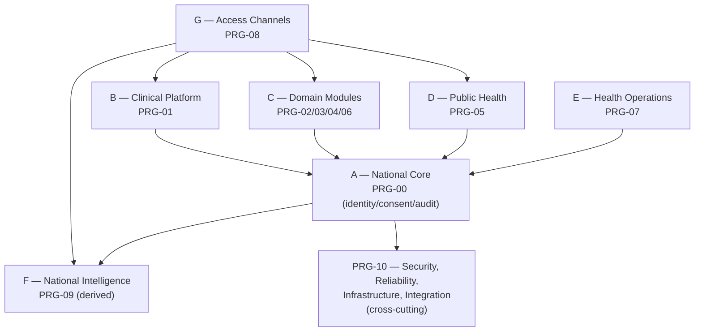
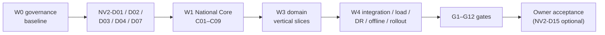

# GULA National Transformation V2 — Master Execution Plan

**Document:** `GULA_NATIONAL_MASTER_EXECUTION_PLAN_V2.md` (new root-level document, deliverable 1 of 18 + manifest)
**Status:** `PROPOSED / PENDING OWNER APPROVAL` — this document creates no release authority.
**Repository:** `/home/samertts/workspace/projects/gula-integration` only. Sibling `gula-platform` is read-only reference (HEAD `f478676b6fc375338648dde46fbf076c015a3f91`).
**Baseline HEAD:** `2206654dc713ea2de8c564a3207dfe05fde23549`, branch `integration/gula-unification-v1`.

---

## 1. Purpose and scope

This plan is the single top-level execution strategy for the GULA National Transformation V2. It defines the target scope, the program and wave structure, the dependency rules that permit safe parallel work, the non-negotiable cross-cutting constraints, the evidence hierarchy, and the gates that must be satisfied before any national release. It is a **planning gate product only**: it does not authorize implementation, commit, merge, deployment, or any change to source, tests, configuration, migrations, or protected governance records.

Scope of this document:

- National target architecture (layers A–G) and the 11 parallel programs `PRG-00` … `PRG-10`.
- Wave sequencing `W0` … `W4` with entry/exit criteria and explicit parallel/non-parallel rules.
- The 15 national integration contracts `C01` … `C15` and the 12 release gates `G1` … `G12` as the coordination contract between teams.
- Owner decisions `NV2-D01` … `NV2-D15`, risks `R-01` … `R-18`, and the relationship to prior governance (P-02 / AUD-F02, P-03 / AUD-F03, P-03-CONCURRENCY).

Out of scope here (owned by sibling V2 documents): detailed architecture blueprint, module registry, capability inventory, program charters, contract schemas, security/data/clinical plans, testing strategy, infrastructure design, controlled-release procedure, dependency graph, risk register detail, acceptance matrix, backlog, decision register, and documentation index. This document governs their consistency; it does not duplicate their detail.

**Naming rule (authoritative):** `PRG-00` … `PRG-10` (also `P0` … `P10`) are the new parallel programs. The audit packages are always written `P-02 / AUD-F02` and `P-03 / AUD-F03`. **`PRG-03` (Diagnostics and Laboratory Systems) is never to be described as the audit package `P-03 / AUD-F03`.**

---

## 2. Standing posture (non-negotiable, carried in every V2 document)

| Posture element | Current value | Authority |
|---|---|---|
| Release hold | **HOLD TRUE** | `GOVERNANCE/FINAL_DECISION.md` §1/§4/§7–§10; `GOVERNANCE/GECS/MASTER_CONTROL.md` §3/§7/§8 |
| Production-ready items | **`production_ready_items = 0`** | `GOVERNANCE/NATIONAL_INTEGRATION/status_registry.json` |
| Stable release | **Stable v1.0.0 NOT DECLARED** | `GULA_MASTER_EXECUTION_STATUS.md:7` |
| Release authorization | **PRODUCTION READY NOT AUTHORIZED** | `GOVERNANCE/FINAL_DECISION.md:13`; `GULA_RELEASE_ACCEPTANCE_REPORT.md` |
| Security | **NOT CERTIFIED** | `GOVERNANCE/FINAL_DECISION.md:46` |
| V2 program/plan/status | **PROPOSED / PENDING OWNER APPROVAL** | this document; seed §4 |

Consequences that bind all teams:

1. No team may treat `DECISION-READY` as `ACCEPTED`, or `ACCEPTED` as `PRODUCTION READY`.
2. No API existence claim equals clinical service completion.
3. Historical `PRODUCTION_READY` / certification claims in older documents are **not** current release authority (§10).
4. Mixed Git provenance (R-01) must be resolved before any save/merge (NV2-D02).
5. No PHI, secrets, provider/financial calls, external network, production DB/service, or SQLite substitution for PostgreSQL evidence.

---

## 3. Document authority and change control

- This plan is subordinate to the owner decision register `GULA_OWNER_DECISION_REGISTER.md` (authority rule lines 9–11): only decisions recorded by the owner can move an item from `BLOCKED` to `ACCEPTED`.
- Changes to this plan require a version bump, a decision record in the decision register, and re-validation against the evidence hierarchy (§12). Local edits by a program team are prohibited.
- Every status in this plan must be backed by a repository-relative path or report citation (§12). Where no evidence exists, use `NOT VERIFIED`.

---

## 4. Operating model (PROPOSED — PENDING OWNER APPROVAL)

The following operating model is submitted for owner approval under `NV2-D01`, `NV2-D04`, and `NV2-D10`. It is not approved as of this document.

| Principle | Meaning in V2 | Approval anchor |
|---|---|---|
| Parallel domain execution | Independent programs advance concurrently **only** against approved, versioned contracts and synthetic data (§8). | NV2-D01, NV2-D10 |
| Controlled national release | All changes funnel through waves `W0`→`W4` and gates `G1`→`G12`; owner acceptance closes the chain. HOLD is not converted to GO by engineering activity. | NV2-D04, NV2-D15 |
| Patient-centered platform | The patient identity (`C01`, NHID/MPI) and the 15-step patient journey are the integration spine; organization/provider (`C02`/`C03`) and authorization/consent/audit (`C05`–`C07`) surround it. | NV2-D01, NV2-D03 |
| Laboratory is a domain, not the platform center | LIMS/RIS-PACS/blood bank live in `PRG-03` and consume `C01`/`C02`/`C05`/`C09`; they do not own national identity, audit truth, or core semantics (§8). | NV2-D01, NV2-D11 |
| No rebuild-from-zero | Existing source, dormant/strategic modules, and archived assets are preserved and evolved. Dormant assets listed in `backend/app/domain_platform/config/dormancy.json` are strategic, not deletion candidates. | NV2-D01 |
| No arbitrary microservices | Service extraction follows owner-approved thresholds (`NV2-D05`); the current monolith/capability structure is the baseline, with only evidence-driven extraction. | NV2-D05 |
| Single source of truth per data class | Authoritative owner assigned per data class; derived copies (notably `PRG-09` analytics) never become competing sources (§8). | NV2-D03 |

---

## 5. Target architecture layers A–G (target scope only)

> These layers describe **target scope**, not current existence. Current implementation evidence is cited in §12 and in `GULA_COMPONENT_INVENTORY.md`.

| Layer | Name | Target responsibility | Lead program(s) |
|---|---|---|---|
| **A** | National Core | Identity/NHID-MPI, organization/facility hierarchy, provider registry, authorization, consent, terminology, immutable audit, event/outbox backbone | PRG-00, PRG-10 |
| **B** | Clinical Platform | Encounter, clinical note, diagnosis, care plan, order, prescription; canonical clinical record authors | PRG-01 |
| **C** | Domain Modules | Laboratory/LIMS, radiology/RIS-PACS, pharmacy, blood bank, specialty care, emergency/hospital verticals | PRG-02, PRG-03, PRG-04, PRG-06 |
| **D** | Public Health | Case/immunization/surveillance derived from authorized clinical events | PRG-05 |
| **E** | Health Operations | Workforce, assets, billing/financial/insurance, quality, biomedical/devices, logistics | PRG-07 |
| **F** | National Intelligence | Warehouse/analytics/AI derived only; never primary clinical source | PRG-09 |
| **G** | Access Channels | Web (`frontend-v3`), mobile (Android/iOS/Flutter/Expo), hospital desktop, citizen/workforce/ministry apps | PRG-08 |

---

## 6. Program portfolio — `PRG-00` … `PRG-10`

| ID | Alias | Program | One-line mission |
|---|---|---|---|
| PRG-00 | P0 | National Core and Governance | Own patient identity/MPI, organization/provider registries, authorization/consent/audit/terminology semantics, and the contract/versioning backbone for the whole platform. |
| PRG-01 | P1 | Clinical Care and EHR | Provide the canonical encounter/note/diagnosis/care-plan/order/prescription record and the synthetic patient-journey spine. |
| PRG-02 | P2 | Hospital and Emergency Systems | Deliver inpatient/HIS, bed/assets, nursing/ICU and EMS workflows as domain authors consuming the clinical platform. |
| PRG-03 | P3 | Diagnostics and Laboratory Systems | Own lab orders/results/QC, radiology reports and DICOM objects, and blood-bank scope as agreed — **not** the audit package P-03 / AUD-F03. |
| PRG-04 | P4 | Pharmacy and Medication Management | Own medication, dispensation, and medication-related clinical events including duplicate-prescription prevention. |
| PRG-05 | P5 | Public Health and Surveillance | Produce case/immunization/surveillance reporting from authorized clinical events, subject to legal scope (NV2-D08). |
| PRG-06 | P6 | Specialty Care | Close identified specialty gaps (oncology, cardiology, nephrology, mental health, dental, rehabilitation) from documented-design level toward verified slices. |
| PRG-07 | P7 | Health Administration and Operations | Cover workforce, assets, billing/financial/insurance, quality, biomedical/devices and logistics operations. |
| PRG-08 | P8 | Citizen and Workforce Applications | Make channel surfaces contract-bound and operational across web, mobile, desktop, citizen and ministry personas. |
| PRG-09 | P9 | National Intelligence and Analytics | Provide derived analytics/warehouse/AI services with no primary clinical authority and no competing source of truth. |
| PRG-10 | P10 | Security, Reliability, Infrastructure and Integration | Own zero-trust controls, audit-chain integrity engineering, migration/DR safety, observability, event/outbox backbone, and gate evidence. |

---

## 7. Waves `W0` … `W4` — entry/exit criteria and parallelism

| Wave | Name | Entry criteria | Exit criteria | Parallelism |
|---|---|---|---|---|
| **W0** | Governance and evidence baseline | Owner registers this V2 set as PROPOSED; seed IDs frozen. | Owner decisions `NV2-D01/D02/D03/D04/D07` recorded; provenance resolved; baseline contradictions reconciled; conflict register for historical certifications. | **Planning gate only — no implementation.** Documentation work may proceed in parallel; no source/migration/contract change. |
| **W1** | National Core contracts + identity/MPI/org/provider foundations | W0 exit; `C01`–`C09` contract owners appointed (NV2-D03). | `C01`–`C09` baselines approved and versioned; `C10`–`C15` drafted; identity/MPI/org/provider foundations with conformance evidence; G1 revalidated after any contract change. | Sequential prerequisite for dependent domains. `WS-CORE-01`/`WS-API-01` may run in parallel with each other against approved stubs; **contract changes are serialized checkpoints** (§8). |
| **W2** | Independent enabling work | Approved contract stubs/IDs + synthetic data policy (NV2-D14). | Security test harness, audit design evidence, observability contract, migration-safety/DR runbook design, E2E skeleton, API conformance tooling — each with cited evidence. | The 8 first workstreams (§7.1) run **in parallel**; they touch no domain source and depend only on contracts/IDs/synthetic data. |
| **W3** | Domain vertical slices | `C01`–`C09` baselines approved; W2 harnesses available. | One verifiable slice per domain with E2E synthetic-journey evidence; open owner decisions flagged, not silently resolved. | Domain slices are **parallel within PRG boundaries**; no team may change shared contracts or national-core semantics locally. Cross-cutting changes serialize (§8). |
| **W4** | National integration, load, DR, offline, controlled rollout | All dependent W3 slices complete; measurement plan approved (NV2-D07). | G1–G12 executed with evidence; owner acceptance recorded; NV2-D15 only if owner elects release candidacy. | Integration/DR/offline/load exercises are **serialized** where they share environments or databases. |

### 7.1 First parallel workstream set (proposal, pending owner — seed §12)

| Workstream | Scope | Program |
|---|---|---|
| WS-CORE-01 | Patient/org/provider identity contracts and conformance suite | PRG-00 |
| WS-SEC-01 | Zero-trust harness: IDOR, cross-tenant, audit-bypass, unauthorized result modification, duplicate prescription, unauthorized export | PRG-10 |
| WS-AUD-01 | Audit-chain design evidence and contract conformance — **documentation/test design only; no P-03 or P-03-CONCURRENCY implementation** | PRG-00 / PRG-10 |
| WS-OBS-01 | Metrics/logs/traces contract and national dashboard schema | PRG-10 |
| WS-DB-01 | Migration safety, PITR/DR runbook validation design | PRG-10 |
| WS-E2E-01 | Synthetic 15-step patient journey scenario skeleton and fixtures | PRG-01 / PRG-10 |
| WS-API-01 | OpenAPI/contract-first validation and versioning tooling | PRG-00 / PRG-10 |
| WS-GOV-01 | Documentation index, decision register, backlog maintenance | PRG-00 |

---

## 8. Critical path and parallel-execution dependency rule

**Critical path:** `W0 → NV2-D01/D02/D03/D04/D07 → W1 C01–C09 → W3 → W4 → G1–G12 → owner acceptance`.

**Parallel-execution dependency rule (seed §13, binding):**

1. Parallel development is allowed **only** against approved contracts and versioned schemas.
2. No team may change `C01`–`C15`, protected governance records, or shared National Core semantics locally.
3. Changes to shared contracts require **contract review + version bump + G1 revalidation**.
4. Data migrations and shared schema changes are **serialized checkpoints**, never parallel edits.

Data ownership (single authoritative owner; derived copies never become competing sources):

| Data class | Authoritative owner |
|---|---|
| NHID/MPI/patient identity; org/facility hierarchy; provider registry; identity/access/authorization/consent/audit/terminology | National Core — PRG-00 |
| Encounter/note/diagnosis/care plan/order/prescription | Clinical Platform — PRG-01 (domain modules author within scope) |
| Lab orders/results/QC; radiology reports and DICOM objects | Diagnostics — PRG-03 |
| Medication/dispensation | PRG-04 |
| Blood bank | PRG-03 / PRG-02 — **unresolved, flag for owner decision** |
| Public health case/immunization/surveillance | PRG-05 (sourced from authorized clinical events) |
| Analytics/warehouse | PRG-09 — derived only, never primary clinical source |
| Audit | Immutable national evidence service under PRG-00/PRG-10; no domain owns audit truth |

---

## 9. Cross-cutting non-negotiables

| Area | Non-negotiable |
|---|---|
| Security / privacy | Zero-trust with fail-closed authorization, service identity, break-glass, and no local audit bypass; no PHI/secrets in this gate; no production service. Current gaps documented in `backend/app/security/zero_trust.py:14-15,37-45`. |
| Data integrity | Single owner per data class (§8); idempotent consumers; transactional outbox where needed; no silent result modification; PostgreSQL semantics required for locking/sequence/trigger evidence — no SQLite substitution. |
| Clinical safety | 15-step synthetic journey must be E2E verified before any clinical claim; validation of critical results, duplicate prescriptions, consent/emergency-access conflict, and offline conflict/quarantine. |
| Interoperability | FHIR R4 for appropriate health resources; DICOM for imaging; **do not force FHIR onto administrative data**. Currently `contracts/export/{openapi,asyncapi,fhir}.json` are byte-size stubs and `contracts/export/fhir.json` is not authoritative. |
| Contract discipline | Contract-first, schema validation, backward compatibility, explicit versioning, correlation IDs, trace propagation, dead-letter handling, retry policies, conflict resolution across `C01`–`C15`. |
| Governance | HOLD TRUE; no release authority from engineering artifacts; protected MD5s and prior manifests unchanged; no commits/deploys. |

---

## 10. Relationship to P-02 / P-03 / P-03-CONCURRENCY and prior governance

| Package | Status (seed §4, authoritative) | Treatment in V2 |
|---|---|---|
| **P-02 / AUD-F02** | `IMPLEMENTED · TESTED · INDEPENDENTLY REVIEWED`; **not** `ACCEPTED`, **not** `PRODUCTION READY`; 2 accepted LOW residuals. Evidence: `AUDIT_EXECUTION_RECORDS/P-02_FINAL_CLOSURE_2026_11_24.md`. | Input evidence only. Does not grant release authority. |
| **P-03 / AUD-F03** | `PREPARED ONLY · NOT IMPLEMENTED`; D1–D5 absent from owner register §9; T9 deferred. Evidence: `AUDIT_EXECUTION_RECORDS/P-03_READINESS_2026_11_24.md`. | Separate blocked package. **Do not confuse with PRG-03.** Not started by V2. |
| **P-03-CONCURRENCY** | Separate, unapproved. Evidence: `AUDIT_EXECUTION_RECORDS/P-03_CONCURRENCY_DESIGN.md`, `AUDIT_EXECUTION_RECORDS/P-03_SCOPE_AND_DEPENDENCY_REVIEW.md`. | Separate owner decision (`NV2-D12`, `NV2-D13`). V2 `WS-AUD-01` is design/documentation/test-design only and does not execute it. |
| Prior governance | `GOVERNANCE/FINAL_DECISION.md` HOLD; `GULA_MASTER_EXECUTION_STATUS.md` zero production-ready items; protected MD5s unchanged. | Binding. Historical GO certifications are conflicts requiring owner decision (NV2-D09), not current status. |

Historical GO documents (`MASTER_RELEASE_CERTIFICATION.md`, `RC_READINESS_REPORT.md`, `ENTERPRISE_PRODUCTION_CERTIFICATION_REPORT.md`, `RELEASE_READINESS_REPORT.md`, several 2026-07-22 `*CERTIFICATION.md` reports) are recorded as **conflict requiring owner decision**, never as current release authority. Current November records override them.

---

## 11. Measurable objectives — **TARGETS, NOT ACHIEVEMENTS**

> Every value below is a **TARGET — NOT AN ACHIEVEMENT**. No value has been measured or attained in this gate. "NOT VERIFIED" means no current evidence artifact exists.

| Metric | TARGET (not achieved) | Current evidence note |
|---|---|---|
| Production-ready items | **0** at all times until owner acceptance | `status_registry.json` = 0 (current, not a target) |
| Release gates passed | **12/12 (G1–G12)** before release candidacy | NOT VERIFIED |
| Approved contracts | **C01–C15** versioned and conformance-checked | Checked-in export catalogs are byte-size stubs |
| E2E patient journeys verified | **≥1 complete 15-step journey** | `OD-008`: no journey E2E verified (BLOCKED) |
| Contract-bound frontend surfaces | Increase from **2** (patients, orders) toward all in-scope surfaces | `frontend-v3/data-source-inventory.json`: 72 unbound, 17 demo-only, 3 safe_bridge, 2 contract-bound |
| Live route consistency | Single reconciled count | Conflicting documented counts (1,442 / 1,815 / 1,817 / 2,116) |
| Migration DAG | Single head, 0 dangling, documented count reconciled | 111 revisions, head `20261119_0003`; documented counts conflict (48 / 110 / 111) |
| Read latency p95 | **< 500 ms** (write < 1000 ms, health p99 < 200 ms) | `k6/load_test.js` targets; no executed result artifact |
| Availability / RTO / RPO | Owner-approved targets via **NV2-D07** | No live HA/DR/failover evidence |
| Security findings | 0 CRITICAL/HIGH/MEDIUM at gate; residuals owner-accepted | P-02 engineering-scope: 0 CRITICAL/HIGH/MEDIUM, 2 LOW |
| Audit-chain concurrency | Verified fix with PG16 evidence | HEAD defect reproduced; uncommitted WT fix not accepted |
| Test evidence | Evidence counts cited, never invented pass % | 353 test files / 2,741 defs inventoried; runs historical/not re-run |
| PHI / secrets / external calls in gate | **0** | Enforced by hard rules |

---

## 12. Evidence hierarchy (source vs prototype vs documented design vs test-only vs production-verified)

Labels are **distinction labels, not statuses** (seed §4). Status vocabulary is exclusive: `IMPLEMENTED · TESTED · INDEPENDENTLY REVIEWED · ACCEPTED · PRODUCTION READY · PARTIALLY IMPLEMENTED · DOCUMENTED ONLY · PLANNED · BLOCKED`.

| Label | Meaning | Example in current repository |
|---|---|---|
| **SOURCE** | Real, in-repository implementation code | LIMS, pharmacy, RIS/PACS, EMS, NIAM identity — `backend/app/...` |
| **WORKING PROTOTYPE** | Executable but non-production scaffold | 8/10 capability stubs (`backend/app/capabilities/`); `backend/core/api/`, `api/demo-api/` |
| **DOCUMENTED DESIGN** | Specification only, no verified implementation | ADRs in `docs/adr/`; `P-03_CONCURRENCY_DESIGN.md`; target layers A–G (this doc) |
| **TEST-ONLY** | Behavior exists in tests/simulation, not in runtime | `health_core` synthetic events; `devices/outbox.py simulation_only=True`; SQLite-forced suite (`backend/tests/conftest.py`) |
| **PRODUCTION-VERIFIED** | Live production evidence | **NONE in this gate — 0 items.** No live load/DR/tracing/production results; `reports/independent-certification-report.md` records no national-scale results |

Rules: (1) no status upgrade without a specific path citation; (2) API existence ≠ clinical completion; (3) `DECISION-READY` ≠ `ACCEPTED`; (4) most FHIR resources are read-only per `KNOWN_LIMITATIONS` §2; (5) external gateways default STUB and HL7→FHIR returns `simulationOnly: True` — cite before claiming integration.

---

## 13. Master checkpoints

| Checkpoint | Purpose | Evidence artifact |
|---|---|---|
| CP-0 Baseline freeze | Verify HEAD + protected MD5s + prior manifests | `AUDIT_EXECUTION_RECORDS/CHECKPOINT_2026_11_20_SHA256.txt`; `GULA_OWNER_DECISION_REGISTER.md` |
| CP-1 Provenance | Resolve mixed Git provenance before save/merge (NV2-D02, R-01) | 20 staged R100 + 162 unstaged + 686 untracked (`-uall`) reconciliation record |
| CP-2 Contract baseline | C01–C09 approved/versioned; G1 revalidation after each change | contract conformance suite (W1) |
| CP-3 V2 document set | 18 documents + SHA manifest (deliverable 19) | `CHECKPOINT_GULA_NATIONAL_V2_2026_11_24_SHA256.txt` (planned, not yet created) |
| CP-4 Wave closure | Exit criteria per wave recorded | wave evidence packs W1–W4 |
| CP-5 Gate execution | G1–G12 results with citations | gate evidence pack |
| CP-6 Owner acceptance | Owner-recorded decision only | `GULA_OWNER_DECISION_REGISTER.md` |

Six additive checkpoint manifests already pass: CHECKPOINT_2026_11_20 6/6, REBUILD 4/4, REV3 3/3, P02 closure 6/6, P03 design 3/3, P03 readiness 2/2 (all under `AUDIT_EXECUTION_RECORDS/`). `CRITICAL_FILE_SHA256.txt` has 3 historical failures superseded by `CHECKPOINT_2026_11_20` lines 4–6 — record as resolved-by-supersession, not as a current hit.

---

## 14. Principal risks and owner decisions

Risks in scope: `R-01` mixed Git provenance · `R-02` National Core contract immaturity · `R-03` audit-chain concurrency (T9) · `R-04` authorization bypass/IDOR · `R-05` patient identity merge conflict · `R-06` silent result modification · `R-07` consent/emergency-access conflict · `R-08` offline conflict/late data · `R-09` PostgreSQL/audit availability coupling · `R-10` unmeasured national load · `R-11` backup/DR unproven · `R-12` specialty module gaps · `R-13` channel divergence · `R-14` event/outbox immaturity · `R-15` protected-record/status conflict · `R-16` AI governance/clinical safety · `R-17` supply-chain/CI trust · `R-18` owner decisions unresolved. Add only `R-19+` if needed.

Owner decisions required to unblock execution: `NV2-D01` … `NV2-D15` (see `GULA_NATIONAL_DECISION_REGISTER_V2.md`). Critical path depends on `NV2-D01/D02/D03/D04/D07`; `NV2-D10` approves the first parallel workstream set and resources. Decisions `NV2-D12` (P-03 / AUD-F03 D1–D5) and `NV2-D13` (P-03-CONCURRENCY) are explicitly separate and outside V2 execution start.

---

## Evidence basis

All citations are repository-relative to `/home/samertts/workspace/projects/gula-integration`; no files were modified.

- **Posture / authority:** `GOVERNANCE/FINAL_DECISION.md` (§1/§4/§7–§10, :13, :46); `GOVERNANCE/GECS/MASTER_CONTROL.md` (§3/§7/§8); `GOVERNANCE/NATIONAL_INTEGRATION/status_registry.json` (`production_ready_items = 0`); `GULA_MASTER_EXECUTION_STATUS.md:7`; `GULA_RELEASE_ACCEPTANCE_REPORT.md`; `GULA_OWNER_DECISION_REGISTER.md` (authority rule lines 9–11, §9).
- **Prior packages:** `AUDIT_EXECUTION_RECORDS/P-02_FINAL_CLOSURE_2026_11_24.md`, `AUDIT_EXECUTION_RECORDS/P-02_IMPLEMENTATION_EVIDENCE_2026_11_24.md`, `AUDIT_EXECUTION_RECORDS/P-02_AFTER_REV3.md`, `AUDIT_EXECUTION_RECORDS/P-02_INDEPENDENT_REVIEW_2026_11_24.md`, `AUDIT_EXECUTION_RECORDS/P-03_READINESS_2026_11_24.md`, `AUDIT_EXECUTION_RECORDS/P-03_CONCURRENCY_DESIGN.md`, `AUDIT_EXECUTION_RECORDS/P-03_SCOPE_AND_DEPENDENCY_REVIEW.md`.
- **Checkpoints:** `AUDIT_EXECUTION_RECORDS/CHECKPOINT_2026_11_20_SHA256.txt`, `CHECKPOINT_REBUILD_2026_11_21_SHA256.txt`, `CHECKPOINT_REV3_2026_11_21_SHA256.txt`, `CHECKPOINT_P02_CLOSURE_2026_11_24_SHA256.txt`, `CHECKPOINT_P03_DESIGN_2026_11_24_SHA256.txt`, `CHECKPOINT_P03_READINESS_2026_11_24_SHA256.txt`, `CRITICAL_FILE_SHA256.txt`.
- **Backend / architecture:** `backend/app/main.py`, `backend/app/factory.py` (`create_app()`; `_register_routes()` ~100 `include_router`), `backend/app/domain_platform/manifest.py` (11 canonical domains), `backend/app/capabilities/` (10 capabilities), `backend/app/services/audit_service.py`, `backend/app/security/zero_trust.py`, `backend/app/config.py`.
- **Data / integration:** `backend/tests/conftest.py` (SQLite-forced suite), `contracts/export/openapi.json`, `contracts/export/asyncapi.json`, `contracts/export/fhir.json`, `contracts/api/v1/catalog.json`, `contracts/events/catalog.json`, `shared/events/bus.py`, `backend/app/services/outbox_service.py`, `k6/load_test.js`, `reports/production_audit_report.md` (MISSION-019/020 not executed), `reports/independent-certification-report.md`.
- **Channels:** `frontend-v3/data-source-inventory.json` (94 surfaces: 72 unbound, 17 demo-only, 3 safe_bridge, 2 contract-bound), `frontend-v3/src/routes/index.tsx` (94 paths/80 RoleGuard), `frontend-v3/index.html` (`lang=ar dir=rtl`), `mobile/android`, `mobile/ios`, `mobile/desktop`, `mobile-expo`, `hospital_desktop/`, `platform/apps/`.
- **Testing / quality:** `ADVERSARIAL_TEST_REPORT.md`, `CERTIFICATION-v1.0.md` (full suite NOT RUN), `GULA_SECURITY_CI_READINESS_PLAN.md`, `GULA_SECURITY_OPERATIONAL_READINESS_ASSESSMENT.md`, `DATABASE_RECOVERY_REPORT.md`, `.github/workflows/` (32 workflows; configuration only).
- **Roadmaps / inventory:** `GULA_COMPONENT_INVENTORY.md` §4 (18 services IMPLEMENTED/TESTED, 0 E2E; Dental #10, Rehabilitation #13, Mental health #14 NOT IMPLEMENTED; Insurance #16 BLOCKED), `GULA_AUDIT_REMEDIATION_ROADMAP.md`, `GULA_COMPLETION_PLAN.md`, `GULA_ARCHITECTURE_DECISIONS.md`, `ARCHITECTURE.md`, `DESIGN.md`, `docs/adr/`, `helm/gula-platform/Chart.yaml`.
- **Authoritative seed (outside repository, read-only):** `/tmp/opencode/gula_v2_seed.md` and `/tmp/opencode/gula_v2_evidence_*.md` (8 evidence files).
