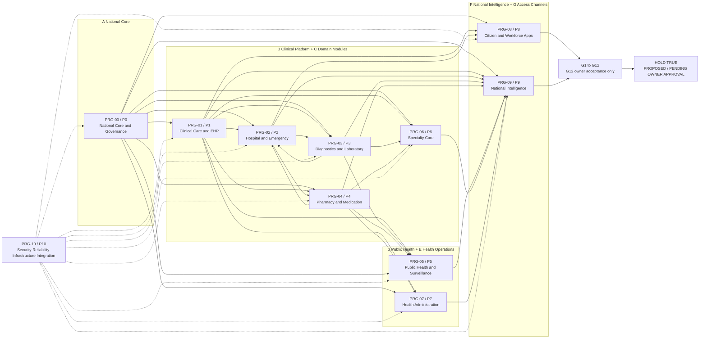
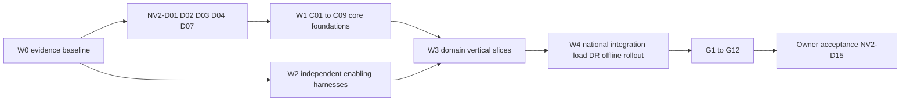

# GULA National Transformation V2 — Program Charters

## 0. Document control

- **Document:** `GULA_NATIONAL_PROGRAM_CHARTERS_V2.md` — new root-level Markdown, V2 deliverable #5.
- **Purpose:** define eleven bounded program charters for the national transformation V2 planning gate. This document creates charters only; it authorizes no implementation, source/test/config/migration change, commit, release, or deployment.
- **All charters are `PROPOSED / PENDING OWNER APPROVAL` under HOLD.** No charter is `ACCEPTED`, `PRODUCTION READY`, or `DONE`. Status values are restricted to `PLANNED` or `BLOCKED`.
- **Posture:** **HOLD TRUE**; `production_ready_items = 0`; **Stable v1.0.0 NOT DECLARED**; **PRODUCTION READY NOT AUTHORIZED** (`GOVERNANCE/FINAL_DECISION.md:13,46`; `GOVERNANCE/NATIONAL_INTEGRATION/status_registry.json`; `GULA_MASTER_EXECUTION_STATUS.md:7`).
- **Authority:** only owner-recorded decisions can move a blocked charter (`GULA_OWNER_DECISION_REGISTER.md:9-11,§9`; `GOVERNANCE/GECS/MASTER_CONTROL.md:§§3,7,8`).
- **Repository boundary:** `gula-integration` only; sibling `gula-platform` is read-only and untouched.

## 1. Identifier discipline and shared evidence baseline

- New parallel programs: `PRG-00`…`PRG-10` = `P0`…`P10`, names per seed §3.
- **Naming guard:** `PRG-03 / P3` is **Diagnostics and Laboratory Systems**. It is **not** legacy audit package `P-03 / AUD-F03`. That package is `PREPARED ONLY · NOT IMPLEMENTED` (D1–D5 absent from owner register §9; T9 deferred to `P-03-CONCURRENCY`) and is never execution scope for PRG-03.
- Contracts: C01 Patient Identity · C02 Organization · C03 Provider · C04 Clinical Resource · C05 Authorization · C06 Consent · C07 Audit · C08 API Versioning · C09 Event · C10 Idempotency · C11 Offline Sync · C12 Error/Retry · C13 Retention · C14 Observability · C15 Migration/Compatibility.
- Gates: G1 Architecture/Contract · G2 Security/Privacy · G3 Clinical Safety/Data Integrity · G4 API/Integration · G5 Database/Migration · G6 Backup/DR · G7 Performance/Capacity · G8 Mobile/Desktop · G9 Offline/Sync · G10 Monitoring/Incident · G11 National Ops · G12 Independent Review/Final Acceptance.
- Status vocabulary is exclusive and must be evidence-cited: IMPLEMENTED · TESTED · INDEPENDENTLY REVIEWED · ACCEPTED · PRODUCTION READY · PARTIALLY IMPLEMENTED · DOCUMENTED ONLY · PLANNED · BLOCKED. Labels SOURCE / WORKING PROTOTYPE / DOCUMENTED DESIGN / TEST-ONLY / PRODUCTION-VERIFIED are not statuses. API existence is not clinical completion; `DECISION-READY` is not `ACCEPTED`. Older `PRODUCTION_READY`/certification claims are conflicts for NV2-D09, not current status.
- **Shared evidence facts (cited once, reused per charter):** (S1) `backend/app/factory.py` `create_app()` line 1097, `_register_routes()` lines 519–836 ≈100 `include_router` calls; static scan 2,388 decorators, not a live count; documented counts conflict (`TEAM_C_INDEPENDENT_VERIFICATION_REPORT.md:32`, `GOVERNANCE/WAVE_0_BASELINE.md:29`, `GULA_MASTER_BASELINE.md:53`, `docs/constitution/runtime/02_route_registration_certification.md:14`). (S2) 111 migration revisions, single head `20261119_0003`, 4 merges, 0 dangling/duplicate IDs; documented counts conflict. (S3) `backend/tests/conftest.py` forces SQLite in-memory; default suite does not exercise PostgreSQL locking/sequences/triggers/DDL. (S4) static backend test inventory 353 files / 2,741 test definitions; 90 security-named test files; Frontend Vitest 56 definitions; Playwright 13 specs/22 tests, no executed pass/fail in reports; E2E journey gap OD-008. (S5) `k6/load_test.js` targets error<1%, read p95<500 ms, write p95<1000 ms, health p99<200 ms; quality-gates p50 200/p95 500/p99 1000 ms, throughput ≥100 rps; no reproducible results (`.benchmarks` empty, benchmark-results.json FAIL, MISSION-019/020 not executed). (S6) structured JSON logs and `/metrics` JSON + `/metrics/prom` exist, but Helm ServiceMonitor scrapes authenticated JSON instead of `/metrics/prom`, SLO metrics `gula_down`/`gula_request_duration_seconds_bucket` have no live call site, no runtime OTel FastAPI instrumentation, no `X-Correlation-ID` header; `contracts/integration.py` has `correlation_id` but middleware never sets `request.state.correlation_id`. (S7) HA/DR are config-only: `config/postgres-ha/patroni.yml`, `scripts/backup.sh`, `continuous-backup.sh`, `pitr-recover.sh`, `restore-test.sh`, `validate-restore.sh`, `dr-*.sh`; `DATABASE_RECOVERY_REPORT.md:7-11` NOT IMPLEMENTED/BLOCKED; no drill. (S8) mixed provenance: 20 staged R100 renames into `archive/legacy/workflow_runtime/`, 162 unstaged tracked, 686 untracked before V2 (collapsed 313); canonical `backend/app/workflows/` untracked. (S9) documented-only/TEST-ONLY integration: `contracts/export/{openapi,asyncapi,fhir}.json` 98/102/305-byte stubs, `health_core/contracts/version.py:6-8` LOCAL_SYNTHETIC_ONLY, four disconnected event/outbox stacks, simulated broker, external gateways default STUB. (S10) capability scaffold: `backend/app/capabilities/` has 10 capabilities; only `fhir_interoperability` and `search_service` registered in factory; 8 are CRUD stubs advertised by `kernel/capabilities_registry_populator.py`.
- **Parallel-execution rule:** parallel work only against approved, versioned contracts; no team may change C01–C15, protected governance records, or National Core semantics locally; contract changes require review + version bump + G1 revalidation; migrations and shared-schema changes are serialized checkpoints (W0 → NV2-D01/D02/D03/D04/D07 → W1 C01–C09 → W3 slices → W4 → G1–G12 → owner acceptance).

## 2. Mermaid overview

## 3. Cross-charter dependency matrix

Cell at **row = consumer, column = provider**: `A` authoritative prerequisite · `C` consumer of owned data/contract · `X` cross-cutting checkpoint/co-validation · `—` no direct dependency. Matrix is proposed and subject to NV2-D01/D03/D10.

| Consumer ↓ / Provider → | P0 | P1 | P2 | P3 | P4 | P5 | P6 | P7 | P8 | P9 | P10 |
|---|---|---|---|---|---|---|---|---|---|---|---|
| PRG-00 / P0 | — | — | — | — | — | — | — | — | — | — | X |
| PRG-01 / P1 | A | — | — | C | C | — | — | — | — | — | X |
| PRG-02 / P2 | A | C | — | C | C | — | — | — | — | — | X |
| PRG-03 / P3 | A | C | C | — | — | — | — | — | — | — | X |
| PRG-04 / P4 | A | C | C | — | — | — | — | — | — | — | X |
| PRG-05 / P5 | A | C | — | C | C | — | — | — | — | — | X |
| PRG-06 / P6 | A | A | — | C | C | — | — | — | — | — | X |
| PRG-07 / P7 | A | C | — | — | C | — | — | — | — | C | X |
| PRG-08 / P8 | A | C | C | C | C | C | C | C | — | — | X |
| PRG-09 / P9 | A | C | C | C | C | C | — | C | — | — | X |
| PRG-10 / P10 | X | X | C | C | C | C | C | C | X | C | — |

- Single authoritative owner per data class (seed §8): NHID/MPI, organization/facility, provider, identity/access/consent/audit/terminology → PRG-00; encounters/notes/diagnoses/care plans/orders/prescriptions → PRG-01 with domain authors; lab orders/results/QC and radiology/DICOM → PRG-03; medication/dispensation → PRG-04; public-health case/immunization/surveillance → PRG-05; analytics/warehouse → PRG-09 derived only; audit is immutable national evidence under PRG-00/PRG-10. Blood-bank ownership (PRG-03/PRG-02) is **unresolved** pending NV2-D03.
- Serialized checkpoints: any C01–C15 change, shared schema/migration, or National Core semantic change is not parallel; W1 contract approval gates W3; W4 evidence gates G12.

### 3.1 Proposed contract ownership map (final assignment pending NV2-D03)

| Contract | Proposed owner | Principal consumers | Lead gate |
|---|---|---|---|
| C01 Patient Identity | PRG-00 | all programs | G1, G3, G4 |
| C02 Organization | PRG-00 | all programs | G1, G4 |
| C03 Provider | PRG-00 | all programs | G1, G4 |
| C04 Clinical Resource | PRG-01 | P2, P3, P4, P5, P6, P7, P8 | G1, G3, G4 |
| C05 Authorization | PRG-00 (enforcement P10) | all programs | G2 |
| C06 Consent | PRG-00 | P1, P3, P5, P6, P8 | G2, G3 |
| C07 Audit | PRG-00 with P10 | all programs | G2, G10, G12 |
| C08 API Versioning | PRG-00 (tooling P10) | all programs | G4 |
| C09 Event | PRG-10 | all programs | G4, G10 |
| C10 Idempotency | PRG-10 | P1–P7, P9 | G4, G5 |
| C11 Offline Sync | PRG-08 (validation P10) | P1, P2, P3, P4, P5, P8 | G8, G9 |
| C12 Error/Retry | PRG-10 | all programs | G4, G10 |
| C13 Retention | PRG-00 (operations P7) | all programs | G2, G11 |
| C14 Observability | PRG-10 | all programs | G10 |
| C15 Migration/Compatibility | PRG-10 (governance P0) | all programs | G5, G4 |

## 4. Program charters

### 4.0 PRG-00 / P0 — National Core and Governance

**Evidence anchors:** `backend/app/identity/`, `backend/app/services/mpi/`, `backend/app/domain_platform/manifest.py`, `GULA_OWNER_DECISION_REGISTER.md`, `GOVERNANCE/FINAL_DECISION.md`.
#### Mission
Establish one authoritative national identity, organization, provider, authorization, consent, audit and terminology core with versioned contracts and a single decision record.
#### Scope (in/out)
**In:** NHID/MPI, `backend/app/identity/`, `backend/app/services/mpi/`, `backend/app/domain_platform/manifest.py` (11 canonical domains), governance registers, contract-first tooling. **Out:** clinical content, domain modules, channel UIs, event broker implementation.
#### Deliverables
C01–C08/C13 baselines; identity/org/provider conformance suite (`WS-CORE-01`); API/versioning tooling (`WS-API-01`); decision index and backlog (`WS-GOV-01`); data/contract owner register; status-conflict register for NV2-D09.
#### Dependencies (programs + contracts C01–C15 + owner decisions NV2-Dxx + gates)
Programs: P10 co-validation; provider to P1–P9. Contracts: owns C01, C02, C03, C05, C06, C07, C13 (C08 shared with P10); consumes C09, C12, C14, C15. Decisions: NV2-D01, NV2-D02, NV2-D03, NV2-D04, NV2-D05, NV2-D06, NV2-D09, NV2-D10, NV2-D12, NV2-D15. Gates: G1, G2, G3, G4, G5, G11, G12.
#### Ownership/RACI roles
R: National Core Engineering Lead, Contract Owners; A: National Owner (owner register); C: Clinical Safety Officer, Security and Privacy Officer, Independent Review Team, Domain Module Leads; I: all program leads. Roles only; no persons named; appointments pending NV2-D03/D10.
#### Contracts owned/consumed
Owns C01, C02, C03, C05, C06, C07, C13; co-owns C08; consumes C09, C12, C14, C15. Ownership proposed, pending NV2-D03.
#### Security and privacy controls
`backend/app/security/{rbac.py,abac.py,auth.py,consent_dep.py,break_glass_guard.py}`, `identity/services/authorization_decision.py:199-314`, `identity/services/consent_service_v2.py:24-81`, canonical hash-chain audit `services/audit_service.py:1-8,31-38`, startup secret validation `backend/app/config.py:135-198`. HS256 only; no OIDC/JWKS (503 route) — a documented gap, not production readiness.
#### Clinical safety controls
NHID merge conflicts must be human-adjudicated (R-05); emergency break-glass is server-verified and distinct from consent (`security/break_glass_guard.py`); no core service may silently alter orders/results; terminology owner decision NV2-D11.
#### Test strategy and required evidence
Conformance tests for C01–C08/C13; PG16-backed identity/consent/audit evidence required (S3, S4); `P-02_FINAL_CLOSURE_2026_11_24.md` is IMPLEMENTED · TESTED · INDEPENDENTLY REVIEWED, not ACCEPTED; P-03/P-03-CONCURRENCY excluded; synthetic data policy NV2-D14; no PHI.
#### Migration and compatibility constraints
C15 gate G5; 111 revisions/single head `20261119_0003` (S2); preserve protected MD5s (`FINAL_DECISION`, MPI audit reports); no SQLite substitution for PG claims; `contracts/routes.py:52` broken import and empty checked-in `openapi.json` vs `X-API-Version: 2.5.0` must be resolved, not assumed.
#### Rollback/Reversibility
Versioned backward-compatible contract changes; archive-first before deletion; expand/contract migrations; reverse a contract version without deleting history; no destructive migration; rollback path reviewed at G5. DR scripts not proven (S7); HOLD prevents live use.
#### Observability requirements
C14: identity/consent/audit decision events with correlation IDs; fix missing `X-Correlation-ID`/`request.state.correlation_id` (S6); `/metrics/prom` scrape; audit-chain alerts to incident process (G10).
#### Performance targets (TARGETS)
TARGETS pending NV2-D07: read p95 <500 ms, write p95 <1000 ms, health p99 <200 ms, error <1% (S5). NOT VERIFIED: no reproducible result artifacts.
#### Acceptance criteria (G1–G12)
G1 lead (contracts/architecture); G2 lead; G3 support (identity/consent safety); G4 lead; G5 lead; G6 support (runbook only); G7 support; G8 N/A (no channel UI); G9 support (identity offline semantics); G10 support; G11 lead; G12 final owner acceptance. No status upgrade without NV2-D15.
#### Risks (R-01…R-18)
R-01 mixed provenance blocks safe promotion; R-02 immature contracts; R-05 merge conflict; R-15 protected-record/status conflict; R-18 unresolved owner decisions.
#### Waves W0–W4
W0: evidence baseline, protected-record verification, no implementation. W1: C01–C08/C13 contracts and identity/MPI/org/provider foundations. W2: API conformance and governance tooling. W3: core-backed domain consumption only after W1 approval. W4: national integration evidence and G1–G12 pack.
#### Definition of Done
Exit condition only: owner-approved contracts, PG16 evidence, independent review, all applicable gates PASS, G12 acceptance; never self-declared.
#### Current status (PLANNED / BLOCKED; never done)
**BLOCKED** — PROPOSED / PENDING OWNER APPROVAL; HOLD TRUE. Blockers NV2-D01/D02/D03/D09/D15; `GOVERNANCE/FINAL_DECISION.md:13`.

### 4.1 PRG-01 / P1 — Clinical Care and EHR

**Evidence anchors:** `backend/app/capabilities/encounter_management/`, `routes/ehr.py`, `ehr/models/`, `services/ehr_service.py`, `backend/app/workflows/`, S10.
#### Mission
Own the canonical encounter, note, diagnosis, care-plan, order and prescription record with C04 as the single clinical resource contract.
#### Scope (in/out)
**In:** OPD/encounters (`backend/app/national/domain/{clinic,visit,appointment,encounter}.py`, `backend/app/national/api/routes/encounter.py`), EHR, orders/results consumption, clinical workflow. **Out:** lab/radiology result production (P3), dispensation (P4), analytics truth (P9).
#### Deliverables
C04 resource schemas; encounter/EHR conformance suite; 15-step synthetic journey skeleton (`WS-E2E-01`); capability-stub retirement plan for 8 unregistered stubs; clinical-safety hazard log.
#### Dependencies (programs + contracts C01–C15 + owner decisions NV2-Dxx + gates)
Programs: P0 authoritative identity/consent/audit; P3 results; P4 medication; P8 channel exposure. Contracts: owns C04; consumes C01–C03, C05–C07, C09–C15. Decisions: NV2-D01, NV2-D03, NV2-D04, NV2-D05, NV2-D06, NV2-D10, NV2-D14. Gates: G1–G5, G7, G10–G12.
#### Ownership/RACI roles
R: Clinical Platform Engineering Lead, Clinical Domain Authors; A: National Owner; C: Clinical Safety Officer, Security and Privacy Officer, Independent Review Team, Diagnostics and Pharmacy Leads; I: Channel and Analytics Leads.
#### Contracts owned/consumed
Owns C04 (proposed NV2-D03); consumes C01, C02, C03, C05, C06, C07, C08, C09, C10, C11, C12, C13, C14, C15.
#### Security and privacy controls
RBAC/ABAC default DENY (`backend/app/security/abac.py`), purpose-bound consent (`security/consent_dep.py`), step-up (`identity/api/step_up.py:21-27`), field-level security only partial runtime scaffolding (`FIELD_SECURITY.md:7-38`) — full enforcement NOT independently confirmed; no PHI in test fixtures.
#### Clinical safety controls
Verification before result display (R-06); diagnosis/order provenance and versioned notes; break-glass separation; no analytic output may change an order; hazard review under G3.
#### Test strategy and required evidence
PG16-backed encounter/order evidence because S3 SQLite suite misses locking/triggers; 2,741 static test definitions are inventory, not pass evidence (S4); 15-step journey currently absent (OD-008); synthetic journey must cover registration→order→sample→result→verification→billing→report.
#### Migration and compatibility constraints
C15/G5 serialization; S2 migration DAG; `fhir_interoperability` registered but most FHIR resources read-only (`KNOWN_LIMITATIONS §2`); stale validation report cites removed Procedure 501; no request version negotiation/Deprecation/Sunset (S9).
#### Rollback/Reversibility
Versioned C04 schemas, backward-compatible readers, archive-first retirement of untracked `backend/app/workflows/`, expand/contract migrations; no destructive rollback; restore evidence required before W4 promotion.
#### Observability requirements
C14: per-encounter/order trace with correlation propagation (`contracts/integration.py` has field, middleware lacks header — S6); clinical safety alerts and audit events; `/metrics/prom`, structured JSON logs.
#### Performance targets (TARGETS)
TARGETS pending NV2-D07: read p95 <500 ms, write p95 <1000 ms, health p99 <200 ms, error <1% (S5). NOT VERIFIED: no reproducible national E2E result.
#### Acceptance criteria (G1–G12)
G1 lead (C04); G2 support; G3 lead; G4 lead; G5 support; G6 N/A (runbook support only); G7 support; G8 support (contract-bound pages); G9 support; G10 support; G11 support; G12 final after owner acceptance.
#### Risks (R-01…R-18)
R-04 IDOR/bypass; R-05 identity merge; R-06 silent result modification; R-07 consent/emergency conflict; R-16 AI/clinical safety; R-18 owner decisions.
#### Waves W0–W4
W0: journey/hazard baseline, no code. W1: C04 approved with C01–C03/C05–C07. W2: `WS-E2E-01` skeleton and security harness. W3: EHR/encounter slice after C01–C09 baselines. W4: national E2E, load, G1–G12 evidence.
#### Definition of Done
Exit condition only: C04 approved, journey passing on PG16 with synthetic data, clinical safety sign-off, gates PASS, G12 owner acceptance.
#### Current status (PLANNED / BLOCKED; never done)
**PLANNED** — PROPOSED / PENDING OWNER APPROVAL; HOLD TRUE. Prerequisites NV2-D01/D03/D04/D14; journey OD-008 not verified.

### 4.2 PRG-02 / P2 — Hospital and Emergency Systems

**Evidence anchors:** `backend/app/ems/`, `backend/app/nursing/`, `backend/app/critical_care/`, `backend/app/services/hospital_service.py`, `backend/app/routes/hospital.py`, `hospital_desktop/`.
#### Mission
Provide bed/asset-aware hospital operations and emergency response as domain authors on P0 identity and P1 clinical records.
#### Scope (in/out)
**In:** `backend/app/hospital/models/__init__.py`, HIS, `backend/app/ems/`, nursing, ICU, bed management, emergency workflow; `hospital_desktop/` is a source-only channel candidate. **Out:** national MPI/authorization truth (P0), lab/radiology production (P3), blood-bank final ownership (NV2-D03).
#### Deliverables
HIS/EMS domain conformance packs; bed/asset consistency checks; emergency break-glass procedure; offline-capable emergency intake requirements; channel wiring proposal for `hospital_desktop/` (3 unittest methods, no CI/Compose).
#### Dependencies (programs + contracts C01–C15 + owner decisions NV2-Dxx + gates)
Programs: P0, P1 authoritative; P3/P4 consumed; P8 channel. Contracts: consumes C01–C07, C09–C15; contributes C04 scope. Decisions: NV2-D01, NV2-D03, NV2-D04, NV2-D06, NV2-D07, NV2-D10, NV2-D14. Gates: G1–G5, G7–G12.
#### Ownership/RACI roles
R: Hospital and Emergency Domain Lead; A: National Owner; C: Clinical Safety Officer, Operations Lead, Security and Privacy Officer, Diagnostics and Pharmacy Leads; I: Channel Lead, Independent Review Team.
#### Contracts owned/consumed
Consumes C01, C02, C03, C04, C05, C06, C07, C08, C09, C10, C11, C12, C13, C14, C15; co-authors C04 emergency scope; blood-bank C04/C07 boundary pending NV2-D03.
#### Security and privacy controls
Scoped roles/delegation `identity/services/authorization_service_v2.py:205-335`; B4 cross-account guard `identity/adaptive_auth/b4_guard.py:14-252`; fresh step-up and fail-closed audit; emergency access distinct from consent (`security/break_glass_guard.py`).
#### Clinical safety controls
Emergency time-critical overrides must be server-verified, logged and reversible; ICU/nursing high-alert medication cross-check with P4; no offline ward decision may overwrite a verified result (R-06/R-08).
#### Test strategy and required evidence
Emergency/offline scenarios with synthetic data (NV2-D14); PG16 evidence for concurrent bed/order writes (S3); static test inventory is not a pass claim (S4); no executed national-scale load (S5); `hospital_desktop/` has no CI evidence.
#### Migration and compatibility constraints
C15/G5 serialized changes; S2 DAG; admin/HIS extraction thresholds NV2-D05; route-count divergence must be resolved by live import measurement, not documentation (S1); no SQLite substitution.
#### Rollback/Reversibility
Versioned emergency procedures; feature-flagged channel wiring; expand/contract bed/asset migrations; archive-first for superseded HIS code; restore drill prerequisite not proven (S7).
#### Observability requirements
C14: emergency event traces, ward-level audit events, incident alerts (G10); fix correlation propagation (S6); health and `/metrics/prom` endpoints.
#### Performance targets (TARGETS)
TARGETS pending NV2-D07: read p95 <500 ms, write p95 <1000 ms, health p99 <200 ms, error <1% (S5). NOT VERIFIED for emergency national load.
#### Acceptance criteria (G1–G12)
G1 support; G2 support; G3 lead (emergency safety); G4 support; G5 support; G6 support; G7 support; G8 support; G9 support (emergency offline); G10 support; G11 lead; G12 final owner acceptance.
#### Risks (R-01…R-18)
R-04 bypass; R-08 offline/late data; R-09 audit/availability coupling; R-12 specialty gaps at ICU/nursing edge; R-18 owner decisions.
#### Waves W0–W4
W0: emergency hazard/bed-consistency baseline. W1: consume approved C01–C07. W2: emergency security and offline harness. W3: HIS/EMS/ICU slice after C01–C09. W4: national ops readiness and G1–G12 evidence.
#### Definition of Done
Exit condition only: approved contracts, PG16 emergency evidence, safety sign-off, gates PASS, G12 acceptance.
#### Current status (PLANNED / BLOCKED; never done)
**PLANNED** — PROPOSED / PENDING OWNER APPROVAL; HOLD TRUE. Prerequisites NV2-D01/D03/D04/D10.

### 4.3 PRG-03 / P3 — Diagnostics and Laboratory Systems

**Evidence anchors:** `backend/app/lims/`, `backend/app/radiology/` (`pacs.py`), `backend/app/blood_bank/`, `integration/standards/{astm,dicom,hl7}.py`, `gateways/lab_device_gateway.py`.
#### Mission
Own lab orders/results/QC, radiology reports and DICOM objects, and coordinate blood-bank ownership under one diagnostics contract boundary.
#### Scope (in/out)
**In:** `services/lab_service.py`, `sample_service.py`, `test_result_service.py`, `quality_control_service.py`, LIMS routes/tests; RIS/PACS `backend/app/radiology/`; `backend/tests/blood_bank/`; ASTM real integration, DICOM QIDO/WADO/STOW via httpx, HMAC device bridge. **Out:** audit package `P-03 / AUD-F03` (separate, blocked), `P-03-CONCURRENCY`, clinical order authorship (P1), analytics truth (P9).
#### Deliverables
Lab/result/QC contract pack; result-verification conformance suite; DICOM/PACS and terminology strategy proposal (NV2-D11); device-gateway replay/HMAC evidence; blood-bank ownership memo.
#### Dependencies (programs + contracts C01–C15 + owner decisions NV2-Dxx + gates)
Programs: P0 identity/audit; P1 orders; P2 bed/emergency; P5 public-health result feeds; P8 result display. Contracts: owns diagnostics scope of C04; consumes C01–C03, C05–C15. Decisions: NV2-D01, NV2-D03, NV2-D04, NV2-D05, NV2-D10, NV2-D11, NV2-D14. Gates: G1–G5, G7, G9–G12.
#### Ownership/RACI roles
R: Diagnostics Domain Lead, LIMS/PACS Engineering Leads; A: National Owner; C: Clinical Safety Officer, Security and Privacy Officer, Hospital/Emergency Lead, Public Health Lead, Independent Review Team; I: Channel and Analytics Leads.
#### Contracts owned/consumed
Owns lab orders/results/QC and radiology/DICOM parts of C04 (proposed NV2-D03); consumes C01, C02, C03, C05, C06, C07, C08, C09, C10, C11, C12, C13, C14, C15; blood bank PRG-03/PRG-02 boundary unresolved.
#### Security and privacy controls
HMAC + replay protection `gateways/lab_device_gateway.py`; authorization decision engine `identity/services/authorization_decision.py:199-314`; consent gating `security/consent_dep.py`; audit chain `services/audit_service.py`; no direct device write to verified result.
#### Clinical safety controls
Westgard QC and verification-before-release; silent result modification forbidden (R-06); critical-result alerting with receipt evidence; DICOM patient/order matching; analyzer-result provenance; R-06 regression evidence required at G3.
#### Test strategy and required evidence
PG16-backed result/audit evidence (S3); 187 security-named and 110 FHIR test definitions are inventory only (S4); LIMS tests exist but no executed national pass claim; device replay and DICOM conformance required; synthetic specimens only (NV2-D14); no PHI.
#### Migration and compatibility constraints
C15/G5; S2 DAG; external gateways default STUB and HL7→FHIR `simulationOnly: True` (S9); DICOM docs contradictory (no pydicom/pynetdicom dependency vs connector claiming STOW); `contracts/export/*.json` stubs; no SQLite substitution.
#### Rollback/Reversibility
Versioned result schemas; archive-first for superseded LIMS/PACS code; expand/contract migrations; device firmware/config rollback; verified results never deleted, superseded with audit trail; restore prerequisite not proven (S7).
#### Observability requirements
C14: QC failure, critical-result, device-replay and PACS-error events; correlation propagation fix (S6); `/metrics/prom`; incident routing under G10.
#### Performance targets (TARGETS)
TARGETS pending NV2-D07: read p95 <500 ms, write p95 <1000 ms, health p99 <200 ms, error <1% (S5). NOT VERIFIED for analyzer/DICOM load.
#### Acceptance criteria (G1–G12)
G1 lead (diagnostics C04); G2 support; G3 lead; G4 lead; G5 support; G6 support; G7 support; G8 support; G9 lead (device offline); G10 support; G11 support; G12 final owner acceptance.
#### Risks (R-01…R-18)
R-06 silent result modification; R-11 DR not proven; R-12 specialty assay gaps; R-14 event/outbox immaturity; R-18 owner decisions incl. NV2-D11.
#### Waves W0–W4
W0: result-safety and device-inventory baseline; confirm PRG-03 ≠ `P-03 / AUD-F03`. W1: diagnostics C04 scope approved. W2: device/security conformance harness. W3: LIMS/RIS/PACS/blood-bank slice. W4: national result/device load, offline, DR, G1–G12.
#### Definition of Done
Exit condition only: approved C04 scope, PG16 result/QC evidence, no silent-modification finding, gates PASS, G12 acceptance.
#### Current status (PLANNED / BLOCKED; never done)
**PLANNED** — PROPOSED / PENDING OWNER APPROVAL; HOLD TRUE. Blocked for DICOM/blood-bank scope until NV2-D03/NV2-D11; `P-03 / AUD-F03` remains separate and PREPARED ONLY.

### 4.4 PRG-04 / P4 — Pharmacy and Medication Management

**Evidence anchors:** `backend/app/pharmacy/`, `backend/app/pharmacy/inventory.py`, `backend/app/billing/`, `backend/app/insurance/`.
#### Mission
Own medication, prescription, dispensation and pharmacy inventory as the single medication source of truth.
#### Scope (in/out)
**In:** pharmacy domain (`backend/app/pharmacy/`), inventory, dispensation, medication reconciliation with P1 prescriptions, insurance/billing exchange boundaries. **Out:** prescribing clinical record authorship (P1), lab/radiology results (P3), analytics truth (P9).
#### Deliverables
Medication contract pack; duplicate-prescription and interaction-safety harness; inventory reconciliation procedure; claims/adjudication compatibility memo; controlled-drug audit evidence design.
#### Dependencies (programs + contracts C01–C15 + owner decisions NV2-Dxx + gates)
Programs: P0 identity/authorization; P1 prescriptions; P2 inpatient wards; P5 immunization feeds; P7 operations. Contracts: owns medication scope of C04; consumes C01–C03, C05–C15. Decisions: NV2-D01, NV2-D03, NV2-D04, NV2-D10, NV2-D14. Gates: G1–G5, G7, G9–G12.
#### Ownership/RACI roles
R: Pharmacy Domain Lead; A: National Owner; C: Clinical Safety Officer, Security and Privacy Officer, Hospital Lead, Public Health Lead, Independent Review Team; I: Operations and Channel Leads.
#### Contracts owned/consumed
Owns medication/dispensation parts of C04 (proposed NV2-D03); consumes C01, C02, C03, C05, C06, C07, C08, C09, C10, C11, C12, C13, C14, C15.
#### Security and privacy controls
Default-DENY ABAC (`security/abac.py`), step-up for controlled substances (`identity/api/step_up.py`), consent/break-glass separation, hashed secrets and startup key validation (`backend/app/config.py`); no provider/financial external calls in V2.
#### Clinical safety controls
Duplicate-prescription prevention, high-alert medication cross-check with ICU/nursing (P2), dose/allergy validation against synthetic data only, controlled-drug audit trail, dispensation reconciliation before billing.
#### Test strategy and required evidence
PG16-backed dispensation/audit evidence (S3); anti-abuse suite partially covered (`ADVERSARIAL_TEST_REPORT.md §3`); brute-force/enumeration results absent; no executed national load (S5); synthetic medicines/patients (NV2-D14).
#### Migration and compatibility constraints
C15/G5; S2 DAG; `backend/app/insurance/` and billing stack duplications flagged in S1 contradictions; no SQLite substitution; external gateway STUB default (S9).
#### Rollback/Reversibility
Versioned medication contracts; expand/contract inventory migrations; dispensation corrections as append-only events under C07; archive-first retirement; no destructive stock adjustment; restore prerequisite unproven (S7).
#### Observability requirements
C14: dispensation, stockout, controlled-drug and reconciliation events; correlation fix (S6); `/metrics/prom`; incident response for stockout/audit gaps (G10).
#### Performance targets (TARGETS)
TARGETS pending NV2-D07: read p95 <500 ms, write p95 <1000 ms, health p99 <200 ms, error <1% (S5). NOT VERIFIED for pharmacy national load.
#### Acceptance criteria (G1–G12)
G1 support; G2 support; G3 lead (medication safety); G4 support; G5 support; G6 support; G7 support; G8 support; G9 support; G10 support; G11 support; G12 final owner acceptance.
#### Risks (R-01…R-18)
R-04 authorization bypass; R-06 silent modification of dispensation; R-08 offline conflict; R-16 AI/clinical safety; R-18 owner decisions.
#### Waves W0–W4
W0: medication-safety baseline. W1: medication C04 scope with approved C01–C07. W2: duplicate/anti-abuse harness. W3: pharmacy slice. W4: national inventory/offline/DR and G1–G12 evidence.
#### Definition of Done
Exit condition only: approved contract scope, PG16 safety evidence, no duplicate-prescription defect, gates PASS, G12 acceptance.
#### Current status (PLANNED / BLOCKED; never done)
**PLANNED** — PROPOSED / PENDING OWNER APPROVAL; HOLD TRUE. Prerequisites NV2-D01/D03/D04/D10.

### 4.5 PRG-05 / P5 — Public Health and Surveillance

**Evidence anchors:** `backend/app/public_health/`, `backend/app/national/intelligence/public_health/surveillance.py`, `backend/app/services/epidemiology.py`, `backend/app/care_continuum/`.
#### Mission
Own case, immunization and surveillance records sourced from authorized clinical events, under an owner-approved legal reporting scope.
#### Scope (in/out)
**In:** public-health domain, surveillance, epidemiology, MCH/immunization/chronic/home-care models (`backend/app/care_continuum/models/{maternal,immunization,chronic_disease,care_journey}.py`), DHIS2 export `routes/compliance.py:551+`. **Out:** primary clinical event authorship (P1), analytics truth (P9), legal scope expansion beyond NV2-D08.
#### Deliverables
Case/immunization/surveillance contract pack; reporting-scope memo (NV2-D08); authorized-event traceability harness; DHIS2 export design (no external calls); synthetic outbreak fixtures.
#### Dependencies (programs + contracts C01–C15 + owner decisions NV2-Dxx + gates)
Programs: P0 identity/consent; P1 clinical events; P3 lab results; P4 immunization medication; P9 derived analytics. Contracts: owns public-health scope of C04; consumes C01–C03, C05–C15. Decisions: NV2-D01, NV2-D03, NV2-D04, NV2-D07, NV2-D08, NV2-D10, NV2-D14. Gates: G1–G5, G7, G9–G12.
#### Ownership/RACI roles
R: Public Health Domain Lead; A: National Owner (legal scope); C: Clinical Safety Officer, Security and Privacy Officer, Diagnostics and Pharmacy Leads, Independent Review Team; I: Analytics and Operations Leads.
#### Contracts owned/consumed
Owns public-health case/immunization/surveillance parts of C04 (proposed NV2-D03); consumes C01, C02, C03, C05, C06, C07, C08, C09, C10, C11, C12, C13, C14, C15.
#### Security and privacy controls
Purpose-bound consent (`consent_service_v2.py`), versioned purpose allowlist and 72h cap, canonical audit for grant/withdraw/check; minimum-necessary case data; no PHI or external DHIS2 call in V2; emergency-access conflict review (R-07).
#### Clinical safety controls
Case classification must trace to authorized clinical/lab events; immunization reconciliation with P4; no surveillance output may trigger clinical action without governed pathway; false-positive review under G3.
#### Test strategy and required evidence
PG16-backed event-to-case traceability (S3); synthetic outbreak data under NV2-D14; 40 migration and 43 offline test definitions are inventory, not results (S4); report correctness evidence required at G3/G11.
#### Migration and compatibility constraints
C15/G5; S2 DAG; DHIS2 export is documented source (`routes/compliance.py:551+`) but no external call; `contracts/export/*.json` stubs (S9); no SQLite substitution.
#### Rollback/Reversibility
Versioned case definitions; append-only corrections under C07; withdraw/reclassify without deleting history; expand/contract migrations; archive-first for superseded surveillance rules; restore prerequisite unproven (S7).
#### Observability requirements
C14: case-creation, reporting and export events with correlation IDs; surveillance error/dead-letter alerts; `/metrics/prom`; incident routing under G10.
#### Performance targets (TARGETS)
TARGETS pending NV2-D07: read p95 <500 ms, write p95 <1000 ms, health p99 <200 ms, error <1% (S5). NOT VERIFIED for national surveillance volumes.
#### Acceptance criteria (G1–G12)
G1 support; G2 lead (legal/privacy scope); G3 support; G4 support; G5 support; G6 support; G7 support; G8 N/A; G9 support; G10 support; G11 lead; G12 final owner acceptance.
#### Risks (R-01…R-18)
R-07 consent/emergency conflict; R-08 offline/late data; R-09 availability coupling; R-14 event immaturity; R-18 owner decisions incl. NV2-D08.
#### Waves W0–W4
W0: legal-scope and event-lineage baseline. W1: approved C01–C07/C04 public-health scope. W2: surveillance conformance harness. W3: public-health slice. W4: national reporting evidence and G1–G12.
#### Definition of Done
Exit condition only: NV2-D08 scope approved, PG16 lineage evidence, gates PASS, G12 acceptance.
#### Current status (PLANNED / BLOCKED; never done)
**BLOCKED** — PROPOSED / PENDING OWNER APPROVAL; HOLD TRUE. Blocker NV2-D08 (reporting/legal scope) plus NV2-D01/D03/D04.

### 4.6 PRG-06 / P6 — Specialty Care

**Evidence anchors:** `backend/app/critical_care/`, `backend/app/care_continuum/`, `backend/app/capabilities/clinical_foundation`, domain evidence §4 of `GULA_COMPONENT_INVENTORY.md`.
#### Mission
Bring specialty care domains onto the canonical clinical platform without inventing parallel clinical sources of truth.
#### Scope (in/out)
**In:** ICU/critical care, care-continuum pathways, OR safety-checklist level, analytics/enum/documentation-level specialties (oncology, cardiology, nephrology, mental health, dental, rehabilitation), pathology/microbiology/molecular as LIMS assay categories. **Out:** new specialty implementations, primary result truth (P3), medication truth (P4).
#### Deliverables
Specialty gap register; modality-to-C04 mapping; clinical-safety hazard review for gaps; terminology strategy input to NV2-D11; no new specialty module source in V2.
#### Dependencies (programs + contracts C01–C15 + owner decisions NV2-Dxx + gates)
Programs: P0 identity/consent; P1 clinical platform authoritative; P3 results; P4 medication; P8 channel. Contracts: consumes C01–C15, contributes specialty C04 scope. Decisions: NV2-D01, NV2-D03, NV2-D04, NV2-D10, NV2-D11. Gates: G1–G5, G8, G10–G12.
#### Ownership/RACI roles
R: Specialty Care Domain Lead; A: National Owner; C: Clinical Safety Officer, Diagnostics and Pharmacy Leads, Security and Privacy Officer, Independent Review Team; I: Channel and Analytics Leads.
#### Contracts owned/consumed
Consumes C01, C02, C03, C04, C05, C06, C07, C08, C09, C10, C11, C12, C13, C14, C15; contributes specialty scope to C04; owns no competing clinical truth.
#### Security and privacy controls
Scoped roles and purpose-bound consent (`backend/app/security/`, `identity/services/consent_service_v2.py`); specialty notes inherit P1 authorization; no specialty-local identity store; no PHI fixtures.
#### Clinical safety controls
Do not present enum/analytics-level specialty data as clinical fact; ICU high-alert checks with P2/P4; hazardous-gap acknowledgements under G3; no autonomous AI recommendation may alter care (R-16).
#### Test strategy and required evidence
Gap-register verified by file citation, not by test pass; coverage of ICU/continuum surfaces via PG16 where DB semantics matter (S3); no executed specialty journey evidence (S4); synthetic data NV2-D14.
#### Migration and compatibility constraints
C15/G5; S2 DAG; 8 unregistered CRUD stubs in `backend/app/capabilities/` must not be treated as implemented specialties (S10); dormant assets preserved (`domain_platform/config/dormancy.json`, `policies/dormancy_policy.py`); no SQLite substitution.
#### Rollback/Reversibility
No new specialty source in V2; mapping/gap register versioned; any later specialty module uses archive-first retirement and expand/contract migrations; no destructive change.
#### Observability requirements
C14: specialty-gap review events, consent-denied access and safety-alert metrics; correlation fix (S6); `/metrics/prom`; G10 incident routing.
#### Performance targets (TARGETS)
TARGETS pending NV2-D07: read p95 <500 ms, write p95 <1000 ms, health p99 <200 ms, error <1% (S5). NOT VERIFIED for specialty load; no specialty capacity model.
#### Acceptance criteria (G1–G12)
G1 support; G2 support; G3 lead (gap hazard acknowledgement); G4 support; G5 support; G6 N/A; G7 support; G8 support; G9 support; G10 support; G11 support; G12 final owner acceptance.
#### Risks (R-01…R-18)
R-12 specialty module gaps; R-13 channel divergence; R-16 AI/clinical safety; R-18 owner decisions.
#### Waves W0–W4
W0: verified gap register. W1: consume approved C01–C07. W2: specialty hazard/clinical-safety harness. W3: only approved specialty slice after C01–C09; no new module without owner decision. W4: national review evidence and G1–G12.
#### Definition of Done
Exit condition only: gap register owner-acknowledged, no false clinical presentation, gates PASS, G12 acceptance.
#### Current status (PLANNED / BLOCKED; never done)
**BLOCKED** — PROPOSED / PENDING OWNER APPROVAL; HOLD TRUE. Blocker R-12 specialty gaps and NV2-D03/D10 scoping.

### 4.7 PRG-07 / P7 — Health Administration and Operations

**Evidence anchors:** `backend/app/governance/models/workforce.py`, `backend/app/biomedical/`, `backend/app/devices/`, `backend/app/billing/`, `backend/app/clinical/quality/`, `config/postgres-ha/patroni.yml`, `scripts/backup.sh`.
#### Mission
Own workforce, biomedical assets, inventory, billing/financial/insurance operations and quality-management processes on governed national data.
#### Scope (in/out)
**In:** HR/procurement partial surfaces, `backend/app/pharmacy/inventory.py`, hospital asset models, biomedical/device registry, billing/financial/insurance, `backend/app/clinical/quality/`, operational retention execution (C13), DR runbook design (WS-DB-01). **Out:** clinical truth (P1), medication truth (P4), analytics truth (P9), live DR execution (HOLD).
#### Deliverables
Operations data-owner register; retention and legal-hold procedure; asset/device reconciliation; migration-safety and PITR/DR runbook design (WS-DB-01); procurement/HR gap register.
#### Dependencies (programs + contracts C01–C15 + owner decisions NV2-Dxx + gates)
Programs: P0 organization/provider/authorization; P1 clinical events; P4 inventory; P9 derived reporting; P10 infrastructure. Contracts: owns C13 execution; consumes C01–C12, C14, C15. Decisions: NV2-D01, NV2-D03, NV2-D04, NV2-D07, NV2-D10, NV2-D15. Gates: G1, G2, G5, G6, G7, G10, G11, G12.
#### Ownership/RACI roles
R: Health Operations Lead; A: National Owner; C: Security and Privacy Officer, Clinical Safety Officer, Infrastructure and DR Lead, Independent Review Team; I: all domain leads.
#### Contracts owned/consumed
Owns operational execution of C13 (policy owner PRG-00); consumes C01, C02, C03, C04, C05, C06, C07, C08, C09, C10, C11, C12, C14, C15.
#### Security and privacy controls
Platform access separates operational reads from `master_admin` writes (`security/platform_access.py:10-12,43-64`); B4 guard `identity/adaptive_auth/b4_guard.py`; least privilege for billing/financial data; no provider or financial external calls; secret placeholders only.
#### Clinical safety controls
Quality-management events must not overwrite clinical facts; device/biomedical defects route to clinical safety review; asset downtime must not suppress critical-result delivery (P3); retention never destroys required clinical evidence.
#### Test strategy and required evidence
Runbook design only: DR scripts exist but no restore/PITR/RTO/RPO drill (S7); `DATABASE_RECOVERY_REPORT.md:7-11` NOT IMPLEMENTED/BLOCKED; 30 disaster test definitions are inventory, not results (S4); no national load results (S5).
#### Migration and compatibility constraints
C15/G5 serialization; S2 DAG; doc drift (`DEVOPS_CERTIFICATION.md` claims py3.14/node24/14 Dockerfiles vs tree py3.12-slim/node22.13-alpine/15 Dockerfiles; root `pyproject.toml` py314 vs CI 3.12); 32 workflows vs stale 6-workflow report; no SQLite substitution.
#### Rollback/Reversibility
Versioned retention policies; legal hold overrides deletion; restore-first before destructive operations; archive-first for retired operations code; no live failover under HOLD; DR rollback path documented but unproven (S7).
#### Observability requirements
C14: asset/billing/retention/DR events; SLO metrics missing live call site (S6); `/metrics/prom` scrape fix; alertmanager webhook is placeholder; incident response under G10/G11.
#### Performance targets (TARGETS)
TARGETS pending NV2-D07: read p95 <500 ms, write p95 <1000 ms, health p99 <200 ms, error <1% (S5). NOT VERIFIED: no RTO/RPO/availability measurement plan approved.
#### Acceptance criteria (G1–G12)
G1 support; G2 lead (operational data privacy); G3 support; G4 support; G5 lead; G6 lead (design evidence only); G7 support; G8 N/A; G9 support; G10 lead; G11 lead; G12 final owner acceptance.
#### Risks (R-01…R-18)
R-04 authorization bypass; R-09 audit/availability coupling; R-11 DR not proven; R-15 status/protected-record conflict; R-17 supply-chain/CI trust; R-18 owner decisions.
#### Waves W0–W4
W0: operations/DR evidence baseline. W1: consume approved C01–C07/C13 policy. W2: `WS-DB-01` migration safety and DR runbook design. W3: operations slice. W4: controlled DR/load evidence and G1–G12.
#### Definition of Done
Exit condition only: owner-approved retention/DR design, PG16 migration evidence, gates PASS, G12 acceptance; live DR not claimed.
#### Current status (PLANNED / BLOCKED; never done)
**PLANNED** — PROPOSED / PENDING OWNER APPROVAL; HOLD TRUE. Prerequisites NV2-D07/D10; DR remains NOT IMPLEMENTED/BLOCKED.

### 4.8 PRG-08 / P8 — Citizen and Workforce Applications

**Evidence anchors:** `frontend-v3/`, `frontend-v3/data-source-inventory.json`, `mobile/android/`, `mobile/desktop/`, `mobile/ios/`, `hospital_desktop/`, `platform/apps/`.
#### Mission
Provide governed, Arabic-first access channels bound to national contracts, with no channel-local clinical source of truth.
#### Scope (in/out)
**In:** `frontend-v3` (94 routes, 80 RoleGuard usages; `index.html:2` lang=ar dir=rtl; i18n ar/en/ku/tk/syr), `mobile/android` (43 @Test), `mobile/desktop` (9 tests), `mobile/ios` (61 tests, missing Xcode metadata), Expo narrow module, `hospital_desktop/` source, `platform/apps/*` source, reference apps. **Out:** new channel business logic, unbound demo flows, primary clinical data ownership.
#### Deliverables
Channel-bound surface register; C11 offline conflict contract pack; channel parity matrix; v3 unbound-surface retirement/bridge plan; iOS CI-binding decision memo; directorate/governorate persona gap register.
#### Dependencies (programs + contracts C01–C15 + owner decisions NV2-Dxx + gates)
Programs: P0 identity/workspace; P1/P2/P3/P4/P5/P6/P7 data; P10 security/observability. Contracts: owns C11; consumes C01–C10, C12–C15. Decisions: NV2-D01, NV2-D03, NV2-D04, NV2-D10, NV2-D14. Gates: G1–G5, G8, G9–G12.
#### Ownership/RACI roles
R: Access Channels Lead; A: National Owner; C: Clinical Safety Officer, Security and Privacy Officer, National Core Lead, Independent Review Team, Access Channel QA Lead; I: domain leads.
#### Contracts owned/consumed
Owns C11 (proposed NV2-D03; validation P10); consumes C01, C02, C03, C04, C05, C06, C07, C08, C09, C10, C12, C13, C14, C15.
#### Security and privacy controls
Workspace-scoped reads `src/api/workspaceScopedReads.ts`, `AuthContext.tsx`, `WorkspaceSelector.tsx`, RoleGuard; cert pinning/encrypted prefs (Android), Keychain/biometrics (iOS); 92 non-operational v3 surfaces and 2 blocked-until-server-enforcement must stay gated; no PHI fixtures.
#### Clinical safety controls
Only contract-bound pages (`src/pages/patients/PatientsPage.tsx`, `src/pages/orders/OrdersPage.tsx`) may display operational data; no demo or safe-bridge surface may present results as verified; offline conflict must not silently overwrite a lab result (R-06/R-08).
#### Test strategy and required evidence
56 Vitest definitions, 13 Playwright specs/22 tests without executed pass/fail (S4); 72 unbound/17 demo-only/3 safe_bridge/2 contract-bound v3 surfaces; a11y gap A09-010; Playwright wiring gaps A09-003/008/009; synthetic journeys NV2-D14; no real patient data.
#### Migration and compatibility constraints
C15/G5; generated clients exist (`src/api/generated/client.ts` 919 lines, `types.ts` 12,412 lines; `contracts/sdk/{python,typescript,dart,kotlin,cli}`) but SDK sync modules are not used by v3; checked-in `openapi.json` 2.1.0 with zero paths vs `X-API-Version: 2.5.0` (S9); no SQLite substitution.
#### Rollback/Reversibility
Feature-flag channel binds; versioned generated clients; revert to previous contract-bound surface set; archive-first for retired demo UIs; no destructive local clinical queue truncation; offline queue convergence plan required before W4.
#### Observability requirements
C14: channel error, auth-denied and sync-conflict telemetry; correlation propagation fix (S6); `/metrics/prom`; incident routing for sync divergence under G10.
#### Performance targets (TARGETS)
TARGETS pending NV2-D07: read p95 <500 ms, write p95 <1000 ms, health p99 <200 ms, error <1% (S5). NOT VERIFIED for channel national load; bundle-budget workflow exists but no current result cited.
#### Acceptance criteria (G1–G12)
G1 support; G2 lead; G3 support; G4 lead; G5 support; G6 N/A; G7 support; G8 lead; G9 lead; G10 support; G11 support; G12 final owner acceptance.
#### Risks (R-01…R-18)
R-05 identity merge; R-08 offline conflict/late data; R-13 channel divergence; R-16 AI/clinical safety; R-18 owner decisions.
#### Waves W0–W4
W0: data-source inventory verification. W1: C01–C03/C11 contracts approved. W2: E2E synthetic journey and channel security harness. W3: bind only approved surfaces after C01–C09. W4: channel parity, offline convergence, G8/G9 and G1–G12 evidence.
#### Definition of Done
Exit condition only: bound surfaces approved, parity/offline evidence, gates PASS, G12 acceptance; demo surfaces remain non-operational.
#### Current status (PLANNED / BLOCKED; never done)
**BLOCKED** — PROPOSED / PENDING OWNER APPROVAL; HOLD TRUE. Blocker: 92 non-operational v3 surfaces and NV2-D03/D14.

### 4.9 PRG-09 / P9 — National Intelligence and Analytics

**Evidence anchors:** `backend/app/health_data/`, `backend/app/nhdw/`, `backend/app/national/intelligence/`, `backend/app/ai/`, `backend/app/national_data/` (dormant), `GULA_COMPONENT_INVENTORY.md §4`.
#### Mission
Provide national analytics and warehousing as derived evidence only, never as a competing primary clinical source.
#### Scope (in/out)
**In:** health data platform, NHDW, national intelligence, research platform, AI/AI-fabric analytics, `backend/app/services/stats_service.py`, dormant `backend/app/national_data/` preserved. **Out:** primary patient/order/result truth, clinical decision authority, activating dormant modules without owner decision.
#### Deliverables
Derived-data lineage register; analytics contract/schema registry; AI/clinical-safety governance pack; capacity/measurement plan input to NV2-D07; preserve-dormant-modules attestation.
#### Dependencies (programs + contracts C01–C15 + owner decisions NV2-Dxx + gates)
Programs: P0 authoritative identity/org; P1–P7 event/data sources; P8 channel telemetry; P10 infrastructure/observability. Contracts: consumes C01–C15; owns no primary contract. Decisions: NV2-D01, NV2-D03, NV2-D04, NV2-D07, NV2-D10, NV2-D15. Gates: G1, G2, G3, G4, G7, G10, G11, G12.
#### Ownership/RACI roles
R: National Intelligence Lead; A: National Owner; C: Clinical Safety Officer, Security and Privacy Officer, Data Owners of P0–P7, Independent Review Team; I: Operations and Channel Leads.
#### Contracts owned/consumed
Consumes C01, C02, C03, C04, C05, C06, C07, C08, C09, C10, C11, C12, C13, C14, C15; owns no primary data contract; derived copies labelled non-authoritative.
#### Security and privacy controls
Purpose-bound consent and ABAC for analytic access (`security/abac.py`, `identity/services/consent_service_v2.py`); no PHI in analytics fixtures; DeepSeek key rotation UNVERIFIED (`GULA_MASTER_EXECUTION_STATUS.md:173`); no external AI/provider calls.
#### Clinical safety controls
No analytic output may change orders, results or prescriptions; AI recommendations are advisory only (R-16); lineage must show source event and owner; gap-level specialty data must not be presented as clinical fact (P6).
#### Test strategy and required evidence
Lineage verification for each derived metric; PG16 evidence for source queries (S3); 78 resilience/30 performance/30 stress/30 chaos definitions are inventory, not results (S4); no national load/chaos results (`reports/independent-certification-report.md`); synthetic data NV2-D14.
#### Migration and compatibility constraints
C15/G5; S2 DAG; `backend/app/national_data/` dormant and `domain_platform/config/dormancy.json` + `policies/dormancy_policy.py` must be preserved; no SQLite substitution; stale benchmark artifacts must not be used as capacity evidence.
#### Rollback/Reversibility
Rebuild derived tables from source; versioned transformation definitions; no destructive source mutation; archive-first for retired models; rollback verified by lineage replay, not by stored snapshots alone.
#### Observability requirements
C14: pipeline freshness, lineage failure and DLQ metrics; fix SLO metric call sites and correlation propagation (S6); `/metrics/prom`; alerting under G10.
#### Performance targets (TARGETS)
TARGETS pending NV2-D07: read p95 <500 ms, write p95 <1000 ms, health p99 <200 ms, error <1% (S5); quality-gates throughput ≥100 rps. NOT VERIFIED: no reproducible national benchmark.
#### Acceptance criteria (G1–G12)
G1 support; G2 lead; G3 support (no clinical authority); G4 support; G5 support; G6 N/A; G7 lead; G8 N/A; G9 support; G10 lead; G11 support; G12 final owner acceptance.
#### Risks (R-01…R-18)
R-10 unmeasured national load; R-12 specialty gaps in source data; R-15 protected-record/status conflict; R-16 AI/clinical safety; R-18 owner decisions.
#### Waves W0–W4
W0: lineage and dormant-asset baseline. W1: consume approved C01–C15. W2: analytics/observability conformance harness. W3: derived slices only. W4: national load, capacity and G1–G12 evidence.
#### Definition of Done
Exit condition only: lineage owner-approved, no primary-source violation, gates PASS, G12 acceptance.
#### Current status (PLANNED / BLOCKED; never done)
**PLANNED** — PROPOSED / PENDING OWNER APPROVAL; HOLD TRUE. Prerequisites NV2-D07/D10; capacity NOT VERIFIED.

### 4.10 PRG-10 / P10 — Security, Reliability, Infrastructure and Integration

**Evidence anchors:** `backend/app/security/`, `services/audit_service.py`, `shared/events/bus.py`, `backend/app/services/outbox_service.py`, `config/postgres-ha/patroni.yml`, `helm/gula-platform`, `scripts/backup.sh`, `k6/load_test.js`.
#### Mission
Provide the cross-cutting zero-trust, audit-integrity, migration, HA/DR, observability, load and integration controls that all programs consume.
#### Scope (in/out)
**In:** authentication/authorization enforcement, `P-02`/`AUD-F02` engineering-scope continuity, audit-chain design evidence only (no P-03 execution), `P-03-CONCURRENCY` separate and excluded, event/outbox unification design, C08–C10/C12/C14/C15 tooling, CI/CD trust, HA config, backup/DR runbook design. **Out:** live release, production deployment, broker/provider/financial calls, SQLite substitutions.
#### Deliverables
Zero-trust test harness `WS-SEC-01` (IDOR, cross-tenant, audit bypass, unauthorized result modification, duplicate prescription, unauthorized export); audit-chain design evidence `WS-AUD-01` (documentation/test design only); observability contract `WS-OBS-01`; migration/DR design `WS-DB-01`; versioning tooling `WS-API-01`; load/capacity plan; supply-chain hardening evidence.
#### Dependencies (programs + contracts C01–C15 + owner decisions NV2-Dxx + gates)
Programs: all programs are co-validated; P0 owns authorization/consent/audit semantics. Contracts: owns C09, C10, C12, C14, C15 (C08 tooling with P0, C07 enforcement with P0). Decisions: NV2-D01, NV2-D02, NV2-D03, NV2-D04, NV2-D05, NV2-D06, NV2-D07, NV2-D10, NV2-D12, NV2-D13, NV2-D14, NV2-D15. Gates: G1–G12 (all).
#### Ownership/RACI roles
R: Security, Reliability and Integration Lead; A: National Owner; C: Independent Review Team, Security and Privacy Officer, Clinical Safety Officer, Infrastructure and DR Lead, all program leads; I: Operations and Release Authority.
#### Contracts owned/consumed
Owns C09, C10, C12, C14, C15; co-owns C08 tooling and C07 enforcement; consumes C01–C07, C11, C13. Contract ownership proposed, final under NV2-D03.
#### Security and privacy controls
HS256 JWT + JTI blacklist (`backend/app/security/auth.py:54-100,121-131`), permission-version revocation (`security/session.py:3-23`), MFA/WebAuthn (`security/mfa_service.py`), OAuth2 PKCE (`security/oauth2_provider.py`), B4/B5 guards, canonical audit hash chain (`services/audit_service.py`), append-only PG triggers (`migrations/20250322_0002:73-104`, `20260505_0005:1-20`). Gaps: no OIDC/JWKS, in-memory demo zero-trust sessions (`security/zero_trust.py:14-15,37-45`), uncommitted audit fix, 91 WT-only remediations, DeepSeek rotation UNVERIFIED.
#### Clinical safety controls
Audit bypass and silent result modification are clinical safety defects (R-03/R-06); break-glass must remain server-verified and logged; emergency availability must fail closed only where clinically agreed; incident review under G3/G10.
#### Test strategy and required evidence
90 security-named test files are inventory (S4); `INDEPENDENT_VERIFICATION_TEAM_C_TIER_B.md:18-23` and `..._B5_REVERIFY.md:23` verify engineering scope with residuals, no PRODUCTION READY; PG16 audit-chain defect evidence 1 failed/1 passed, stored_hash 571f43b6… vs expected 5bb1ab4d… (`P-03_READINESS_2026_11_24.md:20-31`); anti-abuse matrix partial (`ADVERSARIAL_TEST_REPORT.md §3`); no executed national load (S5); environment/data NV2-D14.
#### Migration and compatibility constraints
C15/G5; S2 DAG; 753 passed/119 failed strict schema gate; `backend/tests/conftest.py` SQLite override (S3); `contracts/routes.py:52` breaks 4 schema endpoints; `contracts/sdk` and generated clients real but checked-in OpenAPI empty (S9); 32 workflows vs stale reports; no SQLite substitution for PG evidence.
#### Rollback/Reversibility
Expand/contract migrations and serialized checkpoints; archive-first for retired stacks (S8); version-bump + G1 revalidation for contract changes; feature-flag enforcement changes; restore-first before destructive operations; DR scripts exist but unproven (S7); no live rollback under HOLD.
#### Observability requirements
C14: fix ServiceMonitor `/metrics/prom` target, emit SLO metrics, add runtime OTel instrumentation, set correlation header/state, replace alertmanager placeholder (S6); structured JSON logs already present; G10 incident response evidence.
#### Performance targets (TARGETS)
TARGETS pending NV2-D07: error<1%, read p95<500 ms, write p95<1000 ms, health p99<200 ms (`k6/load_test.js`); p50 200/p95 500/p99 1000 ms and ≥100 rps (quality-gates). NOT VERIFIED: `.benchmarks` empty, benchmark-results.json FAIL, MISSION-019/020 not executed.
#### Acceptance criteria (G1–G12)
G1 lead; G2 lead; G3 support; G4 lead; G5 lead; G6 lead (design only until drill); G7 lead; G8 support; G9 lead; G10 lead; G11 lead; G12 final owner acceptance after NV2-D15.
#### Risks (R-01…R-18)
R-01 mixed provenance; R-03 audit concurrency T9; R-04 adversarial bypass; R-09 audit/availability coupling; R-10 unmeasured load; R-11 DR unproven; R-14 four event stacks/simulated broker; R-17 CI/supply-chain; R-18 owner decisions.
#### Waves W0–W4
W0: security/infra/DR evidence baseline, no P-03 execution. W1: C08–C10/C12/C14/C15 approved. W2: `WS-SEC-01`, `WS-AUD-01`, `WS-OBS-01`, `WS-DB-01`, `WS-API-01` in parallel. W3: integration/control slices with C01–C09 baselines. W4: national load, DR, offline, incident and G1–G12 evidence.
#### Definition of Done
Exit condition only: owner-approved controls, PG16 security/audit evidence, independent review, all gates PASS, G12 acceptance; `P-03 / AUD-F03` and `P-03-CONCURRENCY` remain separately blocked.
#### Current status (PLANNED / BLOCKED; never done)
**BLOCKED** — PROPOSED / PENDING OWNER APPROVAL; HOLD TRUE. Blockers NV2-D02/D06/D07/D12/D13; security NOT CERTIFIED (`GOVERNANCE/FINAL_DECISION.md:46`).

## 5. Cross-cutting notes

- No program may claim `ACCEPTED` or `PRODUCTION READY`: engineering-scope verification (`P-02 / AUD-F02`) is not release authority; historical certifications are conflicts for NV2-D09.
- Contract-first rule: FHIR R4 for appropriate health resources, DICOM for imaging; administrative data is not forced into FHIR; schema validation, backward compatibility, explicit versioning, transactional outbox where needed, idempotent consumers, correlation IDs, trace propagation, dead-letter handling, retry policies and conflict resolution are mandatory (seed §6).
- Data ownership: derived copies never become competing sources of truth; audit is immutable national evidence under PRG-00/PRG-10; blood-bank boundary remains unresolved under NV2-D03.
- All test evidence must distinguish SOURCE / WORKING PROTOTYPE / DOCUMENTED DESIGN / TEST-ONLY / PRODUCTION-VERIFIED and cite paths; absence is `NOT VERIFIED`, never a pass claim.
- Gate gating: W4 evidence feeds G1–G12; G12 plus NV2-D15 is the only path to release candidacy; HOLD remains until owner action.

## Evidence basis

- Seed and drafting rules: `/tmp/opencode/gula_v2_seed.md` (§§1–15), `/tmp/opencode/gula_v2_draft_instructions.md` (hard rules 1–12).
- Backend surface and contradictions: `/tmp/opencode/gula_v2_evidence_backend.md` (factory/route counts, 8/10 capability stubs, 111 migrations, mixed provenance).
- Domain breadth and gaps: `/tmp/opencode/gula_v2_evidence_domain.md` (11 canonical domains, strong LIMS/pharmacy/radiology/EMS, specialty gaps, dormancy policy).
- Test estate: `/tmp/opencode/gula_v2_evidence_tests.md` (353 test files/2,741 definitions, SQLite conftest, P-02/PG facts, P-03 defect evidence, Playwright/E2E gap, k6 targets without results).
- Integration: `/tmp/opencode/gula_v2_evidence_integration.md` (real connectors vs stubs, four event stacks, versioning gaps, generated clients, offline conflicts).
- Infrastructure: `/tmp/opencode/gula_v2_evidence_infra.md` (15 Dockerfiles/9 Compose, Helm, config-only HA, unproven DR, observability gaps, warning-only performance gates).
- Governance: `/tmp/opencode/gula_v2_evidence_governance.md` (owner register authority, FINAL_DECISION HOLD, GECS control, status registry, protected MD5s, unresolved decisions).
- Channels: `/tmp/opencode/gula_v2_evidence_channels.md` (v3 94 surfaces/2 contract-bound, Android/Flutter desktop/iOS clients, un-wired sources).
- Security: `/tmp/opencode/gula_v2_evidence_security.md` (HEAD vs WT code, B1–B5 residuals, consent/audit controls, audit-chain defect, CI config-only, zero-trust gaps).
- Read-only on-disk existence checks in `gula-integration` for cited directories/files: `backend/app/identity/`, `backend/app/services/mpi/`, `backend/app/lims/`, `backend/app/radiology/`, `backend/app/pharmacy/`, `backend/app/public_health/`, `backend/app/nhdw/`, `backend/app/blood_bank/`, `backend/app/ems/`, `backend/app/critical_care/`, `backend/app/nursing/`, `backend/app/care_continuum/`, `backend/app/workflows/`, `backend/app/capabilities/`, `backend/app/domain_platform/manifest.py`, `backend/app/integration/connectors/lis.py`, `frontend-v3/`, `mobile/android/`, `mobile/desktop/`, `mobile/ios/`, `config/postgres-ha/`, `scripts/backup.sh`, `scripts/pitr-recover.sh`, `GOVERNANCE/FINAL_DECISION.md`, `GULA_OWNER_DECISION_REGISTER.md`.
