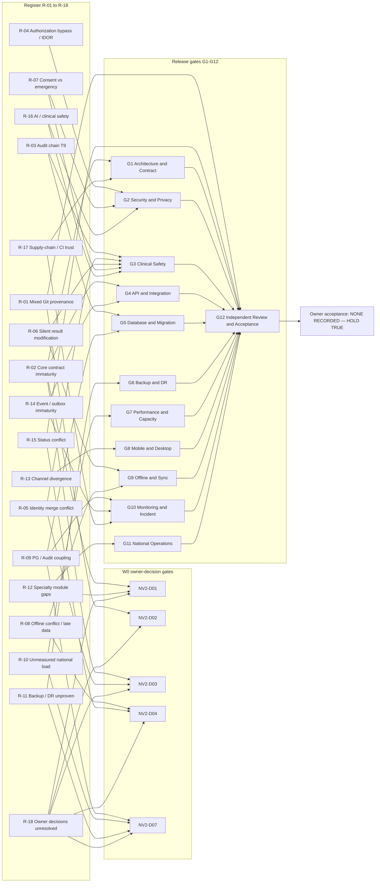

# GULA National Transformation V2 — Risk Register

Status: **PROPOSED / PENDING OWNER APPROVAL** — planning gate only; this register creates no implementation authority and records no risk acceptance.

Standing posture: `GOVERNANCE/FINAL_DECISION.md:13,46` — **HOLD TRUE**, security **NOT CERTIFIED**; `GOVERNANCE/NATIONAL_INTEGRATION/status_registry.json` — `production_ready_items = 0`; `GULA_MASTER_EXECUTION_STATUS.md:7` — **Stable v1.0.0 NOT DECLARED**; **PRODUCTION READY NOT AUTHORIZED**. `GOVERNANCE/GECS/MASTER_CONTROL.md` §3/§7/§8 forbids HOLD→GO and any commit/push/merge/PR/deploy in this gate.

Identifier rules: programs `PRG-00`..`PRG-10`; risks `R-01`..`R-18` exactly as seed §9 (no R-19+ added); gates `G1`..`G12`; contracts `C01`..`C15`; decisions `NV2-D01`..`NV2-D15`; waves `W0`..`W4`. `P-03 / AUD-F03` is a separate blocked audit package, never `PRG-03`.

## 1. Assessment vocabulary

- **Likelihood / Impact:** qualitative `High` / `Medium` / `Low` only. No numeric scores, percentages or computed ratings.
- **Status** uses the seed vocabulary only: IMPLEMENTED · TESTED · INDEPENDENTLY REVIEWED · ACCEPTED · PRODUCTION READY · PARTIALLY IMPLEMENTED · DOCUMENTED ONLY · PLANNED · BLOCKED. SOURCE, WT-code, TEST-ONLY and NOT VERIFIED are distinctions, not statuses.
- Every description cites a repository path or named read-only evidence file; absence of evidence is `NOT VERIFIED`, never PASS. Residual risk is exposure after the proposed control, assuming no owner acceptance — not a waiver.

## 2. Risk-to-gate map

## 3. Master index

| ID | Title | Category | Likelihood | Impact | Status | Primary gates |
|---|---|---|---|---|---|---|
| R-01 | Mixed Git provenance | Governance / change control | High | High | BLOCKED | G12, NV2-D02 |
| R-02 | National Core contract immaturity | Architecture / contracts | High | High | DOCUMENTED ONLY | G1, G4, NV2-D01/D03 |
| R-03 | Audit chain concurrency (T9) | Data integrity / audit | High | High | PARTIALLY IMPLEMENTED | G3, G5 |
| R-04 | Authorization bypass / IDOR | Security | Medium | High | PARTIALLY IMPLEMENTED | G2 |
| R-05 | Patient identity merge conflict | Identity / data integrity | Medium | High | PARTIALLY IMPLEMENTED | G3, NV2-D03 |
| R-06 | Silent result modification | Clinical safety | Medium | High | PARTIALLY IMPLEMENTED | G3, G9 |
| R-07 | Consent / emergency-access conflict | Privacy / clinical safety | Medium | High | PARTIALLY IMPLEMENTED | G2, G3 |
| R-08 | Offline conflict / late data | Offline / synchronisation | High | High | PARTIALLY IMPLEMENTED | G9, NV2-D04 |
| R-09 | PostgreSQL / Audit availability coupling | Reliability | Medium | High | PARTIALLY IMPLEMENTED | G5, G10, NV2-D07 |
| R-10 | Unmeasured national load / capacity | Performance | High | High | BLOCKED | G7, NV2-D07 |
| R-11 | Backup / DR not proven nationally | Disaster recovery | High | High | BLOCKED | G6, NV2-D07 |
| R-12 | Specialty module gaps | Domain coverage | High | Medium | DOCUMENTED ONLY | G11, NV2-D01 |
| R-13 | Mobile / desktop channel divergence | Channels | High | Medium | PARTIALLY IMPLEMENTED | G8 |
| R-14 | Event / outbox immaturity | Integration | High | High | PARTIALLY IMPLEMENTED | G4, G10 |
| R-15 | Protected-record / status conflict | Governance / release authority | High | High | BLOCKED | G12, NV2-D04 |
| R-16 | AI governance / clinical safety | AI / clinical safety | Medium | High | PARTIALLY IMPLEMENTED | G2, G3 |
| R-17 | Supply-chain / CI trust | Security / delivery | High | High | PARTIALLY IMPLEMENTED | G1, G10 |
| R-18 | Owner decisions unresolved | Governance | High | High | BLOCKED | All decision gates, G12 |

## 4. Detailed risk entries

### R-01 — Mixed Git provenance
- **Category / status:** Governance, change control — BLOCKED (NV2-D02 not made; OD-002 BLOCKED).
- **Description:** HEAD `2206654dc713ea2de8c564a3207dfe05fde23549` coexists with 20 staged R100 renames to `archive/legacy/workflow_runtime/` (name-status MD5 `56c524d6ffe9872c3a3ac6eff8c8f203`), 162 unstaged tracked files and 686 untracked files before V2 docs (313 collapsed); canonical `backend/app/workflows/` is untracked, plus 62 untracked `backend/app` entries and 10 untracked migrations.
- **Likelihood:** High (observed). **Impact:** High — no team can trust a shared diff or promotion.
- **Trigger / warning signal:** any save, stage, merge, rebase or branch cut; new untracked files in shared paths.
- **Affected:** PRG-00, PRG-10; C15; G12; W0 hard gate before W1.
- **Mitigation / control:** freeze writes; provenance inventory; archive-first reversible changes; independent review; no V2 edits to shared paths until resolved.
- **Owner role / residual risk:** Program Director (decision owner) + Configuration Manager (PRG-00); residual **High** until reconciled.
- **Required owner decision:** NV2-D02 (and OD-002) before any save/merge. **Verification evidence:** seed §1; `gula_v2_evidence_backend.md` §9–10; `GULA_OWNER_DECISION_REGISTER.md`.

### R-02 — National Core contract immaturity
- **Category / status:** Architecture, contracts — DOCUMENTED ONLY (no C01–C15 baseline approved).
- **Description:** `contracts/export/{openapi,asyncapi,fhir}.json` are 98/102/305-byte stubs; checked-in OpenAPI 2.1.0 has zero paths while middleware emits `X-API-Version: 2.5.0`; `backend/app/contracts/routes.py:52` breaks four schema endpoints; no negotiation/Deprecation/Sunset; `health_core/contracts/version.py:6-8` is `LOCAL_SYNTHETIC_ONLY`.
- **Likelihood:** High. **Impact:** High — parallel teams would code against non-authoritative interfaces.
- **Trigger / warning signal:** clients generated from the checked-in stub; local edits to C01–C15; generated-client drift.
- **Affected:** PRG-00 and all domains; C01–C15; G1, G4; W1.
- **Mitigation / control:** contract-first baselines with schema validation, explicit versioning and backward compatibility; owners under NV2-D03; G1 revalidation on every bump; no local contract edits.
- **Owner role / residual risk:** National Contract Authority (to be appointed) + PRG-00 lead; residual **Medium** after approved baselines, until G4 closes.
- **Required owner decision:** NV2-D01, NV2-D03. **Verification evidence:** `gula_v2_evidence_integration.md` §4, §6; `contracts/export/openapi.json`.

### R-03 — Audit chain concurrency (T9)
- **Category / status:** Data integrity, audit — PARTIALLY IMPLEMENTED (TEST-ONLY diagnostic; defect open at HEAD).
- **Description:** HEAD `_get_last_chain_hash()` is an unlocked tail read; concurrent PG writers can fork the SHA-256 chain (`backend/app/services/audit_service.py:106-112,219-229`). PG16.14 reproduction: 1 failed / 1 passed, stored hash `571f43b6…` vs expected `5bb1ab4d…`. WT advisory-lock fix is uncommitted; `AUDIT_EXECUTION_RECORDS/P-03_READINESS_2026_11_24.md` records PREPARED ONLY / NOT IMPLEMENTED, D1–D5 absent, T9 deferred.
- **Likelihood:** High (reproduced). **Impact:** High — immutable national evidence can be invalidated.
- **Trigger / warning signal:** concurrent audit writes; chain verification mismatch; any attempt to fold the WT fix into V2.
- **Affected:** PRG-00, PRG-10; C07, C09, C13; G3, G5; W1/W2 boundary.
- **Mitigation / control:** separate `P-03 / AUD-F03` and `P-03-CONCURRENCY` packages; WS-AUD-01 design evidence only; read-only `scripts/audit_verifier.py:3-14`; no acceptance without independent review on PostgreSQL.
- **Owner role / residual risk:** National Audit Service Owner (PRG-00) + Security Architecture (PRG-10); residual **High** until T9 separately authorised.
- **Required owner decision:** NV2-D12 (D1–D5) and NV2-D13 (P-03-CONCURRENCY), outside V2 start. **Verification evidence:** `AUDIT_EXECUTION_RECORDS/P-03_READINESS_2026_11_24.md`, `AUDIT_EXECUTION_RECORDS/P-03_CONCURRENCY_DESIGN.md`.

### R-04 — Authorization bypass / IDOR
- **Category / status:** Security — PARTIALLY IMPLEMENTED (HEAD engine SOURCE; WT-code unreviewed).
- **Description:** 91 previously unguarded endpoints plus S-01/S-02/S-13 fixed in working tree only (`GOVERNANCE/SECURITY_REVIEW_REPORT.md:28-38,108-134`). `backend/app/security/zero_trust.py:14-15` keeps `_active_sessions` in memory "for demo"; IP/UA changes only logged, revocation commented out (`:37-45`). Independent B1/B2/B3/B5 found zero API-reachable bypasses but retained residuals (seeded catalog gap, category mismatch, near-majority flag, forged-row key attenuation, `citizen_ulid` provenance).
- **Likelihood:** Medium. **Impact:** High — cross-tenant data exposure.
- **Trigger / warning signal:** new unguarded route; session continuation after device/IP change; certification claims from `SECURITY_CERTIFICATION.md`.
- **Affected:** PRG-00, PRG-10, all domains; C05, C06, C07; G2.
- **Mitigation / control:** deny-by-default engine (`identity/services/authorization_decision.py:199-314,559-603`), B4 cross-account guard, step-up, fail-closed on audit failure, WS-SEC-01 harness; independent review of WT fixes.
- **Owner role / residual risk:** Chief Security Architect (PRG-10); residual **Medium**.
- **Required owner decision:** NV2-D06. **Verification evidence:** `gula_v2_evidence_security.md` §8–10, §18; `INDEPENDENT_VERIFICATION_TEAM_C_TIER_B.md`.

### R-05 — Patient identity merge conflict
- **Category / status:** Identity, data integrity — PARTIALLY IMPLEMENTED (SOURCE with known defect).
- **Description:** HEAD `CRDT_MERGE` is first-seen-key-wins and can overwrite a lab result; `CONFLICT_QUARANTINE` exists only uncommitted. Four offline engines disagree (kernel LWW, health_core synthetic, SDK client/remote-wins, core/sync_engine); SDKs unused by frontend-v3; no authoritative event store to order identity updates.
- **Likelihood:** Medium. **Impact:** High — wrong-patient or lost-result record.
- **Trigger / warning signal:** MPI merge across facilities; late offline update after verification; first-key-wins on clinical fields.
- **Affected:** PRG-00, PRG-03, PRG-08; C01, C09, C10, C11; G3, G9.
- **Mitigation / control:** single NHID/MPI owner (seed §8); clinical-field merge policy at contract level; quarantine-not-overwrite; separate P-03 scope; no WT fix in V2.
- **Owner role / residual risk:** National Patient Identity Owner (PRG-00); residual **High** until one policy is tested on PostgreSQL.
- **Required owner decision:** NV2-D03 and NV2-D12. **Verification evidence:** `gula_v2_evidence_integration.md` §8, §13; `gula_v2_evidence_tests.md` §4.

### R-06 — Silent result modification
- **Category / status:** Clinical safety — PARTIALLY IMPLEMENTED.
- **Description:** `backend/app/services/test_result_service.py` plus inbound staging (`backend/app/integration/inbox.py`, `models/integration_inbox.py`) validate but do not auto-apply; append-only PG triggers reject UPDATE/DELETE (`migrations/20250322_0002:73-104`, `20260505_0005:1-20`), yet the unlocked audit tail (R-03) can mask a change. No E2E journey covers registration→order→sample→result→verification.
- **Likelihood:** Medium. **Impact:** High — undetected alteration of a verified result.
- **Trigger / warning signal:** amendment after verification; absent audit entry for a mutation; chain mismatch.
- **Affected:** PRG-03, PRG-00; C04, C07, C11; G3, G9.
- **Mitigation / control:** immutable audit anchor on every result transition; server-side enforcement; WS-E2E-01 15-step synthetic journey with verification assertions.
- **Owner role / residual risk:** Diagnostics Clinical Safety Owner (PRG-03) + Audit Owner (PRG-00); residual **Medium**.
- **Required owner decision:** NV2-D03, NV2-D04. **Verification evidence:** `gula_v2_evidence_domain.md` §19; `gula_v2_evidence_security.md` §13; `gula_v2_evidence_tests.md` §10.

### R-07 — Consent / emergency-access conflict
- **Category / status:** Privacy, clinical safety — PARTIALLY IMPLEMENTED.
- **Description:** Versioned consent with purpose allowlist and 72 h cap (`identity/services/consent_service_v2.py:24-46,62-81`) and server-verified break-glass distinct from consent (`security/consent_dep.py:1-31`, `security/break_glass_guard.py:1-26`) exist, but field-level enforcement is documented only (`FIELD_SECURITY.md:7-24,28-38`) with partial scaffolding; full enforcement `NOT VERIFIED`.
- **Likelihood:** Medium. **Impact:** High — unlawful disclosure or blocked emergency care.
- **Trigger / warning signal:** break-glass without fresh step-up; withdrawal during an active emergency session; field-level rule present only in docs.
- **Affected:** PRG-00, PRG-01, PRG-02; C05, C06, C07; G2, G3.
- **Mitigation / control:** keep consent gating and break-glass separate; audit every override; test deny and allow paths in WS-SEC-01.
- **Owner role / residual risk:** Privacy Officer + Security Architect (PRG-00/PRG-10); residual **Medium**.
- **Required owner decision:** NV2-D06. **Verification evidence:** `gula_v2_evidence_security.md` §9, §11.

### R-08 — Offline conflict / late data
- **Category / status:** Offline, synchronisation — PARTIALLY IMPLEMENTED (simulation).
- **Description:** No durable production offline queue; primary stores are process-local; `devices/outbox.py` sets `simulation_only=True`; offline simulation marks SYNCED after local hash only; HEAD CRDT overwrite risk (R-05). 43 offline test definitions exist but are TEST-ONLY/synthetic.
- **Likelihood:** High. **Impact:** High — divergent facility records after reconnect.
- **Trigger / warning signal:** network loss during the 15-step journey; two facilities editing one patient; SYNCED without server acknowledgement.
- **Affected:** PRG-00, PRG-08, PRG-03; C01, C04, C09–C12; G8, G9.
- **Mitigation / control:** one durable queue contract with correlation IDs, dead-letter handling, retry policy and conflict quarantine; no SQLite substitution for PG evidence.
- **Owner role / residual risk:** Offline Platform Owner (PRG-10) + Channel Owner (PRG-08); residual **High** until G9 convergence evidence exists.
- **Required owner decision:** NV2-D04 and NV2-D03. **Verification evidence:** `gula_v2_evidence_integration.md` §5, §13; `gula_v2_evidence_channels.md` §4–5.

### R-09 — PostgreSQL / Audit availability coupling
- **Category / status:** Reliability — PARTIALLY IMPLEMENTED (config SOURCE; failover NOT VERIFIED).
- **Description:** Authorization fails closed on audit failure (`identity/services/authorization_decision.py:199-314`) while audit is a PG append-only chain. HA is configuration only: PgBouncer primary-only, Redis Sentinel quorum 1, Kafka replication factor 1, single RabbitMQ/MinIO (`config/postgres-ha/patroni.yml`); no live failover evidence.
- **Likelihood:** Medium. **Impact:** High — audit unavailability becomes a clinical outage.
- **Trigger / warning signal:** audit write latency or PG failover; sentinel quorum loss; request denied solely because audit was unavailable.
- **Affected:** PRG-00, PRG-10; C07, C13, C14; G5, G10.
- **Mitigation / control:** owner-approved availability targets; documented bounded fail-closed behaviour and safe degradation; W4 failover drill; chain-lag monitoring.
- **Owner role / residual risk:** Platform Reliability Owner (PRG-10); residual **Medium–High** until G6/G10 evidence.
- **Required owner decision:** NV2-D07. **Verification evidence:** `gula_v2_evidence_infra.md` §4–5, §8; `gula_v2_evidence_security.md` §9.

### R-10 — Unmeasured national load / capacity
- **Category / status:** Performance — BLOCKED (NOT MEASURED).
- **Description:** `k6/load_test.js` (error <1%, read p95 <500 ms, write p95 <1000 ms, health p99 <200 ms), `tests/load/*` and Locust exist, but `.benchmarks` is empty, stored `benchmark-results.json` FAIL, `reports/production_audit_report.md` records MISSION-019/020 not executed, and `reports/independent-certification-report.md` records no national-scale load/chaos results.
- **Likelihood:** High. **Impact:** High — undiscovered national capacity ceiling.
- **Trigger / warning signal:** performance check warning-only in CI; any GO claim based on targets rather than results.
- **Affected:** PRG-10 and all domains; C14; G7.
- **Mitigation / control:** approved targets and measurement plan; reproducible W4 artifacts; hard gate instead of warning; no invented pass figures.
- **Owner role / residual risk:** Performance Engineering Lead (PRG-10); residual **High** until measured.
- **Required owner decision:** NV2-D07. **Verification evidence:** `gula_v2_evidence_infra.md` §9, §11; `gula_v2_evidence_tests.md` §5.

### R-11 — Backup / DR not proven nationally
- **Category / status:** Disaster recovery — BLOCKED.
- **Description:** `DATABASE_RECOVERY_REPORT.md:7-11` says NOT IMPLEMENTED / BLOCKED. Scripts exist (`scripts/backup.sh`, `pitr-recover.sh`, `restore-test.sh`, `validate-restore.sh`, `dr-*.sh`) but PITR is dry-run unless `FORCE_PITR=true`, `validate-restore.sh` swallows `pg_restore` failures with `|| true`, `dr-failover.sh` has undefined `DR_IP`, `backup-verification.sh` uses mysql clients, and no CI workflow invokes DR scripts.
- **Likelihood:** High. **Impact:** High — unrecoverable national data loss.
- **Trigger / warning signal:** a restore attempt; certification that treats script presence as drill evidence.
- **Affected:** PRG-00, PRG-10; C13, C15; G6.
- **Mitigation / control:** WS-DB-01 runbook design only in W2; live PG16 backup→restore drill in W4 with recorded RPO/RTO; fix swallow-failure patterns; no SQLite substitution.
- **Owner role / residual risk:** Disaster Recovery Owner (PRG-10); residual **High** until a drill passes and is accepted.
- **Required owner decision:** NV2-D07. **Verification evidence:** `DATABASE_RECOVERY_REPORT.md`; `gula_v2_evidence_infra.md` §7.

### R-12 — Specialty module gaps
- **Category / status:** Domain coverage — DOCUMENTED ONLY / BLOCKED for named services.
- **Description:** `GULA_COMPONENT_INVENTORY.md` §4: Dental #10, Rehabilitation #13, Mental health #14 NOT IMPLEMENTED, Insurance #16 BLOCKED; Oncology, Cardiology, Nephrology, Mental health, Dental, Rehabilitation are analytics/enum/documentation-level; Pathology/Microbiology/Molecular are LIMS assay catalogs; OR is resource/checklist-level.
- **Likelihood:** High. **Impact:** Medium — national coverage incomplete.
- **Trigger / warning signal:** a charter claiming a specialty is operational because an enum, KPI or catalog entry exists.
- **Affected:** PRG-06, PRG-07; C04; G11.
- **Mitigation / control:** record gaps in module registry and capability inventory; no dormant-module deletion (`backend/app/domain_platform/config/dormancy.json`); phased charters after approval.
- **Owner role / residual risk:** Specialty Programs Lead (PRG-06); residual **Medium** if owner approves sequencing.
- **Required owner decision:** NV2-D01, NV2-D10. **Verification evidence:** `GULA_COMPONENT_INVENTORY.md` §4; `gula_v2_evidence_domain.md` §5, §11.

### R-13 — Mobile / desktop channel divergence
- **Category / status:** Channels — PARTIALLY IMPLEMENTED (reference shell + source-only clients).
- **Description:** `frontend-v3/data-source-inventory.json`: 94 surfaces = 72 unbound, 17 demo-only, 3 safe_bridge, 2 contract-bound; 92 non-operational. Android 43 `@Test`, Flutter desktop 9 tests, iOS 61 tests but missing Xcode metadata; `hospital_desktop/` 3 unittest methods and no CI/Compose; `platform/apps/*` no tests or dist; no directorate/governorate persona app found.
- **Likelihood:** High. **Impact:** Medium — inconsistent care delivery and false readiness.
- **Trigger / warning signal:** binding to an unbound page; iOS CI metadata failure; root `index.html` links to missing `platform/apps/*/dist`.
- **Affected:** PRG-08, PRG-01, PRG-03; C01, C05, C06, C11; G8.
- **Mitigation / control:** bind only contract-bound surfaces; keep server-enforcement assertions until proven; single channel contract with synthetic fixtures; persona gap register.
- **Owner role / residual risk:** Channels Lead (PRG-08); residual **Medium** until G8 covers bound journeys.
- **Required owner decision:** NV2-D01, NV2-D10. **Verification evidence:** `gula_v2_evidence_channels.md` §1–8; `frontend-v3/data-source-inventory.json`.

### R-14 — Event / outbox immaturity
- **Category / status:** Integration — PARTIALLY IMPLEMENTED (no authoritative event store).
- **Description:** Four stacks: kernel in-memory bus, durable SQL outbox, health_core synthetic events, core/sync_engine LWW. Shared bus swallows handler exceptions; `OutboxWorker` can mark done with zero successful handlers; kernel publish never fills its outbox/inbox/DLQ; dual workers `worker.py` and `core/startup.py:270-272`; no `aio_pika`; external gateways default STUB; AMQP gateway reports success on ImportError.
- **Likelihood:** High. **Impact:** High — silent data loss and false integration success.
- **Trigger / warning signal:** message done with no successful handler; broker outage reported as success; two workers consuming one outbox.
- **Affected:** PRG-10 and all domains; C09, C10, C12, C14; G4, G10.
- **Mitigation / control:** one authoritative broker contract with correlation IDs, trace propagation, dead-letter handling, retry policy, idempotent consumers; remove success-on-ImportError; serialized broker choice.
- **Owner role / residual risk:** Integration Architecture Owner (PRG-10); residual **High** until C09/C10/C12 pass G4.
- **Required owner decision:** NV2-D03, NV2-D06. **Verification evidence:** `gula_v2_evidence_integration.md` §3, §8, §14.

### R-15 — Protected-record / status conflict
- **Category / status:** Governance, release authority — BLOCKED (conflict recorded; no owner acceptance).
- **Description:** Protected MD5s unchanged (`FINAL_DECISION effdfeaf…`, `MPI_FINAL_INDEPENDENT_AUDIT 1a02c015…`, `MPI_INDEPENDENT_AUDIT_FINDINGS ea3969d0…`), while older GO certifications (`MASTER_RELEASE_CERTIFICATION.md`, `RC_READINESS_REPORT.md`, `ENTERPRISE_PRODUCTION_CERTIFICATION_REPORT.md`, 2026-07-22 `*CERTIFICATION.md`) contradict current HOLD records (`GOVERNANCE/FINAL_DECISION.md`, `GULA_RELEASE_ACCEPTANCE_REPORT.md`, `GOVERNANCE/PRODUCTION_READINESS/FINAL_00_MASTER_VERDICT.md`, `GOVERNANCE/ADVERSARIAL_ASSURANCE/FINAL_ASSURANCE_DECISION.md`). Status vocabularies differ; `CRITICAL_FILE_SHA256.txt` has 3 historical failures superseded by `CHECKPOINT_2026_11_20` lines 4–6.
- **Likelihood:** High. **Impact:** High — premature release on stale authority.
- **Trigger / warning signal:** citation of a 2026-07 GO document as current authority; `ACCEPTED` without owner decision; protected file modified.
- **Affected:** PRG-00 and all programs; C15; G12; W0/W4.
- **Mitigation / control:** November records override historical claims; keep protected MD5s unchanged; one status vocabulary per seed §4; HOLD until G12 and explicit acceptance.
- **Owner role / residual risk:** Program Director + Governance Board; residual **High** until NV2-D09 recorded.
- **Required owner decision:** NV2-D09 and NV2-D04. **Verification evidence:** `gula_v2_evidence_governance.md` §3–10; `GOVERNANCE/FINAL_DECISION.md`.

### R-16 — AI governance / clinical safety
- **Category / status:** AI governance, clinical safety — PARTIALLY IMPLEMENTED.
- **Description:** DeepSeek key rotation UNVERIFIED (`GULA_MASTER_EXECUTION_STATUS.md:173`); `ADVERSARIAL_TEST_REPORT.md` §3 anti-abuse matrix partially covered (no broker outages, runtime HTTP probes, migration interruption or offline convergence under loss); no OIDC/JWKS (`backend/app/config.py:178`, `security/oauth2_provider.py:231-263`); field-level enforcement NOT VERIFIED; `backend/app/national_data/` dormant but present.
- **Likelihood:** Medium. **Impact:** High — unsafe or non-auditable AI-assisted clinical output.
- **Trigger / warning signal:** AI feature called production-verified; key rotation claimed without evidence; adversarial matrix presented as complete.
- **Affected:** PRG-00, PRG-01, PRG-09, PRG-10; C05, C06, C07, C14; G2, G3.
- **Mitigation / control:** local-AI-first, no-vendor-lock-in; verified rotation; synthetic-data policy; named clinical safety owner; independent review; do not activate dormant modules.
- **Owner role / residual risk:** Chief Medical Information Officer + AI Governance Owner; residual **Medium–High**.
- **Required owner decision:** NV2-D06, NV2-D14. **Verification evidence:** `gula_v2_evidence_security.md` §7, §12; `gula_v2_evidence_tests.md` §11.

### R-17 — Supply-chain / CI trust
- **Category / status:** Security, delivery — PARTIALLY IMPLEMENTED (tooling configured; execution NOT VERIFIED).
- **Description:** 32 workflows are configuration evidence, not execution (`GULA_SECURITY_CI_READINESS_PLAN.md:3,9`); Semgrep has no workflow invocation; pre-commit uses detect-private-key, not Gitleaks; `nightly.yml` continue-on-error and warn-only performance check; no backup/restore/DR gate; root `pyproject.toml` targets py314 while CI uses 3.12. `GULA_SECURITY_OPERATIONAL_READINESS_ASSESSMENT.md:90-92` records NOT IMPLEMENTED / BLOCKED.
- **Likelihood:** High. **Impact:** High — compromised dependency or unreviewed change reaches deployment.
- **Trigger / warning signal:** a CI job that warns instead of failing; workflow present with no run record; toolchain drift.
- **Affected:** PRG-00, PRG-10; C08, C14, C15; G1, G10.
- **Mitigation / control:** hard gates for ruff/tsc/eslint/tests/migration chain; free/open-source scanners first; retained execution artifacts; align Python target; no new paid dependency without exception.
- **Owner role / residual risk:** DevSecOps Lead (PRG-10); residual **Medium** until execution evidence retained.
- **Required owner decision:** NV2-D04, NV2-D06. **Verification evidence:** `gula_v2_evidence_security.md` §17; `gula_v2_evidence_infra.md` §5, §9.

### R-18 — Owner decisions unresolved
- **Category / status:** Governance — BLOCKED.
- **Description:** Owner register lines 9–11 permit only owner-recorded decisions to move BLOCKED→ACCEPTED. OD-001 accepted only SEC-015/F-01 engineering scope; OD-002…OD-025 BLOCKED; §9 records package-level P-02/P-03 AUTHORIZED with no acceptance and no release authority. All NV2-D01…D15 decisions are PROPOSED / PENDING OWNER APPROVAL.
- **Likelihood:** High. **Impact:** High — every critical-path gate stalls at W0.
- **Trigger / warning signal:** `DECISION-READY` treated as `ACCEPTED`; work starting before NV2-D02; change to protected governance records.
- **Affected:** all PRG-00…PRG-10; C01–C15; G1–G12; W0→W4.
- **Mitigation / control:** decision register as new root doc V2 #17; explicit owner sign-off per decision; HOLD TRUE; no team starts before D01–D04/D07 gate.
- **Owner role / residual risk:** Program Director + Owner Board; residual **High** — master blocker.
- **Required owner decision:** NV2-D01/D02/D03/D04/D07 first, then D05/D06/D09/D10/D14/D15. **Verification evidence:** `GULA_OWNER_DECISION_REGISTER.md` §9, lines 9–11; `gula_v2_evidence_governance.md` §1, §10–13.

## 5. Top critical-path risks

| Risk | Why it is on the critical path | Gate blocked | Earliest decision |
|---|---|---|---|
| R-01 | Mixed provenance makes shared diffs untrustworthy; NV2-D02 precedes W1 (seed §11). | G12 / NV2-D02 | Before any save or merge (W0). |
| R-02 | C01–C15 are contract-graph roots; W2 uses stubs, W3 needs baselines. | G1, G4 | NV2-D01 + NV2-D03 before W1. |
| R-03 | Audit integrity underpins C07/C09; PG defect reproduced at HEAD. | G3, G5 | Separate NV2-D12/D13; must not enter V2 execution. |
| R-15 | Historical GO claims conflict with binding HOLD; no acceptance can be recorded. | G12 | NV2-D09 + NV2-D04 before G12. |
| R-18 | All owner decisions pending; only owners move BLOCKED→ACCEPTED. | All | NV2-D01/D02/D03/D04/D07 at W0. |

These five form one serialized chain. R-03 is not removed by the V2 plan: it is deferred to a separately authorised package and remains an open exposure.

## 6. Risk acceptance rules

1. **No owner acceptance is recorded here.** No risk is ACCEPTED, waived, downgraded or transferred by this document; `GOVERNANCE/FINAL_DECISION.md` and `GULA_OWNER_DECISION_REGISTER.md` §9 remain binding.
2. Only an owner-recorded decision moves BLOCKED→ACCEPTED (register lines 9–11). `DECISION-READY` is not `ACCEPTED`; `P-02 / AUD-F02` with two LOW residuals is `IMPLEMENTED · TESTED · INDEPENDENTLY REVIEWED`, not ACCEPTED/PRODUCTION READY.
3. `P-03 / AUD-F03` is `PREPARED ONLY · NOT IMPLEMENTED`; D1–D5 absent, T9 deferred. Neither it nor P-03-CONCURRENCY may be accepted as V2 start.
4. Historical certification claims are conflicts requiring NV2-D09, not current status; HOLD must not become GO (`GOVERNANCE/GECS/MASTER_CONTROL.md` §3/§7/§8).
5. Residual risk stays High/Medium as stated until verification evidence is independently reviewed; no numeric threshold or completion percentage is inferred from test counts.
6. A gate cannot be PASS by configuration, script presence, documentation or a warning-only CI job; execution evidence must be retained and cited by repository-relative path.
7. No team, subagent or engineering document may accept a risk; only the named owner role with the corresponding NV2 decision ID may record acceptance.

## 7. Evidence basis

Read-only, in `/home/samertts/workspace/projects/gula-integration` at HEAD `2206654dc713ea2de8c564a3207dfe05fde23549`; sibling `gula-platform` not touched.

- `/tmp/opencode/gula_v2_seed.md` (§4 statuses, §7 gates, §8 ownership, §9 exact risk IDs, §10 decisions, §11 waves), `/tmp/opencode/gula_v2_draft_instructions.md`.
- All eight evidence files: `gula_v2_evidence_domain.md`, `gula_v2_evidence_backend.md`, `gula_v2_evidence_tests.md`, `gula_v2_evidence_security.md`, `gula_v2_evidence_integration.md`, `gula_v2_evidence_infra.md`, `gula_v2_evidence_channels.md`, `gula_v2_evidence_governance.md`.
- Paths verified: `GOVERNANCE/FINAL_DECISION.md`, `GOVERNANCE/GECS/MASTER_CONTROL.md`, `GOVERNANCE/NATIONAL_INTEGRATION/status_registry.json`, `GOVERNANCE/PRODUCTION_READINESS/FINAL_00_MASTER_VERDICT.md`, `GOVERNANCE/ADVERSARIAL_ASSURANCE/FINAL_ASSURANCE_DECISION.md`, `GULA_OWNER_DECISION_REGISTER.md`, `GULA_MASTER_EXECUTION_STATUS.md`, `GULA_COMPONENT_INVENTORY.md`, `GULA_SECURITY_OPERATIONAL_READINESS_ASSESSMENT.md`, `ADVERSARIAL_TEST_REPORT.md`, `DATABASE_RECOVERY_REPORT.md`, `AUDIT_EXECUTION_RECORDS/P-02_FINAL_CLOSURE_2026_11_24.md`, `AUDIT_EXECUTION_RECORDS/P-03_READINESS_2026_11_24.md`, `AUDIT_EXECUTION_RECORDS/P-03_CONCURRENCY_DESIGN.md`, `AUDIT_EXECUTION_RECORDS/P-03_SCOPE_AND_DEPENDENCY_REVIEW.md`, `reports/production_audit_report.md`, `reports/independent-certification-report.md`, `backend/app/services/audit_service.py`, `backend/app/security/zero_trust.py`, `backend/app/contracts/routes.py`, `backend/app/domain_platform/manifest.py`, `backend/tests/conftest.py`, `frontend-v3/data-source-inventory.json`, `contracts/export/openapi.json`.
