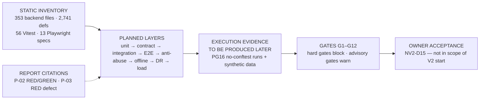

# GULA National Testing and Quality Strategy V2

> **Document status:** `PROPOSED / PENDING OWNER APPROVAL` — planning gate only.
> **Release posture:** `HOLD TRUE`; `production_ready_items = 0`; `Stable v1.0.0 NOT DECLARED`; `PRODUCTION READY NOT AUTHORIZED`.
> **Execution disclaimer — read first:** **This document claims no completed test run.** Every number below is either a *static source inventory* (counted from checked-in files) or a *citation of a pre-existing report*. No test, CI job, probe, load run, migration, restore, or deployment was executed to produce this plan. All execution evidence must be produced later, under an authorised workstream and environment policy (`NV2-D14`).

---

## 0. Scope and authority boundary

This strategy covers the verification model for the national target architecture in `/home/samertts/workspace/projects/gula-integration` (HEAD `2206654dc713ea2de8c564a3207dfe05fde23549`). The sibling `gula-platform` is read-only reference (HEAD `f478676b6fc375338648dde46fbf076c015a3f91`).

Binding posture sources: `GOVERNANCE/FINAL_DECISION.md` §1/§4/§7/§8/§9/§10 (HOLD — do not release; security NOT CERTIFIED), `GOVERNANCE/GECS/MASTER_CONTROL.md` §3/§7/§8 (HOLD must not become GO), `GOVERNANCE/NATIONAL_INTEGRATION/status_registry.json` (`production_ready_items = 0`; STOP before deployment). Historical `PRODUCTION_READY` and certification claims are conflicts requiring owner decision (`NV2-D09`), never current status (seed §4).

Naming rule: `PRG-03` = Diagnostics and Laboratory Systems. Audit packages are always `P-02 / AUD-F02` and `P-03 / AUD-F03`. They are never interchangeable.

---

## 1. Quality doctrine and evidence ladder

**Principle:** a test suite is evidence only when its execution environment is named. Static definition counts prove *coverage intent*, not passing behaviour. This strategy separates four evidence classes:

| Class | Meaning | Admissible as release evidence? |
|---|---|---|
| `STATIC INVENTORY` | `def test_` / `it` / `test` declarations counted from files | No — planning input only |
| `REPORT CITATION` | A dated report's recorded result, not re-run here | Only after freshness and scope check |
| `EXECUTION EVIDENCE` | Log/artifact produced by a named run in a named environment | Yes, when produced later |
| `PRODUCTION-VERIFIED` | Verified against the deployed national service | Not claimed anywhere in this document |

Status ladder per seed §4: `IMPLEMENTED → TESTED → INDEPENDENTLY REVIEWED → ACCEPTED → PRODUCTION READY`. `DECISION-READY` engineering scope is **not** `ACCEPTED`. P-02 / AUD-F02 is `IMPLEMENTED · TESTED · INDEPENDENTLY REVIEWED` (two accepted LOW residuals); P-03 / AUD-F03 is `PREPARED ONLY · NOT IMPLEMENTED` with D1–D5 absent and T9 deferred to `P-03-CONCURRENCY`.

---

## 2. Static test inventory (no pass claim)

### 2.1 Backend — `STATIC INVENTORY`

Source: `gula_v2_evidence_tests.md` §3, counted from `backend/tests/` and `backend/app/**`.

| Layer / category | Static count | Primary location | Evidence class |
|---|---|---|---|
| `test_*.py` files | **353 files** | `backend/tests/`, `backend/app/` | STATIC INVENTORY |
| `def test_` / `async def test_` definitions | **2,741 defs** across 163 files | as above | STATIC INVENTORY |
| Unit | **554 defs** | `backend/tests/unit/` | STATIC INVENTORY |
| Integration | **42 defs** | `backend/tests/integration/` | STATIC INVENTORY |
| Contracts | **4 defs** | `backend/tests/contracts/` | STATIC INVENTORY |
| Security-named | **187 defs** | 90 security-related Python test files (`test_auth_infrastructure.py`, `test_security_regression.py`, `unit/test_b4_cross_account_security.py`, `unit/test_b5_security_regressions.py`, `unit/test_audit_chain_isolation_guard.py`, …) | STATIC INVENTORY |
| FHIR-named | **110 defs** | FHIR routes/mappers/serializers tests | STATIC INVENTORY |
| Migration-named | **40 defs** | `backend/migrations/`, migration tests | STATIC INVENTORY |
| Offline-named | **43 defs** | offline/sync test surfaces | STATIC INVENTORY |
| Resilience | **78 defs** | resilience test surfaces | STATIC INVENTORY |
| Concurrency | **21 defs** | concurrency test surfaces | STATIC INVENTORY |
| Performance | **30 defs** | performance test surfaces | STATIC INVENTORY |
| Stress | **30 defs** | stress test surfaces | STATIC INVENTORY |
| Chaos | **30 defs** | chaos test surfaces | STATIC INVENTORY |
| Disaster | **10 defs** | disaster test surfaces | STATIC INVENTORY |

Categories are filename/symbol-pattern scans, not directories; a definition may belong to more than one category. Counts must not be summed into a "total passing" figure.

### 2.2 Frontend and channels — `STATIC INVENTORY`

| Surface | Static count | Location | Note |
|---|---|---|---|
| Vitest `it`/`test` declarations | **56** | `frontend-v3/` | Documented runs only: 34 tests/10 files and 38 tests/11 files — report citations, not current runs |
| Playwright specs | **13 specs / 22 tests** | `frontend-v3/e2e/`, `frontend-v3/playwright.config.ts` (Chromium) | **No executed pass/fail count found** in repo reports |
| Android `@Test` | 43 | `mobile/android` (CI-managed) | Source inventory (channels audit) |
| Flutter desktop tests | 9 | `mobile/desktop` (CI-managed) | Source inventory |
| iOS tests | 61 | `mobile/ios` | Expected Xcode workspace/project metadata absent — CI cannot bind |
| Expo tests | 4 | `mobile-expo` | Narrow speech-input module only |
| hospital_desktop | 3 unittest methods | `hospital_desktop/` | No CI/Compose wiring |

Critical channel caveat: `frontend-v3/data-source-inventory.json` classifies 94 surfaces as **72 unbound, 17 demo-only, 3 safe_bridge, 2 contract-bound**; 92 non-operational, 2 blocked-until-server-enforcement. Only `src/pages/patients/PatientsPage.tsx` and `src/pages/orders/OrdersPage.tsx` are contract-bound. `frontend-v3` is an active reference shell, not 94 operational workflows — E2E assertions must not treat unbound pages as real journeys.

### 2.3 Load and performance scripts — `DOCUMENTED DESIGN / TEST-ONLY`

| Artifact | Content | Execution evidence |
|---|---|---|
| `k6/load_test.js` | smoke/load/stress/soak; error <1%, read p95 <500 ms, write p95 <1000 ms, health p99 <200 ms | **No executed results** |
| `tests/load/`, Locust | load scripts | **No executed results** |
| `reports/production_audit_report.md` | records MISSION-019/020 national-scale load tests **not executed** | REPORT CITATION |
| `reports/independent-certification-report.md` | records no national-scale load/chaos results | REPORT CITATION |

### 2.4 Historical full-suite figures — conflict, not current

Reported pass figures vary by tree/date: 4913; 4947; 4984+27 skipped; 5105+27; 5124+28; 5138+28; 5151+28. The 5151 figure is explicitly historical and not re-run; `CERTIFICATION-v1.0.md` states the full suite was **NOT RUN** and cannot be used as a current pass claim. This strategy adopts none of them.

---

## 3. PostgreSQL boundary: RED/GREEN evidence, defect evidence, and the conftest warning

### 3.1 The SQLite-forcing conftest warning

`backend/tests/conftest.py` forces **SQLite in-memory**, registers JSONB/BigInteger compilers, and overrides DB dependencies. The default suite therefore does **not** exercise PostgreSQL locking, sequences, isolation, triggers, or PG DDL. Any "passing" default-suite result is inadmissible as PG16 evidence.

**Mandatory rule:** all PG-sensitive layers (audit chain, migrations, concurrency, outbox, locking, clinical result integrity) require a **no-conftest, PostgreSQL 16** run with an explicitly named `DATABASE_URL`, recorded log, schema version, and environment. SQLite substitution is prohibited (seed §1).

### 3.2 P-02 / AUD-F02 — PG16 RED/GREEN (REPORT CITATION)

| Phase | Recorded figure | Source |
|---|---|---|
| RED | **6 failed / 2 passed** | `AUDIT_EXECUTION_RECORDS/P-02_*.md` (evidence tests §7) |
| GREEN | **8 passed** | same |
| Related suite | **224 passed / 9 skipped / 0 failed (115.83 s)** | same |
| Independent verdict | **DECISION-READY**, **0 CRITICAL / 0 HIGH / 0 MEDIUM**, **2 LOW** | `AUDIT_EXECUTION_RECORDS/P-02_INDEPENDENT_REVIEW_2026_11_24.md` |

Sources: `AUDIT_EXECUTION_RECORDS/P-02_FINAL_CLOSURE_2026_11_24.md`, `P-02_IMPLEMENTATION_EVIDENCE_2026_11_24.md`, `P-02_AFTER_REV3.md`, `P-02_INDEPENDENT_REVIEW_2026_11_24.md`. Status: `IMPLEMENTED · TESTED · INDEPENDENTLY REVIEWED` — **not** `ACCEPTED`, **not** `PRODUCTION READY`.

### 3.3 P-03 / AUD-F03 — PG16 RED defect evidence only (REPORT CITATION)

| Item | Recorded figure | Source |
|---|---|---|
| PG diagnostic RED | **1 failed / 1 passed** | `AUDIT_EXECUTION_RECORDS/P-03_READINESS_2026_11_24.md` |
| Hash mismatch | stored_hash `571f43b6…` vs expected `5bb1ab4d…` | same |
| Root cause at HEAD | `_get_last_chain_hash()` unlocked tail read; concurrent PG writers can fork the chain — `backend/app/services/audit_service.py` HEAD lines 106–112, 219–229 | security audit §14 |
| PG16.14 reproduction | 1 failed / 1 passed — **defect evidence only** | evidence security §14 |
| WT fix | advisory locking / READ COMMITTED / autocommit guards, `audit_service.py:48-114,284-325` — **uncommitted, not accepted** | security audit §14 |
| D1–D5 | absent from owner register §9; T9 deferred to `P-03-CONCURRENCY` | evidence governance §12 |

This is an audit-package defect, **not** a `PRG-03` diagnostics finding. P-03 / P-03-CONCURRENCY are separate blocked packages and are not executed by V2 (draft instructions §4).

---

## 4. Planned test layers and workstream ownership

The first parallel workstream set is `PROPOSED / PENDING OWNER APPROVAL` under `NV2-D10`. The six quality-relevant workstreams map as follows:

| Workstream | Program | Planned test responsibility | Depends on | Current status |
|---|---|---|---|---|
| **WS-E2E-01** | PRG-01 / PRG-10 | Synthetic 15-step patient journey skeleton + fixtures (§5) | C01–C04 stubs, synthetic data (`NV2-D14`) | PLANNED |
| **WS-API-01** | PRG-00 / PRG-10 | OpenAPI/contract-first validation, zero-drift and versioning tooling (§7) | Approved C01–C15 | PLANNED |
| **WS-SEC-01** | PRG-10 | Zero-trust anti-abuse harness: IDOR, cross-tenant, audit-bypass, unauthorized result modification, duplicate prescription, unauthorized export (§6) | Synthetic identities, no PHI | PLANNED |
| **WS-AUD-01** | PRG-00 / PRG-10 | Audit-chain design evidence and C07 conformance — **design/test design only; no P-03 or P-03-CONCURRENCY implementation** | Owner decision `NV2-D12`/`NV2-D13` separately | PLANNED (blocked scope) |
| **WS-OBS-01** | PRG-10 | Metrics/logs/traces contract and national dashboard schema; provenance telemetry (§9) | C14 | PLANNED |
| **WS-DB-01** | PRG-10 | Migration safety, PG16 schema gate, PITR/DR runbook validation design (§§10, 12) | `NV2-D07`, `NV2-D14` | PLANNED |

Seed also lists `WS-CORE-01` (identity contracts/conformance) and `WS-GOV-01` (decision register/backlog); they are prerequisites for `WS-API-01`/`WS-E2E-01` but are outside this document's assigned scope.

**Parallel execution rule (seed §13):** parallel teams work only against approved contracts and versioned schemas. No team changes C01–C15, protected records, or shared National Core semantics locally. Migrations and shared schema changes are serialised checkpoints.

---

## 5. Required synthetic 15-step patient journey E2E (`WS-E2E-01`)

**Requirement:** one fully synthetic, deterministic journey that traverses the national target layers A→G with contract assertions at each boundary. It does **not** exist today: 13 Playwright specs are navigation/surface checks; patients/orders/results/sample specs assert "blocks direct reads until server enforcement is proven" or use a safe bridge; OD-008 records "No journey is E2E verified" as BLOCKED.

| Step | Synthetic act | Owning program | Contract assertion |
|---|---|---|---|
| 1 | Register synthetic patient; mint NHID/MPI | PRG-00 | C01 canonical identity; no local alias |
| 2 | Record versioned consent for purpose/domain | PRG-00 | C06 grant + audit emission |
| 3 | Assign organization/facility hierarchy | PRG-00 | C02 single source |
| 4 | Verify synthetic provider; activate privilege | PRG-00 | C03 verification-gated activation |
| 5 | Create OPD/encounter | PRG-01 | C04 clinical truth; correlation propagated |
| 6 | Record clinical note + diagnosis | PRG-01 | C04 owner write; no cross-domain override |
| 7 | Create care plan and clinical order | PRG-01 | C04/C09 event published via outbox |
| 8 | Route lab order to LIMS | PRG-03 | C04/C10 idempotent hand-off |
| 9 | Collect and register sample | PRG-03 | C11 offline-capable capture, then converge |
| 10 | Produce lab result + QC flags | PRG-03 | C09 result event; R-06 no silent modification |
| 11 | Verify result; lock version | PRG-03 | C07 audit; C10 idempotent verify |
| 12 | Attach radiology report + DICOM object reference | PRG-03 | C04/C15 DICOM pointer, no forced FHIR on admin metadata |
| 13 | Prescribe and dispense medication | PRG-04 | C10 duplicate-prescription guard |
| 14 | Generate billing/claim event | PRG-07 | C09/C12 retry + DLQ path |
| 15 | Emit public-health notification + discharge summary; assert full audit chain | PRG-05 / PRG-00-10 | C13 retention scope, C07 immutable chain, C14 trace |

**Acceptance criteria:** all 15 steps run against synthetic fixtures only; every step asserts owner-scoped write authority and a correlation ID; one deliberate late-data and one duplicate-delivery injection are included; no step may be marked passed from a navigation-only assertion. Execution evidence must include run ID, environment, and PG16 schema version.

---

## 6. Anti-abuse matrix (`WS-SEC-01`)

`ADVERSARIAL_TEST_REPORT.md` §3 is **partially covered**; no anti-abuse suite or brute-force/enumeration results were found. The following matrix is planned, with per-case current evidence.

| # | Abuse case | Target contract | Required test | Current evidence |
|---|---|---|---|---|
| A1 | IDOR on patient/result reads | C01, C05 | Cross-subject read denied with audit event | Partial (`PATIENT_ACCESS` blocks direct reads pending server enforcement) |
| A2 | Cross-tenant / cross-workspace access | C02, C05 | Tenant-boundary denial; B4 guard fail-closed | B4 verified engineering scope; residuals remain |
| A3 | Audit-bypass / chain fork | C07 | Concurrent PG16 writers cannot fork chain; hash verify | **RED defect at HEAD** (§3.3); WT fix uncommitted |
| A4 | Unauthorized lab result modification | C04, C09, C10 | Non-owner write rejected; version append-only | No executed test found |
| A5 | Duplicate prescription | C04, C10 | Idempotency + duplicate guard | Listed in `ADVERSARIAL_TEST_REPORT.md`; not run |
| A6 | Unauthorized bulk export | C05, C06, C14 | Consent/purpose enforced; export audited | No executed test found |
| A7 | Brute force / enumeration | C05 | Rate limit + lockout + no user enumeration | No results found |
| A8 | Broker outage | C09, C12 | Outbox retains events; DLQ reconciliation; zero-handler-success never marked done | Not run (evidence tests §11) |
| A9 | Runtime HTTP probes | C05, C08 | 91 WT-only remediated endpoints re-probed after commit | WT-code only, awaiting review (`GOVERNANCE/SECURITY_REVIEW_REPORT.md`) |
| A10 | Migration interruption in flight | C15, C05 | Rollback + no privilege escalation on partial state | Operational migration interruption not run |
| A11 | Offline convergence under network loss | C11 | Quarantine wins; no first-seen-key overwrite | Not run (evidence tests §11) |
| A12 | Consent vs emergency access | C06, C05 | Break-glass server-verified and audited, distinct from consent | Source present; not independently confirmed end-to-end |

Security tooling is configuration-only: Gitleaks/secret guard/pip-audit/dependency review (`.github/workflows/security-hardening.yml:33-107`), Safety/Bandit (`ci.yml:314-328`), CodeQL, Trivy; Semgrep rules exist with no workflow invocation; pre-commit has `detect-private-key` not Gitleaks. `GULA_SECURITY_CI_READINESS_PLAN.md:3,9` records 32 workflows as config evidence with execution `NOT IMPLEMENTED/BLOCKED`.

---

## 7. Contract, zero-drift, and OpenAPI conformance (`WS-API-01`)

| Item | Current evidence | Required control |
|---|---|---|
| Checked-in `contracts/export/openapi.json` | version **2.1.0**, **zero paths** | Regenerate from live app; fail CI on drift |
| Live versioning | `X-API-Version: 2.5.0` middleware; no request negotiation, no Deprecation/Sunset | C08 negotiation + headers |
| Versioned routes | Only `/api/v1/canonical-patients` and `/api/ai/v2`; most routes root-level | Publish versioned surface inventory |
| Schema endpoints | `contracts/routes.py:52` wrong import breaks 4 endpoints | Fix in authorised change, then add conformance tests |
| Export stubs | `contracts/export/{openapi,asyncapi,fhir}.json` = 98/102/305-byte stubs | Replace with generated artifacts |
| Static catalogs | `contracts/api/v1/catalog.json` 202 KB, `contracts/events/catalog.json` 183 KB | Validate against generated truth, not vice versa |
| Generated clients | `frontend-v3/src/api/generated/client.ts` 919 lines, `types.ts` 12,412 lines, `endpoints.ts` 107 KB; SDKs under `contracts/sdk/{python,typescript,dart,kotlin,cli}` | Zero-drift check: regenerate → byte-compare → fail on diff |
| Contract governance in CI | A09-011: gate **not in CI** | Add as hard `G1` gate |
| FHIR conformance | Stale report claims `Procedure` 501 that no longer exists; most resources read-only per `KNOWN_LIMITATIONS` §2 | Regenerate capability statement; assertion set per resource |

Route counts conflict and must not be used as conformance baselines without a live import measurement: 1,815 paths/132 route objects; 1,817 paths/2,130 ops; 2,116 ops/1,804 paths; 1,442 endpoints/111 tags. Static decorator scan found 2,388 route decorators (includes unregistered/stub surfaces — **not** a live route count).

---

## 8. Offline convergence tests (`WS-E2E-01` / `WS-DB-01`)

| Test | Failure mode it must catch | Current state |
|---|---|---|
| Two replicas edit same lab result concurrently | HEAD `CRDT_MERGE` first-seen-key-wins overwrites result | HEAD DEFECT |
| Losing value quarantined, not discarded | No conflict record; silent loss | WT `CONFLICT_QUARANTINE` fix uncommitted |
| Late lab result arrives after local SYNCED | Offline simulation marks SYNCED after local hash only | TEST-ONLY |
| Duplicate delivery / replay | SDK sync naive client-wins/remote-wins; unused by v3 | No durable production queue |
| Cross-worker correlation | No `X-Correlation-ID`; `request.state.correlation_id` never set | Gap |
| Zero-handler outbox | `shared/events/bus.py` swallows exceptions; worker marks done with zero successful handlers | Gap |
| Engine alignment | **4 offline engines**; **3 event buses** (backend audit) vs **four** event/outbox stacks (integration audit) | Count discrepancy — reconcile in W1 |

Required evidence: deterministic replay log, quarantine assertions, and post-convergence owner-state comparison. Convergence is `PLANNED` until the WT fix is independently reviewed and accepted in a separate authorised change.

---

## 9. Migration round-trip and data-integrity tests (`WS-DB-01`)

- Migration DAG: **111 Python revisions**, head `20261119_0003`, root `20250322_0000`, 4 merge revisions, 0 dangling parents, 0 duplicate IDs. Documented counts conflict (48 / 110 / 111).
- Schema gate: QA_AUDIT `A09-004` records **PG16 schema gate 119 failures**; `A09-013` records **seven migration skips without DB URL**.
- `MIG-EXISTING` is `NOT MET` (`GOVERNANCE/FINAL_DECISION.md`).

Required round-trip suite (all PG16, no conftest override):
1. Upgrade from root to head; assert schema version and all append-only audit triggers intact.
2. Downgrade each reversible revision; assert no data loss in synthetic fixtures and no trigger removal.
3. Re-upgrade; assert byte-stable schema and idempotent seed data.
4. Inject an interruption at a merge revision; assert rollback leaves no privileged orphan state (A10 above).
5. Assert no destructive ownership migration and backward-compatible field additions (C15).

---

## 10. Accessibility and channel validation (`G8`)

| Item | Current evidence | Target |
|---|---|---|
| Arabic-first RTL | `frontend-v3/index.html:2` (`lang=ar`, `dir=rtl`); i18n ar/en/ku/tk/syr | Preserve RTL across all new fixtures |
| Accessibility test results | QA_AUDIT `A09-010` flags a11y gap; no executed result | **TARGET:** WCAG 2.2 AA assertions on the 2 contract-bound pages, then all journey steps |
| Channel divergence (`R-13`) | 72 unbound / 17 demo-only v3 surfaces; Android/Flutter/iOS real source with CI gaps | **TARGET:** every journey assertion has a named channel and owner-contract binding |
| Persona coverage | No dedicated directorate/governorate app/route found | **TARGET:** record as gap or owner decision; do not fabricate coverage |

---

## 11. Load and performance targets — `TARGETS`, current `FAIL / NOT MEASURED`

All rows are **TARGETS**, not achievements. Current status uses the exclusive vocabulary required by seed §4.

| Metric | TARGET | Source of target | Current status |
|---|---|---|---|
| Error rate | <1% | `k6/load_test.js` | **NOT MEASURED** — no executed results |
| Read p95 | <500 ms | `k6/load_test.js` | **NOT MEASURED** |
| Write p95 | <1000 ms | `k6/load_test.js` | **NOT MEASURED** |
| Health p99 | <200 ms | `k6/load_test.js` | **NOT MEASURED** |
| p50 / p95 / p99 | 200 / 500 / 1000 ms | quality-gates config | **NOT MEASURED** |
| Throughput | ≥100 rps | quality-gates config | **NOT MEASURED** |
| RTO / RPO / availability | Owner-approved values | `NV2-D07` (not yet approved) | **NOT VERIFIED** |
| Stored benchmark artifact | PASS artifact | `.benchmarks` empty; `benchmark-results.json` **FAIL** | **FAIL** |
| National-scale load/chaos | Executed evidence | `reports/production_audit_report.md`, `reports/independent-certification-report.md` | **NOT MEASURED** |
| Governance performance report | BLOCKED → measured | GOVERNANCE ADVERSARIOUS PERFORMANCE report | **BLOCKED** |

Targets cannot be approved as achieved until `NV2-D07` sets RTO/RPO/availability/P95/P99 and `NV2-D14` approves the environment and synthetic-data policy.

---

## 12. Disaster recovery drill test (`G6` input)

Extensive artifacts exist but no live proof: 15 Dockerfiles, 9 Compose files, `helm/gula-platform` (HPA 2–10, PDB, ServiceMonitor, PVCs), `config/postgres-ha/patroni.yml`, backup/PITR configs, `scripts/{backup,continuous-backup,pitr-recover,restore-test,validate-restore,dr-*}.sh`. Config-only HA (PgBouncer to primary only, Redis Sentinel quorum 1, Kafka replication factor 1, single RabbitMQ/MinIO, Keycloak start-dev, Vault -dev). `DATABASE_RECOVERY_REPORT.md:7-11` = **NOT IMPLEMENTED / BLOCKED**; no restore/PITR/RPO/RTO drill; no CI workflow invokes DR scripts. Known script defects: `backup-verification.sh` uses mysql clients; `validate-restore.sh` swallows `pg_restore` failures with `|| true`; `dr-failover.sh` has undefined `DR_IP`; PITR dry-run unless `FORCE_PITR=true`.

Required drill (design only in V2; execution later, non-production synthetic DB):
1. Take verified backup; record checksum and WAL position.
2. Simulate table loss; restore into same DB and a fresh DB.
3. Assert zero errors, data equality, append-only audit chain verification, and no trigger loss.
4. Measure RPO/RTO against `NV2-D07` targets; produce timestamped artifact.
5. Record pass/fail as `G6` evidence — never from a dry-run or `|| true` path.

---

## 13. CI gates — hard vs advisory

| Class | Checks | Current disposition |
|---|---|---|
| **Hard** | flake8/ruff E9,F; frontend lint/tsc/build; full backend pytest; Safety; Bandit; migration checks | Configured; execution status requires fresh run evidence |
| **Advisory** | `nightly.yml` `continue-on-error`; performance check warns only | Cannot block release — promote only by owner decision |
| **Missing** | backup/restore/DR gate; contract governance gate (A09-011); a11y gate (A09-010); PG16 schema gate (A09-004) | Must be added before corresponding gates can pass |
| **Baselines** | `REGRESSION_MINIMUM_PASSED=780`; quality index threshold 500; two documented MyPy errors tolerated | Config evidence only |
| **Security scans** | CodeQL, Trivy, Gitleaks/pip-audit config; Semgrep rules without workflow invocation | Configuration, not execution (`GULA_SECURITY_CI_READINESS_PLAN.md`) |

Manifest integrity (checkpoint evidence, report citations): `CHECKPOINT_2026_11_20` 6/6, REBUILD 4/4, REV3 3/3, P02 6/6, P03 design 3/3, P03 readiness 2/2. `AUDIT_EXECUTION_RECORDS/CRITICAL_FILE_SHA256.txt` has 3 historical failures superseded by the dated checkpoint (`CHECKPOINT_2026_11_20_SHA256.txt` lines 4–6).

---

## 14. Gate mapping (G1–G12)

| Gate | Evidence this strategy must produce later | Current disposition |
|---|---|---|
| **G1** Architecture and Contract Validation | Regenerated OpenAPI, zero-drift check, C01–C15 conformance, 4 schema endpoints fixed | `NOT VERIFIED` — empty exported spec |
| **G2** Security and Privacy Validation | §6 anti-abuse A1–A12 executed; secret/PHI scan; WT-only endpoints re-probed | `BLOCKED` — security NOT CERTIFIED |
| **G3** Clinical Safety and Data Integrity | §5 journey steps 8–11; lab result immutability; R-06 control | `NOT VERIFIED` |
| **G4** API and Integration Compatibility | §7 conformance + version negotiation; generated client byte-compare | `NOT VERIFIED` |
| **G5** Database and Migration Validation | §9 PG16 round-trip; schema gate 119 failures resolved | `NOT VERIFIED` — A09-004/A09-013 open |
| **G6** Backup and DR | §12 drill with measured RPO/RTO | `BLOCKED` — no drill |
| **G7** Performance and Capacity | §11 TARGETS executed and recorded | `FAIL / NOT MEASURED` |
| **G8** Mobile and Desktop Validation | §10 channel-bound journey assertions; a11y A09-010 closed | `NOT VERIFIED` |
| **G9** Offline and Synchronization Validation | §8 convergence suite; WT conflict fix accepted; bus count reconciled | `BLOCKED` |
| **G10** Monitoring and Incident Response | C14 telemetry: metrics/logs/traces contract; alerting verified | `NOT VERIFIED` — Helm ServiceMonitor scrapes authenticated JSON `/metrics`, not `/metrics/prom`; SLO metrics `gula_down`, `gula_request_duration_seconds_bucket` not emitted by live endpoint |
| **G11** National Operations Readiness | Synthetic-data policy approved; lineage and DR evidence complete | `BLOCKED` — `NV2-D14` outstanding |
| **G12** Independent Review and Final Acceptance | Full evidence pack, HOLD→GO only by owner | `BLOCKED` — not in V2 scope |

---

## 15. Risk register subset (exact seed IDs)

| Risk | Quality impact | Required control |
|---|---|---|
| **R-01** Mixed Git provenance | 20 staged R100 + 162 unstaged + untracked; test evidence can be lost or misattributed | `NV2-D02` before saving evidence; immutable manifest |
| **R-02** National Core contract immaturity | C01–C15 are stubs; conformance has no stable baseline | `WS-API-01` + G1 |
| **R-03** Audit chain concurrency (T9) | Concurrent PG writers fork chain; P-03 RED defect | Separate `P-03-CONCURRENCY` package; no V2 execution |
| **R-04** Authorization bypass / IDOR | A1/A2 abuse cases | `WS-SEC-01` + A09-001 no-op test repair |
| **R-06** Silent result modification | Offline first-seen-key-wins can overwrite results | §8 convergence + G3/G9 |
| **R-07** Consent / emergency-access conflict | Break-glass must remain distinct from consent | A12 test |
| **R-08** Offline conflict / late data | 4 engines, 3 buses (4 stacks), no authoritative store | §8 + W1 inventory reconciliation |
| **R-09** PostgreSQL / Audit availability coupling | DB outages cascade into evidence loss | PG16 outbox/DLQ tests, A8 |
| **R-10** Unmeasured national load/capacity | §11 all NOT MEASURED | `NV2-D07` targets + executed k6/Locust artifacts |
| **R-11** Backup/DR not proven at national scale | §12 BLOCKED | DR drill, G6 |
| **R-13** Mobile/desktop channel divergence | 92 non-operational v3 surfaces | §10 channel binding |
| **R-16** AI governance / clinical safety | Synthetic-only terminology; no clinical efficacy claim | C04 conformance; no PHI |
| **R-17** Supply-chain / CI trust | Scan tools config-only; Semgrep uninvoked | CI hard-gate promotion by owner |

---

## 16. Decisions required from owner

| Decision | Ask |
|---|---|
| `NV2-D07` | Approve RTO/RPO/availability/P95/P99 targets and the measurement plan (§11, §12) |
| `NV2-D10` | Approve the first parallel workstream set and funding/resources (§4) |
| `NV2-D14` | Approve national test environments and synthetic-data policy (§§0, 5, 12) |
| `NV2-D12` / `NV2-D13` | Approve `P-03 / AUD-F03` D1–D5 and `P-03-CONCURRENCY` **separately** — not part of V2 execution start |
| `NV2-D09` | Resolve historical certification vs HOLD conflict before any pass figure is treated as authority |

---

## 17. Evidence basis

Files and reports inspected (read-only) for this strategy:

- Seed and drafting constraints: `/tmp/opencode/gula_v2_seed.md` (§§1, 4, 6, 7, 9, 10, 11, 12, 13, 15), `/tmp/opencode/gula_v2_draft_instructions.md`.
- Evidence audits: `gula_v2_evidence_tests.md` (§§3–13, primary counts), `gula_v2_evidence_infra.md` (§§1–12), `gula_v2_evidence_security.md` (§§3–18), `gula_v2_evidence_integration.md` (§§4–14), `gula_v2_evidence_backend.md`, `gula_v2_evidence_domain.md`, `gula_v2_evidence_governance.md`, `gula_v2_evidence_channels.md` (all under `/tmp/opencode/`).
- Governance: `GOVERNANCE/FINAL_DECISION.md`, `GOVERNANCE/GECS/MASTER_CONTROL.md`, `GOVERNANCE/NATIONAL_INTEGRATION/status_registry.json`, `GULA_OWNER_DECISION_REGISTER.md`, `GULA_MASTER_EXECUTION_STATUS.md`, `AUDIT_EXECUTION_RECORDS/CHECKPOINT_2026_11_20_SHA256.txt`, `AUDIT_EXECUTION_RECORDS/CRITICAL_FILE_SHA256.txt`, `CERTIFICATION-v1.0.md`.
- Test estate: `backend/tests/conftest.py`, `backend/tests/unit/`, `backend/tests/integration/`, `backend/tests/contracts/`, `backend/tests/security/`, `frontend-v3/e2e/`, `frontend-v3/playwright.config.ts`, `frontend-v3/data-source-inventory.json`, `k6/load_test.js`, `tests/load/`, `ADVERSARIAL_TEST_REPORT.md`, `docs/parallel-program/qa/QA_AUDIT.md` (A09-001, A09-004, A09-010, A09-011, A09-013), `reports/production_audit_report.md`, `reports/independent-certification-report.md`.
- Audit-package records (cited only; **not executed**, not implemented here): `AUDIT_EXECUTION_RECORDS/P-02_FINAL_CLOSURE_2026_11_24.md`, `P-02_IMPLEMENTATION_EVIDENCE_2026_11_24.md`, `P-02_AFTER_REV3.md`, `P-02_INDEPENDENT_REVIEW_2026_11_24.md`, `P-03_READINESS_2026_11_24.md`, `P-03_CONCURRENCY_DESIGN.md`, `P-03_SCOPE_AND_DEPENDENCY_REVIEW.md`.
- Infrastructure/DR: `scripts/backup.sh`, `scripts/pitr-recover.sh`, `scripts/validate-restore.sh`, `scripts/dr-failover.sh`, `DATABASE_RECOVERY_REPORT.md`, `config/postgres-ha/patroni.yml`, `helm/gula-platform`, `.github/workflows/{ci.yml,nightly.yml,security-hardening.yml}`, `GULA_SECURITY_CI_READINESS_PLAN.md`.
