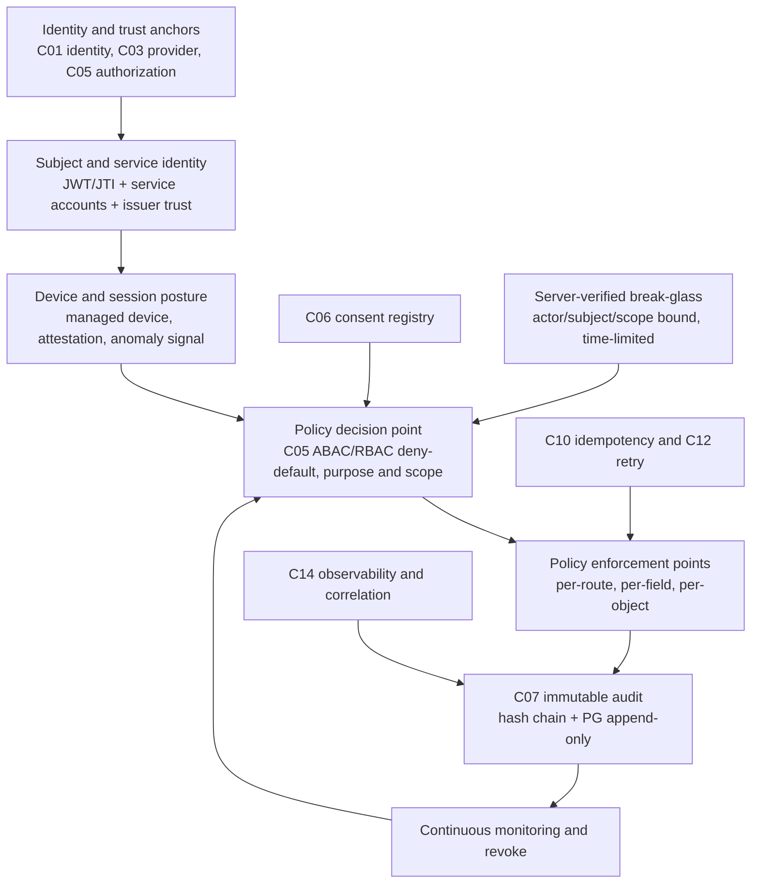

# GULA National Zero-Trust Security Plan V2

**Document:** `GULA_NATIONAL_ZERO_TRUST_SECURITY_PLAN_V2.md` (new root-level planning document)
**Status:** `PROPOSED / PENDING OWNER APPROVAL` — planning gate only; no implementation, no execution, no release authority.
**Repository:** `/home/samertts/workspace/projects/gula-integration` only. Sibling `gula-platform` is out of scope and read-only.
**Baseline:** branch `integration/gula-unification-v1`, HEAD `2206654dc713ea2de8c564a3207dfe05fde23549`.

> **BINDING POSTURE:** `HOLD TRUE`; `production_ready_items = 0`; Stable v1.0.0 **NOT DECLARED**;
> **PRODUCTION READY NOT AUTHORIZED**. This document creates no approval, no certification and no
> release authority. `GOVERNANCE/FINAL_DECISION.md:13,46`,
> `GULA_MASTER_EXECUTION_STATUS.md:7`, `GULA_OWNER_DECISION_REGISTER.md:9–11`,
> `GOVERNANCE/NATIONAL_INTEGRATION/status_registry.json`, `GOVERNANCE/GECS/MASTER_CONTROL.md:3,7,8`.
>
> **TARGETS NOT ACHIEVED.** Every item in sections 4–7 is a target control or target acceptance
> criterion. No target in this document is represented as implemented, tested, accepted or
> production-verified. All claims about present state use cited evidence only.

---

## 0. Purpose, ownership and scope

This plan defines the national zero-trust **target control plane** and the evidence required before
any security release gate can be reconsidered. It is owned by **PRG-10 (Security, Reliability,
Infrastructure and Integration)** with national identity/authorization/consent/audit primitives
owned by **PRG-00 (National Core and Governance)**; domain modules PRG-01…PRG-09 are consumers and
may not fork authorization or audit truth (seed §8; C05 Authorization, C06 Consent, C07 Audit).

**Naming discipline:** `PRG-03` means Diagnostics and Laboratory Systems. The audit packages
`P-02 / AUD-F02` and `P-03 / AUD-F03` are separate, historical, protected records. `P-03-CONCURRENCY`
is a third, separate unapproved design package. Nothing in this document executes or advances any
of those packages (NV2-D12/D13; `AUDIT_EXECUTION_RECORDS/P-03_SCOPE_AND_DEPENDENCY_REVIEW.md`).

**Status vocabulary (seed §4):** IMPLEMENTED · TESTED · INDEPENDENTLY REVIEWED · ACCEPTED ·
PRODUCTION READY · PARTIALLY IMPLEMENTED · DOCUMENTED ONLY · PLANNED · BLOCKED. Additional labels
used here are provenance labels, **not** statuses: SOURCE, WORKING PROTOTYPE, DOCUMENTED DESIGN,
TEST-ONLY, PRODUCTION-VERIFIED. No status is upgraded without a path citation. `DECISION-READY`
is not `ACCEPTED`; older `SECURITY_CERTIFICATION.md` / `SECURITY.md` claims are historical
self-reports, not current authority (`GOVERNANCE/FINAL_DECISION.md`).

---

## 1. Evidence classification of the current state

| Evidence class | What the audit actually observed | Current status |
|---|---|---|
| HEAD source | JWT, RBAC/ABAC, centralized decision engine, B2/B4 guards, consent, encryption, secret guards, audit hash chain, append-only PG triggers | SOURCE / IMPLEMENTED at code level; production verification **NOT VERIFIED** |
| Working tree only | 91 endpoint guard fixes, S-01/S-02/S-13 remediations, advisory-locking audit fix, `CONFLICT_QUARANTINE` change | WORKING PROTOTYPE, unreviewed, uncommitted |
| Independent engineering review | B1/B2/B3/B5 verified with zero API-reachable bypasses; P-02 engineering scope `DECISION-READY` | INDEPENDENTLY REVIEWED, **not ACCEPTED**, 2 LOW residuals |
| Reproduction evidence only | PG16.14 audit-fork diagnostic, 1 failed / 1 passed, `stored_hash=571f43b6…` vs `expected=5bb1ab4d…` | DEFECT EVIDENCE; not a fix proof |
| Configuration only | 32 workflows, Gitleaks/Safety/Bandit/CodeQL/Trivy settings, Semgrep rules | DOCUMENTED ONLY; execution **NOT VERIFIED** |
| Test inventory | 90 security-named Python test files, 187 security-named `def test_` definitions; step-up suite 37/37 executed | TESTED for that scope only; full anti-abuse matrix PARTIALLY COVERED |

No item in this table is `PRODUCTION READY`. Full-suite pass figures in older reports varied by
tree and date and are **not re-run evidence** (`ADVERSARIAL_TEST_REPORT.md §2`,
`CERTIFICATION-v1.0.md` records full suite NOT RUN).

---

## 2. Implemented controls actually present in the repository

| Control | Evidence (repository-relative) | Observed property / limitation |
|---|---|---|
| JWT signing, claims, JTI | `shared/auth/jwt.py:31-82`, `backend/app/security/auth.py:15-29,54-100,121-131,192-209` | signed `account_kind`, `perm_ver`, `jti`; Redis JTI blacklist; symmetric HS256 only (`backend/app/config.py:178`) |
| Session revocation & refresh rotation | `backend/app/security/session.py:3-23`, `backend/app/identity/services/authentication_service.py:60-130`, `backend/app/identity/repositories/session_repository.py:22-24` | permission-version revocation is DB-authoritative and fail-closed; refresh token rotation implemented |
| MFA / strong authentication | `backend/app/security/mfa_service.py:13-39`, `backend/app/identity/api/step_up.py:21-27`, `backend/tests/unit/test_niam_step_up.py` | TOTP, backup codes, WebAuthn; step-up adversarial suite 37 passed (`ADVERSARIAL_TEST_REPORT.md §1`) |
| OAuth2 / service identity primitives | `backend/app/security/oauth2_provider.py:73-103,129-192,271-277`, `backend/app/security/service_accounts.py:19-38` | authorization code/client credentials/refresh, hashed tokens, PKCE S256; hashed service-account API keys |
| Canonical authorization | `backend/app/security/rbac.py:1-6`, `backend/app/security/abac.py:14,52,115-126`, `backend/app/identity/services/authorization_decision.py:199-314,559-603` | canonical `shared.rbac` re-export; ABAC default DENY; centralized decision denies on actor mismatch, inactive session, invalid purpose/scope/relationship, unverified professional, unknown permission, policy deny and audit failure |
| Scoped roles and delegation | `backend/app/identity/services/authorization_service_v2.py:205-335` | scoped roles + delegation chain in the canonical authorization service |
| B4 cross-account guard | `backend/app/identity/adaptive_auth/b4_guard.py:14-26,55,96-111,162-252`, `backend/app/security/platform_access.py:10-12,43-64` | deny-by-default; only `master_admin`/`security_administrator`; fresh own-account step-up; server re-read; audit on allow and deny; fail-closed on audit failure |
| Consent and break-glass separation | `backend/app/security/consent_dep.py:1-31,78-215`, `backend/app/security/break_glass_guard.py:1-26,97-205`, `backend/app/identity/services/consent_service_v2.py:24-46,62-81,121-177`, `backend/app/identity/models/consent.py:34-53` | client header is intent only; server-persisted `BreakGlassSession`, actor+subject+scope bound, read-only scope, justification ≥20 chars, ≤240 minutes, audited denial; consent is versioned, subject-only, purpose-allowlisted, 72h cap |
| Encryption and key validation | `shared/security/encryption.py:9-43`, `backend/app/security/encryption.py:1-38`, `backend/app/config.py:135-165,169-198,238-266` | canonical Fernet + HMAC-protected national-ID tokens; production startup exits on missing/weak `SECRET_KEY`, `REFRESH_TOKEN_SECRET`, `ENCRYPTION_KEY`, `NID_HMAC_KEY`, `AUDIT_ANCHOR_KEY` |
| Secrets hygiene at rest | `.gitignore:2`, `.env.example:6-9` | `.env` ignored; example file contains placeholders only |
| Audit integrity | `backend/app/services/audit_service.py:1-8,31-38`, `shared/audit/service.py:1-8`, `backend/app/identity/services/canonical_audit.py:73-80,175-178,244-255`, `scripts/audit_verifier.py:3-14`, `scripts/gula_guardian.py:49-77` | SHA-256 hash chain + HMAC anchors, redaction and previous/entry hash verification, standalone read-only verifier; append-only PG triggers reject UPDATE/DELETE (`backend/migrations/versions/20250322_0002_perf_indexes_audit_protection.py:73-104`, `backend/migrations/versions/20260505_0005_*.py`) |
| Independent B-series verification | `GOVERNANCE/ADVERSARIAL_ASSURANCE/INDEPENDENT_VERIFICATION_TEAM_C_TIER_B.md:18-23,204-206`, `GOVERNANCE/ADVERSARIAL_ASSURANCE/INDEPENDENT_VERIFICATION_TEAM_C_B5_REVERIFY.md:23,215-222`, `GOVERNANCE/EXECUTION_LEDGER.md:262` | B1/B2/B3 and B5 re-verified with zero API-reachable bypasses; residuals listed in §3 |

---

## 3. Explicit gaps, defects and unresolved conflicts

| ID | Gap / conflict | Evidence | Status |
|---|---|---|---|
| ZT-G01 | Demo-grade zero trust: `_active_sessions` is process-local in-memory ("In-memory for demo, would be Redis in production"); IP/UA change only logged; revocation raise is commented out; no cross-worker state, device posture or continuous authorization | `backend/app/security/zero_trust.py:14-15,37-45` | SOURCE, **WORKING PROTOTYPE ONLY**; not a control plane |
| ZT-G02 | Symmetric HS256 only; OIDC/JWKS unavailable by design; JWKS route returns 503 | `backend/app/config.py:178`, `backend/app/security/oauth2_provider.py:231-263`, `backend/app/routes/oauth2.py:246-250` | PARTIALLY IMPLEMENTED; fail-closed, not OIDC/JWKS production readiness |
| ZT-G03 | Audit-chain concurrency fork at HEAD: unlocked tail read; concurrent PG writers can derive the same predecessor; append-only triggers block in-place repair | `backend/app/services/audit_service.py:106-112,219-229`, `AUDIT_EXECUTION_RECORDS/P-03_CONCURRENCY_DESIGN.md:12-36`, `AUDIT_EXECUTION_RECORDS/P-03_READINESS_2026_11_24.md:20-31` | DEFECT EVIDENCE; PG16.14 diagnostic 1 failed/1 passed |
| ZT-G04 | WT audit fix (advisory lock, READ COMMITTED check, autocommit refusal) is uncommitted and not independently accepted; separate `P-03-CONCURRENCY` design is unapproved | WT `backend/app/services/audit_service.py:47-117`, `AUDIT_EXECUTION_RECORDS/P-03_CONCURRENCY_DESIGN.md:1-10`, `AUDIT_EXECUTION_RECORDS/P-03_OWNER_DECISIONS_REQUIRED.md` | WORKING PROTOTYPE / DOCUMENTED DESIGN ONLY; NV2-D13 blocked |
| ZT-G05 | DeepSeek key rotation UNVERIFIED | `GULA_MASTER_EXECUTION_STATUS.md:173` | NOT VERIFIED |
| ZT-G06 | B1 seeded catalog gap; B2 category mismatch; B3 near-majority flag; B5 forged-row key attenuation; `citizen_ulid` owner-bypass provenance | `GOVERNANCE/ADVERSARIAL_ASSURANCE/INDEPENDENT_VERIFICATION_TEAM_C_TIER_B.md:204-206`, `..._B5_REVERIFY.md:215-222` | INDEPENDENTLY REVIEWED with open residuals; no PRODUCTION READY awarded |
| ZT-G07 | 91 previously unguarded endpoint fixes plus S-01/S-02/S-13 remediated in working tree only, awaiting independent/human review; report verdict stays NOT CERTIFIED / HOLD | `GOVERNANCE/SECURITY_REVIEW_REPORT.md:8-22,28-38,108-134` | WORKING PROTOTYPE; unreviewed |
| ZT-G08 | Semgrep rules have no workflow invocation; pre-commit uses detect-private-key, not Gitleaks; 32 workflows are configuration evidence; no executed CI proof | `.github/workflows/security-hardening.yml:33-107`, `.github/workflows/ci.yml:314-328`, `GULA_SECURITY_CI_READINESS_PLAN.md:3,9`, `GULA_SECURITY_OPERATIONAL_READINESS_ASSESSMENT.md:90-92` | DOCUMENTED ONLY / BLOCKED |
| ZT-G09 | Anti-abuse matrix partially covered: no broker outage, runtime HTTP probe, operational migration interruption or offline convergence-under-loss execution; no brute-force/enumeration result artifact | `ADVERSARIAL_TEST_REPORT.md §3` | PARTIALLY COVERED; no suite result found |
| ZT-G10 | Default test fixture forces in-memory SQLite and overrides DB dependencies; PG locking, sequences, isolation, triggers and DDL are not exercised by the default suite | `backend/tests/conftest.py` | TEST ENVIRONMENT LIMITATION; no SQLite substitution accepted for PG evidence |
| ZT-G11 | Mixed Git provenance: 20 staged R100 renames, 162 unstaged tracked changes, 686 untracked entries before V2 docs; protected MD5s must be preserved | seed §1, `GOVERNANCE/GIT_READINESS_REPORT.md` | R-01 BLOCKED; NV2-D02 unresolved |
| ZT-G12 | Older certification claims conflict with current HOLD records | `GOVERNANCE/FINAL_DECISION.md`, `GULA_RELEASE_ACCEPTANCE_REPORT.md`, `FINAL_00_MASTER_VERDICT.md`, `FINAL_ASSURANCE_DECISION.md` | CONFLICT requiring owner decision NV2-D09 |

---

## 4. Target zero-trust control plane — **TARGETS NOT ACHIEVED**

### 4.1 Target components

| Component | Target behavior (NOT ACHIEVED) | Anchors / contracts |
|---|---|---|
| Identity and trust anchors | One authoritative identity/provider registry; issuer-aware verification; signed `perm_ver`, `jti`, subject, purpose and workspace claims; issuer/key rotation with overlap window | C01, C03, C05; `backend/app/services/mpi/`; `backend/app/identity/` |
| Service identity | Workload identity per service, short-lived credentials, hashed key storage, mTLS or equivalent, no shared static secret, explicit service-to-service authorization | C05, C09; `backend/app/security/service_accounts.py:19-38` is only a primitive |
| Device posture | Managed-device registry, attestation signal, session binding to device, revocation on posture loss; replaces logged-only IP/UA change in `zero_trust.py` | C05, C11; PRG-08 channels |
| Continuous authorization | Re-evaluate RBAC/ABAC at each sensitive action with fresh session, purpose, relationship, professional verification and audit-write success; risk signals can step up or deny | C05; `backend/app/identity/services/authorization_decision.py:199-314` is the canonical seed |
| Break-glass | Server-verified persisted session only; eligible clinical roles; read scope only; justification, category, exact subject, hard expiry; extension requires separate approval; all attempts audited | C06, C07; `backend/app/security/break_glass_guard.py:97-205` contains the technology-neutral invariants |
| Consent enforcement | Deny by default when no active, unexpired, subject/grantee/purpose/scope-specific consent; every decision emits canonical audit; no silent owner or lab bypass | C06, C07; `backend/app/security/consent_dep.py` |
| Audit-bypass prevention | No domain-owned audit truth; actor/role/server-derived identities; append-only PG storage; chain serialization under PG16 with multi-worker proof; verifier run in CI | C07; `backend/app/services/audit_service.py`, `scripts/audit_verifier.py` |
| Revocation | Distributed revocation state (Redis or durable store) with fail-closed behavior when unavailable; JTI and permission-version revocation enforced across workers | C05, C12; `backend/app/security/session.py:3-23` |
| Secret rotation | Versioned keys with overlap verification, rotation runbook, rotation drills, verified third-party key rotation (including DeepSeek) | C13, C14; `backend/app/config.py:135-165` |

---

## 5. Anti-abuse test matrix — target specification, **not executed**

Executable tests, fixtures and results do not exist for most rows. `ADVERSARIAL_TEST_REPORT.md §3`
explicitly records partial coverage. Required environment: PG16 disposable database, real app
factory and dependency graph, synthetic identities only, no SQLite substitution, no production
service, no real provider or financial call.

| Attack class | Target test case and required assertion | Gap today | Gate |
|---|---|---|---|
| IDOR / BOLA | For each object route, actor A requests object of actor B across patient, order, result, sample, report and session resources; expect 403/404 and canonical audit deny | WT endpoint fixes unreviewed (`GOVERNANCE/SECURITY_REVIEW_REPORT.md §3.0`) | G2, G4 |
| BFLA | Low-privilege actor invokes admin/release/config/certification writes; expect deny, no mutation, audited deny | S-01/S-02 WT-only; `backend/app/security/platform_access.py` needs independent proof | G2, G12 |
| Cross-tenant / cross-workspace | Lab A actor reads or writes Lab B data; active workspace mismatch denied; delegation chain cannot widen scope | ABAC deny-default source present; no executed tenant matrix | G2, G3 |
| PHI enumeration | Sequential ULID/NHID/patient-id scan, result-list page walking, error-message differential; expect uniform denial plus rate limit and alert | No enumeration result artifact (`ADVERSARIAL_TEST_REPORT.md §3`) | G2, G10 |
| Unauthorized result modification | Non-verifier attempts result edit, re-release, validation-state change or report correction; expect versioned append/correction path only, original immutable, audit entry | LIMS version/correction source exists (`backend/app/lims/models.py:1243-1296`, `backend/app/lims/services.py:573-588`); no abuse execution | G2, G3, G4 |
| Duplicate prescription / dispensation | Replay same prescription key and concurrent dual submit; expect exactly one dispensation via idempotency key and unique constraint | `backend/app/pharmacy/services.py:700-704,864-890` source present, no runtime proof | G2, G3, G10 |
| Unauthorized export / bulk read | Citizen or non-export role calls export/contract-export/certification export; expect deny; master role export requires purpose and audit | S-11 remediated WT-only; export stubs in `contracts/export/openapi.json` | G2, G12 |
| Token forgery | Altered signature, wrong issuer/audience, unknown `jti`, revoked `perm_ver`, expired refresh, algorithm confusion attempt; expect deny and audit | HS256-only + JWKS 503 (`ZT-G02`) | G2, G4 |
| Brute force / credential stuffing | Repeated bad password, OTP and refresh attempts from one and many sources; expect lockout, backoff and alert | No result artifact found | G2, G10 |
| Consent and break-glass bypass | Client `X-Emergency-Access: true` without persisted session; expired/deactivated/wrong-subject/export-scope session; expect `break_glass_denied` with audit | Guard source present (`break_glass_guard.py`); B2 residual open (`ZT-G06`) | G2, G12 |
| Audit bypass / chain fork | Concurrent PG16 writers from multiple workers, forced chain verification, attempt to UPDATE/DELETE audit rows, forged `actor_id`; expect single chain, trigger rejection, server-derived actor | HEAD defect ZT-G03; WT fix ZT-G04; P-03-CONCURRENCY separate | G2, G5, G12 |

---

## 6. Secret rotation and supply-chain targets — **TARGETS NOT ACHIEVED**

| Area | Current evidence | Target acceptance evidence |
|---|---|---|
| Platform secrets | Startup exit on missing/weak keys (`backend/app/config.py:135-165,169-198,238-266`); `.env.example` placeholders | Versioned rotation runbook, overlap verification, drill result per `SECRET_KEY`, `REFRESH_TOKEN_SECRET`, `ENCRYPTION_KEY`, `NID_HMAC_KEY`, `AUDIT_ANCHOR_KEY`, including anchor-key previous-version handling (`audit_service.py:36-45`) |
| Third-party keys | DeepSeek rotation UNVERIFIED (`GULA_MASTER_EXECUTION_STATUS.md:173`) | Documented owner, rotation procedure, executed verification artifact; until then `NOT VERIFIED` |
| Gitleaks | Workflow config `.github/workflows/security-hardening.yml:33-107`; pre-commit only detect-private-key | Workflow invocation with executed scan result and no real secret; current execution **NOT VERIFIED** |
| Safety / Bandit | `.github/workflows/ci.yml:314-328` | Executed run with result artifact; current execution **NOT VERIFIED** |
| CodeQL | `.github/workflows/codeql.yml:70-99`, `codeql-analysis.yml:38-45` | Executed analysis result with triage; current execution **NOT VERIFIED** |
| Trivy | `.github/workflows/nightly.yml:303-323` | Executed image/dependency scan with triage; current execution **NOT VERIFIED** |
| Semgrep | Rules exist; no workflow invocation found (`gula_v2_evidence_security.md`) | CI invocation with rule set and executed result; currently DOCUMENTED ONLY |
| CI trust | 32 workflows are configuration evidence; `GULA_SECURITY_CI_READINESS_PLAN.md:3,9`, `GULA_SECURITY_OPERATIONAL_READINESS_ASSESSMENT.md:90-92` | Reproducible executed CI proof, pinned tool versions, retained artifacts; not present |

Supply-chain work is a target for W2 in PRG-10 and must not change `.github/workflows/*` during W0.

---

## 7. Gate mapping — target acceptance criteria (all currently unmet)

| Gate | Security acceptance criterion (target) | Current evidence position |
|---|---|---|
| **G2 Security and Privacy Validation** | Executed anti-abuse matrix §5 on PG16; zero critical/high findings; B1/B2/B3/B5 residuals closed or owner-accepted; executed SAST/secret/dependency scans | NOT MET: WT-only fixes, partial matrix, config-only CI |
| **G4 API and Integration Compatibility** | Every exposed route has server-side authorization; contract C05/C06/C07 behavior unchanged across versions; no body-supplied actor/approver; no open export surface | NOT MET: 91 WT-only fixes; S-02 WT-only; broken checked-in OpenAPI (`contracts/export/openapi.json` stub) |
| **G5 Database and Migration Validation** | PG16 chain concurrency proof, append-only triggers verified under load, migration chain and isolation-level enforcement verified; no SQLite substitution | NOT MET: HEAD fork defect; PG diagnostic is defect evidence only; A09-004 records 119 schema-gate failures |
| **G10 Monitoring and Incident Response** | Security events correlated (C14), revocation/failed-auth/enumeration alerts exercised, incident runbook and rotation drill executed | NOT MET: no executed alert/incident proof in evidence |
| **G12 Independent Review and Final Acceptance** | Human security review of WT remediations, NV2-D09 conflict resolved, P-03-CONCURRENCY separately decided, all four protected MD5s unchanged, owner acceptance recorded | NOT MET: HOLD TRUE; no owner acceptance; no release authorization |

---

## 8. Risk and decision links

| ID | Relevance | Required disposition |
|---|---|---|
| R-01 Mixed Git provenance | Blocks safe promotion of WT security fixes | NV2-D02; preserve protected MD5s and prior manifests |
| R-03 Audit chain concurrency (T9) | HEAD fork defect; separate unapproved package | NV2-D13; do not fold into P-03 / AUD-F03 |
| R-04 Authorization bypass / IDOR | 91 WT-only guard fixes, S-01/S-02 residuals | WS-SEC-01 matrix + human review before G2 |
| R-07 Consent / emergency-access conflict | B2 residual, owner-bypass provenance | NV2-D06 policy approval; WS-SEC-01 test |
| R-09 PostgreSQL / Audit availability coupling | Fail-closed audit writes can affect availability | Measure under PG16, design explicitly; no silent fallback |
| R-15 Protected-record / status conflict | Older security certifications conflict with HOLD | NV2-D09 owner decision |
| R-17 Supply-chain / CI trust | Config-only scanners, no executed proof | W2 executed CI artifacts |
| R-18 Owner decisions unresolved | No approval for zero-trust policy, environments or releases | NV2-D06, NV2-D09, NV2-D12, NV2-D13, NV2-D14 |

| Decision | Needed from owner | Blocking effect |
|---|---|---|
| NV2-D06 | Approve national zero-trust policy including break-glass and service identity | No target policy baseline |
| NV2-D09 | Resolve older certification vs HOLD conflict | No accepted current security status |
| NV2-D12 | Decide P-03 / AUD-F03 D1–D5 separately | Audit remediation scope remains undefined |
| NV2-D13 | Decide P-03-CONCURRENCY separately | HEAD chain fork remains unfixed at release level |
| NV2-D14 | Approve national test environments and synthetic data policy | No PG16 anti-abuse execution allowed |

---

## 9. Workstreams, dependencies and checkpoints

| Workstream | Wave | Deliverable (planning/design only in W0) | Depends on |
|---|---|---|---|
| WS-SEC-01 zero-trust test harness | W0 design → W2 execution | IDOR/BOLA/BFLA, cross-tenant, PHI enumeration, unauthorized result modification, duplicate prescription, unauthorized export, token forgery, brute-force, audit-bypass cases with PG16 synthetic fixtures | NV2-D06, NV2-D14, C05/C06/C07 baselines |
| WS-AUD-01 audit-chain design evidence and contract conformance | W0 → W2 | Documentation/test design only for C07 conformance and chain invariants; **no P-03 or P-03-CONCURRENCY implementation** | NV2-D09, NV2-D12, NV2-D13 |
| WS-OBS-01 | W2 | Correlation and security-event schema for C14 | Approved contract baselines |
| WS-API-01 | W1/W2 | Contract-first validation and versioning tooling for C05/C06/C07 | C01–C09 baseline approval |

**Parallel rules:** teams may work only against approved versioned contracts; no team changes C01–C15,
protected records or National Core semantics locally; shared-contract changes require contract review,
version bump and G1 revalidation (seed §13). Security and audit evidence is a **serialized
checkpoint** before G2/G12; no security finding may be closed by editing a report.

---

## 10. Evidence basis

Files and reports inspected as the basis for this document (read-only; no execution of tests, CI,
deployment or migration): `GOVERNANCE/FINAL_DECISION.md`, `GULA_MASTER_EXECUTION_STATUS.md`,
`GULA_OWNER_DECISION_REGISTER.md`, `GOVERNANCE/GECS/MASTER_CONTROL.md`,
`GOVERNANCE/NATIONAL_INTEGRATION/status_registry.json`, `GOVERNANCE/SECURITY_REVIEW_REPORT.md`,
`GOVERNANCE/ADVERSARIAL_ASSURANCE/INDEPENDENT_VERIFICATION_TEAM_C_TIER_B.md`,
`GOVERNANCE/ADVERSARIAL_ASSURANCE/INDEPENDENT_VERIFICATION_TEAM_C_B5_REVERIFY.md`,
`AUDIT_EXECUTION_RECORDS/P-02_FINAL_CLOSURE_2026_11_24.md`,
`AUDIT_EXECUTION_RECORDS/P-03_READINESS_2026_11_24.md`,
`AUDIT_EXECUTION_RECORDS/P-03_CONCURRENCY_DESIGN.md`,
`AUDIT_EXECUTION_RECORDS/P-03_SCOPE_AND_DEPENDENCY_REVIEW.md`, `ADVERSARIAL_TEST_REPORT.md`,
`GULA_SECURITY_CI_READINESS_PLAN.md`, `GULA_SECURITY_OPERATIONAL_READINESS_ASSESSMENT.md`,
`backend/app/security/{auth,rbac,abac,zero_trust,break_glass_guard,consent_dep,platform_access,service_accounts,oauth2_provider,mfa_service,encryption}.py`,
`backend/app/identity/adaptive_auth/b4_guard.py`,
`backend/app/identity/services/{authorization_decision,consent_service_v2,canonical_audit}.py`,
`backend/app/services/audit_service.py` (HEAD and working tree compared),
`backend/app/config.py`, `shared/{auth/jwt.py,audit/service.py,security/encryption.py}`,
`scripts/{audit_verifier.py,gula_guardian.py}`, `backend/tests/conftest.py`,
`.github/workflows/{security-hardening.yml,ci.yml,codeql.yml,nightly.yml}` and the read-only audit
evidence set `/tmp/opencode/gula_v2_evidence_{security,integration,tests,governance,backend}.md`.
No claim in this document was upgraded without one of these citations; absent evidence is recorded
as `NOT VERIFIED`, not as a pass.
